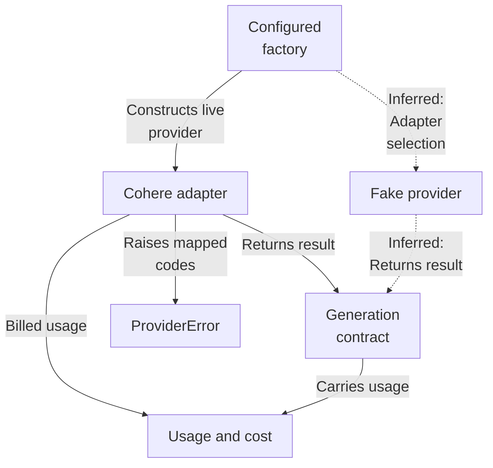
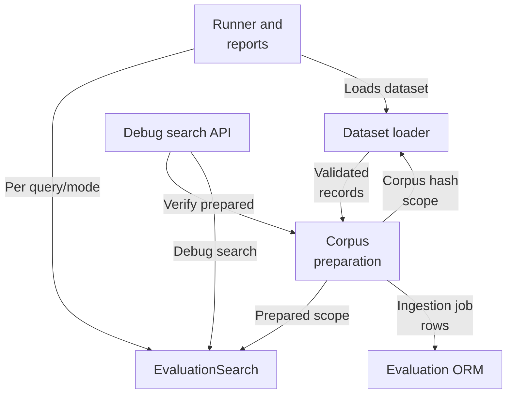
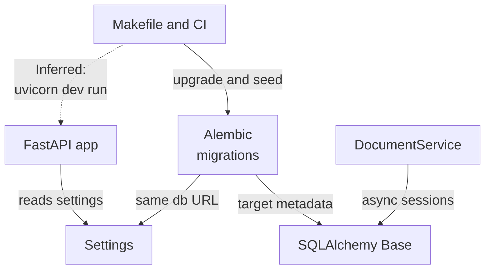
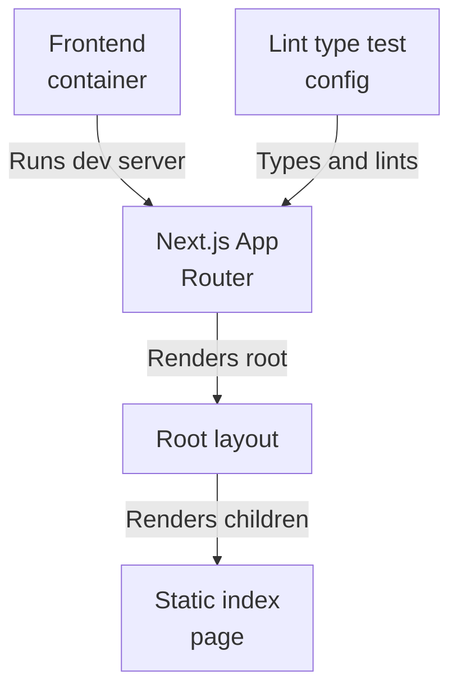
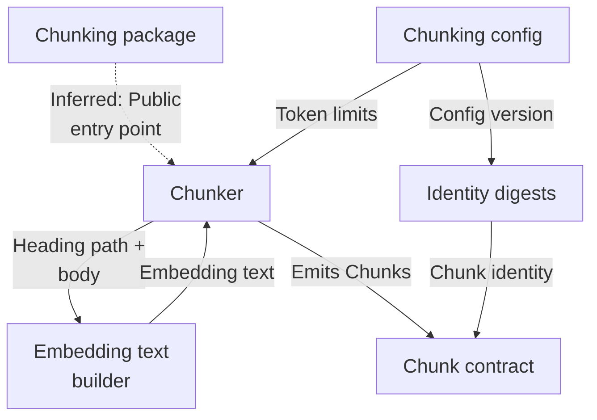
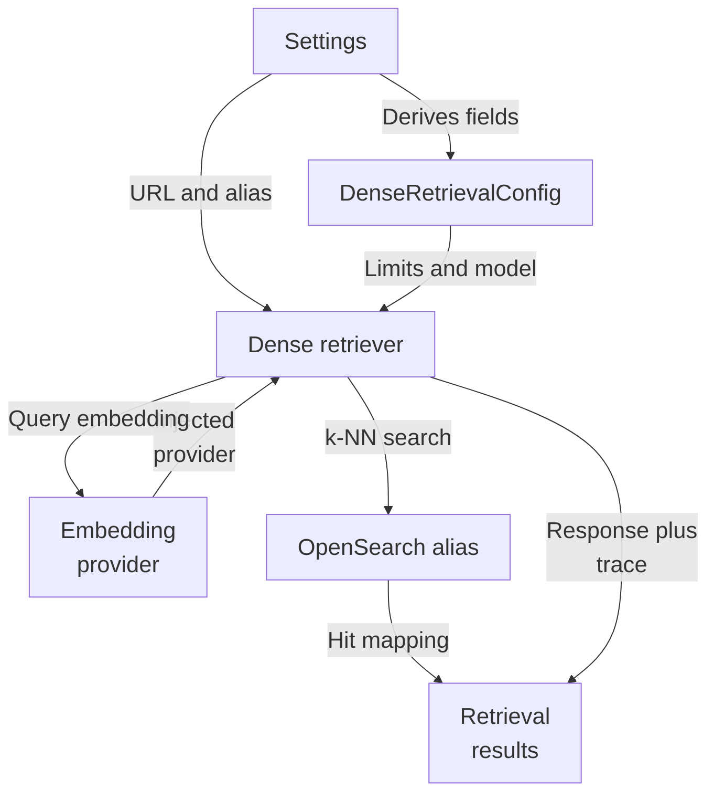

# Repository map

Source revision: `f8493c1d264c525948d9d33ffaf2dd197be97e26`

Browse the Mermaid diagrams below on GitHub. PDFs and PNGs are linked for download.

[Overview PDF](overview/repository-map.pdf) | [Overview details](overview/README.md)

## answers: Architecture

## evaluation: Architecture

## foundation: Architecture

## frontend: Architecture

## ingestion: Architecture

## retrieval: Architecture

## Subsystem maps

| Map | Summary | Views | Last analyzed source |
| --- | --- | --- | --- |
| [answers](maps/answers/README.md) | The answers subsystem defines application-owned async provider contracts for generation, embeddings, and reranking, with validating dataclasses and a code-carrying ProviderError that sanitizes SDK failures. A Cohere generation adapter and a deterministic fake provider both implement the shared GenerationProvider protocol, returning GenerationResult with distinct reported and billed usage plus locally measured latency. No orchestration or caller wiring selecting between adapters is evidenced. | [PDF](maps/answers/repository-map.pdf) · [JSON](maps/answers/map.json) | `f8493c1d264c` |
| [evaluation](maps/evaluation/README.md) | The evaluation subsystem loads hash-verified versioned datasets, prepares isolated per-scope corpora in OpenSearch through the durable ingestion pipeline, runs four retrieval modes via a shared EvaluationSearch boundary, scores rankings with fixed metrics, and emits reproducible reports. It exposes a production-disabled debug search API and a SciFact builder CLI, and owns evaluation ORM tables. | [PDF](maps/evaluation/repository-map.pdf) · [JSON](maps/evaluation/map.json) | `f8493c1d264c` |
| [foundation](maps/foundation/README.md) | The foundation subsystem is the shared base layer of a multi-tenant hybrid RAG service: a create_app FastAPI entry point exposing health/readiness and an evaluation router, a cached typed Settings boundary, an async SQLAlchemy Base, a tenant-scoped DocumentService over replaceable file storage, and a linear Alembic chain defining identity, content, retrieval, evaluation/audit, and ingestion-job schema. Migrations push authorization, lifecycle, lease, and immutability invariants into PostgreSQL, while a Dockerfile, Makefile, Compose, and CI provide orchestration and verification. | [PDF](maps/foundation/repository-map.pdf) · [JSON](maps/foundation/map.json) | `f8493c1d264c` |
| [frontend](maps/frontend/README.md) | This subsystem is the hybrid-rag-search-web frontend: a private Next.js 16 / React 19 App Router project whose container runs the dev server on Node 22. It renders a root layout wrapping a purely static Home page with no state, inputs, or async data loading. No fetch, API route, or environment read is evidenced, so runtime linkage to the answers, foundation, or retrieval subsystems is untraced. | [PDF](maps/frontend/repository-map.pdf) · [JSON](maps/frontend/map.json) | `f8493c1d264c` |
| [ingestion](maps/ingestion/README.md) | The chunking subsystem deterministically converts a ParsedDocument into content-addressed Chunks. It groups parsed blocks by heading path so no chunk crosses a section boundary, greedily packs whole blocks within a token budget with trailing overlap, splits oversized blocks by binary prefix search, and enriches text with reconstructed Markdown headings for embedding while stamping config-version and document-derived identity digests. | [PDF](maps/ingestion/repository-map.pdf) · [JSON](maps/ingestion/map.json) | `f8493c1d264c` |
| [retrieval](maps/retrieval/README.md) | Dense-query retrieval for a multi-tenant hybrid RAG backend: a normalized query is embedded via an injected provider into a vector, then issued as an OpenSearch k-NN search against a read alias with tenant scoping applied at query level. Hits are renormalized into the shared RetrievalResult contract reused by lexical retrieval, with diagnostics kept in a separate trace. Configuration derives from Settings; the only local entry point is a debug CLI, with orchestration living elsewhere. | [PDF](maps/retrieval/repository-map.pdf) · [JSON](maps/retrieval/map.json) | `f8493c1d264c` |

JSON is the source of truth; Mermaid, PNGs, and PDFs are generated views.

Unchanged subsystem views are retained. Source existence checks do not prove model interpretation. See manifest.json and update.json for dependencies, coverage and updates.
