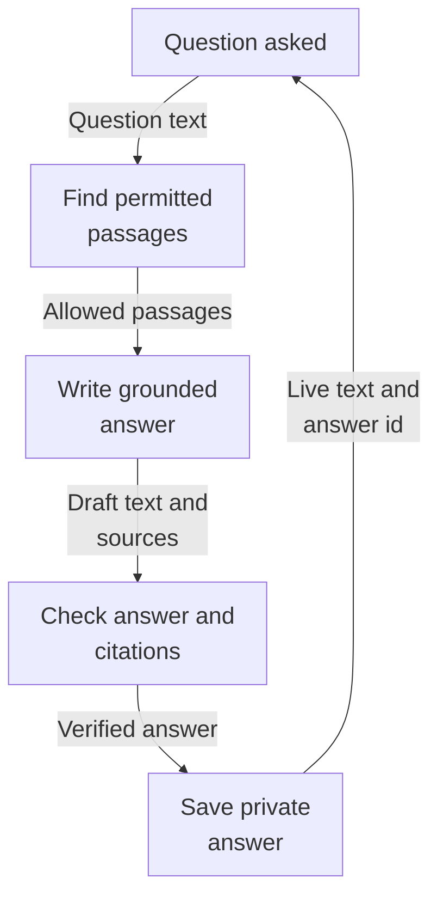
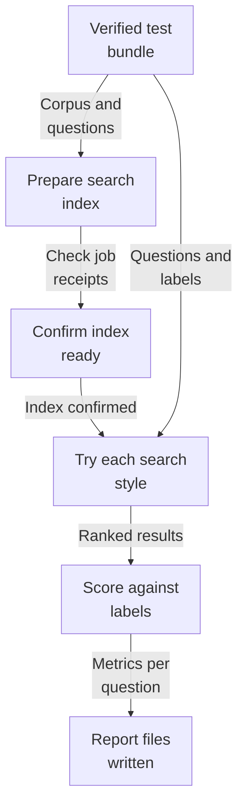
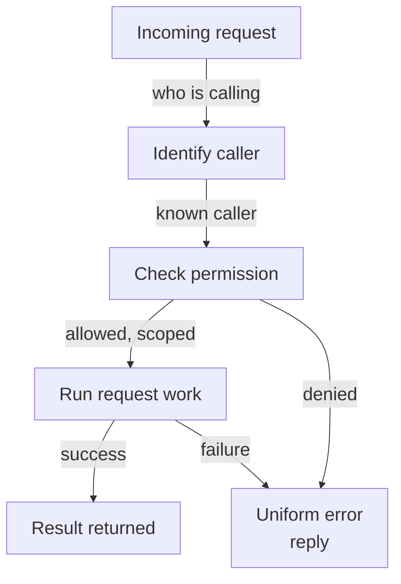
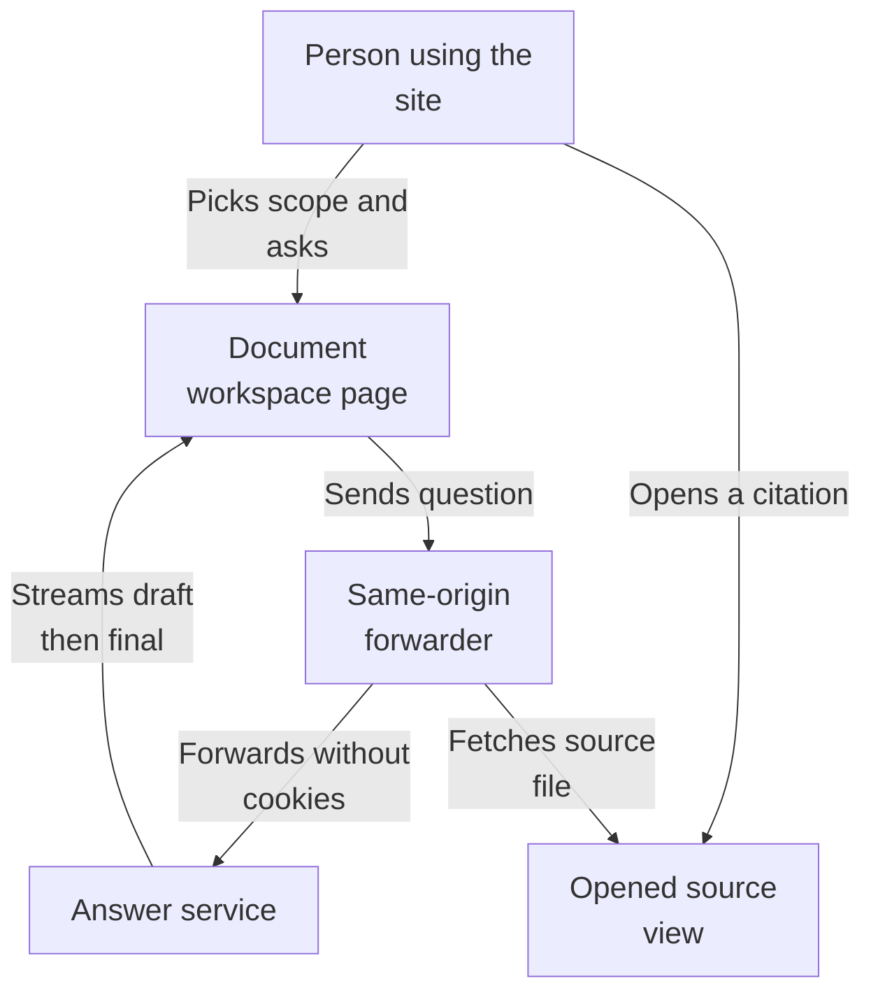
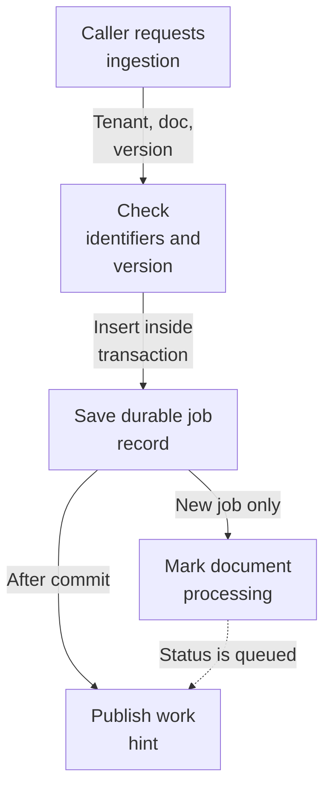
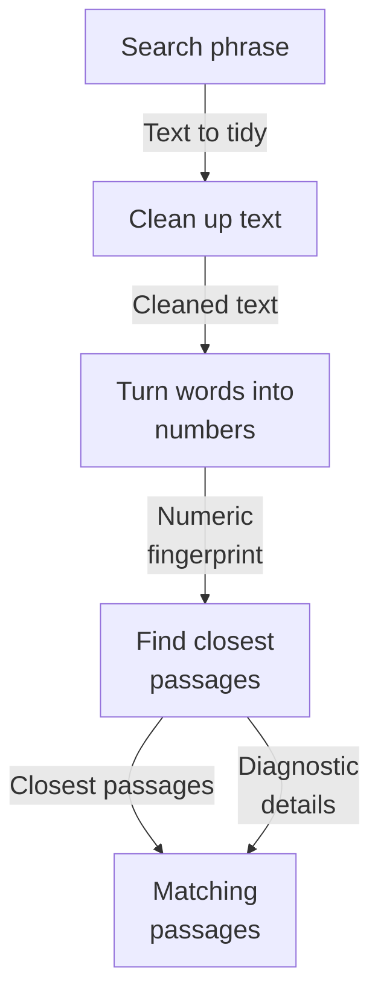

# Repository map

Source revision: `e4abb88a149b365c2838b0f2f0606dff0127b1ab`

Browse the Mermaid diagrams below on GitHub. PDFs and PNGs are linked for download.

[Overview PDF](overview/repository-map.pdf) | [Overview details](overview/README.md)

## answers: How a question becomes a saved answer

This area answers a person's question using their own authorized documents, streaming the answer back live so text appears as it is written. Every claim is checked against the cited passages, and unusable or unverifiable answers are replaced with clear messages instead of invented text. Completed answers are saved privately per user and re-checked on later viewing, so withdrawn source access hides the old answer.

Someone asks a question; the system finds their permitted passages, the model writes a checked answer streamed live, and the finished answer is saved for that person.

Read from top to bottom; arrows show what happens next or what is passed along.

[More about this area and its source evidence](maps/answers/README.md)

## evaluation: How a dataset becomes a scored report

This area measures how good the search is. It loads versioned test bundles whose files are hash-checked, prepares each bundle into its own isolated search index, asks every test question in four search styles, compares the ranked results against human relevance labels, and writes repeatable JSON and Markdown reports. A command-line tool builds the SciFact test set. It is a command-line tool, not a service; the old debug web route is retired, and database tables for runs exist but nothing yet moves a run beyond 'queued'.

A hash-verified test bundle is prepared into its own search index, every test question is searched four ways, results are scored against human relevance labels, and repeatable report files are written.

Read from top to bottom; arrows show what happens next or what is passed along.

[More about this area and its source evidence](maps/evaluation/README.md)

## foundation: How a request becomes a result

This area is the shared foundation of a multi-tenant document search service. It starts the web application with health and readiness checks, handles errors and request tracking uniformly, decides who may do what using a demo-identity login scheme backed by real database permissions, and stores uploaded documents with duplicate detection and safe deletion. The main inputs are incoming web requests plus an uploaded file; the useful results are authorized access, a stored document record with a status, and database schema helper commands for local development.

An incoming web request is identified, checked for permission against the caller's tenant and collections, then handled so it either produces a result or a consistent error reply.

Read from top to bottom; arrows show what happens next or what is passed along.

[More about this area and its source evidence](maps/foundation/README.md)

## frontend: How a question becomes a cited answer

This area is the web front door of an evidence-backed document search product. Through their browser, a person picks a demo identity and collection, asks a question, and watches the answer arrive live with citations they can open and download the original source. All backend calls travel through the same website origin, which quietly rewrites paths, strips cookies, and streams results back.

A person picks a collection and identity, asks a question, and watches the answer stream back live. Citations can be opened to view and download the original source document.

Read from top to bottom; arrows show what happens next or what is passed along.

[More about this area and its source evidence](maps/frontend/README.md)

## ingestion: How a document becomes an ingestion job

This area lets the system accept a document for processing and keep durable, tamper-evident records of the results. A caller supplies a tenant, document, and pipeline version; the service saves a job record, flips the document to processing, and only then signals that work is ready. Finished artifacts (parsed text, chunks, embeddings) are stored as immutable checksum-verified files under one root, keyed safely per tenant and job, so identical inputs can't produce conflicting or corrupted data.

A caller submits a tenant, document, and pipeline version. The service saves a job, marks the document as processing, and after the database commit signals that work is ready.

Read from top to bottom. Dashed arrows show connections that need confirmation.

[More about this area and its source evidence](maps/ingestion/README.md)

## retrieval: How a search becomes matching passages

This area turns a person's search text into likely matching document passages. The text is cleaned, turned into a numeric fingerprint by an outside service, then used to ask a search index for the closest passages, scoped so one customer only sees their own material. It returns those passages plus separate diagnostic details, and is currently runnable only through a developer test command. Blank text is handled without contacting anything.

A search phrase is cleaned, sent out to be turned into numbers, used to find the closest stored passages in the search index, and returned as passages with optional diagnostic detail.

Read from top to bottom; arrows show what happens next or what is passed along.

[More about this area and its source evidence](maps/retrieval/README.md)

## Subsystem maps

| Map | Summary | Views | Last analyzed source |
| --- | --- | --- | --- |
| [answers](maps/answers/README.md) | This area answers a person's question using their own authorized documents, streaming the answer back live so text appears as it is written. Every claim is checked against the cited passages, and unusable or unverifiable answers are replaced with clear messages instead of invented text. Completed answers are saved privately per user and re-checked on later viewing, so withdrawn source access hides the old answer. | [PDF](maps/answers/repository-map.pdf) · [JSON](maps/answers/map.json) | `e4abb88a149b` |
| [evaluation](maps/evaluation/README.md) | This area measures how good the search is. It loads versioned test bundles whose files are hash-checked, prepares each bundle into its own isolated search index, asks every test question in four search styles, compares the ranked results against human relevance labels, and writes repeatable JSON and Markdown reports. A command-line tool builds the SciFact test set. It is a command-line tool, not a service; the old debug web route is retired, and database tables for runs exist but nothing yet moves a run beyond 'queued'. | [PDF](maps/evaluation/repository-map.pdf) · [JSON](maps/evaluation/map.json) | `e4abb88a149b` |
| [foundation](maps/foundation/README.md) | This area is the shared foundation of a multi-tenant document search service. It starts the web application with health and readiness checks, handles errors and request tracking uniformly, decides who may do what using a demo-identity login scheme backed by real database permissions, and stores uploaded documents with duplicate detection and safe deletion. The main inputs are incoming web requests plus an uploaded file; the useful results are authorized access, a stored document record with a status, and database schema helper commands for local development. | [PDF](maps/foundation/repository-map.pdf) · [JSON](maps/foundation/map.json) | `e4abb88a149b` |
| [frontend](maps/frontend/README.md) | This area is the web front door of an evidence-backed document search product. Through their browser, a person picks a demo identity and collection, asks a question, and watches the answer arrive live with citations they can open and download the original source. All backend calls travel through the same website origin, which quietly rewrites paths, strips cookies, and streams results back. | [PDF](maps/frontend/repository-map.pdf) · [JSON](maps/frontend/map.json) | `e4abb88a149b` |
| [ingestion](maps/ingestion/README.md) | This area lets the system accept a document for processing and keep durable, tamper-evident records of the results. A caller supplies a tenant, document, and pipeline version; the service saves a job record, flips the document to processing, and only then signals that work is ready. Finished artifacts (parsed text, chunks, embeddings) are stored as immutable checksum-verified files under one root, keyed safely per tenant and job, so identical inputs can't produce conflicting or corrupted data. | [PDF](maps/ingestion/repository-map.pdf) · [JSON](maps/ingestion/map.json) | `e4abb88a149b` |
| [retrieval](maps/retrieval/README.md) | This area turns a person's search text into likely matching document passages. The text is cleaned, turned into a numeric fingerprint by an outside service, then used to ask a search index for the closest passages, scoped so one customer only sees their own material. It returns those passages plus separate diagnostic details, and is currently runnable only through a developer test command. Blank text is handled without contacting anything. | [PDF](maps/retrieval/repository-map.pdf) · [JSON](maps/retrieval/map.json) | `e4abb88a149b` |

JSON is the source of truth; Mermaid, PNGs, and PDFs are generated views.

Unchanged subsystem views are retained. Source existence checks do not prove model interpretation. See manifest.json and update.json for dependencies, coverage and updates.
