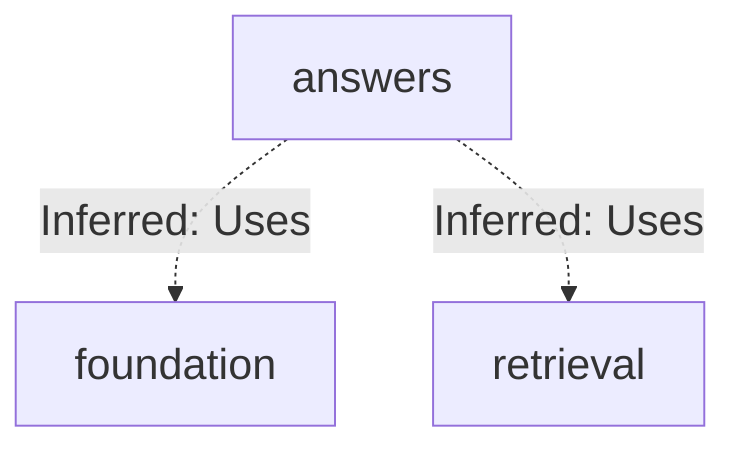
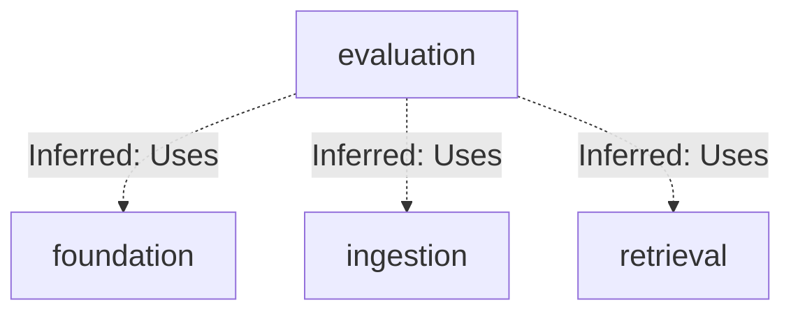
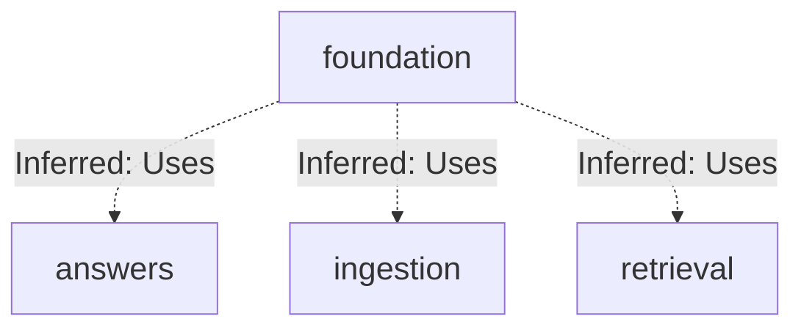
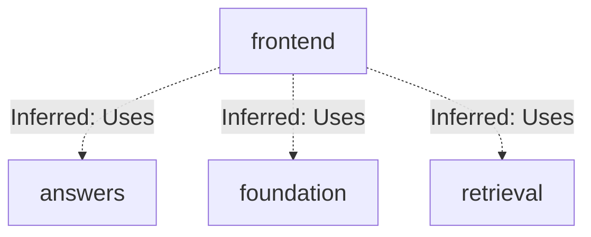
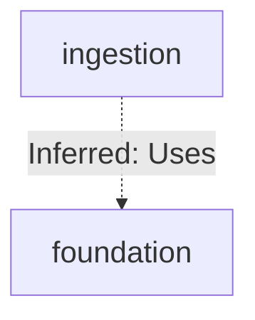
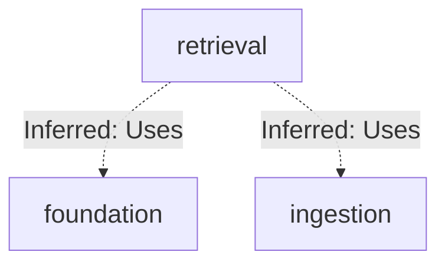

# Repository map

Source revision: `56291a0b9cc466341d5d7a4b71aed8b2c5f412bb`

Browse the Mermaid diagrams below on GitHub. PDFs and PNGs are linked for download.

[Overview PDF](overview/repository-map.pdf) | [Overview details](overview/README.md)

## answers: connections

## evaluation: connections

## foundation: connections

## frontend: connections

## ingestion: connections

## retrieval: connections

## Subsystem maps

| Map | Summary | Views | Last analyzed source |
| --- | --- | --- | --- |
| [answers](maps/answers/README.md) | The answers subsystem defines application-owned async provider contracts for embeddings, generation, and reranking with strict validating dataclasses and content-addressed chunk identity. Cohere adapters (opt-in) and deterministic fake adapters both implement these contracts; live adapters sanitize SDK failures into ProviderError codes and derive Decimal cost/latency usage, while fakes report zero cost and stable synthetic outputs. | [PDF](maps/answers/repository-map.pdf) · [JSON](maps/answers/map.json) | `56291a0b9cc4` |
| [evaluation](maps/evaluation/README.md) | The evaluation subsystem loads hash-verified, versioned datasets, prepares isolated per-scope evaluation corpora in OpenSearch through the durable ingestion pipeline, runs bm25/dense/hybrid/hybrid_rerank retrieval via a shared EvaluationSearch boundary, scores rankings with fixed metrics, and emits reproducible comparison reports. It exposes a debug-only search API and a SciFact builder CLI, and owns evaluation ORM tables. | [PDF](maps/evaluation/repository-map.pdf) · [JSON](maps/evaluation/map.json) | `56291a0b9cc4` |
| [foundation](maps/foundation/README.md) | The foundation subsystem is a FastAPI backend for a multi-tenant hybrid RAG service: a create_app entry point exposing health and evaluation routers, a cached typed Settings boundary, an async SQLAlchemy base, a tenant-scoped DocumentService with filesystem storage, and a linear Alembic chain defining identity, content, retrieval, evaluation/audit, and ingestion-job schema. Migrations push authorization, lifecycle, and immutability invariants into PostgreSQL, while containers, Makefile, and CI provide orchestration. | [PDF](maps/foundation/repository-map.pdf) · [JSON](maps/foundation/map.json) | `56291a0b9cc4` |
| [frontend](maps/frontend/README.md) | This subsystem is the hybrid-rag-search-web frontend: a private Next.js 16 / React 19 App Router project whose Dockerfile runs the dev server on Node 22. It renders a root layout wrapping a purely static Home page, with no state, inputs, or async data loading. No fetch, API route, or env read is present, so runtime linkage to the answers, foundation, or retrieval subsystems is unevidenced. | [PDF](maps/frontend/repository-map.pdf) · [JSON](maps/frontend/map.json) | `56291a0b9cc4` |
| [ingestion](maps/ingestion/README.md) | The chunking subsystem deterministically converts a ParsedDocument into content-addressed Chunks: it groups blocks by heading path, greedily packs them within a token budget with overlap, splits oversized blocks by prefix search, enriches text with reconstructed Markdown headings for embedding, and stamps identity digests derived from the config version and document id. | [PDF](maps/ingestion/repository-map.pdf) · [JSON](maps/ingestion/map.json) | `56291a0b9cc4` |
| [retrieval](maps/retrieval/README.md) | This subsystem implements dense-query retrieval for a multi-tenant hybrid RAG backend: an injected embedding provider turns a normalized query into a vector used in a k-NN search against an OpenSearch read alias, and hits are renormalized into the shared RetrievalResult contract reused by lexical retrieval. Configuration derives from Settings, diagnostics are separated into a trace, and the only local entry point is a debug CLI, with orchestration living elsewhere. | [PDF](maps/retrieval/repository-map.pdf) · [JSON](maps/retrieval/map.json) | `56291a0b9cc4` |

JSON is the source of truth; Mermaid, PNGs, and PDFs are generated views.

Unchanged subsystem views are retained. Source existence checks do not prove model interpretation. See manifest.json and update.json for dependencies, coverage and updates.
