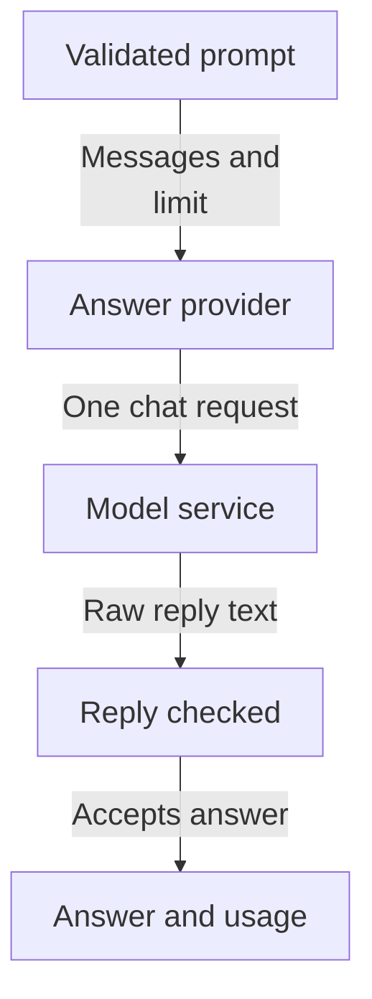
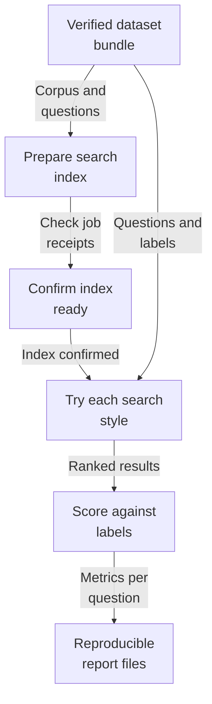
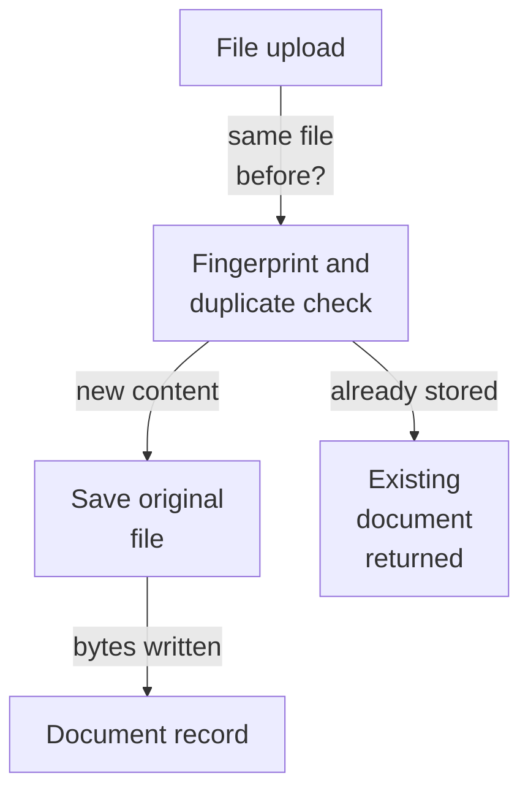
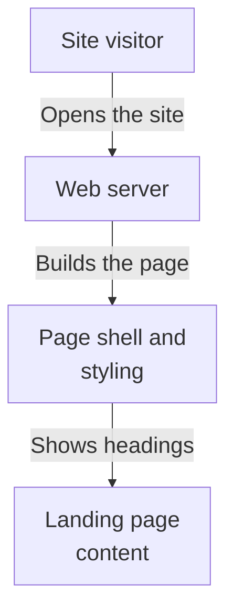
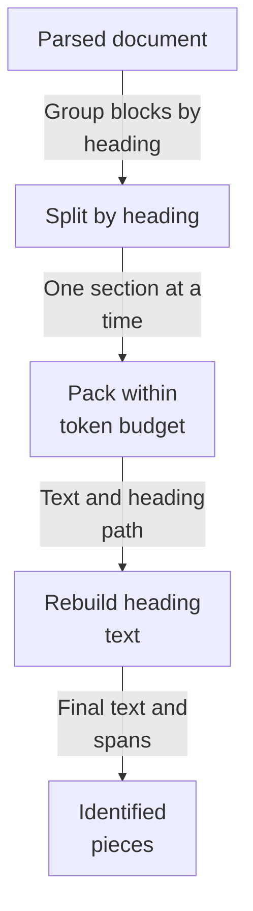
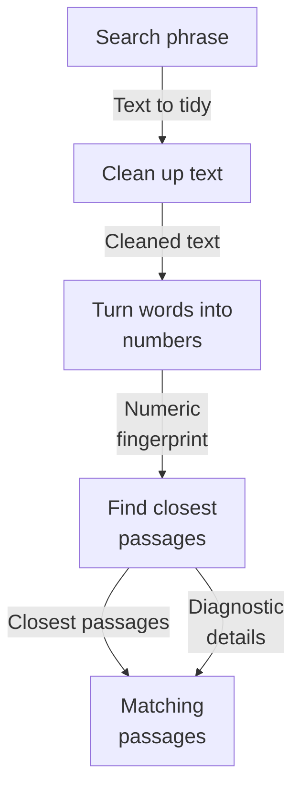

# Repository map

Source revision: `3537e913c1eeec5b5f34d6cbdbf4dc3f8bc74b25`

Browse the Mermaid diagrams below on GitHub. PDFs and PNGs are linked for download.

[Overview PDF](overview/repository-map.pdf) | [Overview details](overview/README.md)

## answers: How a prompt becomes an answer

This area defines the app's own contract for asking an AI model to write an answer, plus two implementations: a real Cohere adapter and a fake one used for testing. A caller supplies a validated list of chat messages and a token limit; the result carries the generated text, why it stopped, the model used, and usage/cost details. Live use is opt-in because a configured factory requires an API key. No caller or route choosing an adapter is evidenced.

A caller supplies validated chat messages; the answer provider forwards one non-streaming request to the model service, re-checks the reply, and returns answer text with finish reason and usage.

Read from top to bottom; arrows show what happens next or what is passed along.

[More about this area and its source evidence](maps/answers/README.md)

## evaluation: How a dataset becomes a scored report

This area builds and runs retrieval-quality tests for the search service. It loads versioned dataset bundles whose files are checked by hash, prepares an isolated search index for each dataset, runs four search styles over every test question, scores how well the results match human relevance labels, and saves reproducible JSON and readable Markdown reports. A local-only debug endpoint and a SciFact dataset builder support this work.

A verified dataset bundle is prepared into its own search index, every test question is searched in four ways, results are scored against human relevance labels, and a repeatable report is written.

Read from top to bottom; arrows show what happens next or what is passed along.

[More about this area and its source evidence](maps/evaluation/README.md)

## foundation: How an uploaded file becomes a stored document

This area is the shared foundation of a multi-tenant document search service. It starts the web application (health and readiness checks), stores documents people upload, deduplicates identical files, and keeps tenants, collections, and upload records separated in PostgreSQL. The main input is an uploaded file plus an already-approved tenant and collection; the useful result is a stored, deduplicated document record with a status, plus database schema and setup commands for local development.

A caller supplies an authorized tenant and collection scope with file bytes. The service fingerprint-checks for duplicates, saves the file, and records its status.

Read from top to bottom; arrows show what happens next or what is passed along.

[More about this area and its source evidence](maps/foundation/README.md)

## frontend: How a visitor gets the landing page

This area is the web front door for an evidence-first enterprise search product: a Next.js page that currently shows a placeholder landing screen with a heading and a note that a search workspace is coming. It is served by a container that runs the development server on port 3000, and it reads no data, stores nothing, and sends nothing. Search, retrieval, and answering are not implemented or connected here yet; a test checks the heading, and code-quality tools check the sources.

A visitor opens the site, the page shell supplies styling and page title, and the static landing content appears. Nothing is looked up or saved, and no search runs.

Read from top to bottom; arrows show what happens next or what is passed along.

[More about this area and its source evidence](maps/frontend/README.md)

## ingestion: How a parsed document becomes searchable pieces

This area turns a parsed document into ordered, ready-to-search pieces. It keeps each piece inside one heading section, packs text up to a token budget with a little overlap, and rebuilds Markdown headings so context is preserved. Each piece gets a stable identifier derived from its document, settings, and content. It runs as a library step; how it is called or where results go next is not shown.

A parsed document is split by heading section, packed into token-budgeted pieces with overlap, enriched with reconstructed headings, and given stable identifiers.

Read from top to bottom; arrows show what happens next or what is passed along.

[More about this area and its source evidence](maps/ingestion/README.md)

## retrieval: How a search becomes matching passages

This area turns a person's search text into likely matching document passages. The text is cleaned, turned into a numeric fingerprint by an outside service, then used to ask a search index for the closest passages, scoped so one customer only sees their own material. It returns those passages plus separate diagnostic details, and is currently runnable only through a developer test command. Blank text is handled without contacting anything.

A search phrase is cleaned, sent out to be turned into numbers, used to find the closest stored passages in the search index, and returned as passages with optional diagnostic detail.

Read from top to bottom; arrows show what happens next or what is passed along.

[More about this area and its source evidence](maps/retrieval/README.md)

## Subsystem maps

| Map | Summary | Views | Last analyzed source |
| --- | --- | --- | --- |
| [answers](maps/answers/README.md) | This area defines the app's own contract for asking an AI model to write an answer, plus two implementations: a real Cohere adapter and a fake one used for testing. A caller supplies a validated list of chat messages and a token limit; the result carries the generated text, why it stopped, the model used, and usage/cost details. Live use is opt-in because a configured factory requires an API key. No caller or route choosing an adapter is evidenced. | [PDF](maps/answers/repository-map.pdf) · [JSON](maps/answers/map.json) | `3537e913c1ee` |
| [evaluation](maps/evaluation/README.md) | This area builds and runs retrieval-quality tests for the search service. It loads versioned dataset bundles whose files are checked by hash, prepares an isolated search index for each dataset, runs four search styles over every test question, scores how well the results match human relevance labels, and saves reproducible JSON and readable Markdown reports. A local-only debug endpoint and a SciFact dataset builder support this work. | [PDF](maps/evaluation/repository-map.pdf) · [JSON](maps/evaluation/map.json) | `3537e913c1ee` |
| [foundation](maps/foundation/README.md) | This area is the shared foundation of a multi-tenant document search service. It starts the web application (health and readiness checks), stores documents people upload, deduplicates identical files, and keeps tenants, collections, and upload records separated in PostgreSQL. The main input is an uploaded file plus an already-approved tenant and collection; the useful result is a stored, deduplicated document record with a status, plus database schema and setup commands for local development. | [PDF](maps/foundation/repository-map.pdf) · [JSON](maps/foundation/map.json) | `3537e913c1ee` |
| [frontend](maps/frontend/README.md) | This area is the web front door for an evidence-first enterprise search product: a Next.js page that currently shows a placeholder landing screen with a heading and a note that a search workspace is coming. It is served by a container that runs the development server on port 3000, and it reads no data, stores nothing, and sends nothing. Search, retrieval, and answering are not implemented or connected here yet; a test checks the heading, and code-quality tools check the sources. | [PDF](maps/frontend/repository-map.pdf) · [JSON](maps/frontend/map.json) | `3537e913c1ee` |
| [ingestion](maps/ingestion/README.md) | This area turns a parsed document into ordered, ready-to-search pieces. It keeps each piece inside one heading section, packs text up to a token budget with a little overlap, and rebuilds Markdown headings so context is preserved. Each piece gets a stable identifier derived from its document, settings, and content. It runs as a library step; how it is called or where results go next is not shown. | [PDF](maps/ingestion/repository-map.pdf) · [JSON](maps/ingestion/map.json) | `3537e913c1ee` |
| [retrieval](maps/retrieval/README.md) | This area turns a person's search text into likely matching document passages. The text is cleaned, turned into a numeric fingerprint by an outside service, then used to ask a search index for the closest passages, scoped so one customer only sees their own material. It returns those passages plus separate diagnostic details, and is currently runnable only through a developer test command. Blank text is handled without contacting anything. | [PDF](maps/retrieval/repository-map.pdf) · [JSON](maps/retrieval/map.json) | `3537e913c1ee` |

JSON is the source of truth; Mermaid, PNGs, and PDFs are generated views.

Unchanged subsystem views are retained. Source existence checks do not prove model interpretation. See manifest.json and update.json for dependencies, coverage and updates.
