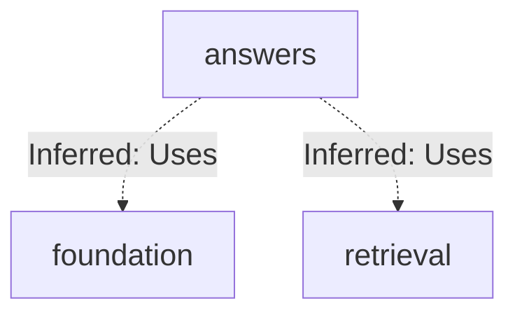
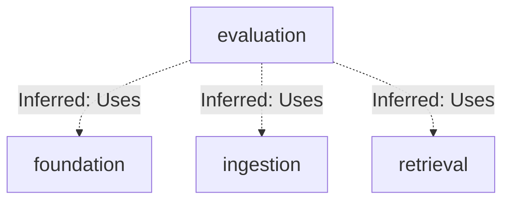
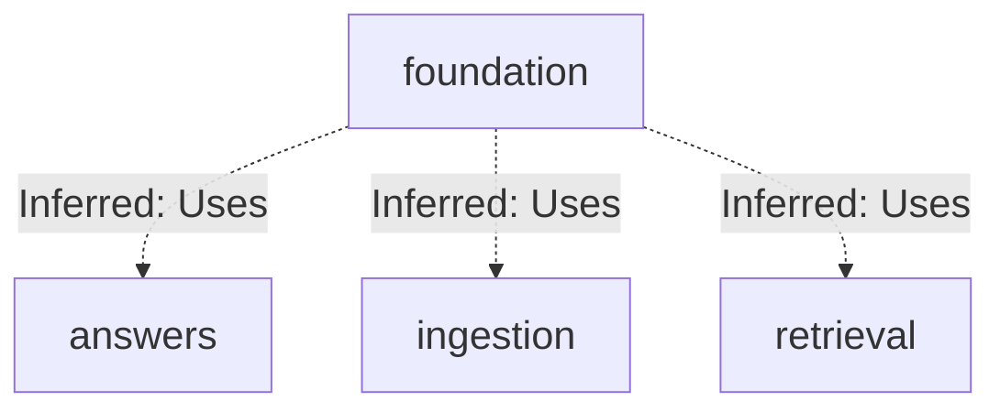
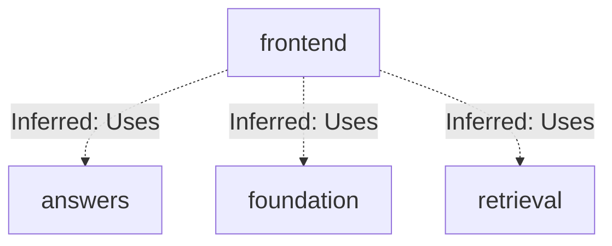
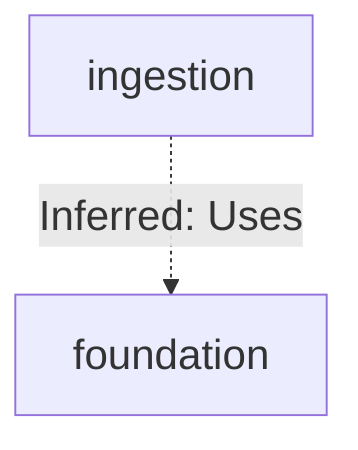
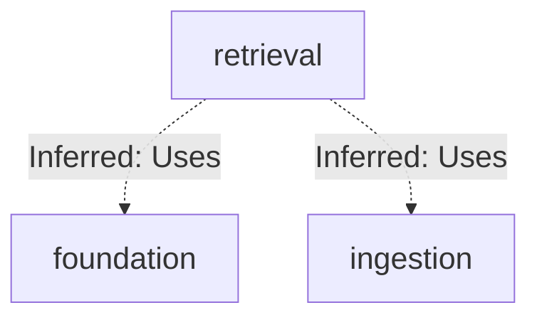

# Repository map

Source revision: `05fb919153379762ce04a644ff9f6ef3e3413ff1`

Browse the Mermaid diagrams below on GitHub. PDFs and PNGs are linked for download.

[Overview PDF](overview/repository-map.pdf) | [Overview details](overview/README.md)

## answers: connections

## evaluation: connections

## foundation: connections

## frontend: connections

## ingestion: connections

## retrieval: connections

## Subsystem maps

| Map | Summary | Views | Last analyzed source |
| --- | --- | --- | --- |
| [answers](maps/answers/README.md) | This subsystem defines provider contracts (embeddings, generation, reranking) with strict dataclass validation and hashing, plus two provider families: Cohere live adapters (opt-in) that sanitize SDK errors into ProviderError codes, and deterministic fake adapters used for non-live tests and loads. A chunking contract module derives stable, content-addressed identifiers from normalized config and span data. | [PDF](maps/answers/repository-map.pdf) · [JSON](maps/answers/map.json) | `05fb91915337` |
| [evaluation](maps/evaluation/README.md) | The evaluation subsystem loads and validates versioned datasets, prepares isolated evaluation corpora in OpenSearch, runs multi-mode retrieval (bm25/dense/hybrid/hybrid_rerank) through EvaluationSearch, scores rankings, and emits comparison reports, with a debug-only search API and a SciFact dataset builder CLI. | [PDF](maps/evaluation/repository-map.pdf) · [JSON](maps/evaluation/map.json) | `05fb91915337` |
| [foundation](maps/foundation/README.md) | This batch maps the foundation layer of a hybrid RAG service: a FastAPI app entry point with health/readiness endpoints, typed settings, a SQLAlchemy async database base, document storage service, and a linear Alembic migration chain building identity, content, retrieval, evaluation/audit, and ingestion-job schema. Container, Makefile, and CI workflows build and verify the backend. | [PDF](maps/foundation/repository-map.pdf) · [JSON](maps/foundation/map.json) | `05fb91915337` |
| [frontend](maps/frontend/README.md) | The supplied findings describe a single Next.js App Router frontend: a Docker/build/test setup, a root layout and static index page, and no observable runtime connection to the backend retrieval, answers, or foundation subsystems. | [PDF](maps/frontend/repository-map.pdf) · [JSON](maps/frontend/map.json) | `05fb91915337` |
| [ingestion](maps/ingestion/README.md) | This batch maps the deterministic document-chunking core of the ingestion subsystem: parsed document blocks are grouped by heading path, greedily packed into token-limited chunks with overlap, enriched with reconstructed Markdown headings for embedding, and stamped with content-addressed identities from canonical digests. | [PDF](maps/ingestion/repository-map.pdf) · [JSON](maps/ingestion/map.json) | `05fb91915337` |
| [retrieval](maps/retrieval/README.md) | This batch maps the dense-query retrieval path of a hybrid RAG backend: a dense retrieval config derived from settings feeds an OpenSearch dense retriever that validates filters, embeds the normalized query via a provider, issues a k-NN search, and returns shared RetrievalResult objects, with a CLI debug entry point. | [PDF](maps/retrieval/repository-map.pdf) · [JSON](maps/retrieval/map.json) | `05fb91915337` |

JSON is the source of truth; Mermaid, PNGs, and PDFs are generated views.

Unchanged subsystem views are retained. Source existence checks do not prove model interpretation. See manifest.json and update.json for dependencies, coverage and updates.
