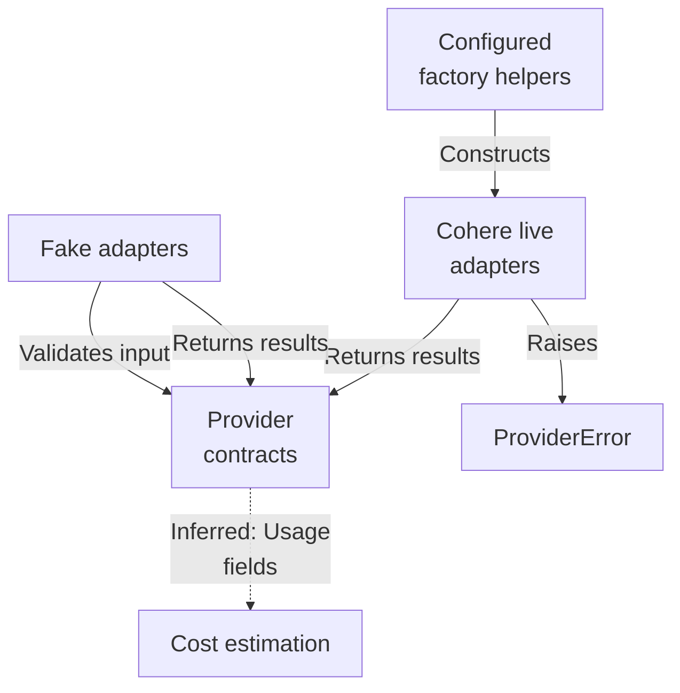
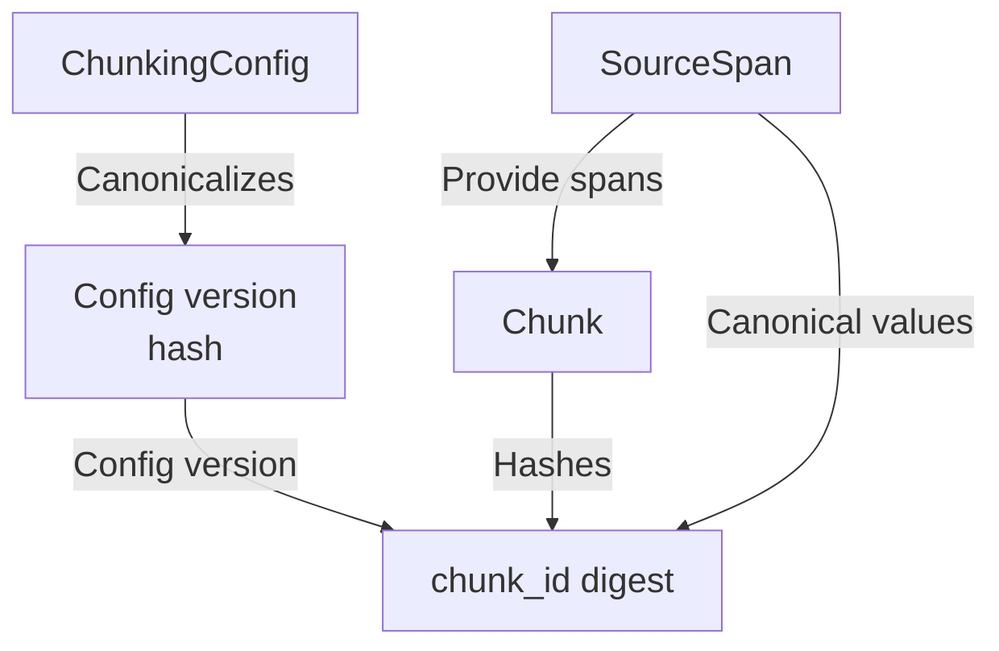
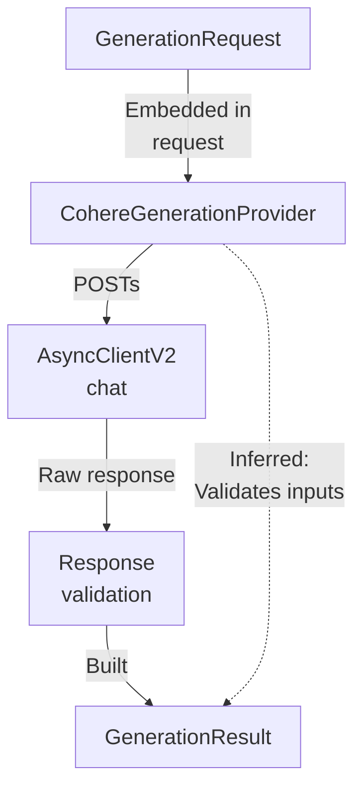
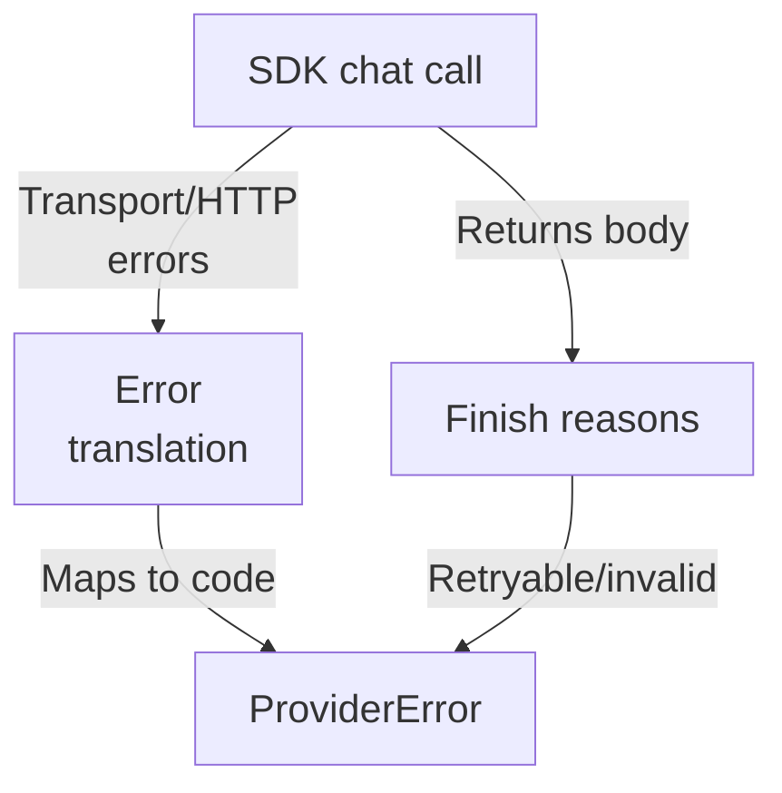
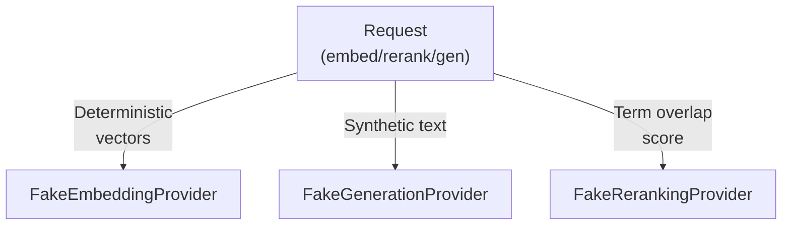

# Repository map

This subsystem defines provider contracts (embeddings, generation, reranking) with strict dataclass validation and hashing, plus two provider families: Cohere live adapters (opt-in) that sanitize SDK errors into ProviderError codes, and deterministic fake adapters used for non-live tests and loads. A chunking contract module derives stable, content-addressed identifiers from normalized config and span data.

Commit: `05fb919153379762ce04a644ff9f6ef3e3413ff1` | Generated: 2026-10-17T22:39:49.347800+00:00

[Open PDF](repository-map.pdf)

**AI-generated analysis. Source references are checked for existence and supplied scope; this does not prove semantic correctness.**

## Scope

Tracked, eligible text only; bounded excerpts, not exhaustive.

14/14 eligible files analyzed; 209 tracked files excluded by policy.

5 API calls. See coverage.json for budgets, exclusions, and usage.

## Architecture

Fake and Cohere adapters implement shared request/result contracts behind a protocol, with errors and usage/cost helpers as cross-cutting modules.

PNG fallback

### Source evidence

- **F0013**: configured_cohere_embeddings requires settings.cohere_api_key and enforces that embed-english-light-v3.0 uses 384 dimensions, then delegates to open_cohere_embeddings inside an async context manager. (<a href="https://github.com/Justin-Mendoza/hybrid-rag-search/blob/05fb919153379762ce04a644ff9f6ef3e3413ff1/backend/src/hybrid_rag_search/providers/cohere_embeddings.py#L1-L191">backend/src/hybrid_rag_search/providers/cohere_embeddings.py:1-191</a>)
- **F0023**: configured_cohere_generation requires settings.cohere_api_key (raises ValueError if None) and mounts open_cohere_generation as an async context manager yielding a CohereGenerationProvider built from Cohere settings. (<a href="https://github.com/Justin-Mendoza/hybrid-rag-search/blob/05fb919153379762ce04a644ff9f6ef3e3413ff1/backend/src/hybrid_rag_search/providers/cohere_generation.py#L1-L231">backend/src/hybrid_rag_search/providers/cohere_generation.py:1-231</a>)
- **F0027**: configured_cohere_reranking requires settings.cohere_api_key (raises ValueError if None) and wraps open_cohere_reranking using Cohere rerank settings. (<a href="https://github.com/Justin-Mendoza/hybrid-rag-search/blob/05fb919153379762ce04a644ff9f6ef3e3413ff1/backend/src/hybrid_rag_search/providers/cohere_reranking.py#L1-L189">backend/src/hybrid_rag_search/providers/cohere_reranking.py:1-189</a>)
- **F0047**: provision_configured_tokenizer constructs a Cohere SDK client (only when settings.cohere_api_key is set) and calls provision_tokenizer; exceptions other than TokenizerSetupError are re-raised as TokenizerSetupError('Cohere SDK could not fetch the tokenizer'). (<a href="https://github.com/Justin-Mendoza/hybrid-rag-search/blob/05fb919153379762ce04a644ff9f6ef3e3413ff1/backend/src/hybrid_rag_search/tokenization.py#L1-L195">backend/src/hybrid_rag_search/tokenization.py:1-195</a>)
- **F0048**: configured_tokenizer_asset maps settings.cohere_embed_model to a pinned TokenizerAsset in SUPPORTED_ASSETS, raising TokenizerSetupError when no pinned asset exists for the configured model. (<a href="https://github.com/Justin-Mendoza/hybrid-rag-search/blob/05fb919153379762ce04a644ff9f6ef3e3413ff1/backend/src/hybrid_rag_search/tokenization.py#L1-L195">backend/src/hybrid_rag_search/tokenization.py:1-195</a>)
- **F0007**: CohereEmbeddingProvider.embed rejects requests whose texts length exceeds 96 with ProviderError('invalid_request'). (<a href="https://github.com/Justin-Mendoza/hybrid-rag-search/blob/05fb919153379762ce04a644ff9f6ef3e3413ff1/backend/src/hybrid_rag_search/providers/cohere_embeddings.py#L1-L191">backend/src/hybrid_rag_search/providers/cohere_embeddings.py:1-191</a>)
- **F0008**: CohereEmbeddingProvider.embed maps EmbeddingPurpose.DOCUMENT to Cohere input_type 'search_document' and all other purposes to 'search_query', and sends truncate='NONE' with embedding_types ['float']. (<a href="https://github.com/Justin-Mendoza/hybrid-rag-search/blob/05fb919153379762ce04a644ff9f6ef3e3413ff1/backend/src/hybrid_rag_search/providers/cohere_embeddings.py#L1-L191">backend/src/hybrid_rag_search/providers/cohere_embeddings.py:1-191</a>)
- **F0017**: CohereGenerationProvider.generate sends a non-streaming chat request via the injected cohere.AsyncClientV2, wrapping it in asyncio.timeout(self.timeout_seconds) with RequestOptions setting max_retries=0. (<a href="https://github.com/Justin-Mendoza/hybrid-rag-search/blob/05fb919153379762ce04a644ff9f6ef3e3413ff1/backend/src/hybrid_rag_search/providers/cohere_generation.py#L1-L231">backend/src/hybrid_rag_search/providers/cohere_generation.py:1-231</a>)
- **F0024**: CohereRerankingProvider.rerank caps candidate sets at 10_000 (invalid_request), computes effective_timeout as the minimum of the instance timeout and the per-call timeout, and issues one client.rerank call with max_retries=0. (<a href="https://github.com/Justin-Mendoza/hybrid-rag-search/blob/05fb919153379762ce04a644ff9f6ef3e3413ff1/backend/src/hybrid_rag_search/providers/cohere_reranking.py#L1-L189">backend/src/hybrid_rag_search/providers/cohere_reranking.py:1-189</a>)
- **F0033**: FakeEmbeddingProvider.embed deterministically derives vectors from a SHAKE-256 hash of [MODEL, dimensions, request.purpose.value, text], producing one normalized vector per request text with zero billed usage and cost. (<a href="https://github.com/Justin-Mendoza/hybrid-rag-search/blob/05fb919153379762ce04a644ff9f6ef3e3413ff1/backend/src/hybrid_rag_search/providers/fake.py#L1-L137">backend/src/hybrid_rag_search/providers/fake.py:1-137</a>)
- **F0035**: FakeRerankingProvider.rerank scores each candidate as the fraction of distinct casefolded query terms present in candidate text, sorts descending by score with ties broken by original index, and truncates to request.top_n. (<a href="https://github.com/Justin-Mendoza/hybrid-rag-search/blob/05fb919153379762ce04a644ff9f6ef3e3413ff1/backend/src/hybrid_rag_search/providers/fake.py#L1-L137">backend/src/hybrid_rag_search/providers/fake.py:1-137</a>)
- **F0037**: FakeGenerationProvider.generate produces text 'Synthetic response {fingerprint}.' where fingerprint is the first 16 hex chars of a SHA-256 of [MODEL, max_output_tokens, message roles and contents], always reporting GenerationFinishReason.COMPLETE and zero usage. (<a href="https://github.com/Justin-Mendoza/hybrid-rag-search/blob/05fb919153379762ce04a644ff9f6ef3e3413ff1/backend/src/hybrid_rag_search/providers/fake.py#L1-L137">backend/src/hybrid_rag_search/providers/fake.py:1-137</a>)
- **F0028**: EmbeddingRequest.__post_init__ enforces a nonempty tuple of nonblank texts and a valid EmbeddingPurpose; EmbeddingResult declares adapter Literal['fake','cohere'] and defaults usage to EmbeddingUsage(). (<a href="https://github.com/Justin-Mendoza/hybrid-rag-search/blob/05fb919153379762ce04a644ff9f6ef3e3413ff1/backend/src/hybrid_rag_search/providers/embeddings.py#L1-L50">backend/src/hybrid_rag_search/providers/embeddings.py:1-50</a>)
- **F0029**: EmbeddingProvider is a Protocol requiring async embed(request) -&gt; EmbeddingResult, documented to preserve batch order and not drop inputs. (<a href="https://github.com/Justin-Mendoza/hybrid-rag-search/blob/05fb919153379762ce04a644ff9f6ef3e3413ff1/backend/src/hybrid_rag_search/providers/embeddings.py#L1-L50">backend/src/hybrid_rag_search/providers/embeddings.py:1-50</a>)
- **F0038**: GenerationRequest.__post_init__ requires a nonempty tuple of GenerationMessage, at least one USER-role message, and a positive int max_output_tokens. (<a href="https://github.com/Justin-Mendoza/hybrid-rag-search/blob/05fb919153379762ce04a644ff9f6ef3e3413ff1/backend/src/hybrid_rag_search/providers/generation.py#L1-L90">backend/src/hybrid_rag_search/providers/generation.py:1-90</a>)
- **F0041**: RerankRequest.__post_init__ enforces nonblank query, nonempty candidates tuple, unique candidate IDs, and top_n between 1 and the candidate count. (<a href="https://github.com/Justin-Mendoza/hybrid-rag-search/blob/05fb919153379762ce04a644ff9f6ef3e3413ff1/backend/src/hybrid_rag_search/providers/reranking.py#L1-L77">backend/src/hybrid_rag_search/providers/reranking.py:1-77</a>)
- **F0030**: ProviderError stores a code from the Literal set and a retryable flag, and formats its message as 'Model provider error: {code}' without exposing provider bodies or headers. (<a href="https://github.com/Justin-Mendoza/hybrid-rag-search/blob/05fb919153379762ce04a644ff9f6ef3e3413ff1/backend/src/hybrid_rag_search/providers/errors.py#L1-L19">backend/src/hybrid_rag_search/providers/errors.py:1-19</a>)
- **F0032**: Both Cohere adapters estimate cost as Decimal(token/unit count) times a Decimal rate (generation divides combined token cost by one million; rerank multiplies search units directly), returning None when billing metrics or rates are missing. (<a href="https://github.com/Justin-Mendoza/hybrid-rag-search/blob/05fb919153379762ce04a644ff9f6ef3e3413ff1/backend/src/hybrid_rag_search/providers/cohere_generation.py#L1-L231">backend/src/hybrid_rag_search/providers/cohere_generation.py:1-231</a>, <a href="https://github.com/Justin-Mendoza/hybrid-rag-search/blob/05fb919153379762ce04a644ff9f6ef3e3413ff1/backend/src/hybrid_rag_search/providers/cohere_reranking.py#L1-L189">backend/src/hybrid_rag_search/providers/cohere_reranking.py:1-189</a>)
- **F0043**: estimate_embedding_cost returns None when either billed_input_tokens or usd_per_million_tokens is None, otherwise multiplies billed_input_tokens by usd_per_million_tokens divided by 1,000,000 using Decimal. (<a href="https://github.com/Justin-Mendoza/hybrid-rag-search/blob/05fb919153379762ce04a644ff9f6ef3e3413ff1/backend/src/hybrid_rag_search/providers/usage.py#L1-L22">backend/src/hybrid_rag_search/providers/usage.py:1-22</a>)
- **F0012**: CohereEmbeddingProvider.embed returns an EmbeddingResult with adapter 'cohere' and an EmbeddingUsage carrying input_tokens, billed_input_tokens, latency_ms and estimated_cost_usd via estimate_embedding_cost. (<a href="https://github.com/Justin-Mendoza/hybrid-rag-search/blob/05fb919153379762ce04a644ff9f6ef3e3413ff1/backend/src/hybrid_rag_search/providers/cohere_embeddings.py#L1-L191">backend/src/hybrid_rag_search/providers/cohere_embeddings.py:1-191</a>)
- **F0021**: generate concatenates text content parts, rejects blank text as invalid_response, and returns a GenerationResult with model, adapter='cohere', latency_ms, and estimated_cost_usd computed from billed tokens and configured per-million rates. (<a href="https://github.com/Justin-Mendoza/hybrid-rag-search/blob/05fb919153379762ce04a644ff9f6ef3e3413ff1/backend/src/hybrid_rag_search/providers/cohere_generation.py#L1-L231">backend/src/hybrid_rag_search/providers/cohere_generation.py:1-231</a>)
- **F0026**: rerank maps each returned index back to request.candidates[item.index].id and returns a RerankResult with rank starting at 1, billed_search_units, latency_ms, and estimated_cost_usd from usd_per_search_unit. (<a href="https://github.com/Justin-Mendoza/hybrid-rag-search/blob/05fb919153379762ce04a644ff9f6ef3e3413ff1/backend/src/hybrid_rag_search/providers/cohere_reranking.py#L1-L189">backend/src/hybrid_rag_search/providers/cohere_reranking.py:1-189</a>)
- **F0010**: CohereEmbeddingProvider.embed translates TimeoutError/httpx.TimeoutException to ProviderError('timeout', retryable=True), httpx.TransportError to 'unavailable' (retryable), HTTP 401/403 to 'authentication', 429 to 'rate_limited' (retryable), status&gt;=500 to 'unavailable' (retryable), and other ApiError to 'invalid_request'. (<a href="https://github.com/Justin-Mendoza/hybrid-rag-search/blob/05fb919153379762ce04a644ff9f6ef3e3413ff1/backend/src/hybrid_rag_search/providers/cohere_embeddings.py#L1-L191">backend/src/hybrid_rag_search/providers/cohere_embeddings.py:1-191</a>)
- **F0019**: generate raises ProviderError with codes timeout/unavailable/authentication/rate_limited/invalid_request by translating TimeoutError, httpx.TimeoutException, httpx.TransportError, and ApiError status codes (401/403/498, 429, &gt;=500). (<a href="https://github.com/Justin-Mendoza/hybrid-rag-search/blob/05fb919153379762ce04a644ff9f6ef3e3413ff1/backend/src/hybrid_rag_search/providers/cohere_generation.py#L1-L231">backend/src/hybrid_rag_search/providers/cohere_generation.py:1-231</a>, <a href="https://github.com/Justin-Mendoza/hybrid-rag-search/blob/05fb919153379762ce04a644ff9f6ef3e3413ff1/backend/src/hybrid_rag_search/providers/errors.py#L1-L19">backend/src/hybrid_rag_search/providers/errors.py:1-19</a>)
- **F0034**: FakeEmbeddingProvider.__init__ validates that dimensions is a positive int via 'type(dimensions) is not int or dimensions &lt;= 0', raising ValueError otherwise. (<a href="https://github.com/Justin-Mendoza/hybrid-rag-search/blob/05fb919153379762ce04a644ff9f6ef3e3413ff1/backend/src/hybrid_rag_search/providers/fake.py#L1-L137">backend/src/hybrid_rag_search/providers/fake.py:1-137</a>)
- **F0036**: FakeRerankingProvider.rerank raises ValueError when timeout_seconds is provided but is not finite or not positive. (<a href="https://github.com/Justin-Mendoza/hybrid-rag-search/blob/05fb919153379762ce04a644ff9f6ef3e3413ff1/backend/src/hybrid_rag_search/providers/fake.py#L1-L137">backend/src/hybrid_rag_search/providers/fake.py:1-137</a>)

## Chunk identity flow

ChunkingConfig validation feeds a canonical JSON version string, and chunk content plus sorted source spans feed a stable chunk_id digest.

PNG fallback

### Source evidence

- **F0001**: ChunkingConfig is a frozen dataclass that validates max_tokens as a positive int, overlap_tokens as a nonnegative int strictly less than max_tokens, and max_tokens not exceeding embedding_limit_tokens, raising ValueError otherwise in __post_init__. (<a href="https://github.com/Justin-Mendoza/hybrid-rag-search/blob/05fb919153379762ce04a644ff9f6ef3e3413ff1/backend/src/hybrid_rag_search/chunking/contracts.py#L1-L162">backend/src/hybrid_rag_search/chunking/contracts.py:1-162</a>)
- **F0006**: DEFAULT_CHUNKING_CONFIG is created at module import time as a ChunkingConfig() with defaults max_tokens=400, overlap_tokens=50, embedding_limit_tokens=512. (<a href="https://github.com/Justin-Mendoza/hybrid-rag-search/blob/05fb919153379762ce04a644ff9f6ef3e3413ff1/backend/src/hybrid_rag_search/chunking/contracts.py#L1-L162">backend/src/hybrid_rag_search/chunking/contracts.py:1-162</a>)
- **F0002**: ChunkingConfig.version builds a sorted-key JSON canonicalization of algorithm, embedding_limit_tokens, max_tokens, overlap_tokens, tokenizer_model, tokenizer_revision and tokenizer_sha256, then returns f"chunkcfg_{stable_digest('chunk-config', canonical)}". (<a href="https://github.com/Justin-Mendoza/hybrid-rag-search/blob/05fb919153379762ce04a644ff9f6ef3e3413ff1/backend/src/hybrid_rag_search/chunking/contracts.py#L1-L162">backend/src/hybrid_rag_search/chunking/contracts.py:1-162</a>)
- **F0004**: Chunk validates that source_spans is a nonempty tuple of SourceSpan values whose (block_number, start_char, end_char) positions are already in sorted source order. (<a href="https://github.com/Justin-Mendoza/hybrid-rag-search/blob/05fb919153379762ce04a644ff9f6ef3e3413ff1/backend/src/hybrid_rag_search/chunking/contracts.py#L1-L162">backend/src/hybrid_rag_search/chunking/contracts.py:1-162</a>)
- **F0005**: SourceSpan enforces end_char greater than start_char and requires its locator to be a SourceLocator instance; canonical_value serializes block_number, end_char, heading_path, page_number and start_char as sorted-key JSON. (<a href="https://github.com/Justin-Mendoza/hybrid-rag-search/blob/05fb919153379762ce04a644ff9f6ef3e3413ff1/backend/src/hybrid_rag_search/chunking/contracts.py#L1-L162">backend/src/hybrid_rag_search/chunking/contracts.py:1-162</a>)
- **F0003**: Chunk.chunk_id computes a stable digest over document_id, config_version, order, content_text, embedding_text and each span's canonical_value(), returning a chk_-prefixed identifier. (<a href="https://github.com/Justin-Mendoza/hybrid-rag-search/blob/05fb919153379762ce04a644ff9f6ef3e3413ff1/backend/src/hybrid_rag_search/chunking/contracts.py#L1-L162">backend/src/hybrid_rag_search/chunking/contracts.py:1-162</a>)

## Generation request path

A GenerationRequest is validated, sent via Cohere's non-streaming chat with a hard timeout and no retries, then parsed into a GenerationResult or returned as a code-mapped ProviderError.

PNG fallback

### Source evidence

- **F0038**: GenerationRequest.__post_init__ requires a nonempty tuple of GenerationMessage, at least one USER-role message, and a positive int max_output_tokens. (<a href="https://github.com/Justin-Mendoza/hybrid-rag-search/blob/05fb919153379762ce04a644ff9f6ef3e3413ff1/backend/src/hybrid_rag_search/providers/generation.py#L1-L90">backend/src/hybrid_rag_search/providers/generation.py:1-90</a>)
- **F0022**: CohereGenerationProvider.__init__ validates model nonblank, finite positive timeout, temperature in [0,1], and nonnegative finite prices, raising ValueError otherwise. (<a href="https://github.com/Justin-Mendoza/hybrid-rag-search/blob/05fb919153379762ce04a644ff9f6ef3e3413ff1/backend/src/hybrid_rag_search/providers/cohere_generation.py#L1-L231">backend/src/hybrid_rag_search/providers/cohere_generation.py:1-231</a>)
- **F0017**: CohereGenerationProvider.generate sends a non-streaming chat request via the injected cohere.AsyncClientV2, wrapping it in asyncio.timeout(self.timeout_seconds) with RequestOptions setting max_retries=0. (<a href="https://github.com/Justin-Mendoza/hybrid-rag-search/blob/05fb919153379762ce04a644ff9f6ef3e3413ff1/backend/src/hybrid_rag_search/providers/cohere_generation.py#L1-L231">backend/src/hybrid_rag_search/providers/cohere_generation.py:1-231</a>)
- **F0049**: test_cohere_generation.py drives CohereGenerationProvider.generate through an httpx.AsyncClient with MockTransport, asserting the request is posted to path /v2/chat with bearer authorization and a JSON body containing model, messages, max_tokens, temperature, and stream:false. (<a href="https://github.com/Justin-Mendoza/hybrid-rag-search/blob/05fb919153379762ce04a644ff9f6ef3e3413ff1/backend/tests/test_cohere_generation.py#L1-L314">backend/tests/test_cohere_generation.py:1-314</a>)
- **F0020**: generate validates the raw SDK response through _ChatResponse.model_validate and treats finish_reason TIMEOUT/ERROR as retryable provider errors and TOOL_CALL as invalid_response. (<a href="https://github.com/Justin-Mendoza/hybrid-rag-search/blob/05fb919153379762ce04a644ff9f6ef3e3413ff1/backend/src/hybrid_rag_search/providers/cohere_generation.py#L1-L231">backend/src/hybrid_rag_search/providers/cohere_generation.py:1-231</a>)
- **F0050**: CohereGenerationProvider.generate aggregates multiple text content parts from the Cohere response (joining 'Grounded ' and 'answer.' into 'Grounded answer.'). (<a href="https://github.com/Justin-Mendoza/hybrid-rag-search/blob/05fb919153379762ce04a644ff9f6ef3e3413ff1/backend/tests/test_cohere_generation.py#L1-L314">backend/tests/test_cohere_generation.py:1-314</a>)
- **F0021**: generate concatenates text content parts, rejects blank text as invalid_response, and returns a GenerationResult with model, adapter='cohere', latency_ms, and estimated_cost_usd computed from billed tokens and configured per-million rates. (<a href="https://github.com/Justin-Mendoza/hybrid-rag-search/blob/05fb919153379762ce04a644ff9f6ef3e3413ff1/backend/src/hybrid_rag_search/providers/cohere_generation.py#L1-L231">backend/src/hybrid_rag_search/providers/cohere_generation.py:1-231</a>)
- **F0039**: GenerationResult.__post_init__ rejects blank text or model, non-GenerationFinishReason finish_reason, and any negative or non-finite numeric usage value (input/output/billed tokens, latency_ms). (<a href="https://github.com/Justin-Mendoza/hybrid-rag-search/blob/05fb919153379762ce04a644ff9f6ef3e3413ff1/backend/src/hybrid_rag_search/providers/generation.py#L1-L90">backend/src/hybrid_rag_search/providers/generation.py:1-90</a>)
- **F0057**: CohereGenerationProvider constructor validates model (non-blank), timeout_seconds (&gt;0), temperature (finite, within [0,1]), and non-negative finite input/output USD rates, raising ValueError otherwise. (<a href="https://github.com/Justin-Mendoza/hybrid-rag-search/blob/05fb919153379762ce04a644ff9f6ef3e3413ff1/backend/tests/test_cohere_generation.py#L1-L314">backend/tests/test_cohere_generation.py:1-314</a>)

## Generation error mapping

SDK and transport failures, HTTP statuses, and malformed responses are translated into sanitized retryable or non-retryable ProviderError codes.

PNG fallback

### Source evidence

- **F0017**: CohereGenerationProvider.generate sends a non-streaming chat request via the injected cohere.AsyncClientV2, wrapping it in asyncio.timeout(self.timeout_seconds) with RequestOptions setting max_retries=0. (<a href="https://github.com/Justin-Mendoza/hybrid-rag-search/blob/05fb919153379762ce04a644ff9f6ef3e3413ff1/backend/src/hybrid_rag_search/providers/cohere_generation.py#L1-L231">backend/src/hybrid_rag_search/providers/cohere_generation.py:1-231</a>)
- **F0049**: test_cohere_generation.py drives CohereGenerationProvider.generate through an httpx.AsyncClient with MockTransport, asserting the request is posted to path /v2/chat with bearer authorization and a JSON body containing model, messages, max_tokens, temperature, and stream:false. (<a href="https://github.com/Justin-Mendoza/hybrid-rag-search/blob/05fb919153379762ce04a644ff9f6ef3e3413ff1/backend/tests/test_cohere_generation.py#L1-L314">backend/tests/test_cohere_generation.py:1-314</a>)
- **F0019**: generate raises ProviderError with codes timeout/unavailable/authentication/rate_limited/invalid_request by translating TimeoutError, httpx.TimeoutException, httpx.TransportError, and ApiError status codes (401/403/498, 429, &gt;=500). (<a href="https://github.com/Justin-Mendoza/hybrid-rag-search/blob/05fb919153379762ce04a644ff9f6ef3e3413ff1/backend/src/hybrid_rag_search/providers/cohere_generation.py#L1-L231">backend/src/hybrid_rag_search/providers/cohere_generation.py:1-231</a>, <a href="https://github.com/Justin-Mendoza/hybrid-rag-search/blob/05fb919153379762ce04a644ff9f6ef3e3413ff1/backend/src/hybrid_rag_search/providers/errors.py#L1-L19">backend/src/hybrid_rag_search/providers/errors.py:1-19</a>)
- **F0055**: httpx.ReadTimeout maps to ProviderError code timeout; httpx.ConnectError maps to unavailable; a ValueError raised by the SDK chat call maps to invalid_response. (<a href="https://github.com/Justin-Mendoza/hybrid-rag-search/blob/05fb919153379762ce04a644ff9f6ef3e3413ff1/backend/tests/test_cohere_generation.py#L1-L314">backend/tests/test_cohere_generation.py:1-314</a>)
- **F0020**: generate validates the raw SDK response through _ChatResponse.model_validate and treats finish_reason TIMEOUT/ERROR as retryable provider errors and TOOL_CALL as invalid_response. (<a href="https://github.com/Justin-Mendoza/hybrid-rag-search/blob/05fb919153379762ce04a644ff9f6ef3e3413ff1/backend/src/hybrid_rag_search/providers/cohere_generation.py#L1-L231">backend/src/hybrid_rag_search/providers/cohere_generation.py:1-231</a>)
- **F0051**: CohereGenerationProvider.generate maps provider finish_reason values COMPLETE and STOP_SEQUENCE to GenerationFinishReason.COMPLETE and MAX_TOKENS to GenerationFinishReason.MAX_TOKENS. (<a href="https://github.com/Justin-Mendoza/hybrid-rag-search/blob/05fb919153379762ce04a644ff9f6ef3e3413ff1/backend/tests/test_cohere_generation.py#L1-L314">backend/tests/test_cohere_generation.py:1-314</a>)
- **F0052**: CohereGenerationProvider.generate raises ProviderError with code timeout (retryable) for TIMEOUT, unavailable (retryable) for ERROR, and invalid_response (non-retryable) for TOOL_CALL finish reasons. (<a href="https://github.com/Justin-Mendoza/hybrid-rag-search/blob/05fb919153379762ce04a644ff9f6ef3e3413ff1/backend/tests/test_cohere_generation.py#L1-L314">backend/tests/test_cohere_generation.py:1-314</a>)
- **F0030**: ProviderError stores a code from the Literal set and a retryable flag, and formats its message as 'Model provider error: {code}' without exposing provider bodies or headers. (<a href="https://github.com/Justin-Mendoza/hybrid-rag-search/blob/05fb919153379762ce04a644ff9f6ef3e3413ff1/backend/src/hybrid_rag_search/providers/errors.py#L1-L19">backend/src/hybrid_rag_search/providers/errors.py:1-19</a>)
- **F0053**: HTTP error statuses are mapped to sanitized ProviderError codes and retryability: 400 invalid_request, 401/403/498 authentication, 429 rate_limited, 500/503 unavailable, with no retries (calls == 1) and suppressed exception context. (<a href="https://github.com/Justin-Mendoza/hybrid-rag-search/blob/05fb919153379762ce04a644ff9f6ef3e3413ff1/backend/tests/test_cohere_generation.py#L1-L314">backend/tests/test_cohere_generation.py:1-314</a>)

## Fake adapter behavior

The fake implementations deterministically derive outputs from request contents with zero billing, serving as the default non-live path.

PNG fallback

### Source evidence

- **F0028**: EmbeddingRequest.__post_init__ enforces a nonempty tuple of nonblank texts and a valid EmbeddingPurpose; EmbeddingResult declares adapter Literal['fake','cohere'] and defaults usage to EmbeddingUsage(). (<a href="https://github.com/Justin-Mendoza/hybrid-rag-search/blob/05fb919153379762ce04a644ff9f6ef3e3413ff1/backend/src/hybrid_rag_search/providers/embeddings.py#L1-L50">backend/src/hybrid_rag_search/providers/embeddings.py:1-50</a>)
- **F0038**: GenerationRequest.__post_init__ requires a nonempty tuple of GenerationMessage, at least one USER-role message, and a positive int max_output_tokens. (<a href="https://github.com/Justin-Mendoza/hybrid-rag-search/blob/05fb919153379762ce04a644ff9f6ef3e3413ff1/backend/src/hybrid_rag_search/providers/generation.py#L1-L90">backend/src/hybrid_rag_search/providers/generation.py:1-90</a>)
- **F0041**: RerankRequest.__post_init__ enforces nonblank query, nonempty candidates tuple, unique candidate IDs, and top_n between 1 and the candidate count. (<a href="https://github.com/Justin-Mendoza/hybrid-rag-search/blob/05fb919153379762ce04a644ff9f6ef3e3413ff1/backend/src/hybrid_rag_search/providers/reranking.py#L1-L77">backend/src/hybrid_rag_search/providers/reranking.py:1-77</a>)
- **F0033**: FakeEmbeddingProvider.embed deterministically derives vectors from a SHAKE-256 hash of [MODEL, dimensions, request.purpose.value, text], producing one normalized vector per request text with zero billed usage and cost. (<a href="https://github.com/Justin-Mendoza/hybrid-rag-search/blob/05fb919153379762ce04a644ff9f6ef3e3413ff1/backend/src/hybrid_rag_search/providers/fake.py#L1-L137">backend/src/hybrid_rag_search/providers/fake.py:1-137</a>)
- **F0034**: FakeEmbeddingProvider.__init__ validates that dimensions is a positive int via 'type(dimensions) is not int or dimensions &lt;= 0', raising ValueError otherwise. (<a href="https://github.com/Justin-Mendoza/hybrid-rag-search/blob/05fb919153379762ce04a644ff9f6ef3e3413ff1/backend/src/hybrid_rag_search/providers/fake.py#L1-L137">backend/src/hybrid_rag_search/providers/fake.py:1-137</a>)
- **F0037**: FakeGenerationProvider.generate produces text 'Synthetic response {fingerprint}.' where fingerprint is the first 16 hex chars of a SHA-256 of [MODEL, max_output_tokens, message roles and contents], always reporting GenerationFinishReason.COMPLETE and zero usage. (<a href="https://github.com/Justin-Mendoza/hybrid-rag-search/blob/05fb919153379762ce04a644ff9f6ef3e3413ff1/backend/src/hybrid_rag_search/providers/fake.py#L1-L137">backend/src/hybrid_rag_search/providers/fake.py:1-137</a>)
- **F0035**: FakeRerankingProvider.rerank scores each candidate as the fraction of distinct casefolded query terms present in candidate text, sorts descending by score with ties broken by original index, and truncates to request.top_n. (<a href="https://github.com/Justin-Mendoza/hybrid-rag-search/blob/05fb919153379762ce04a644ff9f6ef3e3413ff1/backend/src/hybrid_rag_search/providers/fake.py#L1-L137">backend/src/hybrid_rag_search/providers/fake.py:1-137</a>)

## Uncertainties and untraced areas

- How callers select between fake and Cohere adapters in application code (F0031 is inferred, not directly observed).
- Where ChunkingConfig and Chunk are consumed by indexing or other pipeline stages outside this subsystem.
- Whether tokenization and tokenizer asset provisioning (F0044-F0048) are wired at runtime or only tested, since wiring is not shown in the findings.
- User-facing flow: no CLI, HTTP endpoint, or UI is evidenced by these findings.
