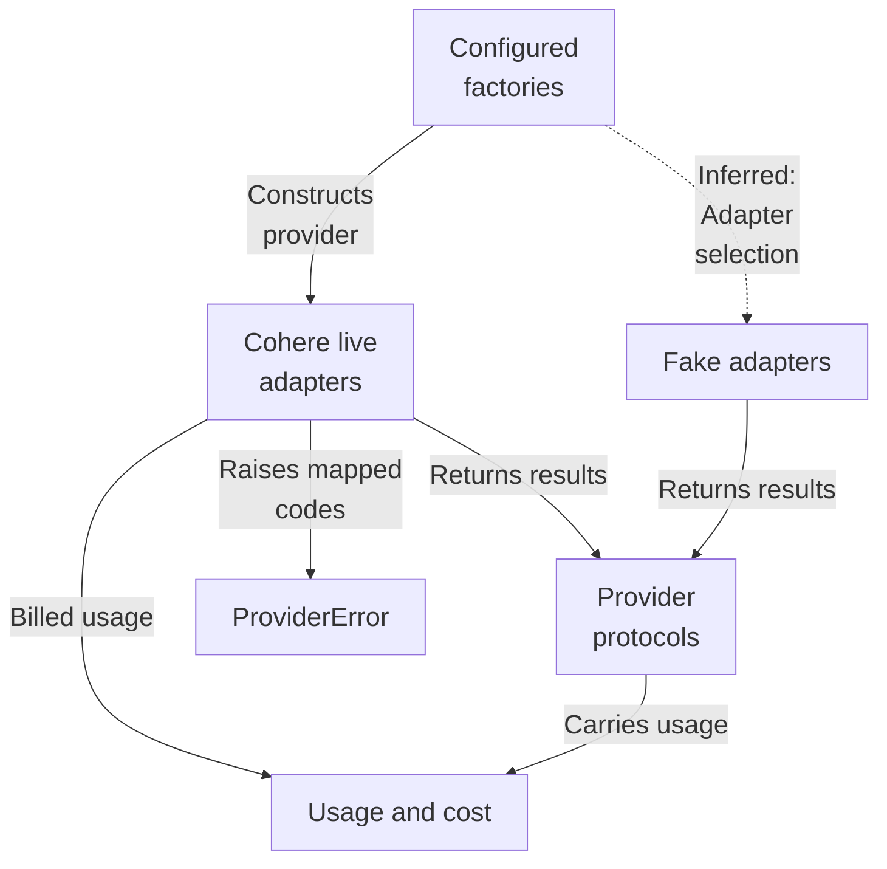
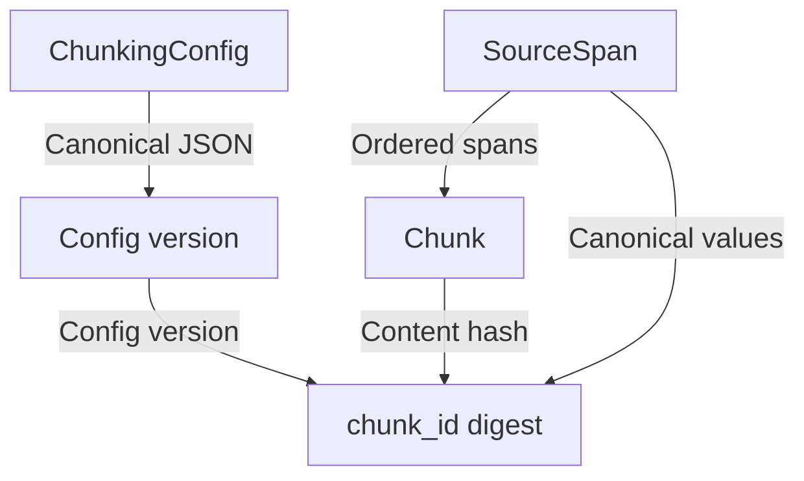
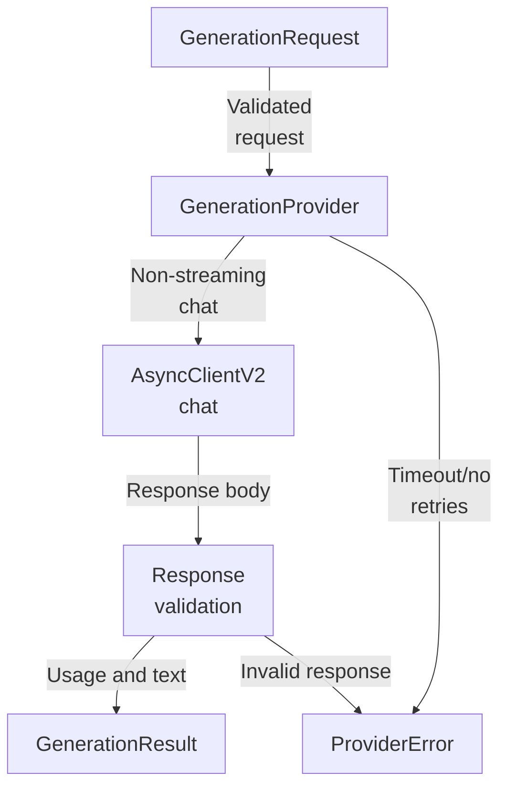
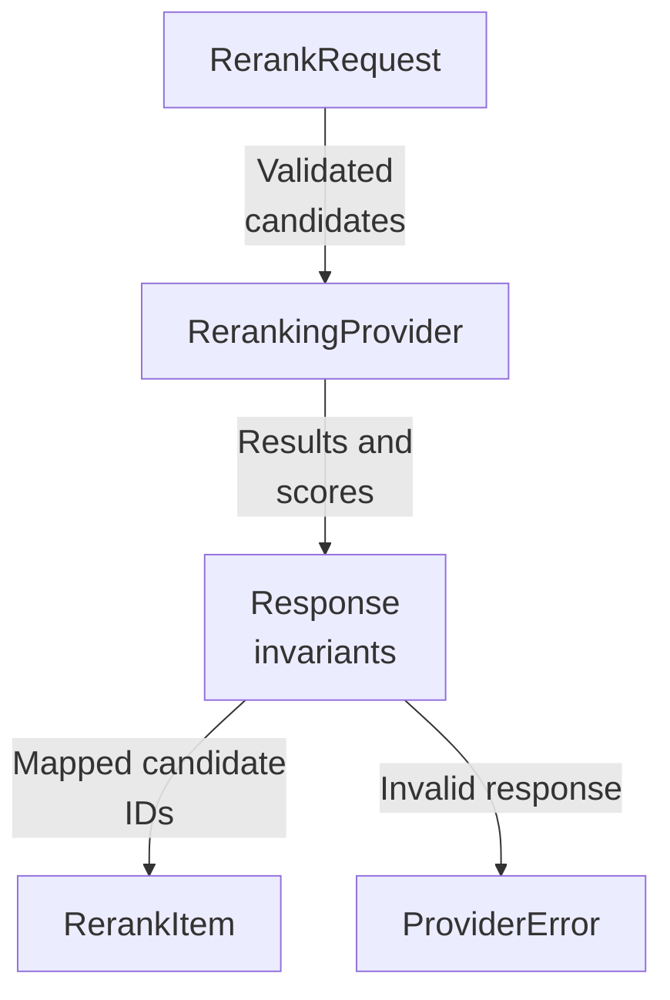
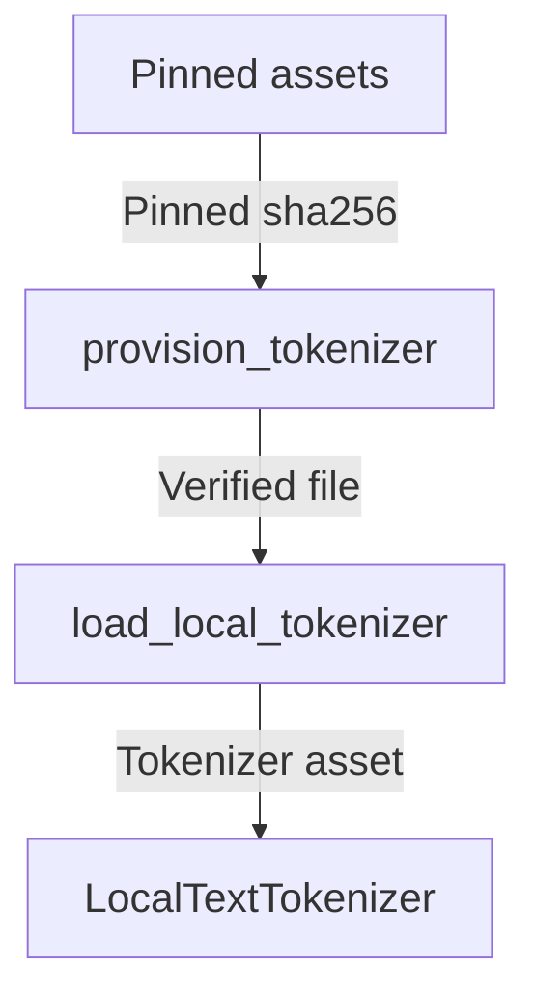
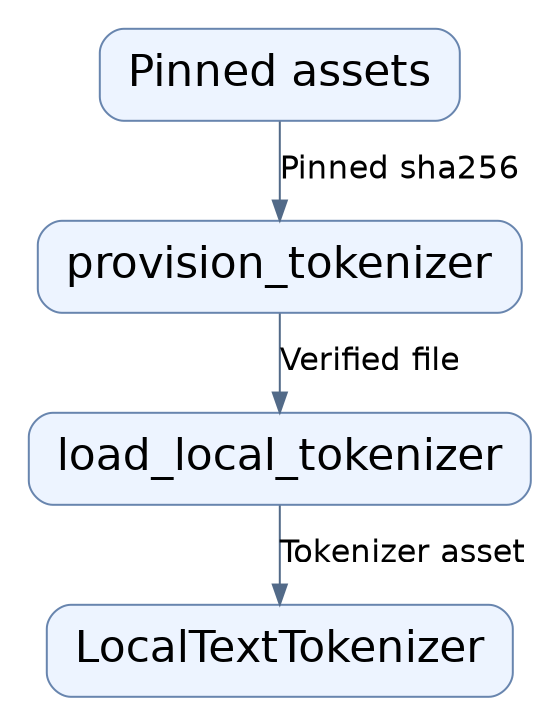

# Repository map

The answers subsystem defines application-owned async provider contracts for embeddings, generation, and reranking with strict validating dataclasses and content-addressed chunk identity. Cohere adapters (opt-in) and deterministic fake adapters both implement these contracts; live adapters sanitize SDK failures into ProviderError codes and derive Decimal cost/latency usage, while fakes report zero cost and stable synthetic outputs.

Commit: `56291a0b9cc466341d5d7a4b71aed8b2c5f412bb` | Generated: 2026-10-17T22:56:19.613055+00:00

[Open PDF](repository-map.pdf)

**AI-generated analysis. Source references are checked for existence and supplied scope; this does not prove semantic correctness.**

## Scope

Tracked, eligible text only; bounded excerpts, not exhaustive.

14/14 eligible files analyzed; 209 tracked files excluded by policy.

5 API calls. See coverage.json for budgets, exclusions, and usage.

## Architecture

Shared protocol contracts are implemented by both the opt-in Cohere live adapters and the deterministic fake family; usage/cost and ProviderError are cross-cutting. The configured_* factories are the boundary callers would use, but caller wiring is not evidenced.

PNG fallback

### Source evidence

- **F0015**: open_cohere_embeddings and configured_cohere_embeddings are async context managers that construct and yield a CohereEmbeddingProvider, with configured_cohere_embeddings reading Settings values and refusing live embeddings when cohere_api_key is None. (<a href="https://github.com/Justin-Mendoza/hybrid-rag-search/blob/56291a0b9cc466341d5d7a4b71aed8b2c5f412bb/backend/src/hybrid_rag_search/providers/cohere_embeddings.py#L1-L191">backend/src/hybrid_rag_search/providers/cohere_embeddings.py:1-191</a>)
- **F0021**: open_cohere_generation and configured_cohere_generation are async context managers that construct a CohereGenerationProvider; configured_cohere_generation requires settings.cohere_api_key and reads model, timeout, temperature, and price settings from Settings. (<a href="https://github.com/Justin-Mendoza/hybrid-rag-search/blob/56291a0b9cc466341d5d7a4b71aed8b2c5f412bb/backend/src/hybrid_rag_search/providers/cohere_generation.py#L1-L231">backend/src/hybrid_rag_search/providers/cohere_generation.py:1-231</a>)
- **F0026**: configured_cohere_reranking and configured_cohere_generation docstrings state the live Cohere adapters are opt-in, with ordinary tests and load runs using the fake adapters instead. (<a href="https://github.com/Justin-Mendoza/hybrid-rag-search/blob/56291a0b9cc466341d5d7a4b71aed8b2c5f412bb/backend/src/hybrid_rag_search/providers/cohere_reranking.py#L1-L189">backend/src/hybrid_rag_search/providers/cohere_reranking.py:1-189</a>, <a href="https://github.com/Justin-Mendoza/hybrid-rag-search/blob/56291a0b9cc466341d5d7a4b71aed8b2c5f412bb/backend/src/hybrid_rag_search/providers/cohere_generation.py#L1-L231">backend/src/hybrid_rag_search/providers/cohere_generation.py:1-231</a>)
- **F0017**: CohereGenerationProvider adapts the application's GenerationRequest/GenerationResult contract to Cohere's async Chat SDK; it is non-streaming and relies on an injected cohere.AsyncClientV2 whose lifetime it does not own. (<a href="https://github.com/Justin-Mendoza/hybrid-rag-search/blob/56291a0b9cc466341d5d7a4b71aed8b2c5f412bb/backend/src/hybrid_rag_search/providers/cohere_generation.py#L1-L231">backend/src/hybrid_rag_search/providers/cohere_generation.py:1-231</a>)
- **F0022**: CohereRerankingProvider adapts RerankRequest to Cohere's async rerank SDK call, sends candidate texts as documents with request.top_n, and rejects candidate sets larger than 10,000 with invalid_request. (<a href="https://github.com/Justin-Mendoza/hybrid-rag-search/blob/56291a0b9cc466341d5d7a4b71aed8b2c5f412bb/backend/src/hybrid_rag_search/providers/cohere_reranking.py#L1-L189">backend/src/hybrid_rag_search/providers/cohere_reranking.py:1-189</a>)
- **F0010**: CohereEmbeddingProvider.embed enforces a maximum of 96 texts per request and raises ProviderError('invalid_request') beyond that. (<a href="https://github.com/Justin-Mendoza/hybrid-rag-search/blob/56291a0b9cc466341d5d7a4b71aed8b2c5f412bb/backend/src/hybrid_rag_search/providers/cohere_embeddings.py#L1-L191">backend/src/hybrid_rag_search/providers/cohere_embeddings.py:1-191</a>)
- **F0034**: FakeEmbeddingProvider.embed, FakeRerankingProvider.rerank, and FakeGenerationProvider.generate are asynchronous coroutines, matching the async Protocol signatures they implement. (<a href="https://github.com/Justin-Mendoza/hybrid-rag-search/blob/56291a0b9cc466341d5d7a4b71aed8b2c5f412bb/backend/src/hybrid_rag_search/providers/fake.py#L1-L137">backend/src/hybrid_rag_search/providers/fake.py:1-137</a>, <a href="https://github.com/Justin-Mendoza/hybrid-rag-search/blob/56291a0b9cc466341d5d7a4b71aed8b2c5f412bb/backend/src/hybrid_rag_search/providers/generation.py#L1-L90">backend/src/hybrid_rag_search/providers/generation.py:1-90</a>, <a href="https://github.com/Justin-Mendoza/hybrid-rag-search/blob/56291a0b9cc466341d5d7a4b71aed8b2c5f412bb/backend/src/hybrid_rag_search/providers/reranking.py#L1-L77">backend/src/hybrid_rag_search/providers/reranking.py:1-77</a>)
- **F0035**: FakeEmbeddingProvider.embed derives each vector deterministically from a SHAKE-256 digest over a canonical JSON of model, dimensions, request.purpose, and text, then normalizes it, so vectors are stable across instances and batch composition but similar text does not yield similar vectors. (<a href="https://github.com/Justin-Mendoza/hybrid-rag-search/blob/56291a0b9cc466341d5d7a4b71aed8b2c5f412bb/backend/src/hybrid_rag_search/providers/fake.py#L1-L137">backend/src/hybrid_rag_search/providers/fake.py:1-137</a>)
- **F0037**: FakeGenerationProvider.generate returns a synthetic 'Synthetic response {fingerprint}' text with finish_reason COMPLETE, where the fingerprint is the first 16 hex chars of a SHA-256 over model, max_output_tokens, and the ordered (role, content) message pairs. (<a href="https://github.com/Justin-Mendoza/hybrid-rag-search/blob/56291a0b9cc466341d5d7a4b71aed8b2c5f412bb/backend/src/hybrid_rag_search/providers/fake.py#L1-L137">backend/src/hybrid_rag_search/providers/fake.py:1-137</a>)
- **F0027**: embeddings.py defines the application-owned EmbeddingProvider Protocol (async embed) plus frozen EmbeddingRequest and EmbeddingResult dataclasses; EmbeddingRequest enforces a nonempty tuple of nonblank strings and a DOCUMENT or QUERY purpose, and EmbeddingResult declares an adapter Literal of "fake" or "cohere". (<a href="https://github.com/Justin-Mendoza/hybrid-rag-search/blob/56291a0b9cc466341d5d7a4b71aed8b2c5f412bb/backend/src/hybrid_rag_search/providers/embeddings.py#L1-L50">backend/src/hybrid_rag_search/providers/embeddings.py:1-50</a>)
- **F0033**: The providers package defines application-owned async Protocol contracts — GenerationProvider.generate (S0009), RerankingProvider.rerank (S0010), and an embeddings contract referenced by FakeEmbeddingProvider (S0008) — so callers depend on protocol types rather than provider SDKs. (<a href="https://github.com/Justin-Mendoza/hybrid-rag-search/blob/56291a0b9cc466341d5d7a4b71aed8b2c5f412bb/backend/src/hybrid_rag_search/providers/generation.py#L1-L90">backend/src/hybrid_rag_search/providers/generation.py:1-90</a>, <a href="https://github.com/Justin-Mendoza/hybrid-rag-search/blob/56291a0b9cc466341d5d7a4b71aed8b2c5f412bb/backend/src/hybrid_rag_search/providers/reranking.py#L1-L77">backend/src/hybrid_rag_search/providers/reranking.py:1-77</a>, <a href="https://github.com/Justin-Mendoza/hybrid-rag-search/blob/56291a0b9cc466341d5d7a4b71aed8b2c5f412bb/backend/src/hybrid_rag_search/providers/fake.py#L1-L137">backend/src/hybrid_rag_search/providers/fake.py:1-137</a>)
- **F0039**: The Generation contract is validated at construction: GenerationMessage requires a nonblank content and a MessageRole, GenerationRequest requires a nonempty tuple of messages including at least one USER message and a positive integer max_output_tokens, and GenerationResult requires nonblank text/model and an adapter of literal 'fake' or 'cohere'. (<a href="https://github.com/Justin-Mendoza/hybrid-rag-search/blob/56291a0b9cc466341d5d7a4b71aed8b2c5f412bb/backend/src/hybrid_rag_search/providers/generation.py#L1-L90">backend/src/hybrid_rag_search/providers/generation.py:1-90</a>)
- **F0028**: ProviderError carries a stable ProviderErrorCode Literal (timeout, unavailable, authentication, rate_limited, invalid_request, invalid_response) and a retryable flag, and its docstring states provider response bodies or headers must never be exposed. (<a href="https://github.com/Justin-Mendoza/hybrid-rag-search/blob/56291a0b9cc466341d5d7a4b71aed8b2c5f412bb/backend/src/hybrid_rag_search/providers/errors.py#L1-L19">backend/src/hybrid_rag_search/providers/errors.py:1-19</a>)
- **F0030**: The generation and reranking adapters share a deliberate error-sanitization convention: caught SDK exceptions are re-raised as ProviderError from None, discarding the original exception context so response bodies and headers are not surfaced. (<a href="https://github.com/Justin-Mendoza/hybrid-rag-search/blob/56291a0b9cc466341d5d7a4b71aed8b2c5f412bb/backend/src/hybrid_rag_search/providers/cohere_generation.py#L1-L231">backend/src/hybrid_rag_search/providers/cohere_generation.py:1-231</a>, <a href="https://github.com/Justin-Mendoza/hybrid-rag-search/blob/56291a0b9cc466341d5d7a4b71aed8b2c5f412bb/backend/src/hybrid_rag_search/providers/cohere_reranking.py#L1-L189">backend/src/hybrid_rag_search/providers/cohere_reranking.py:1-189</a>, <a href="https://github.com/Justin-Mendoza/hybrid-rag-search/blob/56291a0b9cc466341d5d7a4b71aed8b2c5f412bb/backend/src/hybrid_rag_search/providers/errors.py#L1-L19">backend/src/hybrid_rag_search/providers/errors.py:1-19</a>)
- **F0040**: GenerationUsage and RerankUsage/EmbeddingUsage model reported tokens or search units separately from billed quantities, latency, and estimated cost, and GenerationResult.__post_init__ rejects non-finite or negative numeric usage values. (<a href="https://github.com/Justin-Mendoza/hybrid-rag-search/blob/56291a0b9cc466341d5d7a4b71aed8b2c5f412bb/backend/src/hybrid_rag_search/providers/generation.py#L1-L90">backend/src/hybrid_rag_search/providers/generation.py:1-90</a>, <a href="https://github.com/Justin-Mendoza/hybrid-rag-search/blob/56291a0b9cc466341d5d7a4b71aed8b2c5f412bb/backend/src/hybrid_rag_search/providers/reranking.py#L1-L77">backend/src/hybrid_rag_search/providers/reranking.py:1-77</a>, <a href="https://github.com/Justin-Mendoza/hybrid-rag-search/blob/56291a0b9cc466341d5d7a4b71aed8b2c5f412bb/backend/src/hybrid_rag_search/providers/usage.py#L1-L22">backend/src/hybrid_rag_search/providers/usage.py:1-22</a>)
- **F0041**: estimate_embedding_cost returns None (not zero) when either billed_input_tokens or usd_per_million_tokens is None, distinguishing unknown cost from zero cost; the computation uses the Decimal type rather than float. (<a href="https://github.com/Justin-Mendoza/hybrid-rag-search/blob/56291a0b9cc466341d5d7a4b71aed8b2c5f412bb/backend/src/hybrid_rag_search/providers/usage.py#L1-L22">backend/src/hybrid_rag_search/providers/usage.py:1-22</a>)
- **F0019**: CohereGenerationProvider re-validates the SDK response through the strict _ChatResponse pydantic model and maps finish_reason values: TIMEOUT to a retryable timeout error, ERROR to a retryable unavailable error, TOOL_CALL to invalid_response, and MAX_TOKENS to GenerationFinishReason.MAX_TOKENS; empty text is rejected as invalid_response. (<a href="https://github.com/Justin-Mendoza/hybrid-rag-search/blob/56291a0b9cc466341d5d7a4b71aed8b2c5f412bb/backend/src/hybrid_rag_search/providers/cohere_generation.py#L1-L231">backend/src/hybrid_rag_search/providers/cohere_generation.py:1-231</a>)
- **F0025**: CohereRerankingProvider maps each returned SDK index back to request.candidates[index].id, producing RerankItem values with candidate_id, original_index, rank (1-based), and relevance_score, and computes RerankUsage cost from billed search_units and usd_per_search_unit. (<a href="https://github.com/Justin-Mendoza/hybrid-rag-search/blob/56291a0b9cc466341d5d7a4b71aed8b2c5f412bb/backend/src/hybrid_rag_search/providers/cohere_reranking.py#L1-L189">backend/src/hybrid_rag_search/providers/cohere_reranking.py:1-189</a>)
- **F0049**: CohereGenerationProvider.generate(GenerationRequest) is the async entry point that sends a non-streaming request to Cohere's /v2/chat with the configured model, messages, max_tokens, temperature=0.0, and stream=False, then returns a GenerationResult; tests exercise it via an httpx MockTransport (S0013). (<a href="https://github.com/Justin-Mendoza/hybrid-rag-search/blob/56291a0b9cc466341d5d7a4b71aed8b2c5f412bb/backend/tests/test_cohere_generation.py#L1-L314">backend/tests/test_cohere_generation.py:1-314</a>)
- **F0061**: FakeGenerationProvider returns zero billing (billed_input_tokens=0, billed_output_tokens=0, estimated_cost_usd=0) and None token counts and latency, with model 'fake-generation-v1' and adapter 'fake'; distinct request content or max_tokens yields distinct response texts (S0014). (<a href="https://github.com/Justin-Mendoza/hybrid-rag-search/blob/56291a0b9cc466341d5d7a4b71aed8b2c5f412bb/backend/tests/test_generation.py#L1-L102">backend/tests/test_generation.py:1-102</a>)
- **F0013**: CohereEmbeddingProvider.embed translates failures into sanitized ProviderError codes: TimeoutError/httpx.TimeoutException to 'timeout', httpx.TransportError to 'unavailable', ApiError 401/403 to 'authentication', 429 to 'rate_limited', &gt;=500 to 'unavailable', other statuses to 'invalid_request', and ValueError/TypeError to 'invalid_response'. (<a href="https://github.com/Justin-Mendoza/hybrid-rag-search/blob/56291a0b9cc466341d5d7a4b71aed8b2c5f412bb/backend/src/hybrid_rag_search/providers/cohere_embeddings.py#L1-L191">backend/src/hybrid_rag_search/providers/cohere_embeddings.py:1-191</a>)
- **F0018**: CohereGenerationProvider.generate wraps the SDK chat call in asyncio.timeout and passes RequestOptions with max_retries=0, so retries are not delegated to the SDK; timeouts, transport errors, and ApiError status codes are translated into sanitized ProviderError codes (timeout/unavailable/authentication/rate_limited/invalid_request) with retryable flags for timeout, 429, and 5xx. (<a href="https://github.com/Justin-Mendoza/hybrid-rag-search/blob/56291a0b9cc466341d5d7a4b71aed8b2c5f412bb/backend/src/hybrid_rag_search/providers/cohere_generation.py#L1-L231">backend/src/hybrid_rag_search/providers/cohere_generation.py:1-231</a>, <a href="https://github.com/Justin-Mendoza/hybrid-rag-search/blob/56291a0b9cc466341d5d7a4b71aed8b2c5f412bb/backend/src/hybrid_rag_search/providers/errors.py#L1-L19">backend/src/hybrid_rag_search/providers/errors.py:1-19</a>)
- **F0020**: CohereGenerationProvider computes GenerationUsage cost via _estimate_cost using billed token counts and input/output USD-per-million rates, defaulting to 0.0375 and 0.15, and records latency_ms from perf_counter. (<a href="https://github.com/Justin-Mendoza/hybrid-rag-search/blob/56291a0b9cc466341d5d7a4b71aed8b2c5f412bb/backend/src/hybrid_rag_search/providers/cohere_generation.py#L1-L231">backend/src/hybrid_rag_search/providers/cohere_generation.py:1-231</a>)
- **F0058**: GenerationUsage is populated by Cohere's usage block: input/output tokens come from tokens, billed_input/output come from billed_units, latency_ms is measured from perf_counter deltas, and estimated_cost_usd plus per-million rates are Decimal-derived; when the provider omits usage these fields are None (S0013). (<a href="https://github.com/Justin-Mendoza/hybrid-rag-search/blob/56291a0b9cc466341d5d7a4b71aed8b2c5f412bb/backend/tests/test_cohere_generation.py#L1-L314">backend/tests/test_cohere_generation.py:1-314</a>)
- **F0031** (inferred): It is uncertain whether any runtime application code selects between the fake and Cohere providers via the configured_* context managers, since the supplied excerpts show the factory helpers but no caller wiring. (<a href="https://github.com/Justin-Mendoza/hybrid-rag-search/blob/56291a0b9cc466341d5d7a4b71aed8b2c5f412bb/backend/src/hybrid_rag_search/providers/cohere_generation.py#L1-L231">backend/src/hybrid_rag_search/providers/cohere_generation.py:1-231</a>, <a href="https://github.com/Justin-Mendoza/hybrid-rag-search/blob/56291a0b9cc466341d5d7a4b71aed8b2c5f412bb/backend/src/hybrid_rag_search/providers/cohere_reranking.py#L1-L189">backend/src/hybrid_rag_search/providers/cohere_reranking.py:1-189</a>, <a href="https://github.com/Justin-Mendoza/hybrid-rag-search/blob/56291a0b9cc466341d5d7a4b71aed8b2c5f412bb/backend/src/hybrid_rag_search/providers/embeddings.py#L1-L50">backend/src/hybrid_rag_search/providers/embeddings.py:1-50</a>)

## Chunk identity

ChunkingConfig normalizes into a canonical version digest, and chunk content plus canonicalized sorted source spans feed a content-addressed chunk_id; the boundary matters because identity is derived, never stored.

PNG fallback

### Source evidence

- **F0001**: ChunkingConfig is a frozen dataclass whose __post_init__ enforces invariants: max_tokens positive, overlap_tokens nonnegative and smaller than max_tokens, embedding_limit_tokens positive, max_tokens not exceeding embedding_limit_tokens, nonblank string fields, and a lowercase SHA-256 tokenizer hash. (<a href="https://github.com/Justin-Mendoza/hybrid-rag-search/blob/56291a0b9cc466341d5d7a4b71aed8b2c5f412bb/backend/src/hybrid_rag_search/chunking/contracts.py#L1-L162">backend/src/hybrid_rag_search/chunking/contracts.py:1-162</a>)
- **F0006**: SourceSpan couples a SourceLocator (from parsers.contracts) with a half-open [start_char, end_char) range and validates start nonnegative and end strictly greater than start. (<a href="https://github.com/Justin-Mendoza/hybrid-rag-search/blob/56291a0b9cc466341d5d7a4b71aed8b2c5f412bb/backend/src/hybrid_rag_search/chunking/contracts.py#L1-L162">backend/src/hybrid_rag_search/chunking/contracts.py:1-162</a>)
- **F0008**: ChunkingConfig defaults derive tokenizer_model, tokenizer_revision, and tokenizer_sha256 from the shared COHERE_EMBED_ENGLISH_LIGHT_V3 constant, tying chunk identity to tokenizer identity across subsystems. (<a href="https://github.com/Justin-Mendoza/hybrid-rag-search/blob/56291a0b9cc466341d5d7a4b71aed8b2c5f412bb/backend/src/hybrid_rag_search/chunking/contracts.py#L1-L162">backend/src/hybrid_rag_search/chunking/contracts.py:1-162</a>)
- **F0002**: ChunkingConfig.version serializes the config fields to sorted-key compact JSON and derives a 'chunkcfg_' prefixed identity via stable_digest, so any config change alters the version. (<a href="https://github.com/Justin-Mendoza/hybrid-rag-search/blob/56291a0b9cc466341d5d7a4b71aed8b2c5f412bb/backend/src/hybrid_rag_search/chunking/contracts.py#L1-L162">backend/src/hybrid_rag_search/chunking/contracts.py:1-162</a>)
- **F0004**: Chunk.__post_init__ validates that document_id matches 'doc_[0-9a-f]{64}', config_version matches 'chunkcfg_[0-9a-f]{64}', order and embedding_token_count are positive integers, content_text and embedding_text are nonblank, and source_spans is a nonempty tuple of SourceSpan values. (<a href="https://github.com/Justin-Mendoza/hybrid-rag-search/blob/56291a0b9cc466341d5d7a4b71aed8b2c5f412bb/backend/src/hybrid_rag_search/chunking/contracts.py#L1-L162">backend/src/hybrid_rag_search/chunking/contracts.py:1-162</a>)
- **F0005**: Chunk.__post_init__ requires source_spans to be in source order by checking (block_number, start_char, end_char) tuples are sorted. (<a href="https://github.com/Justin-Mendoza/hybrid-rag-search/blob/56291a0b9cc466341d5d7a4b71aed8b2c5f412bb/backend/src/hybrid_rag_search/chunking/contracts.py#L1-L162">backend/src/hybrid_rag_search/chunking/contracts.py:1-162</a>)
- **F0007**: SourceSpan.canonical_value() emits sorted-key compact JSON of block_number, end_char, heading_path, page_number, and start_char, and this canonical form feeds chunk_id hashing. (<a href="https://github.com/Justin-Mendoza/hybrid-rag-search/blob/56291a0b9cc466341d5d7a4b71aed8b2c5f412bb/backend/src/hybrid_rag_search/chunking/contracts.py#L1-L162">backend/src/hybrid_rag_search/chunking/contracts.py:1-162</a>)
- **F0003**: Chunk.chunk_id is computed as a stable_digest over document_id, config_version, order, content_text, embedding_text, and each SourceSpan.canonical_value(), producing a content-addressed 'chk_' identifier. (<a href="https://github.com/Justin-Mendoza/hybrid-rag-search/blob/56291a0b9cc466341d5d7a4b71aed8b2c5f412bb/backend/src/hybrid_rag_search/chunking/contracts.py#L1-L162">backend/src/hybrid_rag_search/chunking/contracts.py:1-162</a>)

## Generation request lifecycle

A validated GenerationRequest is sent as a non-streaming chat with a hard timeout and no SDK retries, then strictly parsed into a GenerationResult carrying Decimal cost and latency; failures become mapped ProviderErrors.

PNG fallback

### Source evidence

- **F0039**: The Generation contract is validated at construction: GenerationMessage requires a nonblank content and a MessageRole, GenerationRequest requires a nonempty tuple of messages including at least one USER message and a positive integer max_output_tokens, and GenerationResult requires nonblank text/model and an adapter of literal 'fake' or 'cohere'. (<a href="https://github.com/Justin-Mendoza/hybrid-rag-search/blob/56291a0b9cc466341d5d7a4b71aed8b2c5f412bb/backend/src/hybrid_rag_search/providers/generation.py#L1-L90">backend/src/hybrid_rag_search/providers/generation.py:1-90</a>)
- **F0059**: The generation contracts are strict dataclasses: GenerationMessage rejects an unknown role string and blank/whitespace content; GenerationRequest requires a non-empty tuple of GenerationMessage with at least one user message and a positive non-bool integer max_tokens; GenerationResult rejects empty text/model, unknown finish_reason, negative token counts, and non-finite latency_ms (S0014). (<a href="https://github.com/Justin-Mendoza/hybrid-rag-search/blob/56291a0b9cc466341d5d7a4b71aed8b2c5f412bb/backend/tests/test_generation.py#L1-L102">backend/tests/test_generation.py:1-102</a>)
- **F0017**: CohereGenerationProvider adapts the application's GenerationRequest/GenerationResult contract to Cohere's async Chat SDK; it is non-streaming and relies on an injected cohere.AsyncClientV2 whose lifetime it does not own. (<a href="https://github.com/Justin-Mendoza/hybrid-rag-search/blob/56291a0b9cc466341d5d7a4b71aed8b2c5f412bb/backend/src/hybrid_rag_search/providers/cohere_generation.py#L1-L231">backend/src/hybrid_rag_search/providers/cohere_generation.py:1-231</a>)
- **F0049**: CohereGenerationProvider.generate(GenerationRequest) is the async entry point that sends a non-streaming request to Cohere's /v2/chat with the configured model, messages, max_tokens, temperature=0.0, and stream=False, then returns a GenerationResult; tests exercise it via an httpx MockTransport (S0013). (<a href="https://github.com/Justin-Mendoza/hybrid-rag-search/blob/56291a0b9cc466341d5d7a4b71aed8b2c5f412bb/backend/tests/test_cohere_generation.py#L1-L314">backend/tests/test_cohere_generation.py:1-314</a>)
- **F0063**: The generation providers perform synchronous request/response chat (stream=False) rather than streaming; there is no evidence in these tests of a streaming channel or incremental token delivery (S0013). (<a href="https://github.com/Justin-Mendoza/hybrid-rag-search/blob/56291a0b9cc466341d5d7a4b71aed8b2c5f412bb/backend/tests/test_cohere_generation.py#L1-L314">backend/tests/test_cohere_generation.py:1-314</a>)
- **F0018**: CohereGenerationProvider.generate wraps the SDK chat call in asyncio.timeout and passes RequestOptions with max_retries=0, so retries are not delegated to the SDK; timeouts, transport errors, and ApiError status codes are translated into sanitized ProviderError codes (timeout/unavailable/authentication/rate_limited/invalid_request) with retryable flags for timeout, 429, and 5xx. (<a href="https://github.com/Justin-Mendoza/hybrid-rag-search/blob/56291a0b9cc466341d5d7a4b71aed8b2c5f412bb/backend/src/hybrid_rag_search/providers/cohere_generation.py#L1-L231">backend/src/hybrid_rag_search/providers/cohere_generation.py:1-231</a>, <a href="https://github.com/Justin-Mendoza/hybrid-rag-search/blob/56291a0b9cc466341d5d7a4b71aed8b2c5f412bb/backend/src/hybrid_rag_search/providers/errors.py#L1-L19">backend/src/hybrid_rag_search/providers/errors.py:1-19</a>)
- **F0014**: CohereEmbeddingProvider.embed re-validates the SDK response through the strict _EmbedResponse pydantic model and raises ProviderError('invalid_response') if vector count or per-vector dimension does not match request/configured dimensions. (<a href="https://github.com/Justin-Mendoza/hybrid-rag-search/blob/56291a0b9cc466341d5d7a4b71aed8b2c5f412bb/backend/src/hybrid_rag_search/providers/cohere_embeddings.py#L1-L191">backend/src/hybrid_rag_search/providers/cohere_embeddings.py:1-191</a>)
- **F0053**: Malformed Cohere responses—empty body, empty content, whitespace-only text, thinking-only content, unknown finish reason, or invalid usage values—raise ProviderError with match 'invalid_response' (S0013). (<a href="https://github.com/Justin-Mendoza/hybrid-rag-search/blob/56291a0b9cc466341d5d7a4b71aed8b2c5f412bb/backend/tests/test_cohere_generation.py#L1-L314">backend/tests/test_cohere_generation.py:1-314</a>)
- **F0019**: CohereGenerationProvider re-validates the SDK response through the strict _ChatResponse pydantic model and maps finish_reason values: TIMEOUT to a retryable timeout error, ERROR to a retryable unavailable error, TOOL_CALL to invalid_response, and MAX_TOKENS to GenerationFinishReason.MAX_TOKENS; empty text is rejected as invalid_response. (<a href="https://github.com/Justin-Mendoza/hybrid-rag-search/blob/56291a0b9cc466341d5d7a4b71aed8b2c5f412bb/backend/src/hybrid_rag_search/providers/cohere_generation.py#L1-L231">backend/src/hybrid_rag_search/providers/cohere_generation.py:1-231</a>)
- **F0058**: GenerationUsage is populated by Cohere's usage block: input/output tokens come from tokens, billed_input/output come from billed_units, latency_ms is measured from perf_counter deltas, and estimated_cost_usd plus per-million rates are Decimal-derived; when the provider omits usage these fields are None (S0013). (<a href="https://github.com/Justin-Mendoza/hybrid-rag-search/blob/56291a0b9cc466341d5d7a4b71aed8b2c5f412bb/backend/tests/test_cohere_generation.py#L1-L314">backend/tests/test_cohere_generation.py:1-314</a>)
- **F0052**: HTTP error statuses from Cohere are translated into sanitized ProviderError codes (400 invalid_request; 401/403/498 authentication; 429 rate_limited; 500/503 unavailable) whose retryable flag varies by code, with the provider suppressing the original exception context and performing no retries (calls == 1) (S0013). (<a href="https://github.com/Justin-Mendoza/hybrid-rag-search/blob/56291a0b9cc466341d5d7a4b71aed8b2c5f412bb/backend/tests/test_cohere_generation.py#L1-L314">backend/tests/test_cohere_generation.py:1-314</a>)
- **F0054**: Transport and parse failures from the SDK are translated to ProviderError codes by exception type: httpx.ReadTimeout -&gt; timeout, httpx.ConnectError -&gt; unavailable, and ValueError -&gt; invalid_response (S0013). (<a href="https://github.com/Justin-Mendoza/hybrid-rag-search/blob/56291a0b9cc466341d5d7a4b71aed8b2c5f412bb/backend/tests/test_cohere_generation.py#L1-L314">backend/tests/test_cohere_generation.py:1-314</a>)
- **F0055**: CohereGenerationProvider applies a total per-request timeout (timeout_seconds) via an asyncio wait, raising ProviderError('timeout') and cancelling the underlying SDK call, while caller-initiated task cancellation propagates as asyncio.CancelledError (S0013). (<a href="https://github.com/Justin-Mendoza/hybrid-rag-search/blob/56291a0b9cc466341d5d7a4b71aed8b2c5f412bb/backend/tests/test_cohere_generation.py#L1-L314">backend/tests/test_cohere_generation.py:1-314</a>)
- **F0050**: CohereGenerationProvider.__init__ validates constructor configuration and raises ValueError for blank model, non-positive/non-finite timeout, out-of-range or non-finite temperature, and negative or NaN token rates, before any request is made (S0013). (<a href="https://github.com/Justin-Mendoza/hybrid-rag-search/blob/56291a0b9cc466341d5d7a4b71aed8b2c5f412bb/backend/tests/test_cohere_generation.py#L1-L314">backend/tests/test_cohere_generation.py:1-314</a>)

## Reranking boundary

RerankRequest enforces unique candidate IDs and top_n bounds before any call; the Cohere adapter validates returned count, index uniqueness, and descending scores, mapping indexes back to candidate IDs with cost from billed search units.

PNG fallback

### Source evidence

- **F0042**: RerankRequest enforces unique candidate IDs and 1 &lt;= top_n &lt;= candidate count, and RerankItem validates original_index &gt;= 0, rank &gt;= 1, and a finite relevance_score, so the reranking boundary rejects malformed ordering before any provider call. (<a href="https://github.com/Justin-Mendoza/hybrid-rag-search/blob/56291a0b9cc466341d5d7a4b71aed8b2c5f412bb/backend/src/hybrid_rag_search/providers/reranking.py#L1-L77">backend/src/hybrid_rag_search/providers/reranking.py:1-77</a>)
- **F0022**: CohereRerankingProvider adapts RerankRequest to Cohere's async rerank SDK call, sends candidate texts as documents with request.top_n, and rejects candidate sets larger than 10,000 with invalid_request. (<a href="https://github.com/Justin-Mendoza/hybrid-rag-search/blob/56291a0b9cc466341d5d7a4b71aed8b2c5f412bb/backend/src/hybrid_rag_search/providers/cohere_reranking.py#L1-L189">backend/src/hybrid_rag_search/providers/cohere_reranking.py:1-189</a>)
- **F0023**: CohereRerankingProvider.rerank derives an effective timeout as the minimum of the provider timeout and an optional per-call timeout, and applies the same SDK error-to-ProviderError status mapping pattern as the generation adapter. (<a href="https://github.com/Justin-Mendoza/hybrid-rag-search/blob/56291a0b9cc466341d5d7a4b71aed8b2c5f412bb/backend/src/hybrid_rag_search/providers/cohere_reranking.py#L1-L189">backend/src/hybrid_rag_search/providers/cohere_reranking.py:1-189</a>, <a href="https://github.com/Justin-Mendoza/hybrid-rag-search/blob/56291a0b9cc466341d5d7a4b71aed8b2c5f412bb/backend/src/hybrid_rag_search/providers/errors.py#L1-L19">backend/src/hybrid_rag_search/providers/errors.py:1-19</a>)
- **F0024**: CohereRerankingProvider validates the rerank response invariants: result count must equal request.top_n, indexes must be unique and within candidate bounds, and scores must be sorted descending; otherwise it raises invalid_response. (<a href="https://github.com/Justin-Mendoza/hybrid-rag-search/blob/56291a0b9cc466341d5d7a4b71aed8b2c5f412bb/backend/src/hybrid_rag_search/providers/cohere_reranking.py#L1-L189">backend/src/hybrid_rag_search/providers/cohere_reranking.py:1-189</a>)
- **F0025**: CohereRerankingProvider maps each returned SDK index back to request.candidates[index].id, producing RerankItem values with candidate_id, original_index, rank (1-based), and relevance_score, and computes RerankUsage cost from billed search_units and usd_per_search_unit. (<a href="https://github.com/Justin-Mendoza/hybrid-rag-search/blob/56291a0b9cc466341d5d7a4b71aed8b2c5f412bb/backend/src/hybrid_rag_search/providers/cohere_reranking.py#L1-L189">backend/src/hybrid_rag_search/providers/cohere_reranking.py:1-189</a>)

## Tokenizer provisioning

Checksum-pinned tokenizer assets bind model, revision, and sha256; provisioning verifies existing files, atomically publishes fetched files, and rejects settings whose model is unsupported. TextTokenizer then defines the span boundary feeding chunking.

PNG fallback

### Source evidence

- **F0043**: tokenization.py provides checksum-pinned local tokenizer provisioning: COHERE_EMBED_ENGLISH_LIGHT_V3 binds model 'embed-english-light-v3.0' to a revision and sha256, SUPPORTED_ASSETS is keyed by model name, and configured_tokenizer_asset raises TokenizerSetupError when settings.cohere_embed_model is absent from SUPPORTED_ASSETS. (<a href="https://github.com/Justin-Mendoza/hybrid-rag-search/blob/56291a0b9cc466341d5d7a4b71aed8b2c5f412bb/backend/src/hybrid_rag_search/tokenization.py#L1-L195">backend/src/hybrid_rag_search/tokenization.py:1-195</a>)
- **F0008**: ChunkingConfig defaults derive tokenizer_model, tokenizer_revision, and tokenizer_sha256 from the shared COHERE_EMBED_ENGLISH_LIGHT_V3 constant, tying chunk identity to tokenizer identity across subsystems. (<a href="https://github.com/Justin-Mendoza/hybrid-rag-search/blob/56291a0b9cc466341d5d7a4b71aed8b2c5f412bb/backend/src/hybrid_rag_search/chunking/contracts.py#L1-L162">backend/src/hybrid_rag_search/chunking/contracts.py:1-162</a>)
- **F0045**: provision_tokenizer avoids overwriting: it returns a TokenizerProvisionResult(downloaded=False) if a verified file already exists, otherwise fetches via the TokenizerFetcher Protocol, verifies the downloaded checksum, writes to a temporary file with fsync, and publishes atomically via os.link, resolving FileExistsError by re-verifying the raced file. (<a href="https://github.com/Justin-Mendoza/hybrid-rag-search/blob/56291a0b9cc466341d5d7a4b71aed8b2c5f412bb/backend/src/hybrid_rag_search/tokenization.py#L1-L195">backend/src/hybrid_rag_search/tokenization.py:1-195</a>)
- **F0044**: load_local_tokenizer verifies file_sha256 of the local tokenizer file against the pinned asset sha256 and raises TokenizerLoadError if the file is missing or the checksum mismatches; the module docstring frames this as verification without contacting Cohere. (<a href="https://github.com/Justin-Mendoza/hybrid-rag-search/blob/56291a0b9cc466341d5d7a4b71aed8b2c5f412bb/backend/src/hybrid_rag_search/tokenization.py#L1-L195">backend/src/hybrid_rag_search/tokenization.py:1-195</a>)
- **F0047**: The TextTokenizer Protocol declares tokenize(text) -&gt; tuple[TokenSpan, ...], and LocalTextTokenizer implements it by zipping Hugging Face encoding.ids with encoding.offsets and rejecting any span whose end_char is not greater than start_char, defining the tokenizer boundary used by deterministic chunking. (<a href="https://github.com/Justin-Mendoza/hybrid-rag-search/blob/56291a0b9cc466341d5d7a4b71aed8b2c5f412bb/backend/src/hybrid_rag_search/tokenization.py#L1-L195">backend/src/hybrid_rag_search/tokenization.py:1-195</a>)

## Uncertainties and untraced areas

- No caller wiring is shown selecting between fake and Cohere providers; whether configured_* factories are invoked at runtime is uncertain (F0031).
- Whether generation temperature/timeout validation and rerank cost fields are exercised by an orchestration layer is not evidenced (F0032).
- No CLI, HTTP endpoint, or UI appears in these findings, so no user-facing flow can be described.
- Where ChunkingConfig, Chunk, and tokenizer provisioning are consumed by indexing or other pipeline stages is not shown.
- SDK client lifetime is owned by callers, but which caller constructs and closes the Cohere AsyncClientV2 outside the open_* factories is not evidenced.
