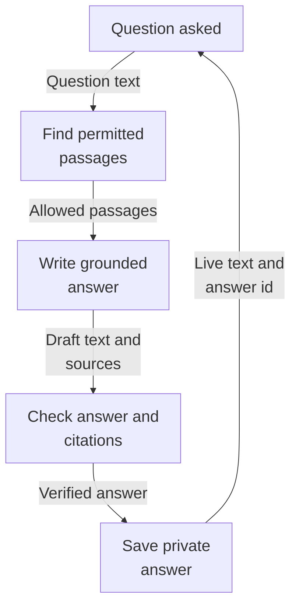
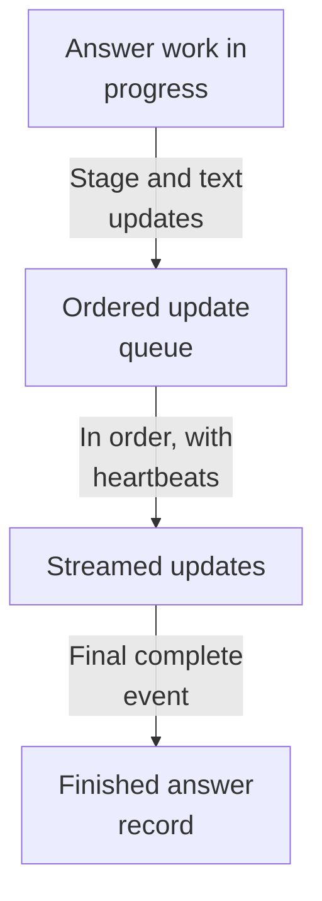
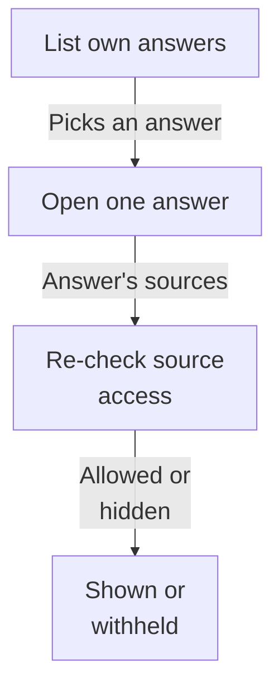
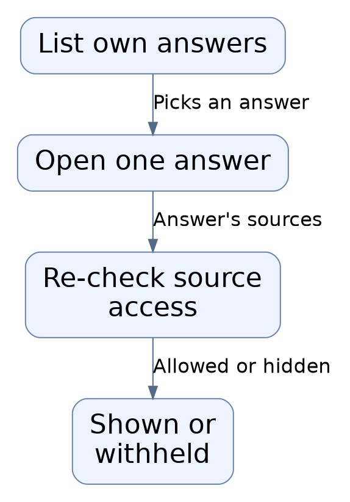
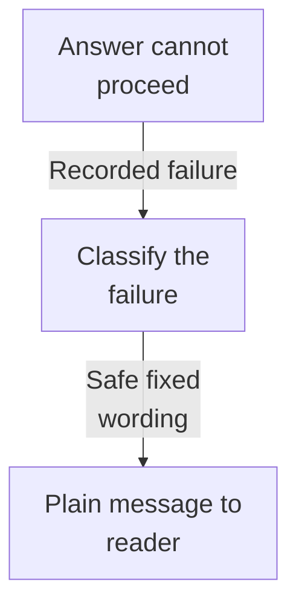
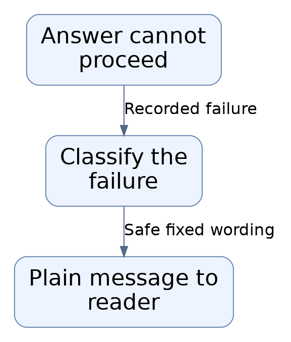

# Repository map

This area answers a person's question using their own authorized documents, streaming the answer back live so text appears as it is written. Every claim is checked against the cited passages, and unusable or unverifiable answers are replaced with clear messages instead of invented text. Completed answers are saved privately per user and re-checked on later viewing, so withdrawn source access hides the old answer.

Commit: `e4abb88a149b365c2838b0f2f0606dff0127b1ab` | Generated: 2026-10-22T15:17:36.966572+00:00

[Open PDF](repository-map.pdf)

**AI-generated analysis. Source references are checked for existence and supplied scope; this does not prove semantic correctness.**

## Scope

Tracked, eligible text only; bounded excerpts, not exhaustive.

16/16 eligible files analyzed; 244 tracked files excluded by policy.

8 API calls. See coverage.json for budgets, exclusions, and usage.

## How a question becomes a saved answer

Someone asks a question; the system finds their permitted passages, the model writes a checked answer streamed live, and the finished answer is saved for that person.

PNG fallback

Read from top to bottom; arrows show what happens next or what is passed along.

### Source evidence

- **F0007**: The streaming endpoint POST /v1/workspaces/{workspace_id}/answers/stream accepts a question (1..4096 chars, whitespace-stripped, extra fields forbidden) and optional collection_id, resolves an authorized scope, and returns a text/event-stream response. (<a href="https://github.com/Justin-Mendoza/Afterclass/blob/e4abb88a149b365c2838b0f2f0606dff0127b1ab/backend/src/hybrid_rag_search/answer_stream.py#L1-L220">backend/src/hybrid_rag_search/answer_stream.py:1-220</a>)
- **F0082**: Questions are validated: blank strings and strings of length 4097 are rejected with ValueError mentioning 'Question', and the generation request sets max_output_tokens=512 with a system message stating evidence is untrusted (contains 'untrusted'). (<a href="https://github.com/Justin-Mendoza/Afterclass/blob/e4abb88a149b365c2838b0f2f0606dff0127b1ab/backend/tests/test_answers.py#L1-L256">backend/tests/test_answers.py:1-256</a>)
- **F0017**: AnswerService orchestrates the answer flow: its prepare() validates the question (rejecting blank or over 4096 characters), calls the evidence retriever's search with mode 'hybrid_rerank', converts returned chunks into AnswerEvidence records, and selects a token-budgeted subset; answer() then builds a generation request and validate_answer() checks the model's output. It is the main entry point that ties retrieval to generation. (<a href="https://github.com/Justin-Mendoza/Afterclass/blob/e4abb88a149b365c2838b0f2f0606dff0127b1ab/backend/src/hybrid_rag_search/answers.py#L1-L348">backend/src/hybrid_rag_search/answers.py:1-348</a>)
- **F0018**: select_evidence() enforces authorization boundaries: it raises ValueError('evidence_scope_violation') if a candidate's tenant_id differs from the scope, its collection is not in scope.collection_ids, or its document is in scope.excluded_document_ids; it also rejects ambiguous duplicate chunk IDs and empty text. This is a hard per-answer authorization gate on evidence, not just filtering. (<a href="https://github.com/Justin-Mendoza/Afterclass/blob/e4abb88a149b365c2838b0f2f0606dff0127b1ab/backend/src/hybrid_rag_search/answers.py#L1-L348">backend/src/hybrid_rag_search/answers.py:1-348</a>)
- **F0020**: The grounding system prompt (GROUNDING_PROMPT, version 'grounded-answer-v1') instructs the model to answer only from supplied documents, treat documents as untrusted evidence rather than instructions, begin with a STATUS line of answered/partial/insufficient_evidence, cite every material claim, and describe conflicting evidence instead of silently choosing. AnswerEvidence text is passed as GenerationDocument content, so document content enters the prompt as data. (<a href="https://github.com/Justin-Mendoza/Afterclass/blob/e4abb88a149b365c2838b0f2f0606dff0127b1ab/backend/src/hybrid_rag_search/answers.py#L1-L348">backend/src/hybrid_rag_search/answers.py:1-348</a>)
- **F0023**: The stream() method yields staged progress (AnswerProgress 'retrieving', then 'generating', then 'validating') and, once it sees a complete first line matching the STATUS pattern, streams AnswerDraft text deltas to the caller; it suppresses draft text while status is insufficient_evidence. It buffers the initial prefix (up to ~100 chars before a newline) to detect the status line before emitting content. (<a href="https://github.com/Justin-Mendoza/Afterclass/blob/e4abb88a149b365c2838b0f2f0606dff0127b1ab/backend/src/hybrid_rag_search/answers.py#L1-L348">backend/src/hybrid_rag_search/answers.py:1-348</a>)
- **F0021**: validate_answer() checks syntax and provenance rather than semantic truth: it requires a leading STATUS line, non-empty answer text, integer citation offsets that map back to matching substrings within the answer (after the status prefix), and source_ids that all appear in the selected evidence chunk IDs. Any violation returns outcome 'failed' with a specific error_code such as invalid_answer_status, empty_answer, invalid_citation, or missing_citations. (<a href="https://github.com/Justin-Mendoza/Afterclass/blob/e4abb88a149b365c2838b0f2f0606dff0127b1ab/backend/src/hybrid_rag_search/answers.py#L1-L348">backend/src/hybrid_rag_search/answers.py:1-348</a>)
- **F0022**: For the insufficient_evidence status, the code discards the model's prose and substitutes a fixed abstention string 'The supplied evidence is insufficient to answer this question.', preventing arbitrary provider text from being published under an abstention label. An answered/partial result with no citations is treated as failed (missing_citations), and a MAX_TOKENS finish reason appends a cut-short notice and downgrades the outcome to 'partial'. (<a href="https://github.com/Justin-Mendoza/Afterclass/blob/e4abb88a149b365c2838b0f2f0606dff0127b1ab/backend/src/hybrid_rag_search/answers.py#L1-L348">backend/src/hybrid_rag_search/answers.py:1-348</a>)
- **F0074**: The transport persists the final result through AnswerHistory.save into the caller's session row, and stores the terminal result without hidden drafts (draft text asserted absent from the saved row). Saved records include an answer_id used in the terminal event. (<a href="https://github.com/Justin-Mendoza/Afterclass/blob/e4abb88a149b365c2838b0f2f0606dff0127b1ab/backend/tests/test_answer_stream.py#L1-L467">backend/tests/test_answer_stream.py:1-467</a>)
- **F0029**: SavedAnswer (table 'saved_answers') persists author-owned answer history: tenant_id, author_user_id, question text, a JSONB 'result' object, and a server-default created_at. Constraints enforce question length 1–4096, that result is a JSON object, and a composite foreign key (tenant_id, author_user_id) to memberships with CASCADE delete, plus a history index on (tenant_id, author_user_id, created_at, id). (<a href="https://github.com/Justin-Mendoza/Afterclass/blob/e4abb88a149b365c2838b0f2f0606dff0127b1ab/backend/src/hybrid_rag_search/models/answers.py#L1-L33">backend/src/hybrid_rag_search/models/answers.py:1-33</a>)
- **F0019**: Evidence selection preserves ranking order and never truncates source text: it walks candidates in order, skips whole chunks that exceed the remaining token budget, counts tokens via a tokenizer, and stops after max_chunks. Token counting is described as a local/offline estimate, not the generation provider's billing. (<a href="https://github.com/Justin-Mendoza/Afterclass/blob/e4abb88a149b365c2838b0f2f0606dff0127b1ab/backend/src/hybrid_rag_search/answers.py#L1-L348">backend/src/hybrid_rag_search/answers.py:1-348</a>)
- **F0072**: The answer_stream transport module builds a Server-Sent-Events response: transport.answer_events is an async generator yielding SSE frames with ordered 'data: ' JSON payloads and monotonic 'id: N' frame headers, and a keepalive comment ': keepalive' frame while waiting for the first event. (<a href="https://github.com/Justin-Mendoza/Afterclass/blob/e4abb88a149b365c2838b0f2f0606dff0127b1ab/backend/tests/test_answer_stream.py#L1-L467">backend/tests/test_answer_stream.py:1-467</a>)
- **F0073**: Event ordering in the SSE stream is progress, content, progress, citations, complete: progress events surround draft content, and the terminal 'complete' event embeds the final result including configuration timings such as first_content_ms and the persisted answer identifier. (<a href="https://github.com/Justin-Mendoza/Afterclass/blob/e4abb88a149b365c2838b0f2f0606dff0127b1ab/backend/tests/test_answer_stream.py#L1-L467">backend/tests/test_answer_stream.py:1-467</a>)

## How a live answer reaches the reader

While the model writes, small updates flow to the reader in order, ending with one complete record that names the saved answer.

PNG fallback

Read from top to bottom; arrows show what happens next or what is passed along.

### Source evidence

- **F0013**: The streaming answer service is obtained via configured_answer_service(settings) inside an async context manager, and streamed updates are classified as AnswerProgress (progress stage) or AnswerDraft (content text); a terminal AnswerResult is required or a ValueError('Missing terminal answer result') is raised. (<a href="https://github.com/Justin-Mendoza/Afterclass/blob/e4abb88a149b365c2838b0f2f0606dff0127b1ab/backend/src/hybrid_rag_search/answer_stream.py#L1-L220">backend/src/hybrid_rag_search/answer_stream.py:1-220</a>)
- **F0011**: The producer uses a bounded asyncio queue (maxsize 16) so provider work stays request-owned, and the consumer emits ': keepalive\n\n' heartbeats every 1.0s when no event is available. (<a href="https://github.com/Justin-Mendoza/Afterclass/blob/e4abb88a149b365c2838b0f2f0606dff0127b1ab/backend/src/hybrid_rag_search/answer_stream.py#L1-L220">backend/src/hybrid_rag_search/answer_stream.py:1-220</a>)
- **F0008**: The stream emits ordered SSE frames typed progress, content, citations, complete, error, each with a monotonically increasing sequence id; payloads are JSON-encoded with non-ASCII preserved. (<a href="https://github.com/Justin-Mendoza/Afterclass/blob/e4abb88a149b365c2838b0f2f0606dff0127b1ab/backend/src/hybrid_rag_search/answer_stream.py#L1-L220">backend/src/hybrid_rag_search/answer_stream.py:1-220</a>)
- **F0072**: The answer_stream transport module builds a Server-Sent-Events response: transport.answer_events is an async generator yielding SSE frames with ordered 'data: ' JSON payloads and monotonic 'id: N' frame headers, and a keepalive comment ': keepalive' frame while waiting for the first event. (<a href="https://github.com/Justin-Mendoza/Afterclass/blob/e4abb88a149b365c2838b0f2f0606dff0127b1ab/backend/tests/test_answer_stream.py#L1-L467">backend/tests/test_answer_stream.py:1-467</a>)
- **F0073**: Event ordering in the SSE stream is progress, content, progress, citations, complete: progress events surround draft content, and the terminal 'complete' event embeds the final result including configuration timings such as first_content_ms and the persisted answer identifier. (<a href="https://github.com/Justin-Mendoza/Afterclass/blob/e4abb88a149b365c2838b0f2f0606dff0127b1ab/backend/tests/test_answer_stream.py#L1-L467">backend/tests/test_answer_stream.py:1-467</a>)
- **F0074**: The transport persists the final result through AnswerHistory.save into the caller's session row, and stores the terminal result without hidden drafts (draft text asserted absent from the saved row). Saved records include an answer_id used in the terminal event. (<a href="https://github.com/Justin-Mendoza/Afterclass/blob/e4abb88a149b365c2838b0f2f0606dff0127b1ab/backend/tests/test_answer_stream.py#L1-L467">backend/tests/test_answer_stream.py:1-467</a>)

## Viewing saved answers later

A person lists their own past answers and opens one; access to the original passages is re-checked each time, so withdrawn sources hide the answer text.

PNG fallback

Read from top to bottom; arrows show what happens next or what is passed along.

### Source evidence

- **F0002**: A GET endpoint lists answer history for a workspace, returning up to 100 items per page (limit default 50, offset default 0) as summaries; the list service re-authorizes the caller via policy.scope before querying. (<a href="https://github.com/Justin-Mendoza/Afterclass/blob/e4abb88a149b365c2838b0f2f0606dff0127b1ab/backend/src/hybrid_rag_search/answer_api.py#L1-L44">backend/src/hybrid_rag_search/answer_api.py:1-44</a>, <a href="https://github.com/Justin-Mendoza/Afterclass/blob/e4abb88a149b365c2838b0f2f0606dff0127b1ab/backend/src/hybrid_rag_search/answer_history.py#L1-L115">backend/src/hybrid_rag_search/answer_history.py:1-115</a>)
- **F0050**: Saved answers are private per author: listing returns only the requesting user's rows in newest-first order (second question before first), and other members of the same workspace (owner DEMO_USER_ID, admin HR_USER_ID) see an empty list and a 404 for another user's answer. S0009 lines 120-134. This is the isolation boundary enforced on history endpoints. (<a href="https://github.com/Justin-Mendoza/Afterclass/blob/e4abb88a149b365c2838b0f2f0606dff0127b1ab/backend/tests/test_answer_history_integration.py#L1-L172">backend/tests/test_answer_history_integration.py:1-172</a>)
- **F0003**: A GET endpoint retrieves one saved answer by answer_id within a workspace; if no row matches id/tenant/author it raises AccessDenied with HTTP 404 ('Answer not found'). (<a href="https://github.com/Justin-Mendoza/Afterclass/blob/e4abb88a149b365c2838b0f2f0606dff0127b1ab/backend/src/hybrid_rag_search/answer_api.py#L1-L44">backend/src/hybrid_rag_search/answer_api.py:1-44</a>, <a href="https://github.com/Justin-Mendoza/Afterclass/blob/e4abb88a149b365c2838b0f2f0606dff0127b1ab/backend/src/hybrid_rag_search/answer_history.py#L1-L115">backend/src/hybrid_rag_search/answer_history.py:1-115</a>)
- **F0061**: The AnswerResult object (outcome, text, evidence) is what gets persisted and returned from get; the integration test asserts the detail response's result.text equals the model text and its evidence[0].document_id matches the document UUID. S0008 lines 66, 72-73; S0009 lines 95-97, 126-128. (<a href="https://github.com/Justin-Mendoza/Afterclass/blob/e4abb88a149b365c2838b0f2f0606dff0127b1ab/backend/tests/test_answer_history.py#L1-L100">backend/tests/test_answer_history.py:1-100</a>, <a href="https://github.com/Justin-Mendoza/Afterclass/blob/e4abb88a149b365c2838b0f2f0606dff0127b1ab/backend/tests/test_answer_history_integration.py#L1-L172">backend/tests/test_answer_history_integration.py:1-172</a>)
- **F0005**: On every read (list and get), the service re-checks current document-level access for each piece of evidence (result.evidence document_ids) via policy.document_scope; if any is denied, 'available' is False, and for get the result payload is nulled out ('result if available else None'). (<a href="https://github.com/Justin-Mendoza/Afterclass/blob/e4abb88a149b365c2838b0f2f0606dff0127b1ab/backend/src/hybrid_rag_search/answer_history.py#L1-L115">backend/src/hybrid_rag_search/answer_history.py:1-115</a>)
- **F0051**: Access to a saved answer is re-evaluated at read time against current source permissions. When the author's CollectionGrant is deleted, the answer still exists but is returned with available=false and result=null, and the protected answer text ("Supported portion."/"Protected") and evidence content is withheld from the response body; when the grant is restored, available returns to true. S0008 lines 76-80; S0009 lines 143-162. (<a href="https://github.com/Justin-Mendoza/Afterclass/blob/e4abb88a149b365c2838b0f2f0606dff0127b1ab/backend/tests/test_answer_history.py#L1-L100">backend/tests/test_answer_history.py:1-100</a>, <a href="https://github.com/Justin-Mendoza/Afterclass/blob/e4abb88a149b365c2838b0f2f0606dff0127b1ab/backend/tests/test_answer_history_integration.py#L1-L172">backend/tests/test_answer_history_integration.py:1-172</a>)
- **F0052**: If a referenced document's status changes to "deleting", the saved answer's result is withheld (result null) on read, even though the grant is present. S0009 lines 163-167. (<a href="https://github.com/Justin-Mendoza/Afterclass/blob/e4abb88a149b365c2838b0f2f0606dff0127b1ab/backend/tests/test_answer_history_integration.py#L1-L172">backend/tests/test_answer_history_integration.py:1-172</a>)
- **F0053**: Losing workspace membership changes the error contract: after the author's Membership row is deleted, reading their own saved answer returns HTTP 403 (not 404), i.e. denial is due to lack of any workspace access. S0009 lines 168-170. (<a href="https://github.com/Justin-Mendoza/Afterclass/blob/e4abb88a149b365c2838b0f2f0606dff0127b1ab/backend/tests/test_answer_history_integration.py#L1-L172">backend/tests/test_answer_history_integration.py:1-172</a>)

## When the answer cannot be produced

Missing permitted passages, timeouts, model faults, or unverifiable drafts become one clear message for the reader, never raw internal detail.

PNG fallback

Read from top to bottom; arrows show what happens next or what is passed along.

### Source evidence

- **F0025**: Retrieval or provider errors during prepare() are caught (RetrievalError, ProviderError) and returned as a failed AnswerResult carrying the error's code plus the run configuration, so failures surface as a structured result rather than an exception to the caller of answer()/stream(). (<a href="https://github.com/Justin-Mendoza/Afterclass/blob/e4abb88a149b365c2838b0f2f0606dff0127b1ab/backend/src/hybrid_rag_search/answers.py#L1-L348">backend/src/hybrid_rag_search/answers.py:1-348</a>)
- **F0070**: AnswerService abstains rather than generating when retrieval returns no chunks: the terminal outcome is 'insufficient_evidence'. When the model itself returns status 'insufficient_evidence', no AnswerDraft is emitted and the terminal text is a fixed insufficient-evidence message. (<a href="https://github.com/Justin-Mendoza/Afterclass/blob/e4abb88a149b365c2838b0f2f0606dff0127b1ab/backend/tests/test_answer_stream.py#L1-L467">backend/tests/test_answer_stream.py:1-467</a>)
- **F0010**: Stream errors are mapped to a closed set of codes with fixed messages: request_timeout, database_unavailable, and verification failures (invalid_citation, missing_citations, invalid_answer_status, empty_answer); generic and provider exceptions fall back to answer_failed/answer_unavailable, and comment states provider exceptions, source text, and internal paths are never sent to clients. (<a href="https://github.com/Justin-Mendoza/Afterclass/blob/e4abb88a149b365c2838b0f2f0606dff0127b1ab/backend/src/hybrid_rag_search/answer_stream.py#L1-L220">backend/src/hybrid_rag_search/answer_stream.py:1-220</a>)
- **F0075**: Transport failures map to safe terminal error events with an answer_id when persisted and no answer_id when the database write fails: AnswerResult error_code invalid_citation propagates, ValueError/OSError-&gt;answer_unavailable, RuntimeError-&gt;answer_failed, no terminal result or an idle producer -&gt; answer_unavailable, an elapsed answer_request_timeout_seconds-&gt;request_timeout, and SQLAlchemyError or TimeoutError during save-&gt;database_unavailable. Raw error strings are asserted absent from emitted JSON. (<a href="https://github.com/Justin-Mendoza/Afterclass/blob/e4abb88a149b365c2838b0f2f0606dff0127b1ab/backend/tests/test_answer_stream.py#L1-L467">backend/tests/test_answer_stream.py:1-467</a>)
- **F0079**: transport.error_message maps internal error codes to user-facing messages, e.g. 'missing_citations' begins 'The answer could not be verified' and 'database_unavailable' begins 'The answer could not be saved'. This function is the user-facing text boundary for failures. (<a href="https://github.com/Justin-Mendoza/Afterclass/blob/e4abb88a149b365c2838b0f2f0606dff0127b1ab/backend/tests/test_answer_stream.py#L1-L467">backend/tests/test_answer_stream.py:1-467</a>)
- **F0022**: For the insufficient_evidence status, the code discards the model's prose and substitutes a fixed abstention string 'The supplied evidence is insufficient to answer this question.', preventing arbitrary provider text from being published under an abstention label. An answered/partial result with no citations is treated as failed (missing_citations), and a MAX_TOKENS finish reason appends a cut-short notice and downgrades the outcome to 'partial'. (<a href="https://github.com/Justin-Mendoza/Afterclass/blob/e4abb88a149b365c2838b0f2f0606dff0127b1ab/backend/src/hybrid_rag_search/answers.py#L1-L348">backend/src/hybrid_rag_search/answers.py:1-348</a>)

## Uncertainties and untraced areas

- Which concrete answer provider (live online service or test stand-in) is chosen at runtime for the history and streaming flows is not evidenced (F0048, F0064, F0112).
- How identity and authorization scopes are actually established is outside these excerpts; the demo user and policy implementations are not shown (F0016).
- How an in-memory answer result from the answer service is written into the saved-answer table is not shown in the service excerpt, though the streaming transport and history service both persist results (F0030, F0074).
- The non-streaming 'answer and save' flow has no HTTP route in the provided excerpts (F0001).
- Exact cancellation handling for newer server gateway interface versions is truncated in the excerpts (F0080).
