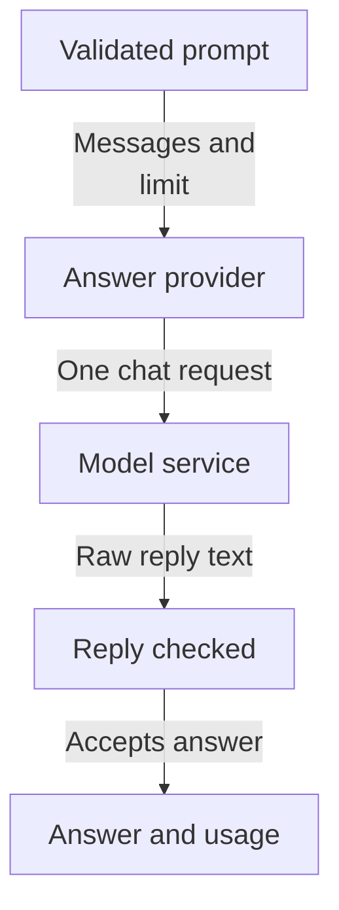
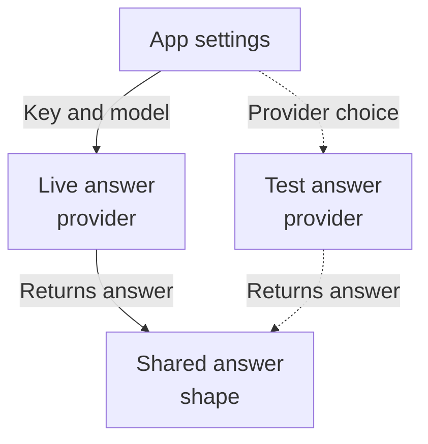
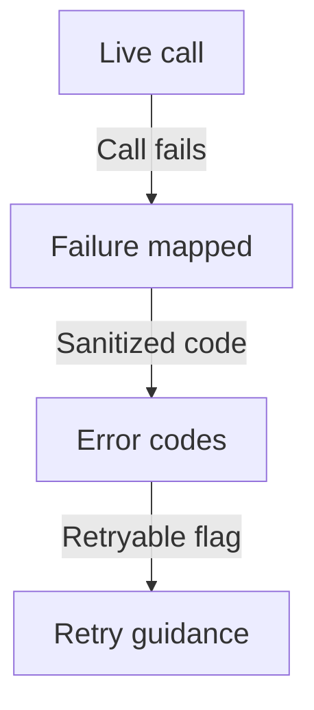

# Repository map

This area defines the app's own contract for asking an AI model to write an answer, plus two implementations: a real Cohere adapter and a fake one used for testing. A caller supplies a validated list of chat messages and a token limit; the result carries the generated text, why it stopped, the model used, and usage/cost details. Live use is opt-in because a configured factory requires an API key. No caller or route choosing an adapter is evidenced.

Commit: `3537e913c1eeec5b5f34d6cbdbf4dc3f8bc74b25` | Generated: 2026-10-19T00:19:50.529485+00:00

[Open PDF](repository-map.pdf)

**AI-generated analysis. Source references are checked for existence and supplied scope; this does not prove semantic correctness.**

## Scope

Tracked, eligible text only; bounded excerpts, not exhaustive.

6/6 eligible files analyzed; 217 tracked files excluded by policy.

3 API calls. See coverage.json for budgets, exclusions, and usage.

## How a prompt becomes an answer

A caller supplies validated chat messages; the answer provider forwards one non-streaming request to the model service, re-checks the reply, and returns answer text with finish reason and usage.

PNG fallback

Read from top to bottom; arrows show what happens next or what is passed along.

### Source evidence

- **F0002**: GenerationRequest carries an ordered, nonempty tuple of GenerationMessage plus max_output_tokens, and validates that at least one message has the USER role and that the token limit is a positive int, so malformed requests fail before any network call. (<a href="https://github.com/Justin-Mendoza/hybrid-rag-search/blob/3537e913c1eeec5b5f34d6cbdbf4dc3f8bc74b25/backend/src/hybrid_rag_search/providers/generation.py#L1-L90">backend/src/hybrid_rag_search/providers/generation.py:1-90</a>)
- **F0003**: GenerationMessage enforces a known MessageRole (system/user/assistant) and nonblank content at construction; invalid roles or empty content raise ValueError. (<a href="https://github.com/Justin-Mendoza/hybrid-rag-search/blob/3537e913c1eeec5b5f34d6cbdbf4dc3f8bc74b25/backend/src/hybrid_rag_search/providers/generation.py#L1-L90">backend/src/hybrid_rag_search/providers/generation.py:1-90</a>)
- **F0001**: The subsystem's central contract is GenerationProvider, a Protocol declaring one async generate(request) -&gt; GenerationResult operation; adapters such as CohereGenerationProvider implement it so callers depend on an app-owned interface rather than a vendor SDK. (<a href="https://github.com/Justin-Mendoza/hybrid-rag-search/blob/3537e913c1eeec5b5f34d6cbdbf4dc3f8bc74b25/backend/src/hybrid_rag_search/providers/generation.py#L1-L90">backend/src/hybrid_rag_search/providers/generation.py:1-90</a>)
- **F0004**: CohereGenerationProvider.generate converts each contract message into Cohere's SystemChatMessageV2/UserChatMessageV2/AssistantChatMessageV2 via _messages, then issues one non-streaming client.chat call with model, max_tokens, temperature, and request_options. (<a href="https://github.com/Justin-Mendoza/hybrid-rag-search/blob/3537e913c1eeec5b5f34d6cbdbf4dc3f8bc74b25/backend/src/hybrid_rag_search/providers/cohere_generation.py#L1-L231">backend/src/hybrid_rag_search/providers/cohere_generation.py:1-231</a>)
- **F0017**: The Cohere generation adapter (CohereGenerationProvider) turns a validated GenerationRequest into a non-streaming Cohere /v2/chat call, sending the given system/user/assistant messages plus max_tokens and temperature, then returns a GenerationResult with concatenated text, finish reason, model, adapter 'cohere', and usage. (<a href="https://github.com/Justin-Mendoza/hybrid-rag-search/blob/3537e913c1eeec5b5f34d6cbdbf4dc3f8bc74b25/backend/tests/test_cohere_generation.py#L1-L314">backend/tests/test_cohere_generation.py:1-314</a>)
- **F0018**: Cohere provider maps provider finish reasons to GenerationFinishReason: COMPLETE and STOP_SEQUENCE become COMPLETE, MAX_TOKENS becomes MAX_TOKENS. (<a href="https://github.com/Justin-Mendoza/hybrid-rag-search/blob/3537e913c1eeec5b5f34d6cbdbf4dc3f8bc74b25/backend/tests/test_cohere_generation.py#L1-L314">backend/tests/test_cohere_generation.py:1-314</a>)
- **F0008**: The Cohere response is re-validated against a strict internal model _ChatResponse (finish_reason as a fixed Literal set, assistant message text parts, and optional token/billed usage) before any result is produced; ValidationError becomes ProviderError('invalid_response'). (<a href="https://github.com/Justin-Mendoza/hybrid-rag-search/blob/3537e913c1eeec5b5f34d6cbdbf4dc3f8bc74b25/backend/src/hybrid_rag_search/providers/cohere_generation.py#L1-L231">backend/src/hybrid_rag_search/providers/cohere_generation.py:1-231</a>)
- **F0010**: On success, generate concatenates all text content parts and rejects empty/whitespace-only output as invalid_response, ensuring GenerationResult.text is meaningful. (<a href="https://github.com/Justin-Mendoza/hybrid-rag-search/blob/3537e913c1eeec5b5f34d6cbdbf4dc3f8bc74b25/backend/src/hybrid_rag_search/providers/cohere_generation.py#L1-L231">backend/src/hybrid_rag_search/providers/cohere_generation.py:1-231</a>)
- **F0011**: GenerationResult is produced with text, finish_reason, model, adapter ('cohere' or 'fake'), and a GenerationUsage carrying reported input/output tokens, separate billed input/output tokens, locally measured latency_ms via perf_counter, and an estimated cost. (<a href="https://github.com/Justin-Mendoza/hybrid-rag-search/blob/3537e913c1eeec5b5f34d6cbdbf4dc3f8bc74b25/backend/src/hybrid_rag_search/providers/cohere_generation.py#L1-L231">backend/src/hybrid_rag_search/providers/cohere_generation.py:1-231</a>, <a href="https://github.com/Justin-Mendoza/hybrid-rag-search/blob/3537e913c1eeec5b5f34d6cbdbf4dc3f8bc74b25/backend/src/hybrid_rag_search/providers/generation.py#L1-L90">backend/src/hybrid_rag_search/providers/generation.py:1-90</a>)
- **F0012**: Estimated generation cost is computed in Decimal as (billed_input * input_rate + billed_output * output_rate) / 1_000_000 from per-million-token rates, and returns None when billed token counts are absent; the rates are also echoed back on the result. (<a href="https://github.com/Justin-Mendoza/hybrid-rag-search/blob/3537e913c1eeec5b5f34d6cbdbf4dc3f8bc74b25/backend/src/hybrid_rag_search/providers/cohere_generation.py#L1-L231">backend/src/hybrid_rag_search/providers/cohere_generation.py:1-231</a>)
- **F0032**: Tests indicate SDK chat calls disable streaming ('stream': False) and authenticate via Bearer token in the Authorization header. (<a href="https://github.com/Justin-Mendoza/hybrid-rag-search/blob/3537e913c1eeec5b5f34d6cbdbf4dc3f8bc74b25/backend/tests/test_cohere_generation.py#L1-L314">backend/tests/test_cohere_generation.py:1-314</a>)

## Choosing a provider and its limits

Two interchangeable providers exist: a live online service gated by an API key, and a deterministic stand-in for testing. Both return the same answer shape. Which one runs is not evidenced.

PNG fallback

Read from top to bottom. Dashed arrows show connections that need confirmation.

### Source evidence

- **F0015**: open_cohere_generation is an async context manager that validates a nonblank API key and yields a configured CohereGenerationProvider, while configured_cohere_generation reads Settings (key, model, timeout, temperature, rates) and raises ValueError when COHERE_API_KEY is absent, so live generation is opt-in. (<a href="https://github.com/Justin-Mendoza/hybrid-rag-search/blob/3537e913c1eeec5b5f34d6cbdbf4dc3f8bc74b25/backend/src/hybrid_rag_search/providers/cohere_generation.py#L1-L231">backend/src/hybrid_rag_search/providers/cohere_generation.py:1-231</a>)
- **F0025**: open_cohere_generation and configured_cohere_generation factories construct the provider; the configured factory reads the API key and model from Settings (COHERE_API_KEY, COHERE_GENERATION_MODEL) and supplies baseline per-million token rates, and both manage the underlying AsyncClientV2 lifetime as an async context manager that is closed on exit. (<a href="https://github.com/Justin-Mendoza/hybrid-rag-search/blob/3537e913c1eeec5b5f34d6cbdbf4dc3f8bc74b25/backend/tests/test_cohere_generation.py#L1-L314">backend/tests/test_cohere_generation.py:1-314</a>)
- **F0004**: CohereGenerationProvider.generate converts each contract message into Cohere's SystemChatMessageV2/UserChatMessageV2/AssistantChatMessageV2 via _messages, then issues one non-streaming client.chat call with model, max_tokens, temperature, and request_options. (<a href="https://github.com/Justin-Mendoza/hybrid-rag-search/blob/3537e913c1eeec5b5f34d6cbdbf4dc3f8bc74b25/backend/src/hybrid_rag_search/providers/cohere_generation.py#L1-L231">backend/src/hybrid_rag_search/providers/cohere_generation.py:1-231</a>)
- **F0014**: CohereGenerationProvider does not create or close its client: the injected cohere.AsyncClientV2 owns its own lifetime and the factory context managers are responsible for opening it. (<a href="https://github.com/Justin-Mendoza/hybrid-rag-search/blob/3537e913c1eeec5b5f34d6cbdbf4dc3f8bc74b25/backend/src/hybrid_rag_search/providers/cohere_generation.py#L1-L231">backend/src/hybrid_rag_search/providers/cohere_generation.py:1-231</a>)
- **F0028**: FakeGenerationProvider is a deterministic, repeatable implementation of GenerationProvider: identical requests yield identical results, response text starts with 'Synthetic response ' and excludes prompt/private content, finish reason is COMPLETE, model 'fake-generation-v1', adapter 'fake', with billed tokens and cost zero and input/output tokens and latency unset. (<a href="https://github.com/Justin-Mendoza/hybrid-rag-search/blob/3537e913c1eeec5b5f34d6cbdbf4dc3f8bc74b25/backend/tests/test_generation.py#L1-L102">backend/tests/test_generation.py:1-102</a>)
- **F0029**: FakeGenerationProvider varies its response text when the user message content or max_output_tokens changes, producing distinct outputs for distinct requests. (<a href="https://github.com/Justin-Mendoza/hybrid-rag-search/blob/3537e913c1eeec5b5f34d6cbdbf4dc3f8bc74b25/backend/tests/test_generation.py#L1-L102">backend/tests/test_generation.py:1-102</a>)
- **F0027**: The generation contract defines validating dataclasses: GenerationMessage enforces a known role and non-empty content; GenerationRequest requires a nonempty tuple of messages including at least one user message and a positive integer max_tokens; GenerationResult requires non-empty text, known finish reason, non-empty model, and finite usage. (<a href="https://github.com/Justin-Mendoza/hybrid-rag-search/blob/3537e913c1eeec5b5f34d6cbdbf4dc3f8bc74b25/backend/tests/test_generation.py#L1-L102">backend/tests/test_generation.py:1-102</a>)
- **F0011**: GenerationResult is produced with text, finish_reason, model, adapter ('cohere' or 'fake'), and a GenerationUsage carrying reported input/output tokens, separate billed input/output tokens, locally measured latency_ms via perf_counter, and an estimated cost. (<a href="https://github.com/Justin-Mendoza/hybrid-rag-search/blob/3537e913c1eeec5b5f34d6cbdbf4dc3f8bc74b25/backend/src/hybrid_rag_search/providers/cohere_generation.py#L1-L231">backend/src/hybrid_rag_search/providers/cohere_generation.py:1-231</a>, <a href="https://github.com/Justin-Mendoza/hybrid-rag-search/blob/3537e913c1eeec5b5f34d6cbdbf4dc3f8bc74b25/backend/src/hybrid_rag_search/providers/generation.py#L1-L90">backend/src/hybrid_rag_search/providers/generation.py:1-90</a>)
- **F0001**: The subsystem's central contract is GenerationProvider, a Protocol declaring one async generate(request) -&gt; GenerationResult operation; adapters such as CohereGenerationProvider implement it so callers depend on an app-owned interface rather than a vendor SDK. (<a href="https://github.com/Justin-Mendoza/hybrid-rag-search/blob/3537e913c1eeec5b5f34d6cbdbf4dc3f8bc74b25/backend/src/hybrid_rag_search/providers/generation.py#L1-L90">backend/src/hybrid_rag_search/providers/generation.py:1-90</a>)
- **F0030** (inferred): GenerationRequest and its messages are supplied by the caller of GenerationProvider.generate; no orchestrator, HTTP route, or CLI selecting between the fake and Cohere adapters is evidenced in these excerpts, so the runtime wiring that chooses an adapter is unknown. (<a href="https://github.com/Justin-Mendoza/hybrid-rag-search/blob/3537e913c1eeec5b5f34d6cbdbf4dc3f8bc74b25/backend/tests/test_cohere_generation.py#L1-L314">backend/tests/test_cohere_generation.py:1-314</a>, <a href="https://github.com/Justin-Mendoza/hybrid-rag-search/blob/3537e913c1eeec5b5f34d6cbdbf4dc3f8bc74b25/backend/tests/test_generation.py#L1-L102">backend/tests/test_generation.py:1-102</a>)

## When the model service fails

Failures from the online service are turned into one closed set of error codes with retry guidance, and messages never include the provider's raw reply body or headers.

PNG fallback

Read from top to bottom; arrows show what happens next or what is passed along.

### Source evidence

- **F0005**: Each generate call applies a hard wall-clock bound using asyncio.timeout(self.timeout_seconds) and disables SDK retries by setting max_retries=0 in RequestOptions, so retry/backoff behavior is not delegated to the Cohere SDK. (<a href="https://github.com/Justin-Mendoza/hybrid-rag-search/blob/3537e913c1eeec5b5f34d6cbdbf4dc3f8bc74b25/backend/src/hybrid_rag_search/providers/cohere_generation.py#L1-L231">backend/src/hybrid_rag_search/providers/cohere_generation.py:1-231</a>)
- **F0024**: The Cohere provider enforces a total timeout (timeout_seconds) around the chat call, and caller-side asyncio cancellation propagates as asyncio.CancelledError rather than being converted to a ProviderError. (<a href="https://github.com/Justin-Mendoza/hybrid-rag-search/blob/3537e913c1eeec5b5f34d6cbdbf4dc3f8bc74b25/backend/tests/test_cohere_generation.py#L1-L314">backend/tests/test_cohere_generation.py:1-314</a>)
- **F0006**: SDK and transport failures are mapped to sanitized ProviderError codes and retryability: TimeoutError/httpx.TimeoutException -&gt; timeout(retryable), httpx.TransportError -&gt; unavailable(retryable), 401/403/498 -&gt; authentication, 429 -&gt; rate_limited(retryable), &gt;=500 -&gt; unavailable(retryable), other ApiError -&gt; invalid_request, ValueError/TypeError -&gt; invalid_response. (<a href="https://github.com/Justin-Mendoza/hybrid-rag-search/blob/3537e913c1eeec5b5f34d6cbdbf4dc3f8bc74b25/backend/src/hybrid_rag_search/providers/cohere_generation.py#L1-L231">backend/src/hybrid_rag_search/providers/cohere_generation.py:1-231</a>)
- **F0020**: HTTP error statuses from Cohere are sanitized into ProviderError without leaking provider detail: 400 invalid_request, 401/403/498 authentication, 429 rate_limited (retryable), 500/503 unavailable (retryable); each attempt makes exactly one HTTP call (no retries), and the ProviderError suppresses the original exception context. (<a href="https://github.com/Justin-Mendoza/hybrid-rag-search/blob/3537e913c1eeec5b5f34d6cbdbf4dc3f8bc74b25/backend/tests/test_cohere_generation.py#L1-L314">backend/tests/test_cohere_generation.py:1-314</a>)
- **F0007**: ProviderError carries only a stable code from a closed Literal set (timeout, unavailable, authentication, rate_limited, invalid_request, invalid_response) plus a retryable flag, and its message intentionally excludes provider response bodies or headers. (<a href="https://github.com/Justin-Mendoza/hybrid-rag-search/blob/3537e913c1eeec5b5f34d6cbdbf4dc3f8bc74b25/backend/src/hybrid_rag_search/providers/errors.py#L1-L19">backend/src/hybrid_rag_search/providers/errors.py:1-19</a>)
- **F0019**: Non-text provider finish reasons (TIMEOUT, ERROR, TOOL_CALL) are raised as ProviderError with codes timeout (retryable) and unavailable (retryable), while TOOL_CALL maps to invalid_response (non-retryable). (<a href="https://github.com/Justin-Mendoza/hybrid-rag-search/blob/3537e913c1eeec5b5f34d6cbdbf4dc3f8bc74b25/backend/tests/test_cohere_generation.py#L1-L314">backend/tests/test_cohere_generation.py:1-314</a>)

## Uncertainties and untraced areas

- No caller, command-line entry point, or web route selecting between the live and test answer providers is evidenced, so runtime wiring is unknown (F0030).
- Which component opens and closes the underlying network client outside the factory helpers is not evidenced (F0014, F0025).
- How downstream code uses the returned cost estimate, latency, or finish reason is not shown (F0011, F0012).
- Whether these answer providers are connected to the retrieval or evaluation flows elsewhere in the application is not evidenced.
