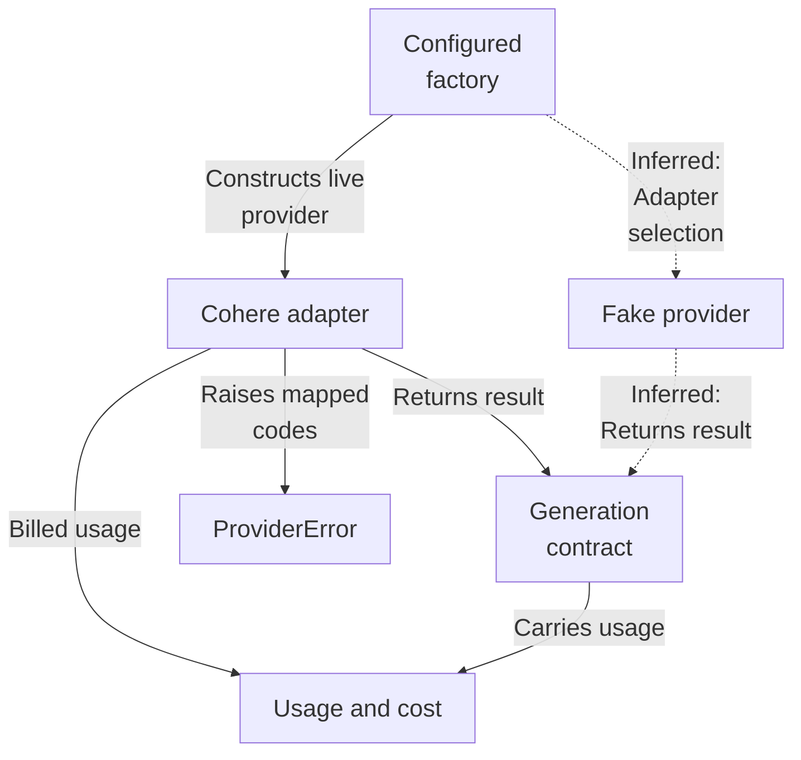
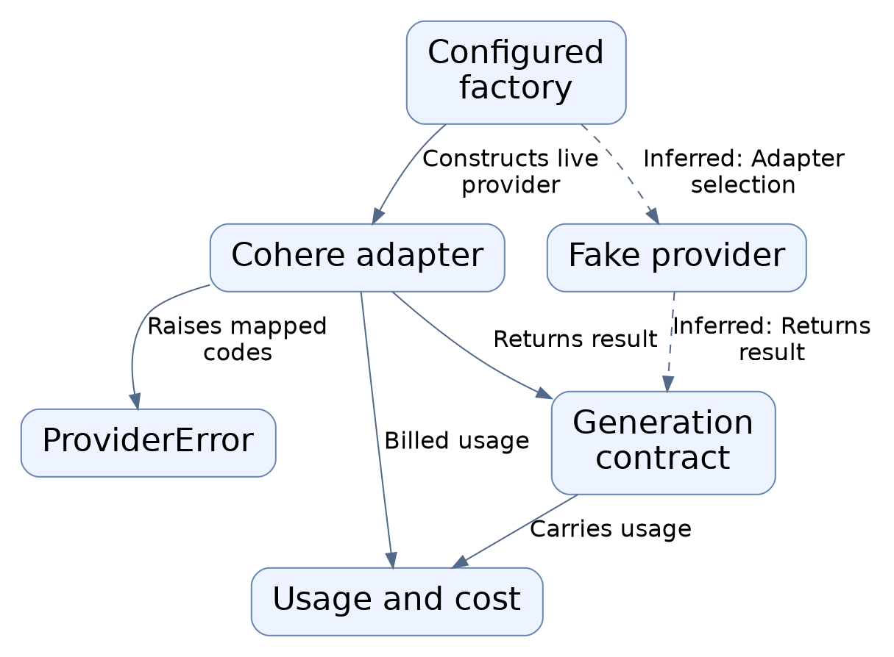
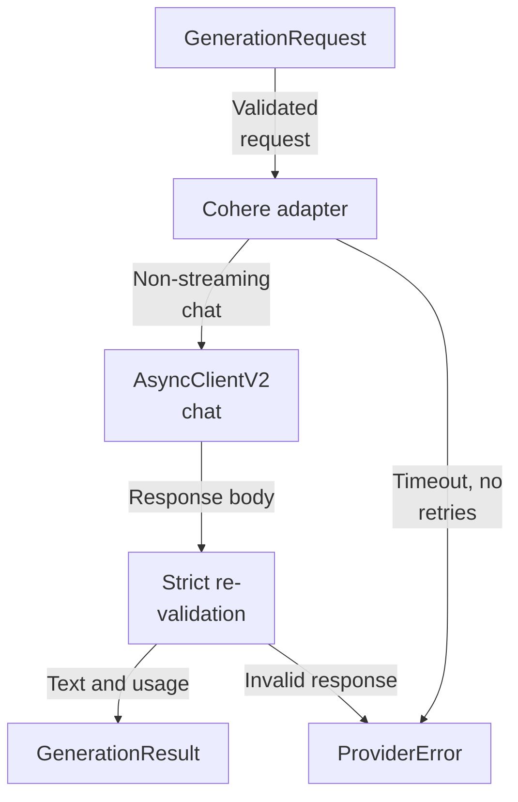
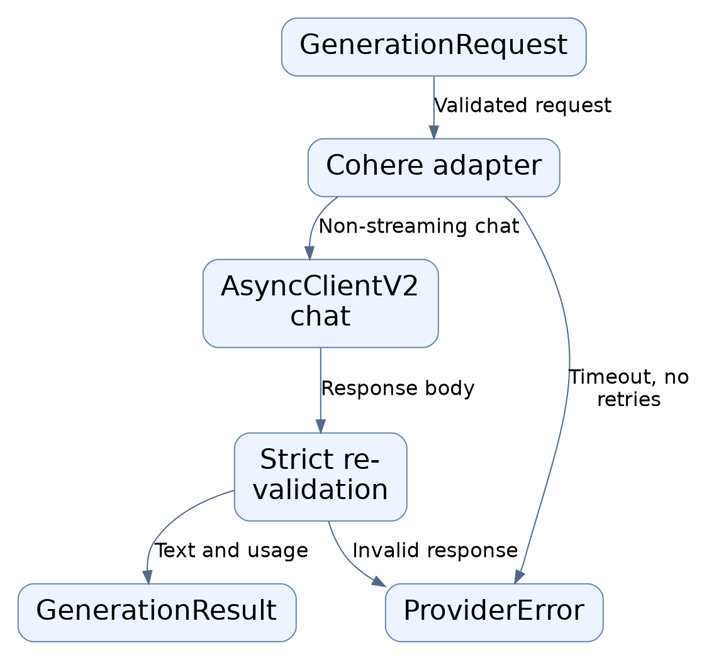

# Repository map

The answers subsystem defines application-owned async provider contracts for generation, embeddings, and reranking, with validating dataclasses and a code-carrying ProviderError that sanitizes SDK failures. A Cohere generation adapter and a deterministic fake provider both implement the shared GenerationProvider protocol, returning GenerationResult with distinct reported and billed usage plus locally measured latency. No orchestration or caller wiring selecting between adapters is evidenced.

Commit: `f8493c1d264c525948d9d33ffaf2dd197be97e26` | Generated: 2026-10-18T18:31:57.000660+00:00

[Open PDF](repository-map.pdf)

**AI-generated analysis. Source references are checked for existence and supplied scope; this does not prove semantic correctness.**

## Scope

Tracked, eligible text only; bounded excerpts, not exhaustive.

6/6 eligible files analyzed; 217 tracked files excluded by policy.

3 API calls. See coverage.json for budgets, exclusions, and usage.

## Architecture

Application-owned protocols define the boundary; the opt-in Cohere adapter and the deterministic fake both implement GenerationProvider. The configured factory gates live generation on credentials, but caller wiring is not evidenced.

PNG fallback

### Source evidence

- **F0014**: open_cohere_generation and configured_cohere_generation are async context managers that yield a CohereGenerationProvider; the injected cohere.AsyncClientV2 owns its own lifetime per the class docstring, and configured_cohere_generation reads api key, model, timeout, temperature, and rates from Settings and is described as an opt-in live generator. (<a href="https://github.com/Justin-Mendoza/hybrid-rag-search/blob/f8493c1d264c525948d9d33ffaf2dd197be97e26/backend/src/hybrid_rag_search/providers/cohere_generation.py#L1-L231">backend/src/hybrid_rag_search/providers/cohere_generation.py:1-231</a>)
- **F0015**: configured_cohere_generation raises ValueError when settings.cohere_api_key is None, and open_cohere_generation raises ValueError on a blank API key, so live generation is gated on explicit credentials. (<a href="https://github.com/Justin-Mendoza/hybrid-rag-search/blob/f8493c1d264c525948d9d33ffaf2dd197be97e26/backend/src/hybrid_rag_search/providers/cohere_generation.py#L1-L231">backend/src/hybrid_rag_search/providers/cohere_generation.py:1-231</a>)
- **F0026**: open_cohere_generation and configured_cohere_generation are async context managers that own an AsyncClientV2 lifecycle (closing it on exit) and reject blank or missing API keys; configured_cohere_generation reads COHERE_API_KEY and COHERE_GENERATION_MODEL from Settings and applies baseline rates. (<a href="https://github.com/Justin-Mendoza/hybrid-rag-search/blob/f8493c1d264c525948d9d33ffaf2dd197be97e26/backend/tests/test_cohere_generation.py#L1-L314">backend/tests/test_cohere_generation.py:1-314</a>)
- **F0001**: CohereGenerationProvider is a non-streaming adapter that implements the GenerationProvider protocol: generate() accepts a GenerationRequest and returns a GenerationResult. (<a href="https://github.com/Justin-Mendoza/hybrid-rag-search/blob/f8493c1d264c525948d9d33ffaf2dd197be97e26/backend/src/hybrid_rag_search/providers/cohere_generation.py#L1-L231">backend/src/hybrid_rag_search/providers/cohere_generation.py:1-231</a>, <a href="https://github.com/Justin-Mendoza/hybrid-rag-search/blob/f8493c1d264c525948d9d33ffaf2dd197be97e26/backend/src/hybrid_rag_search/providers/generation.py#L1-L90">backend/src/hybrid_rag_search/providers/generation.py:1-90</a>)
- **F0004**: CohereGenerationProvider._messages maps application MessageRole values (SYSTEM, USER, else ASSISTANT) onto Cohere SDK message types (SystemChatMessageV2, UserChatMessageV2, AssistantChatMessageV2). (<a href="https://github.com/Justin-Mendoza/hybrid-rag-search/blob/f8493c1d264c525948d9d33ffaf2dd197be97e26/backend/src/hybrid_rag_search/providers/cohere_generation.py#L1-L231">backend/src/hybrid_rag_search/providers/cohere_generation.py:1-231</a>, <a href="https://github.com/Justin-Mendoza/hybrid-rag-search/blob/f8493c1d264c525948d9d33ffaf2dd197be97e26/backend/src/hybrid_rag_search/providers/generation.py#L1-L90">backend/src/hybrid_rag_search/providers/generation.py:1-90</a>)
- **F0008**: Cohere responses are re-validated against a strict internal pydantic model _ChatResponse (via response.model_dump then model_validate), and null/blank text, ValidationError, TOOL_CALL, TIMEOUT, or ERROR finish reasons are converted to ProviderError codes rather than returned. (<a href="https://github.com/Justin-Mendoza/hybrid-rag-search/blob/f8493c1d264c525948d9d33ffaf2dd197be97e26/backend/src/hybrid_rag_search/providers/cohere_generation.py#L1-L231">backend/src/hybrid_rag_search/providers/cohere_generation.py:1-231</a>)
- **F0029**: FakeGenerationProvider implements GenerationProvider deterministically: identical requests yield identical results, results vary with changed prompt content or max_tokens, report model 'fake-generation-v1'/adapter 'fake', zero billed tokens and cost, and null input/output tokens and latency, and never echo prompt text. (<a href="https://github.com/Justin-Mendoza/hybrid-rag-search/blob/f8493c1d264c525948d9d33ffaf2dd197be97e26/backend/tests/test_generation.py#L1-L102">backend/tests/test_generation.py:1-102</a>)
- **F0030** (inferred): Both the Cohere adapter and the fake provider conform to the shared GenerationProvider contract returning GenerationResult with an adapter field ('cohere' vs 'fake'), so callers can swap implementations. (<a href="https://github.com/Justin-Mendoza/hybrid-rag-search/blob/f8493c1d264c525948d9d33ffaf2dd197be97e26/backend/tests/test_cohere_generation.py#L1-L314">backend/tests/test_cohere_generation.py:1-314</a>, <a href="https://github.com/Justin-Mendoza/hybrid-rag-search/blob/f8493c1d264c525948d9d33ffaf2dd197be97e26/backend/tests/test_generation.py#L1-L102">backend/tests/test_generation.py:1-102</a>)
- **F0002**: The generation contract is application-owned and independent of the Cohere SDK: GenerationRequest, GenerationResult, GenerationUsage, MessageRole, and GenerationFinishReason are defined in providers/generation.py, and GenerationProvider is a Protocol with a single async generate() method. (<a href="https://github.com/Justin-Mendoza/hybrid-rag-search/blob/f8493c1d264c525948d9d33ffaf2dd197be97e26/backend/src/hybrid_rag_search/providers/generation.py#L1-L90">backend/src/hybrid_rag_search/providers/generation.py:1-90</a>)
- **F0027**: GenerationMessage validates that role is a MessageRole and content is non-blank; GenerationRequest requires a non-empty tuple of GenerationMessage, rejects leading system-only or malformed entries, and requires a positive integer max_tokens (bool rejected). (<a href="https://github.com/Justin-Mendoza/hybrid-rag-search/blob/f8493c1d264c525948d9d33ffaf2dd197be97e26/backend/tests/test_generation.py#L1-L102">backend/tests/test_generation.py:1-102</a>)
- **F0028**: GenerationResult validates non-empty text, a known GenerationFinishReason, non-empty model, plus non-negative usage fields; GenerationUsage rejects negative token counts and non-finite latency. (<a href="https://github.com/Justin-Mendoza/hybrid-rag-search/blob/f8493c1d264c525948d9d33ffaf2dd197be97e26/backend/tests/test_generation.py#L1-L102">backend/tests/test_generation.py:1-102</a>)
- **F0007**: ProviderError is a code-carrying exception whose message is fixed to the code text, and the module docstring states provider response bodies and headers must never be exposed. (<a href="https://github.com/Justin-Mendoza/hybrid-rag-search/blob/f8493c1d264c525948d9d33ffaf2dd197be97e26/backend/src/hybrid_rag_search/providers/errors.py#L1-L19">backend/src/hybrid_rag_search/providers/errors.py:1-19</a>)
- **F0032**: Provider errors surface as ProviderError carrying code/retryable and __suppress_context__ (original provider exception chained but suppressed), making failure classification the boundary for callers. (<a href="https://github.com/Justin-Mendoza/hybrid-rag-search/blob/f8493c1d264c525948d9d33ffaf2dd197be97e26/backend/tests/test_cohere_generation.py#L1-L314">backend/tests/test_cohere_generation.py:1-314</a>)
- **F0010**: Reported token usage and billed usage are kept distinct: GenerationUsage carries input_tokens/output_tokens from usage.tokens plus billed_input_tokens/billed_output_tokens from usage.billed_units. (<a href="https://github.com/Justin-Mendoza/hybrid-rag-search/blob/f8493c1d264c525948d9d33ffaf2dd197be97e26/backend/src/hybrid_rag_search/providers/cohere_generation.py#L1-L231">backend/src/hybrid_rag_search/providers/cohere_generation.py:1-231</a>, <a href="https://github.com/Justin-Mendoza/hybrid-rag-search/blob/f8493c1d264c525948d9d33ffaf2dd197be97e26/backend/src/hybrid_rag_search/providers/generation.py#L1-L90">backend/src/hybrid_rag_search/providers/generation.py:1-90</a>)
- **F0011**: _estimate_cost computes estimated_cost_usd only when both billed token counts are present, using Decimal input/output per-million rates; a missing billed count yields None (unknown rather than zero), matching the estimate_embedding_cost convention in providers/usage.py. (<a href="https://github.com/Justin-Mendoza/hybrid-rag-search/blob/f8493c1d264c525948d9d33ffaf2dd197be97e26/backend/src/hybrid_rag_search/providers/cohere_generation.py#L1-L231">backend/src/hybrid_rag_search/providers/cohere_generation.py:1-231</a>, <a href="https://github.com/Justin-Mendoza/hybrid-rag-search/blob/f8493c1d264c525948d9d33ffaf2dd197be97e26/backend/src/hybrid_rag_search/providers/usage.py#L1-L22">backend/src/hybrid_rag_search/providers/usage.py:1-22</a>)
- **F0009**: GenerationFinishReason is narrowed on return: finish_reason MAX_TOKENS maps to GenerationFinishReason.MAX_TOKENS, and all other accepted reasons map to GenerationFinishReason.COMPLETE. (<a href="https://github.com/Justin-Mendoza/hybrid-rag-search/blob/f8493c1d264c525948d9d33ffaf2dd197be97e26/backend/src/hybrid_rag_search/providers/cohere_generation.py#L1-L231">backend/src/hybrid_rag_search/providers/cohere_generation.py:1-231</a>, <a href="https://github.com/Justin-Mendoza/hybrid-rag-search/blob/f8493c1d264c525948d9d33ffaf2dd197be97e26/backend/src/hybrid_rag_search/providers/generation.py#L1-L90">backend/src/hybrid_rag_search/providers/generation.py:1-90</a>)
- **F0006**: generate() maps failures into ProviderError codes: TimeoutError/httpx.TimeoutException to retryable 'timeout'; httpx.TransportError to retryable 'unavailable'; ApiError status 401/403/498 to 'authentication', 429 to retryable 'rate_limited', &gt;=500 to retryable 'unavailable', otherwise 'invalid_request'; ValueError/TypeError to 'invalid_response'. (<a href="https://github.com/Justin-Mendoza/hybrid-rag-search/blob/f8493c1d264c525948d9d33ffaf2dd197be97e26/backend/src/hybrid_rag_search/providers/cohere_generation.py#L1-L231">backend/src/hybrid_rag_search/providers/cohere_generation.py:1-231</a>, <a href="https://github.com/Justin-Mendoza/hybrid-rag-search/blob/f8493c1d264c525948d9d33ffaf2dd197be97e26/backend/src/hybrid_rag_search/providers/errors.py#L1-L19">backend/src/hybrid_rag_search/providers/errors.py:1-19</a>)
- **F0022**: HTTP errors are sanitized: responses with statuses 400/401/403/429/498/500/503 map to fixed ProviderError codes (invalid_request, authentication, rate_limited, unavailable) with retryable flags, without leaking provider response text, and are not auto-retried (single call). (<a href="https://github.com/Justin-Mendoza/hybrid-rag-search/blob/f8493c1d264c525948d9d33ffaf2dd197be97e26/backend/tests/test_cohere_generation.py#L1-L314">backend/tests/test_cohere_generation.py:1-314</a>)
- **F0016** (inferred): No orchestration layer, CLI, HTTP route, or caller selecting between the fake and Cohere generation adapters appears in these sources, so how providers are wired at runtime is not evidenced. (<a href="https://github.com/Justin-Mendoza/hybrid-rag-search/blob/f8493c1d264c525948d9d33ffaf2dd197be97e26/backend/src/hybrid_rag_search/providers/cohere_generation.py#L1-L231">backend/src/hybrid_rag_search/providers/cohere_generation.py:1-231</a>, <a href="https://github.com/Justin-Mendoza/hybrid-rag-search/blob/f8493c1d264c525948d9d33ffaf2dd197be97e26/backend/src/hybrid_rag_search/providers/generation.py#L1-L90">backend/src/hybrid_rag_search/providers/generation.py:1-90</a>)
- **F0031** (inferred): configured_cohere_generation is a configuration-driven factory selecting the live Cohere provider from Settings; no caller wiring selecting between fake and Cohere at runtime is evidenced in these files. (<a href="https://github.com/Justin-Mendoza/hybrid-rag-search/blob/f8493c1d264c525948d9d33ffaf2dd197be97e26/backend/tests/test_cohere_generation.py#L1-L314">backend/tests/test_cohere_generation.py:1-314</a>, <a href="https://github.com/Justin-Mendoza/hybrid-rag-search/blob/f8493c1d264c525948d9d33ffaf2dd197be97e26/backend/tests/test_generation.py#L1-L102">backend/tests/test_generation.py:1-102</a>)

## Generation request lifecycle

A validated request becomes a non-streaming chat with a hard timeout and SDK retries disabled; the response is strictly re-validated into a result or mapped to a sanitized ProviderError.

PNG fallback

### Source evidence

- **F0003**: GenerationRequest enforces nonempty validated messages containing at least one user message and a positive integer max_output_tokens via __post_init__. (<a href="https://github.com/Justin-Mendoza/hybrid-rag-search/blob/f8493c1d264c525948d9d33ffaf2dd197be97e26/backend/src/hybrid_rag_search/providers/generation.py#L1-L90">backend/src/hybrid_rag_search/providers/generation.py:1-90</a>)
- **F0027**: GenerationMessage validates that role is a MessageRole and content is non-blank; GenerationRequest requires a non-empty tuple of GenerationMessage, rejects leading system-only or malformed entries, and requires a positive integer max_tokens (bool rejected). (<a href="https://github.com/Justin-Mendoza/hybrid-rag-search/blob/f8493c1d264c525948d9d33ffaf2dd197be97e26/backend/tests/test_generation.py#L1-L102">backend/tests/test_generation.py:1-102</a>)
- **F0005**: generate() performs a hard timeout via asyncio.timeout around client.chat and sets RequestOptions max_retries to 0, so retries are disabled at the SDK layer. (<a href="https://github.com/Justin-Mendoza/hybrid-rag-search/blob/f8493c1d264c525948d9d33ffaf2dd197be97e26/backend/src/hybrid_rag_search/providers/cohere_generation.py#L1-L231">backend/src/hybrid_rag_search/providers/cohere_generation.py:1-231</a>)
- **F0013**: CohereGenerationProvider.__init__ validates model nonblank, timeout positive and finite, temperature within [0,1], and nonnegative finite Decimal rates, raising ValueError otherwise. (<a href="https://github.com/Justin-Mendoza/hybrid-rag-search/blob/f8493c1d264c525948d9d33ffaf2dd197be97e26/backend/src/hybrid_rag_search/providers/cohere_generation.py#L1-L231">backend/src/hybrid_rag_search/providers/cohere_generation.py:1-231</a>)
- **F0017**: CohereGenerationProvider tests drive the provider against a mocked AsyncClientV2/HTTP transport, showing the provider issues a non-streaming POST to /v2/chat with messages, max_tokens, temperature, and stream=false derived from a GenerationRequest. (<a href="https://github.com/Justin-Mendoza/hybrid-rag-search/blob/f8493c1d264c525948d9d33ffaf2dd197be97e26/backend/tests/test_cohere_generation.py#L1-L314">backend/tests/test_cohere_generation.py:1-314</a>)
- **F0018**: GenerationRequest carries a tuple of GenerationMessage (system/user/assistant roles) plus max_tokens; the Cohere adapter translates these into provider message roles and adds temperature 0.0 and stream false by default. (<a href="https://github.com/Justin-Mendoza/hybrid-rag-search/blob/f8493c1d264c525948d9d33ffaf2dd197be97e26/backend/tests/test_cohere_generation.py#L1-L314">backend/tests/test_cohere_generation.py:1-314</a>)
- **F0008**: Cohere responses are re-validated against a strict internal pydantic model _ChatResponse (via response.model_dump then model_validate), and null/blank text, ValidationError, TOOL_CALL, TIMEOUT, or ERROR finish reasons are converted to ProviderError codes rather than returned. (<a href="https://github.com/Justin-Mendoza/hybrid-rag-search/blob/f8493c1d264c525948d9d33ffaf2dd197be97e26/backend/src/hybrid_rag_search/providers/cohere_generation.py#L1-L231">backend/src/hybrid_rag_search/providers/cohere_generation.py:1-231</a>)
- **F0024**: Malformed Cohere responses (empty content, blank-only text, thinking-only content, unknown finish reason, negative tokens, non-numeric billed units) raise ProviderError matching 'invalid_response'. (<a href="https://github.com/Justin-Mendoza/hybrid-rag-search/blob/f8493c1d264c525948d9d33ffaf2dd197be97e26/backend/tests/test_cohere_generation.py#L1-L314">backend/tests/test_cohere_generation.py:1-314</a>)
- **F0009**: GenerationFinishReason is narrowed on return: finish_reason MAX_TOKENS maps to GenerationFinishReason.MAX_TOKENS, and all other accepted reasons map to GenerationFinishReason.COMPLETE. (<a href="https://github.com/Justin-Mendoza/hybrid-rag-search/blob/f8493c1d264c525948d9d33ffaf2dd197be97e26/backend/src/hybrid_rag_search/providers/cohere_generation.py#L1-L231">backend/src/hybrid_rag_search/providers/cohere_generation.py:1-231</a>, <a href="https://github.com/Justin-Mendoza/hybrid-rag-search/blob/f8493c1d264c525948d9d33ffaf2dd197be97e26/backend/src/hybrid_rag_search/providers/generation.py#L1-L90">backend/src/hybrid_rag_search/providers/generation.py:1-90</a>)
- **F0028**: GenerationResult validates non-empty text, a known GenerationFinishReason, non-empty model, plus non-negative usage fields; GenerationUsage rejects negative token counts and non-finite latency. (<a href="https://github.com/Justin-Mendoza/hybrid-rag-search/blob/f8493c1d264c525948d9d33ffaf2dd197be97e26/backend/tests/test_generation.py#L1-L102">backend/tests/test_generation.py:1-102</a>)
- **F0006**: generate() maps failures into ProviderError codes: TimeoutError/httpx.TimeoutException to retryable 'timeout'; httpx.TransportError to retryable 'unavailable'; ApiError status 401/403/498 to 'authentication', 429 to retryable 'rate_limited', &gt;=500 to retryable 'unavailable', otherwise 'invalid_request'; ValueError/TypeError to 'invalid_response'. (<a href="https://github.com/Justin-Mendoza/hybrid-rag-search/blob/f8493c1d264c525948d9d33ffaf2dd197be97e26/backend/src/hybrid_rag_search/providers/cohere_generation.py#L1-L231">backend/src/hybrid_rag_search/providers/cohere_generation.py:1-231</a>, <a href="https://github.com/Justin-Mendoza/hybrid-rag-search/blob/f8493c1d264c525948d9d33ffaf2dd197be97e26/backend/src/hybrid_rag_search/providers/errors.py#L1-L19">backend/src/hybrid_rag_search/providers/errors.py:1-19</a>)
- **F0032**: Provider errors surface as ProviderError carrying code/retryable and __suppress_context__ (original provider exception chained but suppressed), making failure classification the boundary for callers. (<a href="https://github.com/Justin-Mendoza/hybrid-rag-search/blob/f8493c1d264c525948d9d33ffaf2dd197be97e26/backend/tests/test_cohere_generation.py#L1-L314">backend/tests/test_cohere_generation.py:1-314</a>)
- **F0019**: Cohere multi-part text content in the response (multiple {type:text} parts) is concatenated into a single GenerationResult.text, and usage.tokens map to input/output token counts while usage.billed_units map to billed token counts. (<a href="https://github.com/Justin-Mendoza/hybrid-rag-search/blob/f8493c1d264c525948d9d33ffaf2dd197be97e26/backend/tests/test_cohere_generation.py#L1-L314">backend/tests/test_cohere_generation.py:1-314</a>)
- **F0010**: Reported token usage and billed usage are kept distinct: GenerationUsage carries input_tokens/output_tokens from usage.tokens plus billed_input_tokens/billed_output_tokens from usage.billed_units. (<a href="https://github.com/Justin-Mendoza/hybrid-rag-search/blob/f8493c1d264c525948d9d33ffaf2dd197be97e26/backend/src/hybrid_rag_search/providers/cohere_generation.py#L1-L231">backend/src/hybrid_rag_search/providers/cohere_generation.py:1-231</a>, <a href="https://github.com/Justin-Mendoza/hybrid-rag-search/blob/f8493c1d264c525948d9d33ffaf2dd197be97e26/backend/src/hybrid_rag_search/providers/generation.py#L1-L90">backend/src/hybrid_rag_search/providers/generation.py:1-90</a>)
- **F0023**: CohereGenerationProvider enforces a total timeout_seconds; on timeout it raises ProviderError('timeout') and cancels the in-flight SDK coroutine, while a caller-initiated asyncio.CancelledError propagates unchanged. (<a href="https://github.com/Justin-Mendoza/hybrid-rag-search/blob/f8493c1d264c525948d9d33ffaf2dd197be97e26/backend/tests/test_cohere_generation.py#L1-L314">backend/tests/test_cohere_generation.py:1-314</a>)

## Uncertainties and untraced areas

- No caller, CLI, HTTP route, or orchestration layer selecting between fake and Cohere generation adapters is evidenced, so runtime wiring is unknown (F0016, F0031).
- Where the created provider is closed or which component owns the AsyncClientV2 lifetime outside the open/configured factories is not evidenced (F0014, F0026).
- How GenerationResult consumers use estimated_cost_usd, latency_ms, or finish reasons downstream is not shown.
- Whether the generation adapter is used by retrieval or evaluation flows in the wider application is not evidenced.
