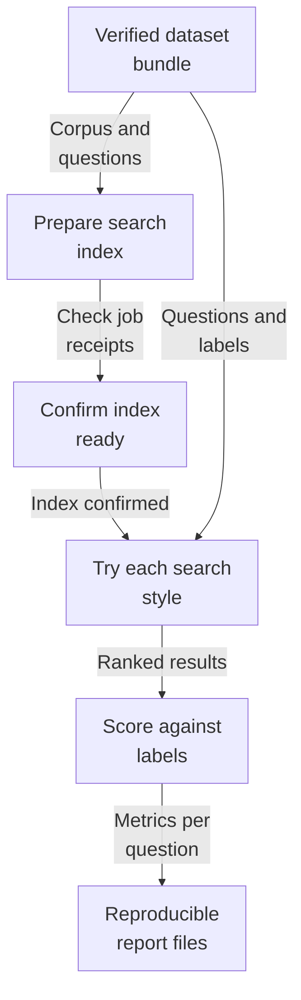
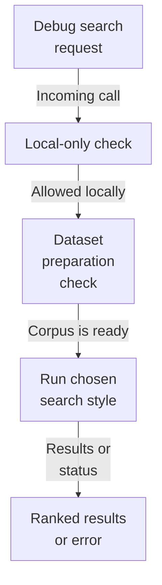
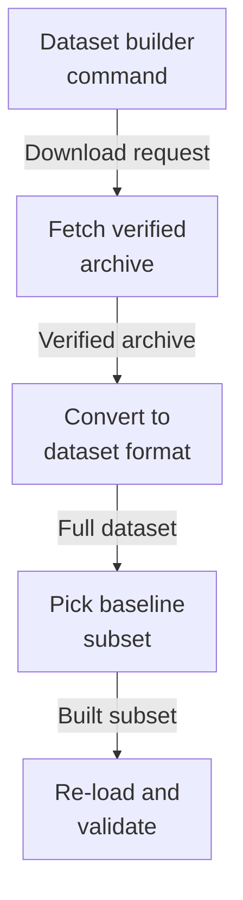

# Repository map

This area builds and runs retrieval-quality tests for the search service. It loads versioned dataset bundles whose files are checked by hash, prepares an isolated search index for each dataset, runs four search styles over every test question, scores how well the results match human relevance labels, and saves reproducible JSON and readable Markdown reports. A local-only debug endpoint and a SciFact dataset builder support this work.

Commit: `3537e913c1eeec5b5f34d6cbdbf4dc3f8bc74b25` | Generated: 2026-10-19T00:21:57.138353+00:00

[Open PDF](repository-map.pdf)

**AI-generated analysis. Source references are checked for existence and supplied scope; this does not prove semantic correctness.**

## Scope

Tracked, eligible text only; bounded excerpts, not exhaustive.

20/20 eligible files analyzed; 203 tracked files excluded by policy.

8 API calls. See coverage.json for budgets, exclusions, and usage.

## How a dataset becomes a scored report

A verified dataset bundle is prepared into its own search index, every test question is searched in four ways, results are scored against human relevance labels, and a repeatable report is written.

PNG fallback

Read from top to bottom; arrows show what happens next or what is passed along.

### Source evidence

- **F0017**: load_dataset loads and validates an evaluation dataset from a directory containing a manifest plus corpus, queries, and judgments JSONL files, returning an immutable EvaluationDataset without mutating the source. (<a href="https://github.com/Justin-Mendoza/hybrid-rag-search/blob/3537e913c1eeec5b5f34d6cbdbf4dc3f8bc74b25/backend/src/hybrid_rag_search/evaluation/datasets.py#L1-L195">backend/src/hybrid_rag_search/evaluation/datasets.py:1-195</a>)
- **F0019**: load_dataset verifies a SHA-256 hash of each declared dataset file against the manifest and raises DatasetValidationError on mismatch, making content integrity part of the load contract. (<a href="https://github.com/Justin-Mendoza/hybrid-rag-search/blob/3537e913c1eeec5b5f34d6cbdbf4dc3f8bc74b25/backend/src/hybrid_rag_search/evaluation/datasets.py#L1-L195">backend/src/hybrid_rag_search/evaluation/datasets.py:1-195</a>)
- **F0024**: load_dataset requires every query to have at least one judgment and at least one positive (relevance_grade &gt; 0) judgment, otherwise raising DatasetValidationError. (<a href="https://github.com/Justin-Mendoza/hybrid-rag-search/blob/3537e913c1eeec5b5f34d6cbdbf4dc3f8bc74b25/backend/src/hybrid_rag_search/evaluation/datasets.py#L1-L195">backend/src/hybrid_rag_search/evaluation/datasets.py:1-195</a>)
- **F0010**: prepare_corpus validates a nonnegative document_delay, prepares the evaluation index, creates a Tenant and Collection row idempotently (on_conflict_do_nothing), and disposes its database engine in a finally block. (<a href="https://github.com/Justin-Mendoza/hybrid-rag-search/blob/3537e913c1eeec5b5f34d6cbdbf4dc3f8bc74b25/backend/src/hybrid_rag_search/evaluation/corpus.py#L1-L264">backend/src/hybrid_rag_search/evaluation/corpus.py:1-264</a>)
- **F0011**: For each corpus record, prepare_corpus computes a sha256 content digest, saves content to LocalFileStorage under a tenant/document key, and inserts a Document row scoped to tenant and collection; if a document already exists, a differing content_hash or source_metadata triggers a ValueError treating prepared documents as immutable. (<a href="https://github.com/Justin-Mendoza/hybrid-rag-search/blob/3537e913c1eeec5b5f34d6cbdbf4dc3f8bc74b25/backend/src/hybrid_rag_search/evaluation/corpus.py#L1-L264">backend/src/hybrid_rag_search/evaluation/corpus.py:1-264</a>)
- **F0012**: prepare_corpus enqueues a durable ingestion job per document and, when the job is not already succeeded, runs run_configured_job inline through ManualActor and the OpenSearch index, raising ValueError with the job id and result if ingestion does not succeed. (<a href="https://github.com/Justin-Mendoza/hybrid-rag-search/blob/3537e913c1eeec5b5f34d6cbdbf4dc3f8bc74b25/backend/src/hybrid_rag_search/evaluation/corpus.py#L1-L264">backend/src/hybrid_rag_search/evaluation/corpus.py:1-264</a>)
- **F0014**: verify_prepared fails closed: it queries IngestionJob rows for the scope's documents at the scope pipeline version with status 'succeeded', requires the count to equal the corpus size, and requires each completed job's checkpoint to contain an 'index' receipt with a string generation_id and integer chunk_count. (<a href="https://github.com/Justin-Mendoza/hybrid-rag-search/blob/3537e913c1eeec5b5f34d6cbdbf4dc3f8bc74b25/backend/src/hybrid_rag_search/evaluation/corpus.py#L1-L264">backend/src/hybrid_rag_search/evaluation/corpus.py:1-264</a>)
- **F0015**: verify_prepared then queries the evaluation read alias with an aggregation over document_id and generation_id filtered by tenant, collection, and visibility 'ready', and raises ValueError if the observed generations/chunk counts differ from the job receipts, guarding against stale or rebuilt indexes and returning the total ready document count on success. (<a href="https://github.com/Justin-Mendoza/hybrid-rag-search/blob/3537e913c1eeec5b5f34d6cbdbf4dc3f8bc74b25/backend/src/hybrid_rag_search/evaluation/corpus.py#L1-L264">backend/src/hybrid_rag_search/evaluation/corpus.py:1-264</a>)
- **F0056**: EvaluationSearch.search receives an EvaluationDataset, a query string, a mode in ('bm25','dense','hybrid','hybrid_rerank') and optional metadata filters, raises ValueError on unknown modes, and derives per-dataset index scope and read alias through evaluation_scope and evaluation_index_settings, updating the aliases on the lexical and (if present) dense retrievers. (<a href="https://github.com/Justin-Mendoza/hybrid-rag-search/blob/3537e913c1eeec5b5f34d6cbdbf4dc3f8bc74b25/backend/src/hybrid_rag_search/evaluation/search.py#L1-L139">backend/src/hybrid_rag_search/evaluation/search.py:1-139</a>)
- **F0058**: Mode dispatch branches by retriever: bm25 uses the lexical retriever; dense lazily constructs a Cohere embeddings provider and a dense retriever; hybrid adds a HybridRetriever with RRF candidate_limit=BUDGET; hybrid_rerank additionally lazily constructs a Cohere reranker and a RerankedRetriever with settings-derived config. Providers are entered into an AsyncExitStack for the lifetime of the EvaluationSearch context. (<a href="https://github.com/Justin-Mendoza/hybrid-rag-search/blob/3537e913c1eeec5b5f34d6cbdbf4dc3f8bc74b25/backend/src/hybrid_rag_search/evaluation/search.py#L1-L139">backend/src/hybrid_rag_search/evaluation/search.py:1-139</a>)
- **F0060**: EvaluationSearch.search returns a dict containing mode, a chunks list with document/chunk identity and rank, a documents list of unique ranked document ids, and a trace converted from the selected retriever's trace dataclass via asdict. (<a href="https://github.com/Justin-Mendoza/hybrid-rag-search/blob/3537e913c1eeec5b5f34d6cbdbf4dc3f8bc74b25/backend/src/hybrid_rag_search/evaluation/search.py#L1-L139">backend/src/hybrid_rag_search/evaluation/search.py:1-139</a>)
- **F0027**: score_ranking deduplicates the ranking while preserving order, then computes recall@5, recall@10, and recall@50 against the set of positively judged documents. (<a href="https://github.com/Justin-Mendoza/hybrid-rag-search/blob/3537e913c1eeec5b5f34d6cbdbf4dc3f8bc74b25/backend/src/hybrid_rag_search/evaluation/metrics.py#L1-L28">backend/src/hybrid_rag_search/evaluation/metrics.py:1-28</a>)
- **F0029**: score_ranking computes ndcg@10 using graded relevance (2^grade - 1 discounted by log2(rank+1)) and normalizes by an ideal DCG over the top ten judged grades. (<a href="https://github.com/Justin-Mendoza/hybrid-rag-search/blob/3537e913c1eeec5b5f34d6cbdbf4dc3f8bc74b25/backend/src/hybrid_rag_search/evaluation/metrics.py#L1-L28">backend/src/hybrid_rag_search/evaluation/metrics.py:1-28</a>)
- **F0038**: save_report writes both report.json (jsonable_encoder-serialized, sorted keys) and report.md (markdown_report rendering aggregate table plus per-query BM25 differences) into a created output directory. (<a href="https://github.com/Justin-Mendoza/hybrid-rag-search/blob/3537e913c1eeec5b5f34d6cbdbf4dc3f8bc74b25/backend/src/hybrid_rag_search/evaluation/runner.py#L1-L301">backend/src/hybrid_rag_search/evaluation/runner.py:1-301</a>)
- **F0041**: run_baseline records reproduction metadata: schema identifier, UTC creation time, git HEAD revision and dirty-worktree flag, dataset id/version/hashes/counts, chunk count, pipeline version, resolved OpenSearch indexes, tenant and collection ids, hardware info, caller-supplied cache_state, query delay, execution note, model names, adapters, allowlisted config, metric rules, and a count of hybrid_rerank results with a fallback reason. (<a href="https://github.com/Justin-Mendoza/hybrid-rag-search/blob/3537e913c1eeec5b5f34d6cbdbf4dc3f8bc74b25/backend/src/hybrid_rag_search/evaluation/runner.py#L1-L301">backend/src/hybrid_rag_search/evaluation/runner.py:1-301</a>)
- **F0033**: runner.py is a CLI (main via argparse subcommands prepare/run/compare/export) that orchestrates retrieval-benchmark execution: 'run' loads a named dataset via selected_dataset, applies benchmark_settings and evaluation_index_settings, verifies prepared corpus chunks, then drives evaluate over all queries and all MODES. (<a href="https://github.com/Justin-Mendoza/hybrid-rag-search/blob/3537e913c1eeec5b5f34d6cbdbf4dc3f8bc74b25/backend/src/hybrid_rag_search/evaluation/runner.py#L1-L301">backend/src/hybrid_rag_search/evaluation/runner.py:1-301</a>)
- **F0034**: evaluate iterates each query and each retrieval mode, calls the injected search function, trims chunk fields, computes ranking from result documents, scores via score_ranking against per-query judgments, and records metrics, elapsed_ms, chunk_count, document_count and full search result per mode. (<a href="https://github.com/Justin-Mendoza/hybrid-rag-search/blob/3537e913c1eeec5b5f34d6cbdbf4dc3f8bc74b25/backend/src/hybrid_rag_search/evaluation/runner.py#L1-L301">backend/src/hybrid_rag_search/evaluation/runner.py:1-301</a>)
- **F0059**: After retrieval, EvaluationSearch.search validates every returned chunk against the prepared evaluation scope, raising ValueError if tenant, collection, document id or pipeline_version mismatch, then annotates each chunk with its rank and mapped evaluation_document_id and produces a de-duplicated document-level ranking keyed by evaluation document id. (<a href="https://github.com/Justin-Mendoza/hybrid-rag-search/blob/3537e913c1eeec5b5f34d6cbdbf4dc3f8bc74b25/backend/src/hybrid_rag_search/evaluation/search.py#L1-L139">backend/src/hybrid_rag_search/evaluation/search.py:1-139</a>)
- **F0037**: Aggregate metrics are the mean across queries for each mode and metric key, with metric names recall@5, recall@10, recall@50, mrr@10, ndcg@10. (<a href="https://github.com/Justin-Mendoza/hybrid-rag-search/blob/3537e913c1eeec5b5f34d6cbdbf4dc3f8bc74b25/backend/src/hybrid_rag_search/evaluation/runner.py#L1-L301">backend/src/hybrid_rag_search/evaluation/runner.py:1-301</a>)

## How a debug search request is answered

A local-only request names a dataset and question, the service checks the dataset is prepared, runs one search style in an isolated scope, and returns ranked results or a clear error status.

PNG fallback

Read from top to bottom; arrows show what happens next or what is passed along.

### Source evidence

- **F0002**: The debug search HTTP endpoint POST /debug/search accepts a DebugSearchRequest with dataset limited to synthetic-workspace, scifact, or scifact-subset, a query string (1-4096 chars), and a SearchMode; it refuses requests when settings.app_env is 'production' with a 404, making it local-only. (<a href="https://github.com/Justin-Mendoza/hybrid-rag-search/blob/3537e913c1eeec5b5f34d6cbdbf4dc3f8bc74b25/backend/src/hybrid_rag_search/evaluation/api.py#L1-L37">backend/src/hybrid_rag_search/evaluation/api.py:1-37</a>)
- **F0092**: The debug search endpoint (/debug/search) validates dataset and scope selection (rejecting '../notes.txt' and caller-supplied tenant_ids with 422), returns results for each supported mode, and is disabled (404) when app_env is production. (<a href="https://github.com/Justin-Mendoza/hybrid-rag-search/blob/3537e913c1eeec5b5f34d6cbdbf4dc3f8bc74b25/backend/tests/test_evaluation_search.py#L1-L181">backend/tests/test_evaluation_search.py:1-181</a>)
- **F0003**: debug_search resolves the dataset via selected_dataset, verifies preparation via verify_prepared, then opens an EvaluationSearch context and returns search results with debug=True; ValueError/OSError map to HTTP 409 and RetrievalError/ProviderError map to HTTP 503 with the error code. (<a href="https://github.com/Justin-Mendoza/hybrid-rag-search/blob/3537e913c1eeec5b5f34d6cbdbf4dc3f8bc74b25/backend/src/hybrid_rag_search/evaluation/api.py#L1-L37">backend/src/hybrid_rag_search/evaluation/api.py:1-37</a>)
- **F0093**: The debug endpoint maps preparation and retrieval failures to HTTP status codes: 409 when the corpus is not prepared, and 503 for RetrievalError/ProviderError unavailability. (<a href="https://github.com/Justin-Mendoza/hybrid-rag-search/blob/3537e913c1eeec5b5f34d6cbdbf4dc3f8bc74b25/backend/tests/test_evaluation_search.py#L1-L181">backend/tests/test_evaluation_search.py:1-181</a>)
- **F0089**: EvaluationSearch.search supports the four modes in MODES, rejects unknown modes with 'Unknown search', rejects unsupported filters such as tenant_id with 'Unsupported', and rejects hits whose tenant/collection fall outside the evaluation scope with a ValueError mentioning 'outside'. (<a href="https://github.com/Justin-Mendoza/hybrid-rag-search/blob/3537e913c1eeec5b5f34d6cbdbf4dc3f8bc74b25/backend/tests/test_evaluation_search.py#L1-L181">backend/tests/test_evaluation_search.py:1-181</a>)

## How the SciFact test set is built

A pinned public archive is downloaded and hash-checked, converted into the shared dataset format, trimmed to a deterministic 30-question, 500-document baseline, and re-loaded to prove it is valid.

PNG fallback

Read from top to bottom; arrows show what happens next or what is passed along.

### Source evidence

- **F0049**: The SciFact module is a command-line dataset builder: main() parses a required command (download, validate, subset), optional --output and --source paths, defaults output to the versioned cache directory for download/validate and to the subset v1 directory for subset, then prints a summary line after running. (<a href="https://github.com/Justin-Mendoza/hybrid-rag-search/blob/3537e913c1eeec5b5f34d6cbdbf4dc3f8bc74b25/backend/src/hybrid_rag_search/evaluation/scifact.py#L1-L222">backend/src/hybrid_rag_search/evaluation/scifact.py:1-222</a>)
- **F0050**: download_archive fetches the pinned BEIR SciFact zip from a fixed HTTPS URL with redirects and a 60-second timeout, writes it to a temporary '.partial' file, verifies its SHA-256 against SCIFACT_ARCHIVE_SHA256, and only then atomically replaces the destination, raising ValueError on hash mismatch and removing the partial file in a finally block. (<a href="https://github.com/Justin-Mendoza/hybrid-rag-search/blob/3537e913c1eeec5b5f34d6cbdbf4dc3f8bc74b25/backend/src/hybrid_rag_search/evaluation/scifact.py#L1-L222">backend/src/hybrid_rag_search/evaluation/scifact.py:1-222</a>)
- **F0051**: convert_archive re-verifies the archive hash before reading, extracts 'scifact/qrels/test.tsv', 'scifact/corpus.jsonl' and 'scifact/queries.jsonl' from the zip in memory, maps corpus ids to 'scifact-doc-&lt;id&gt;', query ids to 'scifact-query-&lt;id&gt;', keeps only queries that appear in qrels, converts qrels scores to relevance grades (3 if score&gt;0 else 0), and writes corpus.jsonl, queries.jsonl and judgments.jsonl sorted by id plus a manifest.json recording the source URL, archive hash, license and per-file SHA-256 hashes. (<a href="https://github.com/Justin-Mendoza/hybrid-rag-search/blob/3537e913c1eeec5b5f34d6cbdbf4dc3f8bc74b25/backend/src/hybrid_rag_search/evaluation/scifact.py#L1-L222">backend/src/hybrid_rag_search/evaluation/scifact.py:1-222</a>)
- **F0052**: build_subset selects a deterministic sample from an already-converted dataset: 30 queries by lowest salted SHA-256 of 'scifact-subset-v1:&lt;id&gt;', all their judgments, then fills to exactly 500 documents by the same salted hash ordering, raising ValueError if the source has fewer than 30 queries or 500 documents or if judgments already require more than 500 documents. (<a href="https://github.com/Justin-Mendoza/hybrid-rag-search/blob/3537e913c1eeec5b5f34d6cbdbf4dc3f8bc74b25/backend/src/hybrid_rag_search/evaluation/scifact.py#L1-L222">backend/src/hybrid_rag_search/evaluation/scifact.py:1-222</a>)
- **F0053**: build_subset writes a rewritten manifest labeled dataset_id 'scifact-subset' version 'scifact-subset-v1' that records the parent dataset hash and describes the selection rule, then reloads the output via load_dataset as a final validation before returning the output path. (<a href="https://github.com/Justin-Mendoza/hybrid-rag-search/blob/3537e913c1eeec5b5f34d6cbdbf4dc3f8bc74b25/backend/src/hybrid_rag_search/evaluation/scifact.py#L1-L222">backend/src/hybrid_rag_search/evaluation/scifact.py:1-222</a>)
- **F0063**: Dataset integrity is enforced at multiple points: archive and file-level SHA-256 hashes, a pinned version label, and a full load_dataset re-read between building and returning a dataset, so a corrupted or altered SciFact source is rejected before downstream use. (<a href="https://github.com/Justin-Mendoza/hybrid-rag-search/blob/3537e913c1eeec5b5f34d6cbdbf4dc3f8bc74b25/backend/src/hybrid_rag_search/evaluation/scifact.py#L1-L222">backend/src/hybrid_rag_search/evaluation/scifact.py:1-222</a>)

## Uncertainties and untraced areas

- How the saved evaluation records in the database connect at runtime to the dataset bundle loader is not shown.
- The internal retrieval, scoring, and settings behavior behind the shared search boundary is only inferred from where it is called.
- Whether durable ingestion jobs always run inline here or can also be handled by a separate worker service is not traced.
- How evaluation scores or saved runs are surfaced to any user interface or external caller beyond the debug endpoint is not described.
