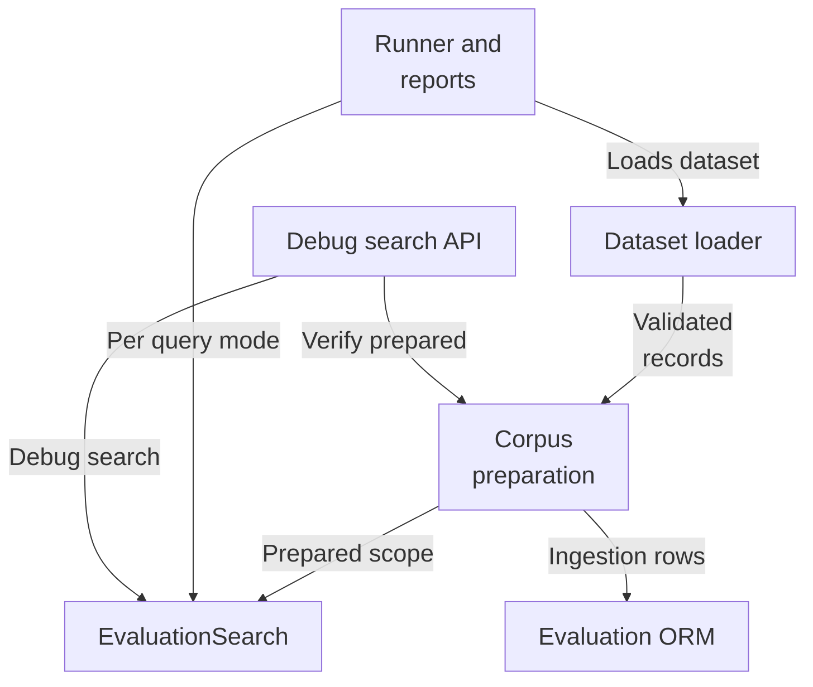
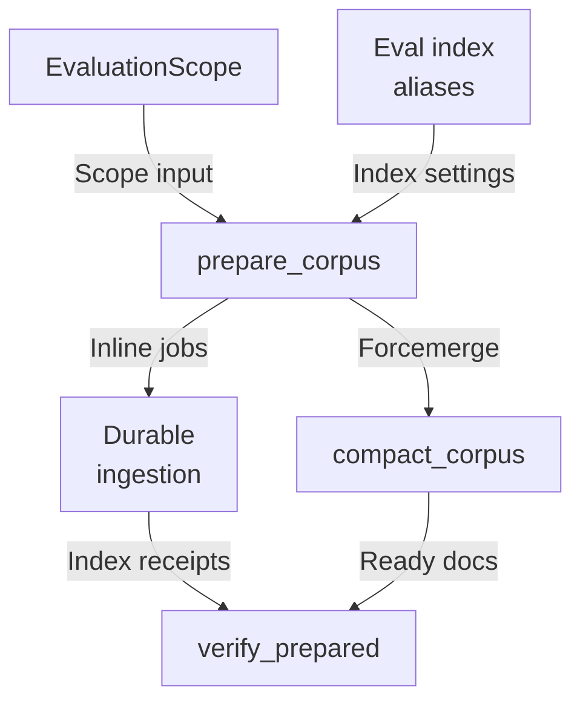
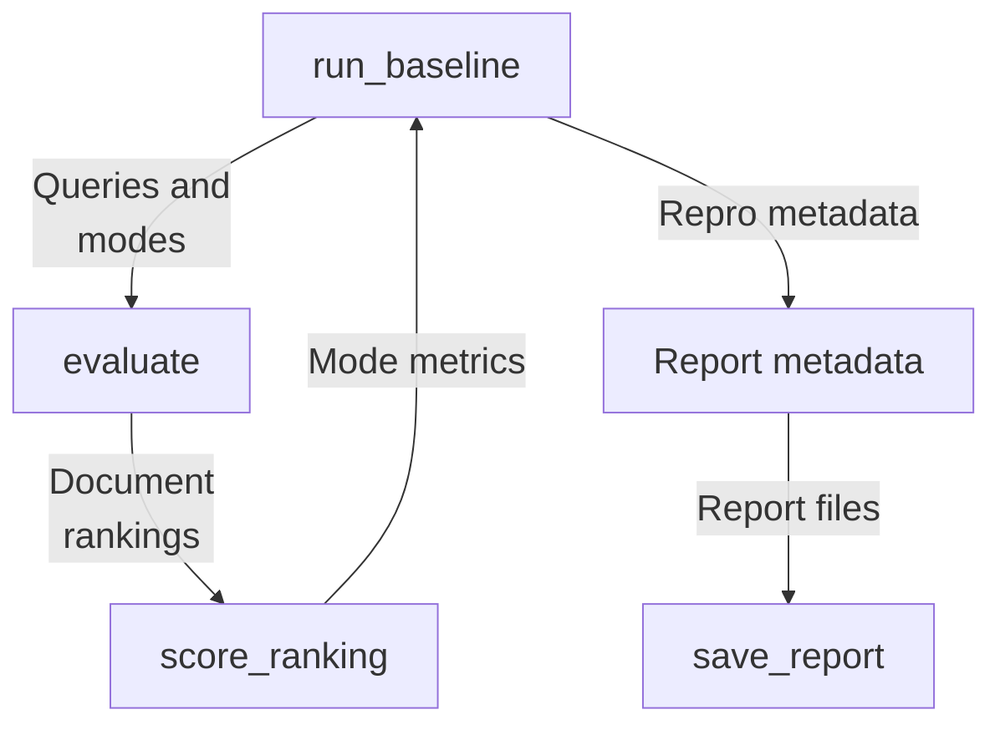
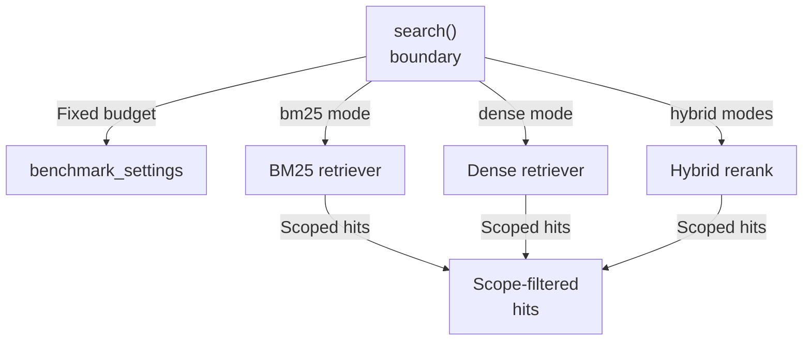
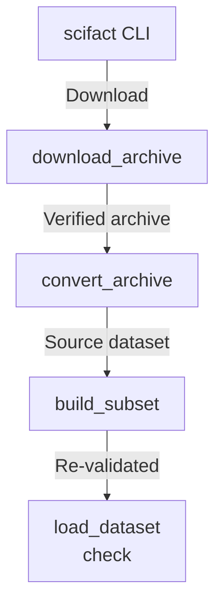

# Repository map

The evaluation subsystem loads hash-verified, versioned datasets, prepares isolated per-scope evaluation corpora in OpenSearch through the durable ingestion pipeline, runs bm25/dense/hybrid/hybrid_rerank retrieval via a shared EvaluationSearch boundary, scores rankings with fixed metrics, and emits reproducible comparison reports. It exposes a debug-only search API and a SciFact builder CLI, and owns evaluation ORM tables.

Commit: `56291a0b9cc466341d5d7a4b71aed8b2c5f412bb` | Generated: 2026-10-17T22:57:54.000518+00:00

[Open PDF](repository-map.pdf)

**AI-generated analysis. Source references are checked for existence and supplied scope; this does not prove semantic correctness.**

## Scope

Tracked, eligible text only; bounded excerpts, not exhaustive.

20/20 eligible files analyzed; 203 tracked files excluded by policy.

8 API calls. See coverage.json for budgets, exclusions, and usage.

## Architecture

Evaluation composes dataset loading, corpus preparation, mode-dispatch search, scoring/reporting, its HTTP and CLI entry points, and persistence; boundaries matter because corpus state and retrieval faults map to distinct errors.

PNG fallback

### Source evidence

- **F0001**: The evaluation package's public surface (S0001) re-exports the versioned dataset contracts (CorpusRecord, DatasetManifest, EvaluationDataset, JudgmentRecord, QueryRecord) and load_dataset from hybrid_rag_search.evaluation.datasets; numbered-day comments indicate contracts and loaders are the package's core abstraction. (<a href="https://github.com/Justin-Mendoza/hybrid-rag-search/blob/56291a0b9cc466341d5d7a4b71aed8b2c5f412bb/backend/src/hybrid_rag_search/evaluation/__init__.py#L1-L19">backend/src/hybrid_rag_search/evaluation/__init__.py:1-19</a>)
- **F0017**: load_dataset(directory) is the public entry point of evaluation/datasets.py: it reads manifest.json as a DatasetManifest, then reads corpus.jsonl, queries.jsonl, and judgments.jsonl into typed Pydantic records, returning an EvaluationDataset with computed corpus_hash and dataset_hash. (<a href="https://github.com/Justin-Mendoza/hybrid-rag-search/blob/56291a0b9cc466341d5d7a4b71aed8b2c5f412bb/backend/src/hybrid_rag_search/evaluation/datasets.py#L1-L195">backend/src/hybrid_rag_search/evaluation/datasets.py:1-195</a>)
- **F0018**: Dataset files are integrity-checked before parsing: for each manifest.files entry, load_dataset computes SHA-256 of the file bytes and raises DatasetValidationError on mismatch with the declared entry.sha256. (<a href="https://github.com/Justin-Mendoza/hybrid-rag-search/blob/56291a0b9cc466341d5d7a4b71aed8b2c5f412bb/backend/src/hybrid_rag_search/evaluation/datasets.py#L1-L195">backend/src/hybrid_rag_search/evaluation/datasets.py:1-195</a>)
- **F0021**: load_dataset performs cross-record validation beyond schema: it enforces unique corpus and query ids (_unique_ids), requires each judgment.query_id to reference a known query, requires each judgment.target_id to exist in the corpus, and requires the referenced corpus record's type to match judgment.target_type. (<a href="https://github.com/Justin-Mendoza/hybrid-rag-search/blob/56291a0b9cc466341d5d7a4b71aed8b2c5f412bb/backend/src/hybrid_rag_search/evaluation/datasets.py#L1-L195">backend/src/hybrid_rag_search/evaluation/datasets.py:1-195</a>)
- **F0005**: corpus.py defines a fixed evaluation tenant EVALUATION_TENANT (UUID ...0201) and a DATASETS mapping of three named datasets: synthetic-workspace, scifact, and scifact-subset; selected_dataset resolves names against this mapping and raises ValueError on unknown names (S0003). (<a href="https://github.com/Justin-Mendoza/hybrid-rag-search/blob/56291a0b9cc466341d5d7a4b71aed8b2c5f412bb/backend/src/hybrid_rag_search/evaluation/corpus.py#L1-L264">backend/src/hybrid_rag_search/evaluation/corpus.py:1-264</a>)
- **F0006**: evaluation_scope derives a deterministic EvaluationScope: collection_id is uuid5 of the evaluation tenant plus the dataset corpus_hash and configured pipeline version, and each document id is uuid5 of the collection id plus the record id, so the same dataset/pipeline yields the same scope (S0003). (<a href="https://github.com/Justin-Mendoza/hybrid-rag-search/blob/56291a0b9cc466341d5d7a4b71aed8b2c5f412bb/backend/src/hybrid_rag_search/evaluation/corpus.py#L1-L264">backend/src/hybrid_rag_search/evaluation/corpus.py:1-264</a>)
- **F0010**: prepare_corpus reuses the durable ingestion pipeline rather than a bespoke path: it creates a Tenant and Collection row (conflict-ignoring inserts), persists document bytes via LocalFileStorage with a content-hash check, enqueues jobs through IngestionJobService with a no-op ManualPublisher, and runs them inline via run_configured_job with a ManualActor (S0003). (<a href="https://github.com/Justin-Mendoza/hybrid-rag-search/blob/56291a0b9cc466341d5d7a4b71aed8b2c5f412bb/backend/src/hybrid_rag_search/evaluation/corpus.py#L1-L264">backend/src/hybrid_rag_search/evaluation/corpus.py:1-264</a>)
- **F0012**: prepare_corpus ensures pipeline completeness before returning: it calls compact_corpus (OpenSearch _forcemerge with max_num_segments=1) and then verify_prepared, so corpus preparation ends with a forced-merged and verified index (S0003). (<a href="https://github.com/Justin-Mendoza/hybrid-rag-search/blob/56291a0b9cc466341d5d7a4b71aed8b2c5f412bb/backend/src/hybrid_rag_search/evaluation/corpus.py#L1-L264">backend/src/hybrid_rag_search/evaluation/corpus.py:1-264</a>)
- **F0056**: EvaluationSearch.search enforces mode membership in MODES and rejects filter keys outside {source_type, author, source_date_from, source_date_to}. (<a href="https://github.com/Justin-Mendoza/hybrid-rag-search/blob/56291a0b9cc466341d5d7a4b71aed8b2c5f412bb/backend/src/hybrid_rag_search/evaluation/search.py#L1-L139">backend/src/hybrid_rag_search/evaluation/search.py:1-139</a>)
- **F0057**: EvaluationSearch lazy-initializes mode-specific retrievers: bm25 uses self.lexical directly; dense/hybrid lazily enter configured_cohere_embeddings and build OpenSearchDenseRetriever and HybridRetriever; hybrid_rerank additionally lazily enters configured_cohere_reranking and builds RerankedRetriever, all tracked on an AsyncExitStack. (<a href="https://github.com/Justin-Mendoza/hybrid-rag-search/blob/56291a0b9cc466341d5d7a4b71aed8b2c5f412bb/backend/src/hybrid_rag_search/evaluation/search.py#L1-L139">backend/src/hybrid_rag_search/evaluation/search.py:1-139</a>)
- **F0060**: After retrieval, EvaluationSearch.search validates every evidence item against scope by checking tenant_id, collection_id, document_id membership in scope.document_ids, and pipeline_version, raising ValueError on any out-of-scope result. (<a href="https://github.com/Justin-Mendoza/hybrid-rag-search/blob/56291a0b9cc466341d5d7a4b71aed8b2c5f412bb/backend/src/hybrid_rag_search/evaluation/search.py#L1-L139">backend/src/hybrid_rag_search/evaluation/search.py:1-139</a>)
- **F0062** (inferred): EvaluationSearch constructs the docstring-implied shared boundary for HTTP and the benchmark runner: the module docstring states it is 'One evaluation search boundary shared by HTTP and the benchmark runner', and the class docstring notes it shares provider resources across queries without caching query embeddings. (<a href="https://github.com/Justin-Mendoza/hybrid-rag-search/blob/56291a0b9cc466341d5d7a4b71aed8b2c5f412bb/backend/src/hybrid_rag_search/evaluation/search.py#L1-L139">backend/src/hybrid_rag_search/evaluation/search.py:1-139</a>)
- **F0033**: The evaluation runner's `run_baseline` orchestrates retrieval benchmarking: it derives benchmark settings via `benchmark_settings(get_settings())`, selects a dataset with `selected_dataset(name)`, applies `evaluation_index_settings`, verifies prepared corpus chunks via `verify_prepared`, then runs `evaluate` through an async `EvaluationSearch` context and writes reports via `save_report`. (<a href="https://github.com/Justin-Mendoza/hybrid-rag-search/blob/56291a0b9cc466341d5d7a4b71aed8b2c5f412bb/backend/src/hybrid_rag_search/evaluation/runner.py#L1-L301">backend/src/hybrid_rag_search/evaluation/runner.py:1-301</a>)
- **F0034**: `evaluate` iterates over every query in the dataset and over each mode in `MODES`, calling the injected async `search` function per (query, mode) and timing each call with `perf_counter`; it is decoupled from the concrete search implementation via the `SearchFunction` type alias. (<a href="https://github.com/Justin-Mendoza/hybrid-rag-search/blob/56291a0b9cc466341d5d7a4b71aed8b2c5f412bb/backend/src/hybrid_rag_search/evaluation/runner.py#L1-L301">backend/src/hybrid_rag_search/evaluation/runner.py:1-301</a>)
- **F0043**: `save_report` runs the report through `jsonable_encoder`, creates the output directory, and writes two files: `report.json` (sorted, indented JSON) and `report.md` rendered by `markdown_report`. (<a href="https://github.com/Justin-Mendoza/hybrid-rag-search/blob/56291a0b9cc466341d5d7a4b71aed8b2c5f412bb/backend/src/hybrid_rag_search/evaluation/runner.py#L1-L301">backend/src/hybrid_rag_search/evaluation/runner.py:1-301</a>)
- **F0045**: The module's `main()` exposes an argparse CLI with subcommands `prepare`, `run`, `compare`, and `export`; `prepare` calls `prepare_corpus`, `run` calls `run_baseline`, `export` re-saves a JSON report, and `compare` prints `compare_reports` output as JSON. (<a href="https://github.com/Justin-Mendoza/hybrid-rag-search/blob/56291a0b9cc466341d5d7a4b71aed8b2c5f412bb/backend/src/hybrid_rag_search/evaluation/runner.py#L1-L301">backend/src/hybrid_rag_search/evaluation/runner.py:1-301</a>)
- **F0002**: api.py exposes a single local-only debug endpoint POST /debug/search (S0002) that rejects requests when settings.app_env == "production" with HTTP 404, gating the evaluation search surface out of production deployments. (<a href="https://github.com/Justin-Mendoza/hybrid-rag-search/blob/56291a0b9cc466341d5d7a4b71aed8b2c5f412bb/backend/src/hybrid_rag_search/evaluation/api.py#L1-L37">backend/src/hybrid_rag_search/evaluation/api.py:1-37</a>)
- **F0003**: debug_search orchestrates the full evaluation search path inline: selected_dataset(name) loads the dataset, verify_prepared(dataset, settings) validates the prepared corpus, then EvaluationSearch(settings) is used as an async context manager to run search(dataset, query, mode, debug=True) (S0002). (<a href="https://github.com/Justin-Mendoza/hybrid-rag-search/blob/56291a0b9cc466341d5d7a4b71aed8b2c5f412bb/backend/src/hybrid_rag_search/evaluation/api.py#L1-L37">backend/src/hybrid_rag_search/evaluation/api.py:1-37</a>)
- **F0004**: debug_search maps failures to distinct HTTP boundaries: ValueError/OSError become 409 (state conflict), while RetrievalError and ProviderError become 503 with error.code, keeping retrieval/provider faults separate from corpus-state faults (S0002). (<a href="https://github.com/Justin-Mendoza/hybrid-rag-search/blob/56291a0b9cc466341d5d7a4b71aed8b2c5f412bb/backend/src/hybrid_rag_search/evaluation/api.py#L1-L37">backend/src/hybrid_rag_search/evaluation/api.py:1-37</a>)
- **F0065**: models/evaluation.py defines SQLAlchemy ORM models EvaluationDataset, Judgment, EvaluationRun, and AuditEvent, all inheriting from the shared Base in hybrid_rag_search.database, making the evaluation subsystem the owner of the evaluation_datasets, judgments, evaluation_runs, and audit_events tables. (<a href="https://github.com/Justin-Mendoza/hybrid-rag-search/blob/56291a0b9cc466341d5d7a4b71aed8b2c5f412bb/backend/src/hybrid_rag_search/models/evaluation.py#L1-L172">backend/src/hybrid_rag_search/models/evaluation.py:1-172</a>)
- **F0066**: Judgment and EvaluationRun both reference evaluation_datasets via composite ForeignKeyConstraint on (tenant_id, dataset_id), enforcing tenant-scoped referential integrity; EvaluationRun additionally references retrieval_configs on (tenant_id, retrieval_config_id) with ondelete RESTRICT, so retrieval configs backing runs cannot be deleted. (<a href="https://github.com/Justin-Mendoza/hybrid-rag-search/blob/56291a0b9cc466341d5d7a4b71aed8b2c5f412bb/backend/src/hybrid_rag_search/models/evaluation.py#L1-L172">backend/src/hybrid_rag_search/models/evaluation.py:1-172</a>)
- **F0067**: EvaluationRunStatus enumerates queued/running/succeeded/failed/cancelled and is enforced both by the Python StrEnum and a SQL CheckConstraint (status_allowed) on evaluation_runs, plus DEFAULT queued via server_default. (<a href="https://github.com/Justin-Mendoza/hybrid-rag-search/blob/56291a0b9cc466341d5d7a4b71aed8b2c5f412bb/backend/src/hybrid_rag_search/models/evaluation.py#L1-L172">backend/src/hybrid_rag_search/models/evaluation.py:1-172</a>)
- **F0069**: EvaluationRun separates a metrics JSONB object column from status/error_message/started_at/finished_at/updated_at columns, indicating a state-machine lifecycle is tracked at the row level rather than in a separate job table. (<a href="https://github.com/Justin-Mendoza/hybrid-rag-search/blob/56291a0b9cc466341d5d7a4b71aed8b2c5f412bb/backend/src/hybrid_rag_search/models/evaluation.py#L1-L172">backend/src/hybrid_rag_search/models/evaluation.py:1-172</a>)
- **F0058**: EvaluationSearch.search derives scope and index settings per call via evaluation_scope(dataset, self.settings) and evaluation_index_settings(dataset, self.settings), and reassigns self.lexical.read_alias and self.dense.read_alias from the configured opensearch_read_alias. (<a href="https://github.com/Justin-Mendoza/hybrid-rag-search/blob/56291a0b9cc466341d5d7a4b71aed8b2c5f412bb/backend/src/hybrid_rag_search/evaluation/search.py#L1-L139">backend/src/hybrid_rag_search/evaluation/search.py:1-139</a>)
- **F0048**: The runner depends on the evaluation corpus, datasets, metrics, and search modules (`prepare_corpus`, `verify_prepared`, `selected_dataset`, `evaluation_index_settings`, `evaluation_scope`, `EvaluationDataset`, `score_ranking`, `MODES`, `EvaluationSearch`, `benchmark_settings`, `Settings`), so the runner is the top-level orchestrator over dataset loading, corpus preparation, mode dispatch, and scoring; the internal behavior of those modules is not shown in this excerpt. (<a href="https://github.com/Justin-Mendoza/hybrid-rag-search/blob/56291a0b9cc466341d5d7a4b71aed8b2c5f412bb/backend/src/hybrid_rag_search/evaluation/runner.py#L1-L301">backend/src/hybrid_rag_search/evaluation/runner.py:1-301</a>)
- **F0092**: The debug endpoint POST /debug/search resolves the dataset, calls verify_prepared, and runs EvaluationSearch across all modes; it returns 422 for unknown datasets or disallowed tenant_id, 404 when app_env is 'production', 409 when verify_prepared raises (not prepared), and 503 when verify_prepared raises RetrievalError(retryable=True) or ProviderError('unavailable') (S0014). (<a href="https://github.com/Justin-Mendoza/hybrid-rag-search/blob/56291a0b9cc466341d5d7a4b71aed8b2c5f412bb/backend/tests/test_evaluation_search.py#L1-L181">backend/tests/test_evaluation_search.py:1-181</a>)
- **F0013**: verify_prepared performs two-phase validation that fails closed: it queries Postgres for succeeded IngestionJob rows matching tenant, document ids, and pipeline version, requires a valid index receipt (generation_id string, integer chunk_count) per job, then aggregates OpenSearch ready-visibility documents by document_id/generation_id and requires exact equality with expected generations and doc counts (S0003). (<a href="https://github.com/Justin-Mendoza/hybrid-rag-search/blob/56291a0b9cc466341d5d7a4b71aed8b2c5f412bb/backend/src/hybrid_rag_search/evaluation/corpus.py#L1-L264">backend/src/hybrid_rag_search/evaluation/corpus.py:1-264</a>)

## Corpus preparation flow

prepare_corpus derives a deterministic scope and index aliases, reuses the durable ingestion pipeline inline, treats persisted documents as immutable, then force-merges and verifies against job receipts.

PNG fallback

### Source evidence

- **F0006**: evaluation_scope derives a deterministic EvaluationScope: collection_id is uuid5 of the evaluation tenant plus the dataset corpus_hash and configured pipeline version, and each document id is uuid5 of the collection id plus the record id, so the same dataset/pipeline yields the same scope (S0003). (<a href="https://github.com/Justin-Mendoza/hybrid-rag-search/blob/56291a0b9cc466341d5d7a4b71aed8b2c5f412bb/backend/src/hybrid_rag_search/evaluation/corpus.py#L1-L264">backend/src/hybrid_rag_search/evaluation/corpus.py:1-264</a>)
- **F0007**: Evaluation scopes are restricted to document corpora: evaluation_scope raises ValueError if any corpus record.type != "document", and comments state Day 15 evaluates document corpora only (S0003). (<a href="https://github.com/Justin-Mendoza/hybrid-rag-search/blob/56291a0b9cc466341d5d7a4b71aed8b2c5f412bb/backend/src/hybrid_rag_search/evaluation/corpus.py#L1-L264">backend/src/hybrid_rag_search/evaluation/corpus.py:1-264</a>)
- **F0086**: evaluation_scope derives a stable scope from dataset and settings: changing dataset_hash does not change the scope, while changing corpus_hash or opensearch_index_schema_version does; the scope exposes tenant_id, collection_id, pipeline_version, and document_ids (8 in the fixture) (S0013). (<a href="https://github.com/Justin-Mendoza/hybrid-rag-search/blob/56291a0b9cc466341d5d7a4b71aed8b2c5f412bb/backend/tests/test_evaluation_runner.py#L1-L174">backend/tests/test_evaluation_runner.py:1-174</a>)
- **F0008**: evaluation_index_settings derives per-scope OpenSearch read/write alias names of the form hybrid-rag-eval-{collection_id}-read/-write, deliberately isolated from demo aliases and manual rebuilds (S0003). (<a href="https://github.com/Justin-Mendoza/hybrid-rag-search/blob/56291a0b9cc466341d5d7a4b71aed8b2c5f412bb/backend/src/hybrid_rag_search/evaluation/corpus.py#L1-L264">backend/src/hybrid_rag_search/evaluation/corpus.py:1-264</a>)
- **F0009**: ensure_evaluation_index HEAD-checks the physical index hybrid-rag-eval-{collection_id} and, only when absent (404), creates it via OpenSearchIndexManager and then points the write alias and promotes the read alias (S0003). (<a href="https://github.com/Justin-Mendoza/hybrid-rag-search/blob/56291a0b9cc466341d5d7a4b71aed8b2c5f412bb/backend/src/hybrid_rag_search/evaluation/corpus.py#L1-L264">backend/src/hybrid_rag_search/evaluation/corpus.py:1-264</a>)
- **F0075**: corpus.ensure_evaluation_index conditionally calls OpenSearchIndexManager().create: a 404 response triggers create once, while a 200 response on subsequent calls does not re-create, and evaluation index settings use an opensearch_read_alias prefixed 'hybrid-rag-eval-'. (<a href="https://github.com/Justin-Mendoza/hybrid-rag-search/blob/56291a0b9cc466341d5d7a4b71aed8b2c5f412bb/backend/tests/test_evaluation_corpus.py#L1-L154">backend/tests/test_evaluation_corpus.py:1-154</a>)
- **F0010**: prepare_corpus reuses the durable ingestion pipeline rather than a bespoke path: it creates a Tenant and Collection row (conflict-ignoring inserts), persists document bytes via LocalFileStorage with a content-hash check, enqueues jobs through IngestionJobService with a no-op ManualPublisher, and runs them inline via run_configured_job with a ManualActor (S0003). (<a href="https://github.com/Justin-Mendoza/hybrid-rag-search/blob/56291a0b9cc466341d5d7a4b71aed8b2c5f412bb/backend/src/hybrid_rag_search/evaluation/corpus.py#L1-L264">backend/src/hybrid_rag_search/evaluation/corpus.py:1-264</a>)
- **F0011**: prepare_corpus treats previously persisted documents as immutable-per-dataset: if an existing Document's content_hash or source_metadata differs from the dataset record it raises ValueError ("Prepared evaluation document differs from dataset") instead of overwriting (S0003). (<a href="https://github.com/Justin-Mendoza/hybrid-rag-search/blob/56291a0b9cc466341d5d7a4b71aed8b2c5f412bb/backend/src/hybrid_rag_search/evaluation/corpus.py#L1-L264">backend/src/hybrid_rag_search/evaluation/corpus.py:1-264</a>)
- **F0015**: prepare_corpus supports an explicit document_delay parameter (sleeping between documents) and raises ValueError for negative values, and ManualActor/ManualPublisher are documented as executing durable jobs inline with retries left explicit (S0003). (<a href="https://github.com/Justin-Mendoza/hybrid-rag-search/blob/56291a0b9cc466341d5d7a4b71aed8b2c5f412bb/backend/src/hybrid_rag_search/evaluation/corpus.py#L1-L264">backend/src/hybrid_rag_search/evaluation/corpus.py:1-264</a>)
- **F0072**: corpus.prepare_corpus is idempotent for already-prepared documents: when the persisted IngestionJob exists and enqueue status is 'succeeded', run_configured_job is not awaited and session.add is not called (test asserts neither ran). (<a href="https://github.com/Justin-Mendoza/hybrid-rag-search/blob/56291a0b9cc466341d5d7a4b71aed8b2c5f412bb/backend/tests/test_evaluation_corpus.py#L1-L154">backend/tests/test_evaluation_corpus.py:1-154</a>)
- **F0079**: The evaluation subsystem composes with ingestion (IngestionJob, IngestionJobService, JobRunResult, run_configured_job) and retrieval (retrieval_configs foreign key, EvaluationSearch) rather than re-implementing them, as seen in the corpus tests' imports and the EvaluationRun FK to retrieval_configs. (<a href="https://github.com/Justin-Mendoza/hybrid-rag-search/blob/56291a0b9cc466341d5d7a4b71aed8b2c5f412bb/backend/tests/test_evaluation_corpus.py#L1-L154">backend/tests/test_evaluation_corpus.py:1-154</a>, <a href="https://github.com/Justin-Mendoza/hybrid-rag-search/blob/56291a0b9cc466341d5d7a4b71aed8b2c5f412bb/backend/src/hybrid_rag_search/models/evaluation.py#L1-L172">backend/src/hybrid_rag_search/models/evaluation.py:1-172</a>)
- **F0012**: prepare_corpus ensures pipeline completeness before returning: it calls compact_corpus (OpenSearch _forcemerge with max_num_segments=1) and then verify_prepared, so corpus preparation ends with a forced-merged and verified index (S0003). (<a href="https://github.com/Justin-Mendoza/hybrid-rag-search/blob/56291a0b9cc466341d5d7a4b71aed8b2c5f412bb/backend/src/hybrid_rag_search/evaluation/corpus.py#L1-L264">backend/src/hybrid_rag_search/evaluation/corpus.py:1-264</a>)
- **F0013**: verify_prepared performs two-phase validation that fails closed: it queries Postgres for succeeded IngestionJob rows matching tenant, document ids, and pipeline version, requires a valid index receipt (generation_id string, integer chunk_count) per job, then aggregates OpenSearch ready-visibility documents by document_id/generation_id and requires exact equality with expected generations and doc counts (S0003). (<a href="https://github.com/Justin-Mendoza/hybrid-rag-search/blob/56291a0b9cc466341d5d7a4b71aed8b2c5f412bb/backend/src/hybrid_rag_search/evaluation/corpus.py#L1-L264">backend/src/hybrid_rag_search/evaluation/corpus.py:1-264</a>)
- **F0014**: prepare_corpus used inside verify_prepared/debug_search relies on the durable ingestion records (IngestionJob.checkpoint["index"] receipts) as the source of truth for OpenSearch index contents, coupling the evaluation subsystem's integrity check to the ingestion subsystem's bookkeeping (S0003). (<a href="https://github.com/Justin-Mendoza/hybrid-rag-search/blob/56291a0b9cc466341d5d7a4b71aed8b2c5f412bb/backend/src/hybrid_rag_search/evaluation/corpus.py#L1-L264">backend/src/hybrid_rag_search/evaluation/corpus.py:1-264</a>)
- **F0074**: corpus.verify_prepared requires every scoped document to have an IngestionJob row with a non-empty checkpoint containing index.generation_id and chunk_count (a 'receipt'), and then queries OpenSearch via httpx.AsyncClient aggregation buckets per document key, raising ValueError when generations differ. (<a href="https://github.com/Justin-Mendoza/hybrid-rag-search/blob/56291a0b9cc466341d5d7a4b71aed8b2c5f412bb/backend/tests/test_evaluation_corpus.py#L1-L154">backend/tests/test_evaluation_corpus.py:1-154</a>)

## Evaluation run flow

run_baseline selects and prepares a dataset, calls evaluate across modes, scores each ranking against judgments, attaches credential-free reproduction metadata, and writes JSON plus markdown reports.

PNG fallback

### Source evidence

- **F0033**: The evaluation runner's `run_baseline` orchestrates retrieval benchmarking: it derives benchmark settings via `benchmark_settings(get_settings())`, selects a dataset with `selected_dataset(name)`, applies `evaluation_index_settings`, verifies prepared corpus chunks via `verify_prepared`, then runs `evaluate` through an async `EvaluationSearch` context and writes reports via `save_report`. (<a href="https://github.com/Justin-Mendoza/hybrid-rag-search/blob/56291a0b9cc466341d5d7a4b71aed8b2c5f412bb/backend/src/hybrid_rag_search/evaluation/runner.py#L1-L301">backend/src/hybrid_rag_search/evaluation/runner.py:1-301</a>)
- **F0039**: `run_baseline` queries the OpenSearch read alias over HTTP with `httpx.AsyncClient(base_url=settings.opensearch_url)` issuing `GET /_alias/{settings.opensearch_read_alias}` and records the sorted returned index names into report metadata as `index`. (<a href="https://github.com/Justin-Mendoza/hybrid-rag-search/blob/56291a0b9cc466341d5d7a4b71aed8b2c5f412bb/backend/src/hybrid_rag_search/evaluation/runner.py#L1-L301">backend/src/hybrid_rag_search/evaluation/runner.py:1-301</a>)
- **F0040**: `run_baseline` shells out to `git rev-parse HEAD` and `git diff HEAD --name-only` via `subprocess.check_output` to record `code_revision` and `tracked_worktree_dirty` in the reproducibility metadata. (<a href="https://github.com/Justin-Mendoza/hybrid-rag-search/blob/56291a0b9cc466341d5d7a4b71aed8b2c5f412bb/backend/src/hybrid_rag_search/evaluation/runner.py#L1-L301">backend/src/hybrid_rag_search/evaluation/runner.py:1-301</a>)
- **F0034**: `evaluate` iterates over every query in the dataset and over each mode in `MODES`, calling the injected async `search` function per (query, mode) and timing each call with `perf_counter`; it is decoupled from the concrete search implementation via the `SearchFunction` type alias. (<a href="https://github.com/Justin-Mendoza/hybrid-rag-search/blob/56291a0b9cc466341d5d7a4b71aed8b2c5f412bb/backend/src/hybrid_rag_search/evaluation/runner.py#L1-L301">backend/src/hybrid_rag_search/evaluation/runner.py:1-301</a>)
- **F0035**: For each result, `evaluate` trims the returned `chunks` to only `chunk_id`, `evaluation_document_id`, `rank`, and `score`, explicitly to avoid repeating source bytes across many benchmark queries (corpus text is already versioned). (<a href="https://github.com/Justin-Mendoza/hybrid-rag-search/blob/56291a0b9cc466341d5d7a4b71aed8b2c5f412bb/backend/src/hybrid_rag_search/evaluation/runner.py#L1-L301">backend/src/hybrid_rag_search/evaluation/runner.py:1-301</a>)
- **F0037**: `evaluate` validates judgments by rejecting any judgment whose `target_type` is not `'document'` or whose `target_id` is duplicated within a query, raising `ValueError('Evaluation requires unique document judgments per query')`, and also rejects a negative `query_delay`. (<a href="https://github.com/Justin-Mendoza/hybrid-rag-search/blob/56291a0b9cc466341d5d7a4b71aed8b2c5f412bb/backend/src/hybrid_rag_search/evaluation/runner.py#L1-L301">backend/src/hybrid_rag_search/evaluation/runner.py:1-301</a>)
- **F0026**: score_ranking(ranking, judgments) is the public scoring entry point in evaluation/metrics.py; it validates that all grades are integers in [0,3] and that at least one positive judgment exists, otherwise raising ValueError. (<a href="https://github.com/Justin-Mendoza/hybrid-rag-search/blob/56291a0b9cc466341d5d7a4b71aed8b2c5f412bb/backend/src/hybrid_rag_search/evaluation/metrics.py#L1-L28">backend/src/hybrid_rag_search/evaluation/metrics.py:1-28</a>)
- **F0028**: score_ranking emits recall@5, recall@10, recall@50, mrr@10, and ndcg@10; recall uses the count of distinct relevant documents in the top-cutoff as numerator, and mrr@10 takes the reciprocal rank of the first relevant document within the top 10 else 0.0. (<a href="https://github.com/Justin-Mendoza/hybrid-rag-search/blob/56291a0b9cc466341d5d7a4b71aed8b2c5f412bb/backend/src/hybrid_rag_search/evaluation/metrics.py#L1-L28">backend/src/hybrid_rag_search/evaluation/metrics.py:1-28</a>)
- **F0036**: `evaluate` uses `score_ranking(ranking, judgments[query.id])` where `ranking` is the list of `document_id` values from `result['documents']`, and computes each non-bm25 mode's `delta_vs_bm25` by subtracting the bm25 metric values, making bm25 the reference baseline. (<a href="https://github.com/Justin-Mendoza/hybrid-rag-search/blob/56291a0b9cc466341d5d7a4b71aed8b2c5f412bb/backend/src/hybrid_rag_search/evaluation/runner.py#L1-L301">backend/src/hybrid_rag_search/evaluation/runner.py:1-301</a>)
- **F0041**: The report metadata emitted by `run_baseline` captures dataset identity and hashes (`dataset_id`, `version`, `dataset_hash`, `corpus_hash`), resolved `tenant_id`/`collection_id`, `pipeline_version`, hardware details from `platform`/`os`, model names (`cohere_embed_model`, `cohere_rerank_model`), adapter descriptors, and the declared execution mode string ('sequential queries and modes; hybrid branches concurrent; no query embedding cache'). (<a href="https://github.com/Justin-Mendoza/hybrid-rag-search/blob/56291a0b9cc466341d5d7a4b71aed8b2c5f412bb/backend/src/hybrid_rag_search/evaluation/runner.py#L1-L301">backend/src/hybrid_rag_search/evaluation/runner.py:1-301</a>)
- **F0042**: `configuration(settings)` builds an explicit allowlist of settings names (all `opensearch_bm25_*` fields plus a fixed list of dense, rerank, and timeout settings), with a comment stating this prevents credentials and unrelated settings from entering reports, and appends a hard-coded `rrf_rank_constant: 60`. (<a href="https://github.com/Justin-Mendoza/hybrid-rag-search/blob/56291a0b9cc466341d5d7a4b71aed8b2c5f412bb/backend/src/hybrid_rag_search/evaluation/runner.py#L1-L301">backend/src/hybrid_rag_search/evaluation/runner.py:1-301</a>)
- **F0082**: run_baseline records reproduction metadata including code_revision via a subprocess rev-parse call, tracked_worktree_dirty from git status output, cache_state, platform/processor values, and adapter names (e.g. embedding=cohere), and the saved report is asserted not to contain an injected secret value, separating reproduction metadata from credentials (S0013). (<a href="https://github.com/Justin-Mendoza/hybrid-rag-search/blob/56291a0b9cc466341d5d7a4b71aed8b2c5f412bb/backend/tests/test_evaluation_runner.py#L1-L174">backend/tests/test_evaluation_runner.py:1-174</a>)
- **F0043**: `save_report` runs the report through `jsonable_encoder`, creates the output directory, and writes two files: `report.json` (sorted, indented JSON) and `report.md` rendered by `markdown_report`. (<a href="https://github.com/Justin-Mendoza/hybrid-rag-search/blob/56291a0b9cc466341d5d7a4b71aed8b2c5f412bb/backend/src/hybrid_rag_search/evaluation/runner.py#L1-L301">backend/src/hybrid_rag_search/evaluation/runner.py:1-301</a>)
- **F0085**: save_report writes report.json (structured per-query per-mode deltas such as delta_vs_bm25) and report.md (containing a 'Per-query differences' section) into the provided output directory (S0013). (<a href="https://github.com/Justin-Mendoza/hybrid-rag-search/blob/56291a0b9cc466341d5d7a4b71aed8b2c5f412bb/backend/tests/test_evaluation_runner.py#L1-L174">backend/tests/test_evaluation_runner.py:1-174</a>)
- **F0081**: The evaluation runner's run_baseline(name, output_dir, cache_state, count) invokes evaluate(dataset, search) for each query mode, scores rankings, attaches reproduction metadata, and persists report.json and report.md via save_report; tests patch runner.evaluate with AsyncMock to exercise only the surrounding orchestration and metadata persistence (S0013). (<a href="https://github.com/Justin-Mendoza/hybrid-rag-search/blob/56291a0b9cc466341d5d7a4b71aed8b2c5f412bb/backend/tests/test_evaluation_runner.py#L1-L174">backend/tests/test_evaluation_runner.py:1-174</a>)
- **F0038**: `evaluate` aggregates per-mode metrics as the arithmetic mean across all query rows, and supports an optional per-query `query_delay` applied via `asyncio.sleep` before each query's mode loop. (<a href="https://github.com/Justin-Mendoza/hybrid-rag-search/blob/56291a0b9cc466341d5d7a4b71aed8b2c5f412bb/backend/src/hybrid_rag_search/evaluation/runner.py#L1-L301">backend/src/hybrid_rag_search/evaluation/runner.py:1-301</a>)

## Search mode dispatch

EvaluationSearch validates mode and filters, fixes a benchmark budget, lazy-builds the mode-specific retriever, then asserts every result stays inside the resolved scope before deduplicating documents.

PNG fallback

### Source evidence

- **F0056**: EvaluationSearch.search enforces mode membership in MODES and rejects filter keys outside {source_type, author, source_date_from, source_date_to}. (<a href="https://github.com/Justin-Mendoza/hybrid-rag-search/blob/56291a0b9cc466341d5d7a4b71aed8b2c5f412bb/backend/src/hybrid_rag_search/evaluation/search.py#L1-L139">backend/src/hybrid_rag_search/evaluation/search.py:1-139</a>)
- **F0062** (inferred): EvaluationSearch constructs the docstring-implied shared boundary for HTTP and the benchmark runner: the module docstring states it is 'One evaluation search boundary shared by HTTP and the benchmark runner', and the class docstring notes it shares provider resources across queries without caching query embeddings. (<a href="https://github.com/Justin-Mendoza/hybrid-rag-search/blob/56291a0b9cc466341d5d7a4b71aed8b2c5f412bb/backend/src/hybrid_rag_search/evaluation/search.py#L1-L139">backend/src/hybrid_rag_search/evaluation/search.py:1-139</a>)
- **F0090**: EvaluationSearch validates mode and filters: an unknown mode raises ValueError matching 'Unknown search', a user-supplied tenant_id filter raises ValueError matching 'Unsupported', and a hit whose tenant_id falls outside the resolved scope raises ValueError matching 'outside' (S0014). (<a href="https://github.com/Justin-Mendoza/hybrid-rag-search/blob/56291a0b9cc466341d5d7a4b71aed8b2c5f412bb/backend/tests/test_evaluation_search.py#L1-L181">backend/tests/test_evaluation_search.py:1-181</a>)
- **F0058**: EvaluationSearch.search derives scope and index settings per call via evaluation_scope(dataset, self.settings) and evaluation_index_settings(dataset, self.settings), and reassigns self.lexical.read_alias and self.dense.read_alias from the configured opensearch_read_alias. (<a href="https://github.com/Justin-Mendoza/hybrid-rag-search/blob/56291a0b9cc466341d5d7a4b71aed8b2c5f412bb/backend/src/hybrid_rag_search/evaluation/search.py#L1-L139">backend/src/hybrid_rag_search/evaluation/search.py:1-139</a>)
- **F0059**: EvaluationSearch.search calls benchmark_settings, which model_copies Settings to fix opensearch_bm25_candidate_limit, opensearch_dense_candidate_limit, rerank_candidate_limit, and rerank_result_limit all to BUDGET=100, so evaluation retrievers run with a fixed budget independent of production settings. (<a href="https://github.com/Justin-Mendoza/hybrid-rag-search/blob/56291a0b9cc466341d5d7a4b71aed8b2c5f412bb/backend/src/hybrid_rag_search/evaluation/search.py#L1-L139">backend/src/hybrid_rag_search/evaluation/search.py:1-139</a>)
- **F0088**: benchmark_settings raises rerank_candidate_limit and rerank_result_limit to 100 (versus the default Settings value of 20 for rerank_candidate_limit) for evaluation runs, and configuration(settings) deliberately omits secrets such as cohere_api_key (S0013). (<a href="https://github.com/Justin-Mendoza/hybrid-rag-search/blob/56291a0b9cc466341d5d7a4b71aed8b2c5f412bb/backend/tests/test_evaluation_runner.py#L1-L174">backend/tests/test_evaluation_runner.py:1-174</a>)
- **F0057**: EvaluationSearch lazy-initializes mode-specific retrievers: bm25 uses self.lexical directly; dense/hybrid lazily enter configured_cohere_embeddings and build OpenSearchDenseRetriever and HybridRetriever; hybrid_rerank additionally lazily enters configured_cohere_reranking and builds RerankedRetriever, all tracked on an AsyncExitStack. (<a href="https://github.com/Justin-Mendoza/hybrid-rag-search/blob/56291a0b9cc466341d5d7a4b71aed8b2c5f412bb/backend/src/hybrid_rag_search/evaluation/search.py#L1-L139">backend/src/hybrid_rag_search/evaluation/search.py:1-139</a>)
- **F0089**: EvaluationSearch.search(dataset, query, mode, filters) accepts the four modes in MODES, dispatches to BM25, dense, or hybrid retrievers constructed via from_settings (OpenSearchBM25Retriever / OpenSearchDenseRetriever), and asserts that every outgoing OpenSearch request body serializes the scope's tenant_id and collection_id as filters (S0014). (<a href="https://github.com/Justin-Mendoza/hybrid-rag-search/blob/56291a0b9cc466341d5d7a4b71aed8b2c5f412bb/backend/tests/test_evaluation_search.py#L1-L181">backend/tests/test_evaluation_search.py:1-181</a>)
- **F0063**: Hybrid RRF is configured with RRFConfig(candidate_limit=BUDGET), tying hybrid candidate limits to the same fixed BUDGET=100 used for retrieval defaults. (<a href="https://github.com/Justin-Mendoza/hybrid-rag-search/blob/56291a0b9cc466341d5d7a4b71aed8b2c5f412bb/backend/src/hybrid_rag_search/evaluation/search.py#L1-L139">backend/src/hybrid_rag_search/evaluation/search.py:1-139</a>)
- **F0060**: After retrieval, EvaluationSearch.search validates every evidence item against scope by checking tenant_id, collection_id, document_id membership in scope.document_ids, and pipeline_version, raising ValueError on any out-of-scope result. (<a href="https://github.com/Justin-Mendoza/hybrid-rag-search/blob/56291a0b9cc466341d5d7a4b71aed8b2c5f412bb/backend/src/hybrid_rag_search/evaluation/search.py#L1-L139">backend/src/hybrid_rag_search/evaluation/search.py:1-139</a>)
- **F0061**: EvaluationSearch.search maps retrieved chunks to evaluation document IDs (scope.document_ids[str(item.document_id)]) and deduplicates documents by that ID into a documents list with unique rank, while keeping the full chunks list. (<a href="https://github.com/Justin-Mendoza/hybrid-rag-search/blob/56291a0b9cc466341d5d7a4b71aed8b2c5f412bb/backend/src/hybrid_rag_search/evaluation/search.py#L1-L139">backend/src/hybrid_rag_search/evaluation/search.py:1-139</a>)
- **F0091**: EvaluationSearch converts OpenSearch chunk hits into results containing both raw chunks and a deduplicated documents list with document_id, chunk_id, and rank, honoring scope.document_ids mapping when building the documents output (S0014). (<a href="https://github.com/Justin-Mendoza/hybrid-rag-search/blob/56291a0b9cc466341d5d7a4b71aed8b2c5f412bb/backend/tests/test_evaluation_search.py#L1-L181">backend/tests/test_evaluation_search.py:1-181</a>)

## SciFact dataset build

The SciFact CLI verifies a pinned archive download, converts BEIR files into the shared four-file contract, and can build a deterministic 30-query/500-doc subset that load_dataset re-validates.

PNG fallback

### Source evidence

- **F0050**: scifact.py's CLI dispatches 'download' to download_archive then convert_archive, and 'subset' to build_subset; the 'validate' choice exists in the parser but no branch handles it explicitly in main(). (<a href="https://github.com/Justin-Mendoza/hybrid-rag-search/blob/56291a0b9cc466341d5d7a4b71aed8b2c5f412bb/backend/src/hybrid_rag_search/evaluation/scifact.py#L1-L222">backend/src/hybrid_rag_search/evaluation/scifact.py:1-222</a>)
- **F0094**: The SciFact builder CLI implements 'download' and 'validate' subcommands; download calls download_archive then convert_archive into the output directory, prints corpus/query/judgment counts and dataset_hash, and writes manifest.json recording the archive's SHA-256 under source.archive_sha256 (S0015). (<a href="https://github.com/Justin-Mendoza/hybrid-rag-search/blob/56291a0b9cc466341d5d7a4b71aed8b2c5f412bb/backend/tests/test_scifact_dataset.py#L1-L100">backend/tests/test_scifact_dataset.py:1-100</a>)
- **F0101**: The scifact module exposes a CLI `main()` that parses a 'subset' subcommand with a `--source` option and writes to a module-level default `SUBSET_OUTPUT` path. (<a href="https://github.com/Justin-Mendoza/hybrid-rag-search/blob/56291a0b9cc466341d5d7a4b71aed8b2c5f412bb/backend/tests/test_scifact_subset.py#L1-L97">backend/tests/test_scifact_subset.py:1-97</a>)
- **F0051**: download_archive fetches SCIFACT_URL via httpx with follow_redirects and a 60s timeout into a '.partial' temp file, verifies SHA-256 against the pinned SCIFACT_ARCHIVE_SHA256, and only then atomically replace()s the destination. (<a href="https://github.com/Justin-Mendoza/hybrid-rag-search/blob/56291a0b9cc466341d5d7a4b71aed8b2c5f412bb/backend/src/hybrid_rag_search/evaluation/scifact.py#L1-L222">backend/src/hybrid_rag_search/evaluation/scifact.py:1-222</a>)
- **F0095**: scifact.download_archive and convert_archive both verify the archive against SCIFACT_ARCHIVE_SHA256, raising ValueError matching 'SHA-256 mismatch' on mismatch; download_archive leaves no scifact.partial file behind after a rejected download (S0015). (<a href="https://github.com/Justin-Mendoza/hybrid-rag-search/blob/56291a0b9cc466341d5d7a4b71aed8b2c5f412bb/backend/tests/test_scifact_dataset.py#L1-L100">backend/tests/test_scifact_dataset.py:1-100</a>)
- **F0052**: convert_archive re-verifies the archive hash before reading, then converts BEIR SciFact test files (qrels/test.tsv, corpus.jsonl, queries.jsonl) into the shared four-file contract (corpus.jsonl, queries.jsonl, judgments.jsonl, manifest.json) with 'scifact-doc-'/'scifact-query-' ID prefixes and a schema_version of 'evaluation-dataset-v1'. (<a href="https://github.com/Justin-Mendoza/hybrid-rag-search/blob/56291a0b9cc466341d5d7a4b71aed8b2c5f412bb/backend/src/hybrid_rag_search/evaluation/scifact.py#L1-L222">backend/src/hybrid_rag_search/evaluation/scifact.py:1-222</a>)
- **F0053**: convert_archive sets judgment relevance_grade to 3 when the qrels score is &gt;0 and 0 otherwise, collapsing SciFact's graded qrels into a binary grade. (<a href="https://github.com/Justin-Mendoza/hybrid-rag-search/blob/56291a0b9cc466341d5d7a4b71aed8b2c5f412bb/backend/src/hybrid_rag_search/evaluation/scifact.py#L1-L222">backend/src/hybrid_rag_search/evaluation/scifact.py:1-222</a>)
- **F0096**: scifact.convert_archive produces a deterministic normalized dataset (corpus ids like scifact-doc-10, queries like scifact-query-1, judgment relevance_grade 3) that load_dataset later validates, and includes a 'version=beir-2021-03-19-test-v1' marker in its summary (S0015). (<a href="https://github.com/Justin-Mendoza/hybrid-rag-search/blob/56291a0b9cc466341d5d7a4b71aed8b2c5f412bb/backend/tests/test_scifact_dataset.py#L1-L100">backend/tests/test_scifact_dataset.py:1-100</a>)
- **F0054**: build_subset selects 30 queries and 500 documents by stable salted SHA-256 ordering over a 'scifact-subset-v1:' salt, requires at least 30 queries and 500 corpus docs, and refuses if the selected judgment targets exceed 500 documents. (<a href="https://github.com/Justin-Mendoza/hybrid-rag-search/blob/56291a0b9cc466341d5d7a4b71aed8b2c5f412bb/backend/src/hybrid_rag_search/evaluation/scifact.py#L1-L222">backend/src/hybrid_rag_search/evaluation/scifact.py:1-222</a>)
- **F0097**: The SciFact subset builder `scifact.build_subset` is deterministic with respect to input order: it selects 30 queries by sorting on `sha256("scifact-subset-v1:{query.id}")`, so reversed corpus, query, and judgment inputs produce an identical dataset, as asserted by test_selection_ignores_input_order_and_retains_complete_judgments. (<a href="https://github.com/Justin-Mendoza/hybrid-rag-search/blob/56291a0b9cc466341d5d7a4b71aed8b2c5f412bb/backend/tests/test_scifact_subset.py#L1-L97">backend/tests/test_scifact_subset.py:1-97</a>)
- **F0099**: build_subset enforces size constraints: it rejects a source with fewer than 30 queries (ValueError 'at least 30') and rejects inputs requiring more than 500 required documents (ValueError 'more than 500'). (<a href="https://github.com/Justin-Mendoza/hybrid-rag-search/blob/56291a0b9cc466341d5d7a4b71aed8b2c5f412bb/backend/tests/test_scifact_subset.py#L1-L97">backend/tests/test_scifact_subset.py:1-97</a>)
- **F0064**: scifact.py's CLI computes _summary(output) which calls load_dataset(directory) and prints dataset id/version, corpus/query/judgment counts, and corpus_hash/dataset_hash, so every successful CLI run ends by re-validating the produced dataset. (<a href="https://github.com/Justin-Mendoza/hybrid-rag-search/blob/56291a0b9cc466341d5d7a4b71aed8b2c5f412bb/backend/src/hybrid_rag_search/evaluation/scifact.py#L1-L222">backend/src/hybrid_rag_search/evaluation/scifact.py:1-222</a>)
- **F0100**: Subset output is a valid dataset that re-loads through `load_dataset`, yielding 500 corpus entries and 30 queries, and its manifest.source.license is propagated as 'CC BY-NC 2.0'. (<a href="https://github.com/Justin-Mendoza/hybrid-rag-search/blob/56291a0b9cc466341d5d7a4b71aed8b2c5f412bb/backend/tests/test_scifact_subset.py#L1-L97">backend/tests/test_scifact_subset.py:1-97</a>)
- **F0109**: build_subset depends on `load_dataset` for source reading and its output is expected to be re-loadable and schema-conformant, making the dataset loader the validation boundary for builder output. (<a href="https://github.com/Justin-Mendoza/hybrid-rag-search/blob/56291a0b9cc466341d5d7a4b71aed8b2c5f412bb/backend/tests/test_scifact_subset.py#L1-L97">backend/tests/test_scifact_subset.py:1-97</a>, <a href="https://github.com/Justin-Mendoza/hybrid-rag-search/blob/56291a0b9cc466341d5d7a4b71aed8b2c5f412bb/datasets/schemas/manifest.schema.json#L1-L41">datasets/schemas/manifest.schema.json:1-41</a>)

## Uncertainties and untraced areas

- Runtime wiring between the evaluation ORM models and the dataset loader is not observed (F0080).
- How the runner's OpenSearch read-alias lookup (F0039) relates to corpus alias derivation beyond the shared read-alias name (F0008, F0075).
- Error-code contracts exposed to callers for the debug endpoint beyond HTTP status mapping (F0004, F0092).
- Concurrency/ORDM behavior of inline durable jobs under real ingestion workers or the ingestion worker service (F0010, F0015).
- Whether the EvaluationSearch module docstring's shared HTTP-and-runner boundary is enforced structurally or only by convention (F0062, uncertain).
