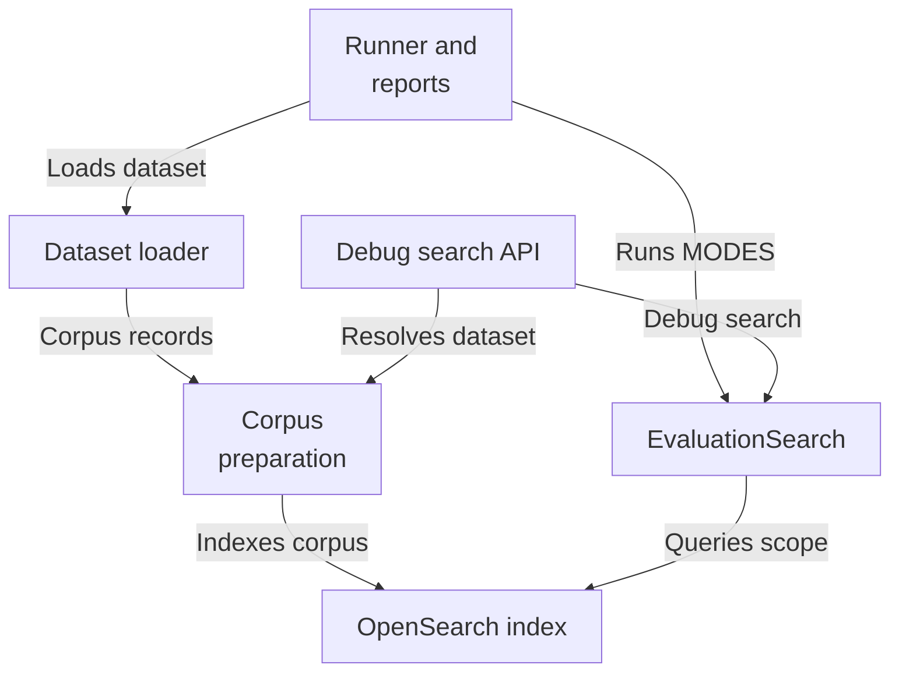
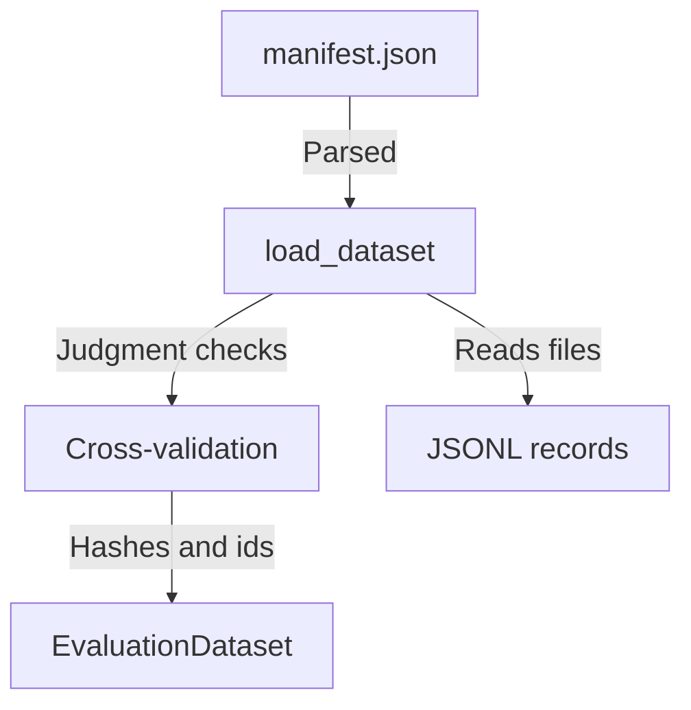
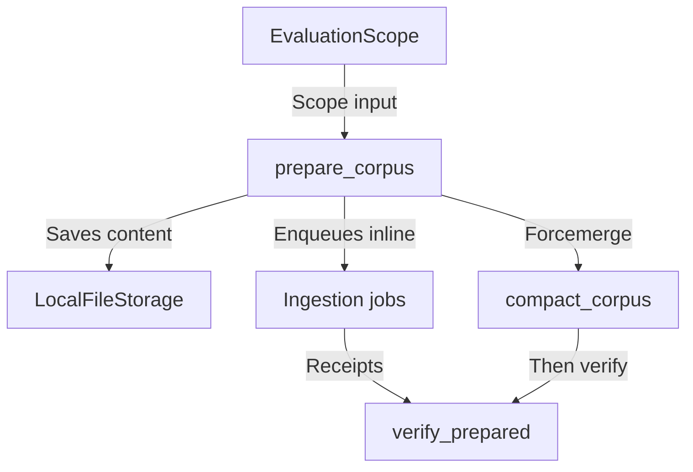
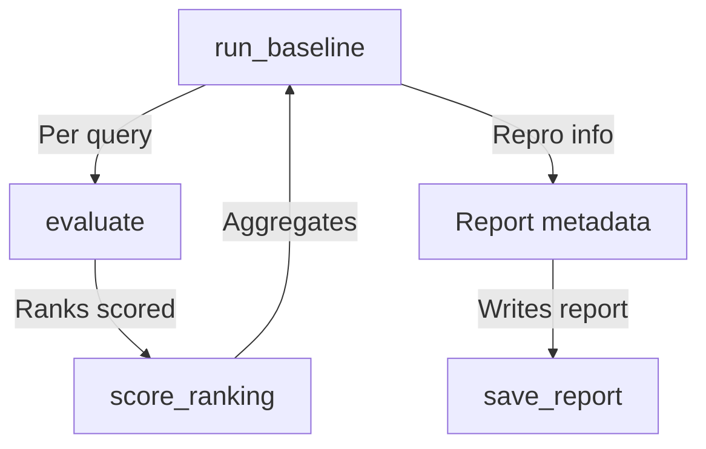
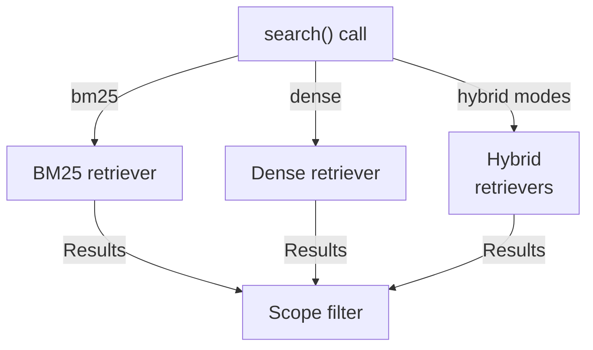
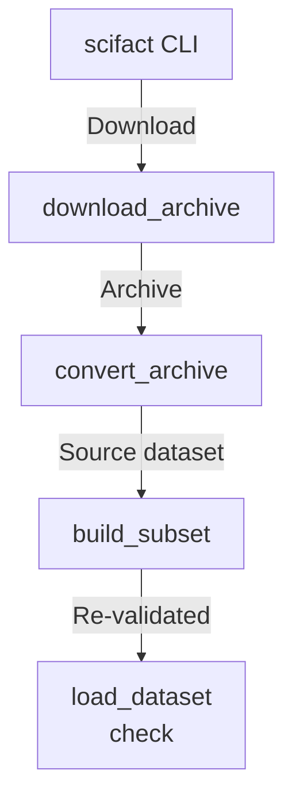
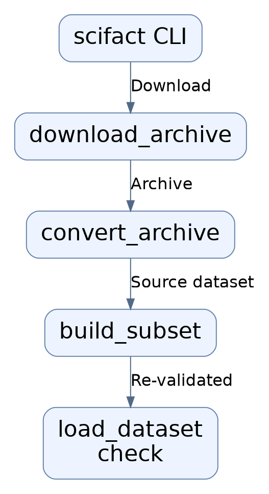

# Repository map

The evaluation subsystem loads and validates versioned datasets, prepares isolated evaluation corpora in OpenSearch, runs multi-mode retrieval (bm25/dense/hybrid/hybrid_rerank) through EvaluationSearch, scores rankings, and emits comparison reports, with a debug-only search API and a SciFact dataset builder CLI.

Commit: `05fb919153379762ce04a644ff9f6ef3e3413ff1` | Generated: 2026-10-17T22:41:11.018195+00:00

[Open PDF](repository-map.pdf)

**AI-generated analysis. Source references are checked for existence and supplied scope; this does not prove semantic correctness.**

## Scope

Tracked, eligible text only; bounded excerpts, not exhaustive.

20/20 eligible files analyzed; 203 tracked files excluded by policy.

8 API calls. See coverage.json for budgets, exclusions, and usage.

## Architecture

Dataset loading, corpus preparation, evaluation search, scoring, and reporting modules, plus CLI, debug API, and storage surfaces.

PNG fallback

### Source evidence

- **F0001**: The evaluation package's __init__ re-exports CorpusRecord, DatasetManifest, EvaluationDataset, JudgmentRecord, QueryRecord, and load_dataset from hybrid_rag_search.evaluation.datasets via its __all__ list. (<a href="https://github.com/Justin-Mendoza/hybrid-rag-search/blob/05fb919153379762ce04a644ff9f6ef3e3413ff1/backend/src/hybrid_rag_search/evaluation/__init__.py#L1-L19">backend/src/hybrid_rag_search/evaluation/__init__.py:1-19</a>)
- **F0017**: load_dataset(directory) reads manifest.json and validates it as DatasetManifest, wrapping OSError and ValidationError into DatasetValidationError. (<a href="https://github.com/Justin-Mendoza/hybrid-rag-search/blob/05fb919153379762ce04a644ff9f6ef3e3413ff1/backend/src/hybrid_rag_search/evaluation/datasets.py#L1-L195">backend/src/hybrid_rag_search/evaluation/datasets.py:1-195</a>)
- **F0018**: load_dataset verifies each manifest-listed file's SHA-256 against DatasetFile.sha256 before parsing, raising DatasetValidationError on mismatch. (<a href="https://github.com/Justin-Mendoza/hybrid-rag-search/blob/05fb919153379762ce04a644ff9f6ef3e3413ff1/backend/src/hybrid_rag_search/evaluation/datasets.py#L1-L195">backend/src/hybrid_rag_search/evaluation/datasets.py:1-195</a>)
- **F0019**: DatasetManifest.require_all_files_once enforces that files contains corpus.jsonl, queries.jsonl, and judgments.jsonl exactly once. (<a href="https://github.com/Justin-Mendoza/hybrid-rag-search/blob/05fb919153379762ce04a644ff9f6ef3e3413ff1/backend/src/hybrid_rag_search/evaluation/datasets.py#L1-L195">backend/src/hybrid_rag_search/evaluation/datasets.py:1-195</a>)
- **F0025**: load_dataset computes corpus_hash as SHA-256 of corpus.jsonl bytes and dataset_hash over schema_version, dataset_id, version, and sorted per-file SHA-256 pairs. (<a href="https://github.com/Justin-Mendoza/hybrid-rag-search/blob/05fb919153379762ce04a644ff9f6ef3e3413ff1/backend/src/hybrid_rag_search/evaluation/datasets.py#L1-L195">backend/src/hybrid_rag_search/evaluation/datasets.py:1-195</a>)
- **F0007**: corpus.py builds an EvaluationScope where collection_id is uuid5(EVALUATION_TENANT, corpus_hash + pipeline_version) and document IDs are uuid5(collection_id, record.id); evaluation_scope rejects non-document corpus records with ValueError. (<a href="https://github.com/Justin-Mendoza/hybrid-rag-search/blob/05fb919153379762ce04a644ff9f6ef3e3413ff1/backend/src/hybrid_rag_search/evaluation/corpus.py#L1-L264">backend/src/hybrid_rag_search/evaluation/corpus.py:1-264</a>)
- **F0009**: prepare_corpus creates an async engine and sessionmaker, ensures the evaluation index, inserts Tenant and Collection rows with on_conflict_do_nothing, then enqueues and runs ingestion jobs per corpus document. (<a href="https://github.com/Justin-Mendoza/hybrid-rag-search/blob/05fb919153379762ce04a644ff9f6ef3e3413ff1/backend/src/hybrid_rag_search/evaluation/corpus.py#L1-L264">backend/src/hybrid_rag_search/evaluation/corpus.py:1-264</a>)
- **F0010**: prepare_corpus computes a sha256 digest of title+text content, saves it via LocalFileStorage under storage_key(tenant_id, document_id), and raises ValueError if an existing Document has a differing content_hash or source_metadata. (<a href="https://github.com/Justin-Mendoza/hybrid-rag-search/blob/05fb919153379762ce04a644ff9f6ef3e3413ff1/backend/src/hybrid_rag_search/evaluation/corpus.py#L1-L264">backend/src/hybrid_rag_search/evaluation/corpus.py:1-264</a>)
- **F0012**: prepare_corpus disposes the engine in a finally block, then calls compact_corpus and verify_prepared before returning the scope. (<a href="https://github.com/Justin-Mendoza/hybrid-rag-search/blob/05fb919153379762ce04a644ff9f6ef3e3413ff1/backend/src/hybrid_rag_search/evaluation/corpus.py#L1-L264">backend/src/hybrid_rag_search/evaluation/corpus.py:1-264</a>)
- **F0016**: evaluation_index_settings derives per-collection read/write alias names prefixed with 'hybrid-rag-eval-{collection_id}' via settings.model_copy, isolating evaluation indices from demo aliases. (<a href="https://github.com/Justin-Mendoza/hybrid-rag-search/blob/05fb919153379762ce04a644ff9f6ef3e3413ff1/backend/src/hybrid_rag_search/evaluation/corpus.py#L1-L264">backend/src/hybrid_rag_search/evaluation/corpus.py:1-264</a>)
- **F0054**: search.py defines SearchMode literal with MODES ('bm25','dense','hybrid','hybrid_rerank') and BUDGET=100; benchmark_settings overrides candidate and result limits in Settings to BUDGET. (<a href="https://github.com/Justin-Mendoza/hybrid-rag-search/blob/05fb919153379762ce04a644ff9f6ef3e3413ff1/backend/src/hybrid_rag_search/evaluation/search.py#L1-L139">backend/src/hybrid_rag_search/evaluation/search.py:1-139</a>)
- **F0055**: EvaluationSearch.__init__ constructs OpenSearchBM25Retriever.from_settings and initializes dense/hybrid/reranked lazily as None; search() branches on mode, using lexical for 'bm25', dense for 'dense', hybrid for 'hybrid', and reranked for 'hybrid_rerank'. (<a href="https://github.com/Justin-Mendoza/hybrid-rag-search/blob/05fb919153379762ce04a644ff9f6ef3e3413ff1/backend/src/hybrid_rag_search/evaluation/search.py#L1-L139">backend/src/hybrid_rag_search/evaluation/search.py:1-139</a>)
- **F0057**: search() calls evaluation_scope and evaluation_index_settings from evaluation.corpus to derive tenant_id, collection_id, read alias, allowed document IDs, and pipeline_version, and assigns the read alias onto the lexical and (if built) dense retrievers. (<a href="https://github.com/Justin-Mendoza/hybrid-rag-search/blob/05fb919153379762ce04a644ff9f6ef3e3413ff1/backend/src/hybrid_rag_search/evaluation/search.py#L1-L139">backend/src/hybrid_rag_search/evaluation/search.py:1-139</a>)
- **F0060**: search() assembles output chunks with rank and evaluation_document_id, then deduplicates by evaluation_document_id to produce a documents list, returning {mode, chunks, documents, trace} where trace is derived via asdict from each retriever's response trace. (<a href="https://github.com/Justin-Mendoza/hybrid-rag-search/blob/05fb919153379762ce04a644ff9f6ef3e3413ff1/backend/src/hybrid_rag_search/evaluation/search.py#L1-L139">backend/src/hybrid_rag_search/evaluation/search.py:1-139</a>)
- **F0031**: main() is the CLI entry point; it defines subcommands 'prepare', 'run', 'compare', and 'export', and dispatches via asyncio.run for prepare/run, save_report for export, and compare_reports for the default branch. (<a href="https://github.com/Justin-Mendoza/hybrid-rag-search/blob/05fb919153379762ce04a644ff9f6ef3e3413ff1/backend/src/hybrid_rag_search/evaluation/runner.py#L1-L301">backend/src/hybrid_rag_search/evaluation/runner.py:1-301</a>)
- **F0032**: evaluate() iterates dataset.queries, sleeping query_delay between queries, and for each query calls search(dataset, query.text, mode, query.metadata_filters) once per mode in MODES. (<a href="https://github.com/Justin-Mendoza/hybrid-rag-search/blob/05fb919153379762ce04a644ff9f6ef3e3413ff1/backend/src/hybrid_rag_search/evaluation/runner.py#L1-L301">backend/src/hybrid_rag_search/evaluation/runner.py:1-301</a>)
- **F0035**: evaluate() scores each mode's ranking (document_id order) with score_ranking against that query's judgments and records elapsed_ms, chunk_count, and document_count. (<a href="https://github.com/Justin-Mendoza/hybrid-rag-search/blob/05fb919153379762ce04a644ff9f6ef3e3413ff1/backend/src/hybrid_rag_search/evaluation/runner.py#L1-L301">backend/src/hybrid_rag_search/evaluation/runner.py:1-301</a>)
- **F0038**: save_report() JSON-encodes via jsonable_encoder, creates the output directory, and writes report.json and report.md. (<a href="https://github.com/Justin-Mendoza/hybrid-rag-search/blob/05fb919153379762ce04a644ff9f6ef3e3413ff1/backend/src/hybrid_rag_search/evaluation/runner.py#L1-L301">backend/src/hybrid_rag_search/evaluation/runner.py:1-301</a>)
- **F0002**: api.py defines an APIRouter named 'router' and a POST /debug/search endpoint (debug_search) tagged 'evaluation'. (<a href="https://github.com/Justin-Mendoza/hybrid-rag-search/blob/05fb919153379762ce04a644ff9f6ef3e3413ff1/backend/src/hybrid_rag_search/evaluation/api.py#L1-L37">backend/src/hybrid_rag_search/evaluation/api.py:1-37</a>)
- **F0003**: DebugSearchRequest is a pydantic model with extra='forbid' requiring dataset (Literal synthetic-workspace|scifact|scifact-subset), query (1-4096 chars), and mode (SearchMode). (<a href="https://github.com/Justin-Mendoza/hybrid-rag-search/blob/05fb919153379762ce04a644ff9f6ef3e3413ff1/backend/src/hybrid_rag_search/evaluation/api.py#L1-L37">backend/src/hybrid_rag_search/evaluation/api.py:1-37</a>)
- **F0004**: debug_search returns HTTP 404 when settings.app_env equals 'production', making the debug endpoint local-only. (<a href="https://github.com/Justin-Mendoza/hybrid-rag-search/blob/05fb919153379762ce04a644ff9f6ef3e3413ff1/backend/src/hybrid_rag_search/evaluation/api.py#L1-L37">backend/src/hybrid_rag_search/evaluation/api.py:1-37</a>)
- **F0013**: compact_corpus issues an OpenSearch _forcemerge POST with max_num_segments=1 and flush=true on the evaluation physical index and raises on HTTP error status. (<a href="https://github.com/Justin-Mendoza/hybrid-rag-search/blob/05fb919153379762ce04a644ff9f6ef3e3413ff1/backend/src/hybrid_rag_search/evaluation/corpus.py#L1-L264">backend/src/hybrid_rag_search/evaluation/corpus.py:1-264</a>)
- **F0041**: run_baseline() performs an external HTTP GET to /_alias/{opensearch_read_alias} using httpx.AsyncClient and raises for status, recording sorted index names in report metadata. (<a href="https://github.com/Justin-Mendoza/hybrid-rag-search/blob/05fb919153379762ce04a644ff9f6ef3e3413ff1/backend/src/hybrid_rag_search/evaluation/runner.py#L1-L301">backend/src/hybrid_rag_search/evaluation/runner.py:1-301</a>)
- **F0088**: Outgoing OpenSearch requests built by EvaluationSearch contain the scope tenant_id and collection_id serialized in the request body. (<a href="https://github.com/Justin-Mendoza/hybrid-rag-search/blob/05fb919153379762ce04a644ff9f6ef3e3413ff1/backend/tests/test_evaluation_search.py#L1-L181">backend/tests/test_evaluation_search.py:1-181</a>)
- **F0043**: run_baseline() runs evaluation within an 'async with EvaluationSearch(settings)' context and records rerank_fallback_count by counting queries whose hybrid_rerank trace fallback_reason is not None. (<a href="https://github.com/Justin-Mendoza/hybrid-rag-search/blob/05fb919153379762ce04a644ff9f6ef3e3413ff1/backend/src/hybrid_rag_search/evaluation/runner.py#L1-L301">backend/src/hybrid_rag_search/evaluation/runner.py:1-301</a>)
- **F0045**: run_baseline() records metadata including report schema 'retrieval-evaluation-v1', UTC timestamp, dataset hashes/counts, chunk_count, tenant/collection ids, hardware info, cache_state, query_delay_seconds, models, adapters, and metric_rules. (<a href="https://github.com/Justin-Mendoza/hybrid-rag-search/blob/05fb919153379762ce04a644ff9f6ef3e3413ff1/backend/src/hybrid_rag_search/evaluation/runner.py#L1-L301">backend/src/hybrid_rag_search/evaluation/runner.py:1-301</a>)
- **F0005**: debug_search calls selected_dataset, awaits verify_prepared, then opens an async EvaluationSearch context and awaits its search(...) with debug=True. (<a href="https://github.com/Justin-Mendoza/hybrid-rag-search/blob/05fb919153379762ce04a644ff9f6ef3e3413ff1/backend/src/hybrid_rag_search/evaluation/api.py#L1-L37">backend/src/hybrid_rag_search/evaluation/api.py:1-37</a>)
- **F0100**: selected_dataset(request.dataset) is invoked from DebugSearchRequest(dataset='scifact-subset', ...), wiring the evaluation debug API to registered datasets and reporting a 500-item corpus. (<a href="https://github.com/Justin-Mendoza/hybrid-rag-search/blob/05fb919153379762ce04a644ff9f6ef3e3413ff1/backend/tests/test_scifact_subset.py#L1-L97">backend/tests/test_scifact_subset.py:1-97</a>)

## Dataset loading and validation

load_dataset reads the manifest, verifies file hashes, parses JSONL rows, enforces uniqueness, and cross-validates judgments against corpus and queries.

PNG fallback

### Source evidence

- **F0017**: load_dataset(directory) reads manifest.json and validates it as DatasetManifest, wrapping OSError and ValidationError into DatasetValidationError. (<a href="https://github.com/Justin-Mendoza/hybrid-rag-search/blob/05fb919153379762ce04a644ff9f6ef3e3413ff1/backend/src/hybrid_rag_search/evaluation/datasets.py#L1-L195">backend/src/hybrid_rag_search/evaluation/datasets.py:1-195</a>)
- **F0019**: DatasetManifest.require_all_files_once enforces that files contains corpus.jsonl, queries.jsonl, and judgments.jsonl exactly once. (<a href="https://github.com/Justin-Mendoza/hybrid-rag-search/blob/05fb919153379762ce04a644ff9f6ef3e3413ff1/backend/src/hybrid_rag_search/evaluation/datasets.py#L1-L195">backend/src/hybrid_rag_search/evaluation/datasets.py:1-195</a>)
- **F0107**: manifest.schema.json requires schema_version='evaluation-dataset-v1', dataset_id, name, version, purpose='evaluation', description, source (requiring name), and a files array of exactly 3 items with path enum ['corpus.jsonl','queries.jsonl','judgments.jsonl'] and sha256. (<a href="https://github.com/Justin-Mendoza/hybrid-rag-search/blob/05fb919153379762ce04a644ff9f6ef3e3413ff1/datasets/schemas/manifest.schema.json#L1-L41">datasets/schemas/manifest.schema.json:1-41</a>)
- **F0018**: load_dataset verifies each manifest-listed file's SHA-256 against DatasetFile.sha256 before parsing, raising DatasetValidationError on mismatch. (<a href="https://github.com/Justin-Mendoza/hybrid-rag-search/blob/05fb919153379762ce04a644ff9f6ef3e3413ff1/backend/src/hybrid_rag_search/evaluation/datasets.py#L1-L195">backend/src/hybrid_rag_search/evaluation/datasets.py:1-195</a>)
- **F0021**: _read_jsonl parses each line with json.loads and validates against the given pydantic model, rejecting blank lines and non-object lines with DatasetValidationError including file name and line number. (<a href="https://github.com/Justin-Mendoza/hybrid-rag-search/blob/05fb919153379762ce04a644ff9f6ef3e3413ff1/backend/src/hybrid_rag_search/evaluation/datasets.py#L1-L195">backend/src/hybrid_rag_search/evaluation/datasets.py:1-195</a>)
- **F0022**: _unique_ids raises DatasetValidationError listing duplicate IDs for corpus and query records. (<a href="https://github.com/Justin-Mendoza/hybrid-rag-search/blob/05fb919153379762ce04a644ff9f6ef3e3413ff1/backend/src/hybrid_rag_search/evaluation/datasets.py#L1-L195">backend/src/hybrid_rag_search/evaluation/datasets.py:1-195</a>)
- **F0023**: load_dataset cross-validates judgments against corpus and queries, requiring known query_id, known target_id, and matching target_type. (<a href="https://github.com/Justin-Mendoza/hybrid-rag-search/blob/05fb919153379762ce04a644ff9f6ef3e3413ff1/backend/src/hybrid_rag_search/evaluation/datasets.py#L1-L195">backend/src/hybrid_rag_search/evaluation/datasets.py:1-195</a>)
- **F0024**: load_dataset rejects datasets where any query lacks a judgment or lacks a positive (grade &gt; 0) judgment. (<a href="https://github.com/Justin-Mendoza/hybrid-rag-search/blob/05fb919153379762ce04a644ff9f6ef3e3413ff1/backend/src/hybrid_rag_search/evaluation/datasets.py#L1-L195">backend/src/hybrid_rag_search/evaluation/datasets.py:1-195</a>)
- **F0020**: CorpusRecord.validate_parent enforces chunk records require document_id and document records must not have document_id. (<a href="https://github.com/Justin-Mendoza/hybrid-rag-search/blob/05fb919153379762ce04a644ff9f6ef3e3413ff1/backend/src/hybrid_rag_search/evaluation/datasets.py#L1-L195">backend/src/hybrid_rag_search/evaluation/datasets.py:1-195</a>)
- **F0025**: load_dataset computes corpus_hash as SHA-256 of corpus.jsonl bytes and dataset_hash over schema_version, dataset_id, version, and sorted per-file SHA-256 pairs. (<a href="https://github.com/Justin-Mendoza/hybrid-rag-search/blob/05fb919153379762ce04a644ff9f6ef3e3413ff1/backend/src/hybrid_rag_search/evaluation/datasets.py#L1-L195">backend/src/hybrid_rag_search/evaluation/datasets.py:1-195</a>)
- **F0105**: corpus.schema.json requires fields id, type, text with type enum ['document','chunk'], and forbids additional properties (additionalProperties: false). (<a href="https://github.com/Justin-Mendoza/hybrid-rag-search/blob/05fb919153379762ce04a644ff9f6ef3e3413ff1/datasets/schemas/corpus.schema.json#L1-L16">datasets/schemas/corpus.schema.json:1-16</a>)
- **F0106**: judgment.schema.json requires query_id, target_type, target_id, relevance_grade and constrains relevance_grade to integer 0-3. (<a href="https://github.com/Justin-Mendoza/hybrid-rag-search/blob/05fb919153379762ce04a644ff9f6ef3e3413ff1/datasets/schemas/judgment.schema.json#L1-L14">datasets/schemas/judgment.schema.json:1-14</a>)

## Corpus preparation flow

prepare_corpus computes scope, writes content to storage, enqueues inline durable jobs, then compacts and verifies the index against job receipts.

PNG fallback

### Source evidence

- **F0007**: corpus.py builds an EvaluationScope where collection_id is uuid5(EVALUATION_TENANT, corpus_hash + pipeline_version) and document IDs are uuid5(collection_id, record.id); evaluation_scope rejects non-document corpus records with ValueError. (<a href="https://github.com/Justin-Mendoza/hybrid-rag-search/blob/05fb919153379762ce04a644ff9f6ef3e3413ff1/backend/src/hybrid_rag_search/evaluation/corpus.py#L1-L264">backend/src/hybrid_rag_search/evaluation/corpus.py:1-264</a>)
- **F0083**: evaluation_scope() derives a scope sensitive to corpus_hash and opensearch_index_schema_version but not dataset_hash, and raises ValueError for corpora whose entries are not documents (matching 'document corpora'). (<a href="https://github.com/Justin-Mendoza/hybrid-rag-search/blob/05fb919153379762ce04a644ff9f6ef3e3413ff1/backend/tests/test_evaluation_runner.py#L1-L174">backend/tests/test_evaluation_runner.py:1-174</a>)
- **F0009**: prepare_corpus creates an async engine and sessionmaker, ensures the evaluation index, inserts Tenant and Collection rows with on_conflict_do_nothing, then enqueues and runs ingestion jobs per corpus document. (<a href="https://github.com/Justin-Mendoza/hybrid-rag-search/blob/05fb919153379762ce04a644ff9f6ef3e3413ff1/backend/src/hybrid_rag_search/evaluation/corpus.py#L1-L264">backend/src/hybrid_rag_search/evaluation/corpus.py:1-264</a>)
- **F0010**: prepare_corpus computes a sha256 digest of title+text content, saves it via LocalFileStorage under storage_key(tenant_id, document_id), and raises ValueError if an existing Document has a differing content_hash or source_metadata. (<a href="https://github.com/Justin-Mendoza/hybrid-rag-search/blob/05fb919153379762ce04a644ff9f6ef3e3413ff1/backend/src/hybrid_rag_search/evaluation/corpus.py#L1-L264">backend/src/hybrid_rag_search/evaluation/corpus.py:1-264</a>)
- **F0011**: prepare_corpus uses ManualActor/ManualPublisher stubs so durable ingestion jobs execute inline via run_configured_job and treats any non-SUCCEEDED JobRunResult as a ValueError. (<a href="https://github.com/Justin-Mendoza/hybrid-rag-search/blob/05fb919153379762ce04a644ff9f6ef3e3413ff1/backend/src/hybrid_rag_search/evaluation/corpus.py#L1-L264">backend/src/hybrid_rag_search/evaluation/corpus.py:1-264</a>)
- **F0014**: verify_prepared queries succeeded IngestionJob rows for the scope's tenant/documents/pipeline_version, raises ValueError when the count differs from the corpus size, and validates each job's checkpoint['index'] receipt (generation_id str, chunk_count int). (<a href="https://github.com/Justin-Mendoza/hybrid-rag-search/blob/05fb919153379762ce04a644ff9f6ef3e3413ff1/backend/src/hybrid_rag_search/evaluation/corpus.py#L1-L264">backend/src/hybrid_rag_search/evaluation/corpus.py:1-264</a>)
- **F0015**: verify_prepared then aggregates the read alias with tenant_id/collection_id/visibility=ready filters and raises ValueError if the aggregated generation/count map does not match the expected receipts, returning the summed doc_count. (<a href="https://github.com/Justin-Mendoza/hybrid-rag-search/blob/05fb919153379762ce04a644ff9f6ef3e3413ff1/backend/src/hybrid_rag_search/evaluation/corpus.py#L1-L264">backend/src/hybrid_rag_search/evaluation/corpus.py:1-264</a>)
- **F0012**: prepare_corpus disposes the engine in a finally block, then calls compact_corpus and verify_prepared before returning the scope. (<a href="https://github.com/Justin-Mendoza/hybrid-rag-search/blob/05fb919153379762ce04a644ff9f6ef3e3413ff1/backend/src/hybrid_rag_search/evaluation/corpus.py#L1-L264">backend/src/hybrid_rag_search/evaluation/corpus.py:1-264</a>)
- **F0013**: compact_corpus issues an OpenSearch _forcemerge POST with max_num_segments=1 and flush=true on the evaluation physical index and raises on HTTP error status. (<a href="https://github.com/Justin-Mendoza/hybrid-rag-search/blob/05fb919153379762ce04a644ff9f6ef3e3413ff1/backend/src/hybrid_rag_search/evaluation/corpus.py#L1-L264">backend/src/hybrid_rag_search/evaluation/corpus.py:1-264</a>)

## Evaluation run flow

run_baseline prepares scope, calls evaluate for each mode, scores rankings, records reproduction metadata, and saves JSON plus markdown reports.

PNG fallback

### Source evidence

- **F0040**: run_baseline() builds settings via benchmark_settings and evaluation_index_settings, verifies the prepared corpus with verify_prepared, and derives scope via evaluation_scope. (<a href="https://github.com/Justin-Mendoza/hybrid-rag-search/blob/05fb919153379762ce04a644ff9f6ef3e3413ff1/backend/src/hybrid_rag_search/evaluation/runner.py#L1-L301">backend/src/hybrid_rag_search/evaluation/runner.py:1-301</a>)
- **F0043**: run_baseline() runs evaluation within an 'async with EvaluationSearch(settings)' context and records rerank_fallback_count by counting queries whose hybrid_rerank trace fallback_reason is not None. (<a href="https://github.com/Justin-Mendoza/hybrid-rag-search/blob/05fb919153379762ce04a644ff9f6ef3e3413ff1/backend/src/hybrid_rag_search/evaluation/runner.py#L1-L301">backend/src/hybrid_rag_search/evaluation/runner.py:1-301</a>)
- **F0045**: run_baseline() records metadata including report schema 'retrieval-evaluation-v1', UTC timestamp, dataset hashes/counts, chunk_count, tenant/collection ids, hardware info, cache_state, query_delay_seconds, models, adapters, and metric_rules. (<a href="https://github.com/Justin-Mendoza/hybrid-rag-search/blob/05fb919153379762ce04a644ff9f6ef3e3413ff1/backend/src/hybrid_rag_search/evaluation/runner.py#L1-L301">backend/src/hybrid_rag_search/evaluation/runner.py:1-301</a>)
- **F0032**: evaluate() iterates dataset.queries, sleeping query_delay between queries, and for each query calls search(dataset, query.text, mode, query.metadata_filters) once per mode in MODES. (<a href="https://github.com/Justin-Mendoza/hybrid-rag-search/blob/05fb919153379762ce04a644ff9f6ef3e3413ff1/backend/src/hybrid_rag_search/evaluation/runner.py#L1-L301">backend/src/hybrid_rag_search/evaluation/runner.py:1-301</a>)
- **F0033**: evaluate() validates query_delay is nonnegative and raises ValueError when judgments include a non-document target or duplicate document judgment per query. (<a href="https://github.com/Justin-Mendoza/hybrid-rag-search/blob/05fb919153379762ce04a644ff9f6ef3e3413ff1/backend/src/hybrid_rag_search/evaluation/runner.py#L1-L301">backend/src/hybrid_rag_search/evaluation/runner.py:1-301</a>)
- **F0034**: evaluate() trims each search result's 'chunks' to keys chunk_id, evaluation_document_id, rank, score before storing it, to avoid repeating corpus source bytes. (<a href="https://github.com/Justin-Mendoza/hybrid-rag-search/blob/05fb919153379762ce04a644ff9f6ef3e3413ff1/backend/src/hybrid_rag_search/evaluation/runner.py#L1-L301">backend/src/hybrid_rag_search/evaluation/runner.py:1-301</a>)
- **F0026**: score_ranking(ranking, judgments) validates that all relevance grades are ints in 0..3 and that at least one positive judgment exists, otherwise raising ValueError. (<a href="https://github.com/Justin-Mendoza/hybrid-rag-search/blob/05fb919153379762ce04a644ff9f6ef3e3413ff1/backend/src/hybrid_rag_search/evaluation/metrics.py#L1-L28">backend/src/hybrid_rag_search/evaluation/metrics.py:1-28</a>)
- **F0028**: score_ranking computes recall@5, recall@10, recall@50 using set intersection of cutoff documents with relevant keys, and mrr@10 as reciprocal rank of the first relevant document within the top 10. (<a href="https://github.com/Justin-Mendoza/hybrid-rag-search/blob/05fb919153379762ce04a644ff9f6ef3e3413ff1/backend/src/hybrid_rag_search/evaluation/metrics.py#L1-L28">backend/src/hybrid_rag_search/evaluation/metrics.py:1-28</a>)
- **F0029**: score_ranking computes ndcg@10 using DCG with gain (2**grade - 1)/log2(rank+1) and ideal DCG from the top-10 sorted judgment grades; unjudged results contribute grade 0. (<a href="https://github.com/Justin-Mendoza/hybrid-rag-search/blob/05fb919153379762ce04a644ff9f6ef3e3413ff1/backend/src/hybrid_rag_search/evaluation/metrics.py#L1-L28">backend/src/hybrid_rag_search/evaluation/metrics.py:1-28</a>)
- **F0041**: run_baseline() performs an external HTTP GET to /_alias/{opensearch_read_alias} using httpx.AsyncClient and raises for status, recording sorted index names in report metadata. (<a href="https://github.com/Justin-Mendoza/hybrid-rag-search/blob/05fb919153379762ce04a644ff9f6ef3e3413ff1/backend/src/hybrid_rag_search/evaluation/runner.py#L1-L301">backend/src/hybrid_rag_search/evaluation/runner.py:1-301</a>)
- **F0042**: run_baseline() shells out to git rev-parse HEAD and git diff HEAD --name-only via subprocess to record code_revision and tracked_worktree_dirty. (<a href="https://github.com/Justin-Mendoza/hybrid-rag-search/blob/05fb919153379762ce04a644ff9f6ef3e3413ff1/backend/src/hybrid_rag_search/evaluation/runner.py#L1-L301">backend/src/hybrid_rag_search/evaluation/runner.py:1-301</a>)
- **F0044**: configuration() builds an explicit allowlist of settings names starting with 'opensearch_bm25_' plus named keys, preventing credentials and unrelated settings from entering reports, and adds rrf_rank_constant=60. (<a href="https://github.com/Justin-Mendoza/hybrid-rag-search/blob/05fb919153379762ce04a644ff9f6ef3e3413ff1/backend/src/hybrid_rag_search/evaluation/runner.py#L1-L301">backend/src/hybrid_rag_search/evaluation/runner.py:1-301</a>)
- **F0038**: save_report() JSON-encodes via jsonable_encoder, creates the output directory, and writes report.json and report.md. (<a href="https://github.com/Justin-Mendoza/hybrid-rag-search/blob/05fb919153379762ce04a644ff9f6ef3e3413ff1/backend/src/hybrid_rag_search/evaluation/runner.py#L1-L301">backend/src/hybrid_rag_search/evaluation/runner.py:1-301</a>)
- **F0082**: save_report() writes both report.json (containing per-query mode/delta_vs_bm25 metrics) and report.md (with a 'Per-query differences' section) into the given directory. (<a href="https://github.com/Justin-Mendoza/hybrid-rag-search/blob/05fb919153379762ce04a644ff9f6ef3e3413ff1/backend/tests/test_evaluation_runner.py#L1-L174">backend/tests/test_evaluation_runner.py:1-174</a>)
- **F0035**: evaluate() scores each mode's ranking (document_id order) with score_ranking against that query's judgments and records elapsed_ms, chunk_count, and document_count. (<a href="https://github.com/Justin-Mendoza/hybrid-rag-search/blob/05fb919153379762ce04a644ff9f6ef3e3413ff1/backend/src/hybrid_rag_search/evaluation/runner.py#L1-L301">backend/src/hybrid_rag_search/evaluation/runner.py:1-301</a>)
- **F0036**: evaluate() computes delta_vs_bm25 for every mode against the 'bm25' metrics, and averages each metric across all rows into an aggregate per mode. (<a href="https://github.com/Justin-Mendoza/hybrid-rag-search/blob/05fb919153379762ce04a644ff9f6ef3e3413ff1/backend/src/hybrid_rag_search/evaluation/runner.py#L1-L301">backend/src/hybrid_rag_search/evaluation/runner.py:1-301</a>)

## Search mode dispatch

EvaluationSearch validates mode and filters, derives scope, dispatches to the appropriate retriever (lazy provider contexts), then filters and deduplicates results.

PNG fallback

### Source evidence

- **F0056**: EvaluationSearch.search validates that mode is in MODES (raising ValueError otherwise) and that filter keys are within {source_type, author, source_date_from, source_date_to}, raising ValueError for unsupported metadata filters. (<a href="https://github.com/Justin-Mendoza/hybrid-rag-search/blob/05fb919153379762ce04a644ff9f6ef3e3413ff1/backend/src/hybrid_rag_search/evaluation/search.py#L1-L139">backend/src/hybrid_rag_search/evaluation/search.py:1-139</a>)
- **F0061**: parse_source_date (imported from retrieval_filters) is applied to filter values whose key starts with 'source_date_' before passing them into retriever options. (<a href="https://github.com/Justin-Mendoza/hybrid-rag-search/blob/05fb919153379762ce04a644ff9f6ef3e3413ff1/backend/src/hybrid_rag_search/evaluation/search.py#L1-L139">backend/src/hybrid_rag_search/evaluation/search.py:1-139</a>)
- **F0055**: EvaluationSearch.__init__ constructs OpenSearchBM25Retriever.from_settings and initializes dense/hybrid/reranked lazily as None; search() branches on mode, using lexical for 'bm25', dense for 'dense', hybrid for 'hybrid', and reranked for 'hybrid_rerank'. (<a href="https://github.com/Justin-Mendoza/hybrid-rag-search/blob/05fb919153379762ce04a644ff9f6ef3e3413ff1/backend/src/hybrid_rag_search/evaluation/search.py#L1-L139">backend/src/hybrid_rag_search/evaluation/search.py:1-139</a>)
- **F0057**: search() calls evaluation_scope and evaluation_index_settings from evaluation.corpus to derive tenant_id, collection_id, read alias, allowed document IDs, and pipeline_version, and assigns the read alias onto the lexical and (if built) dense retrievers. (<a href="https://github.com/Justin-Mendoza/hybrid-rag-search/blob/05fb919153379762ce04a644ff9f6ef3e3413ff1/backend/src/hybrid_rag_search/evaluation/search.py#L1-L139">backend/src/hybrid_rag_search/evaluation/search.py:1-139</a>)
- **F0058**: Dense, hybrid, and reranked retrievers and their provider entry contexts are created lazily on first non-bm25 call via AsyncExitStack.enter_async_context using configured_cohere_embeddings and configured_cohere_reranking, so provider resources are shared across queries. (<a href="https://github.com/Justin-Mendoza/hybrid-rag-search/blob/05fb919153379762ce04a644ff9f6ef3e3413ff1/backend/src/hybrid_rag_search/evaluation/search.py#L1-L139">backend/src/hybrid_rag_search/evaluation/search.py:1-139</a>)
- **F0059**: search() enforces scope by raising ValueError 'Search returned evidence outside the prepared evaluation scope' when a result's tenant_id, collection_id, document_id, or pipeline_version does not match the evaluation scope. (<a href="https://github.com/Justin-Mendoza/hybrid-rag-search/blob/05fb919153379762ce04a644ff9f6ef3e3413ff1/backend/src/hybrid_rag_search/evaluation/search.py#L1-L139">backend/src/hybrid_rag_search/evaluation/search.py:1-139</a>)
- **F0060**: search() assembles output chunks with rank and evaluation_document_id, then deduplicates by evaluation_document_id to produce a documents list, returning {mode, chunks, documents, trace} where trace is derived via asdict from each retriever's response trace. (<a href="https://github.com/Justin-Mendoza/hybrid-rag-search/blob/05fb919153379762ce04a644ff9f6ef3e3413ff1/backend/src/hybrid_rag_search/evaluation/search.py#L1-L139">backend/src/hybrid_rag_search/evaluation/search.py:1-139</a>)

## SciFact dataset build

The scifact CLI downloads and hash-verifies the archive, converts it into a normalized dataset, and optionally builds a deterministic 30-query/500-doc subset re-validated by load_dataset.

PNG fallback

### Source evidence

- **F0047**: scifact.py defines a CLI entry point via main() with subcommands 'download', 'validate', 'subset', dispatched when the module is run as __main__; 'download' calls download_archive then convert_archive, 'subset' calls build_subset, and every command prints _summary(output). (<a href="https://github.com/Justin-Mendoza/hybrid-rag-search/blob/05fb919153379762ce04a644ff9f6ef3e3413ff1/backend/src/hybrid_rag_search/evaluation/scifact.py#L1-L222">backend/src/hybrid_rag_search/evaluation/scifact.py:1-222</a>)
- **F0099**: scifact.main() is a CLI entry point that accepts a 'subset' subcommand with a '--source' option and writes to the SUBSET_OUTPUT path. (<a href="https://github.com/Justin-Mendoza/hybrid-rag-search/blob/05fb919153379762ce04a644ff9f6ef3e3413ff1/backend/tests/test_scifact_subset.py#L1-L97">backend/tests/test_scifact_subset.py:1-97</a>)
- **F0048**: download_archive performs an HTTP GET to SCIFACT_URL using httpx.get with follow_redirects and 60s timeout, writes the body to a .partial file, verifies its SHA-256 against SCIFACT_ARCHIVE_SHA256, and on mismatch raises ValueError; the partial file is always removed in a finally block. (<a href="https://github.com/Justin-Mendoza/hybrid-rag-search/blob/05fb919153379762ce04a644ff9f6ef3e3413ff1/backend/src/hybrid_rag_search/evaluation/scifact.py#L1-L222">backend/src/hybrid_rag_search/evaluation/scifact.py:1-222</a>)
- **F0092**: scifact.convert_archive() and download_archive() validate the archive against SCIFACT_ARCHIVE_SHA256 and raise ValueError matching 'SHA-256 mismatch' on mismatch; a failed download leaves no partial file. (<a href="https://github.com/Justin-Mendoza/hybrid-rag-search/blob/05fb919153379762ce04a644ff9f6ef3e3413ff1/backend/tests/test_scifact_dataset.py#L1-L100">backend/tests/test_scifact_dataset.py:1-100</a>)
- **F0049**: convert_archive re-verifies the archive SHA-256, opens the zip in memory, reads scifact/qrels/test.tsv, scifact/corpus.jsonl, and scifact/queries.jsonl, and emits a normalized four-file dataset (corpus.jsonl, queries.jsonl, judgments.jsonl, manifest.json). (<a href="https://github.com/Justin-Mendoza/hybrid-rag-search/blob/05fb919153379762ce04a644ff9f6ef3e3413ff1/backend/src/hybrid_rag_search/evaluation/scifact.py#L1-L222">backend/src/hybrid_rag_search/evaluation/scifact.py:1-222</a>)
- **F0050**: convert_archive remaps source IDs by prefixing 'scifact-doc-' for corpus, 'scifact-query-' for queries, and rewrites judgment relevance as grade 3 when score &gt; 0 else 0. (<a href="https://github.com/Justin-Mendoza/hybrid-rag-search/blob/05fb919153379762ce04a644ff9f6ef3e3413ff1/backend/src/hybrid_rag_search/evaluation/scifact.py#L1-L222">backend/src/hybrid_rag_search/evaluation/scifact.py:1-222</a>)
- **F0051**: build_subset loads an existing dataset, selects 30 queries and fills to 500 documents by salted SHA-256 ordering ('scifact-subset-v1:&lt;id&gt;'), always including documents referenced by the selected queries' judgments, and raises ValueError if fewer than 30 queries, 500 documents, or if judgments require more than 500 distinct documents. (<a href="https://github.com/Justin-Mendoza/hybrid-rag-search/blob/05fb919153379762ce04a644ff9f6ef3e3413ff1/backend/src/hybrid_rag_search/evaluation/scifact.py#L1-L222">backend/src/hybrid_rag_search/evaluation/scifact.py:1-222</a>)
- **F0101**: Query selection in scifact.build_subset is order-independent, using sha256 over the string 'scifact-subset-v1:{query.id}' to rank queries and taking the first 30. (<a href="https://github.com/Justin-Mendoza/hybrid-rag-search/blob/05fb919153379762ce04a644ff9f6ef3e3413ff1/backend/tests/test_scifact_subset.py#L1-L97">backend/tests/test_scifact_subset.py:1-97</a>)
- **F0102**: scifact.build_subset retains all judgments whose query_id belongs to the selected query set, as asserted by comparing set(first.judgments) to judgments filtered by selected query ids. (<a href="https://github.com/Justin-Mendoza/hybrid-rag-search/blob/05fb919153379762ce04a644ff9f6ef3e3413ff1/backend/tests/test_scifact_subset.py#L1-L97">backend/tests/test_scifact_subset.py:1-97</a>)
- **F0052**: Both convert_archive and build_subset write rendered JSONL files plus a manifest.json and, in build_subset, re-invoke load_dataset(output) to validate the written dataset before returning the output path. (<a href="https://github.com/Justin-Mendoza/hybrid-rag-search/blob/05fb919153379762ce04a644ff9f6ef3e3413ff1/backend/src/hybrid_rag_search/evaluation/scifact.py#L1-L222">backend/src/hybrid_rag_search/evaluation/scifact.py:1-222</a>)
- **F0053** (inferred): S0007 imports StrictModel and load_dataset from hybrid_rag_search.evaluation.datasets; this is a dependency usage, and the actual behavior of load_dataset is not visible in this excerpt (inference from the call sites). (<a href="https://github.com/Justin-Mendoza/hybrid-rag-search/blob/05fb919153379762ce04a644ff9f6ef3e3413ff1/backend/src/hybrid_rag_search/evaluation/scifact.py#L1-L222">backend/src/hybrid_rag_search/evaluation/scifact.py:1-222</a>)

## Uncertainties and untraced areas

- Whether the debug API's selected_dataset call and EvaluationSearch share the same settings object at runtime (F0100, F0110 are import-based wiring, run partially inferred).
- How the runner's HTTP alias GET (F0041) connects to the corpus module's evaluation_index_settings beyond the read alias name.
- Runtime binding between ORM models in models/evaluation.py and the dataset loader; no observed calls between them in findings.
- Concurrency/threading behavior of prepare_corpus jobs and compact_corpus ordering under real ingestion workers.
