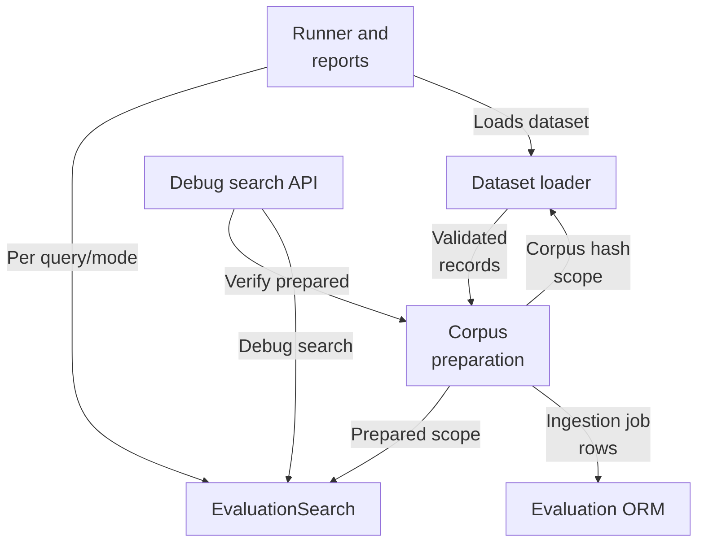
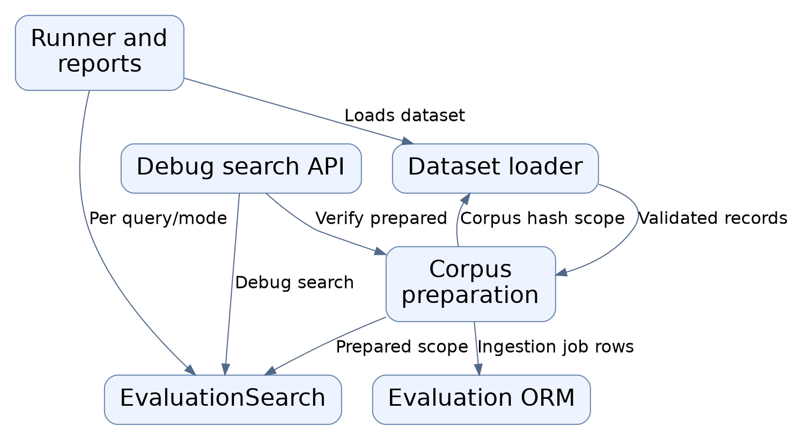
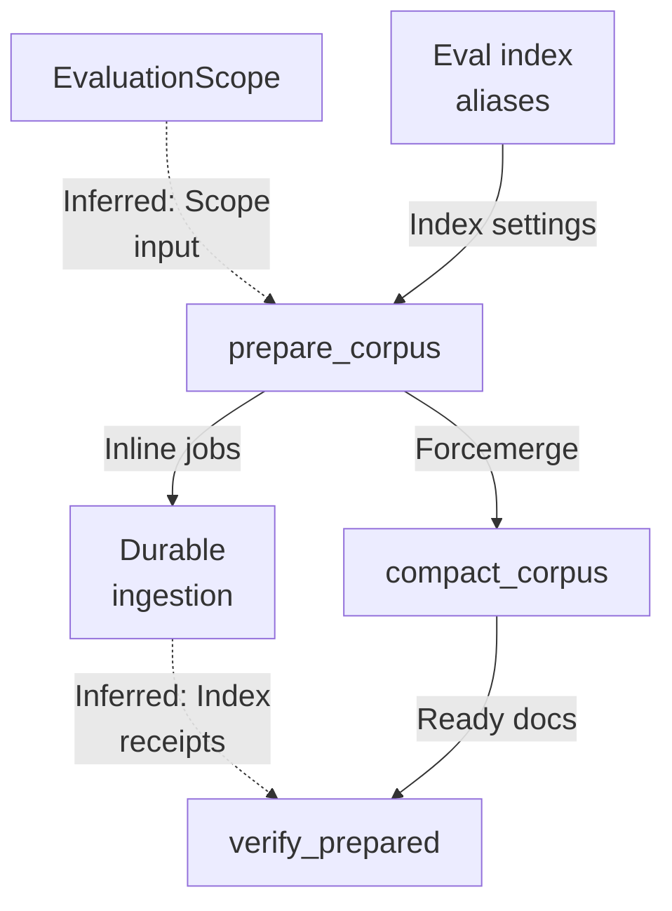
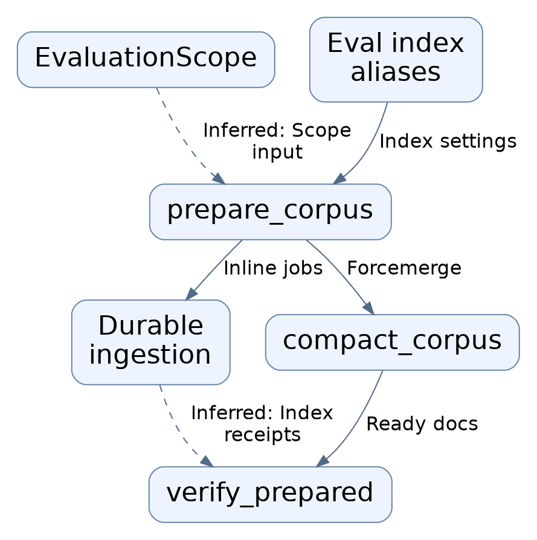
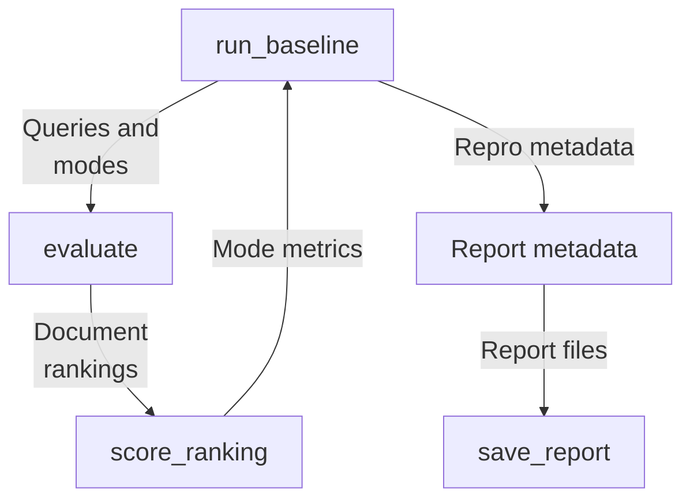
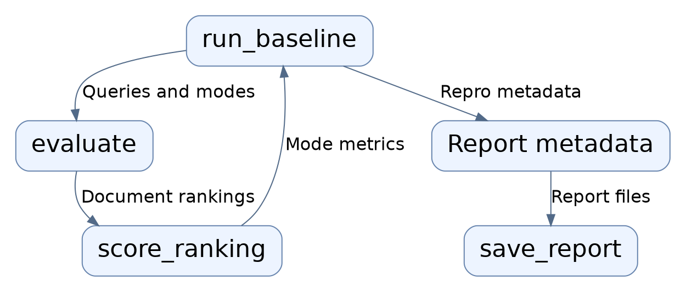
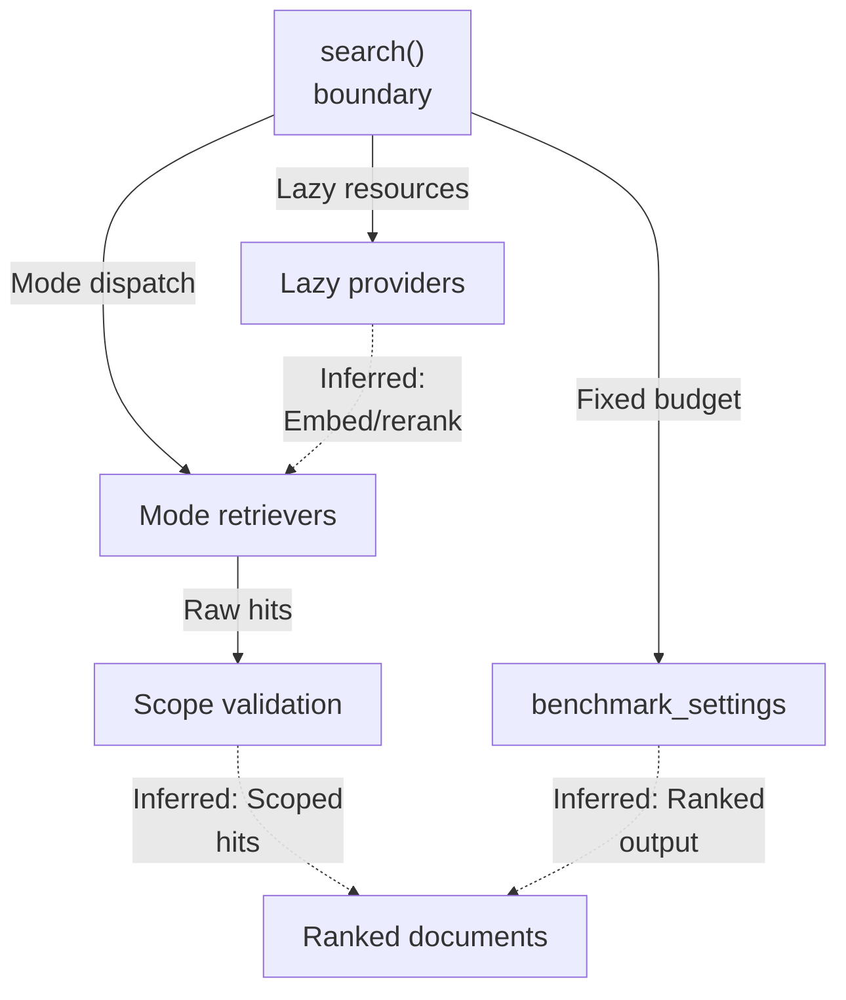
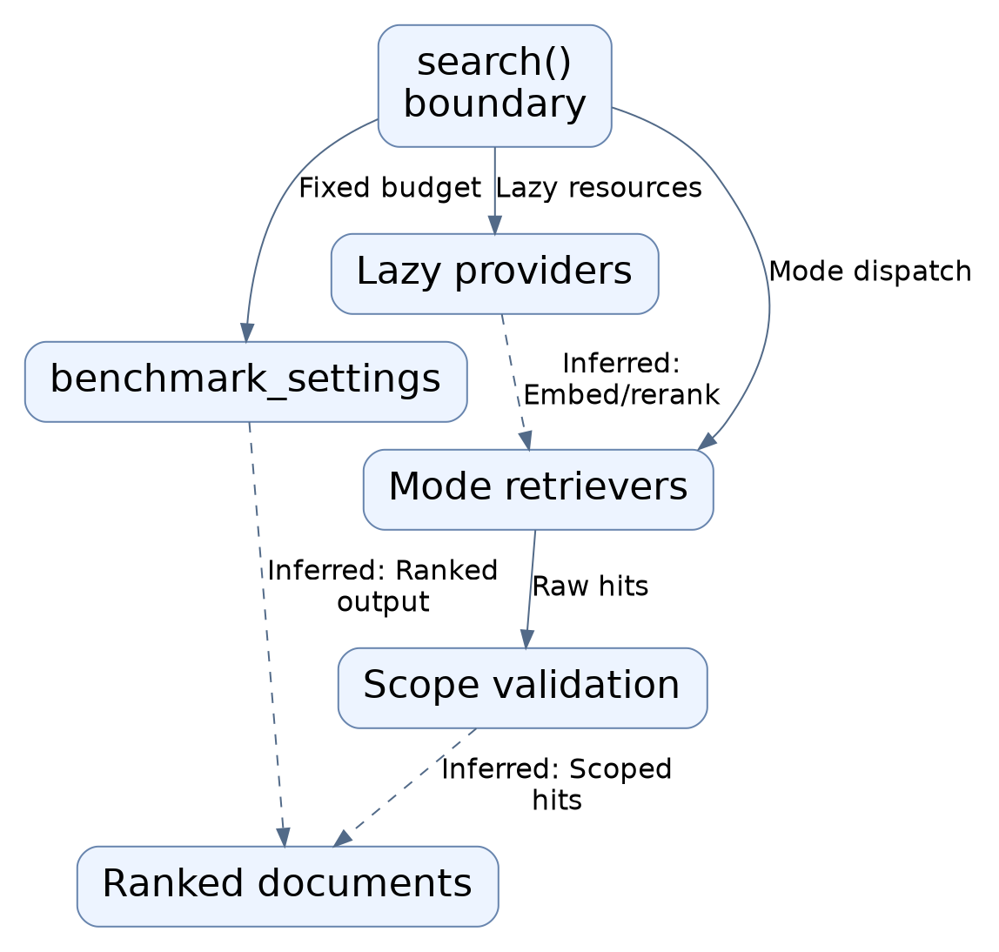
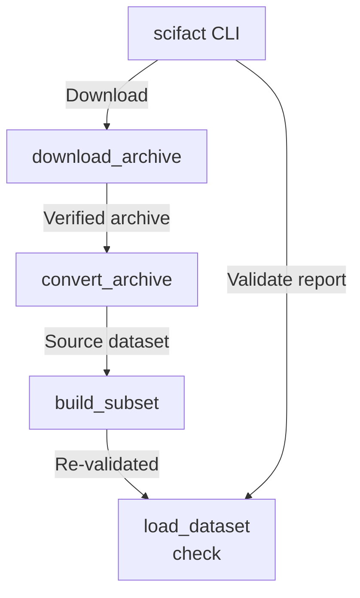
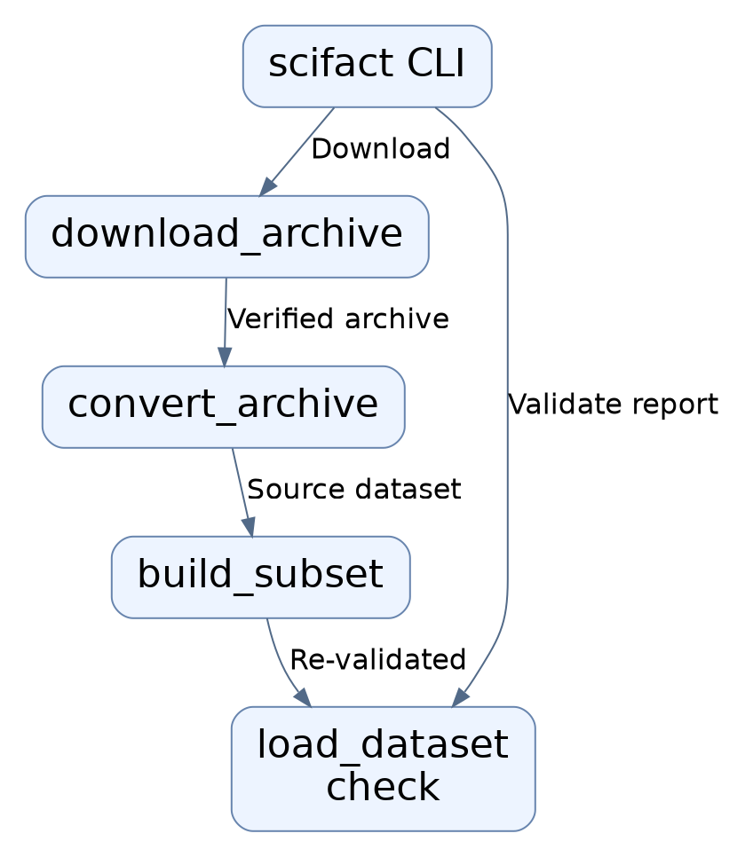

# Repository map

The evaluation subsystem loads hash-verified versioned datasets, prepares isolated per-scope corpora in OpenSearch through the durable ingestion pipeline, runs four retrieval modes via a shared EvaluationSearch boundary, scores rankings with fixed metrics, and emits reproducible reports. It exposes a production-disabled debug search API and a SciFact builder CLI, and owns evaluation ORM tables.

Commit: `f8493c1d264c525948d9d33ffaf2dd197be97e26` | Generated: 2026-10-18T18:33:37.746827+00:00

[Open PDF](repository-map.pdf)

**AI-generated analysis. Source references are checked for existence and supplied scope; this does not prove semantic correctness.**

## Scope

Tracked, eligible text only; bounded excerpts, not exhaustive.

20/20 eligible files analyzed; 203 tracked files excluded by policy.

8 API calls. See coverage.json for budgets, exclusions, and usage.

## Architecture

Dataset loading, corpus preparation, search dispatch, scoring/reporting, and the HTTP surface are separate boundaries; the API and runner share one search boundary, while corpus state faults map to distinct errors.

PNG fallback

### Source evidence

- **F0001**: The evaluation package __init__ re-exports its public contract from hybrid_rag_search.evaluation.datasets: CorpusRecord, DatasetManifest, EvaluationDataset, JudgmentRecord, QueryRecord, and load_dataset, defining the versioned dataset boundary. (<a href="https://github.com/Justin-Mendoza/hybrid-rag-search/blob/f8493c1d264c525948d9d33ffaf2dd197be97e26/backend/src/hybrid_rag_search/evaluation/__init__.py#L1-L19">backend/src/hybrid_rag_search/evaluation/__init__.py:1-19</a>)
- **F0017**: load_dataset(directory) is the public loader entry point: it reads manifest.json, validates it via DatasetManifest.model_validate_json, and returns an immutable EvaluationDataset bundling manifest, corpus, queries, judgments, corpus_hash, and dataset_hash. (<a href="https://github.com/Justin-Mendoza/hybrid-rag-search/blob/f8493c1d264c525948d9d33ffaf2dd197be97e26/backend/src/hybrid_rag_search/evaluation/datasets.py#L1-L195">backend/src/hybrid_rag_search/evaluation/datasets.py:1-195</a>)
- **F0020**: The strict dataset contract uses StrictModel with ConfigDict(extra="forbid", frozen=True), so records reject unknown fields and are immutable, and Identifier values must match ^[a-z0-9][a-z0-9._-]*$. (<a href="https://github.com/Justin-Mendoza/hybrid-rag-search/blob/f8493c1d264c525948d9d33ffaf2dd197be97e26/backend/src/hybrid_rag_search/evaluation/datasets.py#L1-L195">backend/src/hybrid_rag_search/evaluation/datasets.py:1-195</a>)
- **F0005**: corpus.py derives a deterministic EvaluationScope: collection_id = uuid5(EVALUATION_TENANT, f'{corpus_hash}:{pipeline}') and document_ids keyed by uuid5(collection, record.id), tying scope identity to dataset content hash and pipeline version. (<a href="https://github.com/Justin-Mendoza/hybrid-rag-search/blob/f8493c1d264c525948d9d33ffaf2dd197be97e26/backend/src/hybrid_rag_search/evaluation/corpus.py#L1-L264">backend/src/hybrid_rag_search/evaluation/corpus.py:1-264</a>)
- **F0006**: evaluation_index_settings rewrites opensearch_read_alias/write_alias to hybrid-rag-eval-{collection_id}-read/-write, keeping evaluation index creation separate from demo aliases and manual rebuilds. (<a href="https://github.com/Justin-Mendoza/hybrid-rag-search/blob/f8493c1d264c525948d9d33ffaf2dd197be97e26/backend/src/hybrid_rag_search/evaluation/corpus.py#L1-L264">backend/src/hybrid_rag_search/evaluation/corpus.py:1-264</a>)
- **F0012**: verify_prepared fails closed by querying IngestionJob rows for scope.tenant_id, scope.document_ids, scope.pipeline_version and status 'succeeded', raising ValueError if the count differs from the corpus or if a checkpoint's index receipt lacks a string generation_id or an int chunk_count. (<a href="https://github.com/Justin-Mendoza/hybrid-rag-search/blob/f8493c1d264c525948d9d33ffaf2dd197be97e26/backend/src/hybrid_rag_search/evaluation/corpus.py#L1-L264">backend/src/hybrid_rag_search/evaluation/corpus.py:1-264</a>)
- **F0049**: EvaluationSearch.search is the single dispatch boundary that selects one of four retrieval modes ('bm25', 'dense', 'hybrid', 'hybrid_rerank') declared in MODES, raising ValueError for an unknown mode. (<a href="https://github.com/Justin-Mendoza/hybrid-rag-search/blob/f8493c1d264c525948d9d33ffaf2dd197be97e26/backend/src/hybrid_rag_search/evaluation/search.py#L1-L139">backend/src/hybrid_rag_search/evaluation/search.py:1-139</a>)
- **F0052**: EvaluationSearch.search validates that every returned evidence item's tenant_id, collection_id, pipeline_version, and document_id match the resolved evaluation scope, raising ValueError('Search returned evidence outside the prepared evaluation scope') on mismatch. (<a href="https://github.com/Justin-Mendoza/hybrid-rag-search/blob/f8493c1d264c525948d9d33ffaf2dd197be97e26/backend/src/hybrid_rag_search/evaluation/search.py#L1-L139">backend/src/hybrid_rag_search/evaluation/search.py:1-139</a>)
- **F0056**: The evaluation search module docstring describes EvaluationSearch as 'One evaluation search boundary shared by HTTP and the benchmark runner', indicating intended reuse across HTTP and benchmark entry points. (<a href="https://github.com/Justin-Mendoza/hybrid-rag-search/blob/f8493c1d264c525948d9d33ffaf2dd197be97e26/backend/src/hybrid_rag_search/evaluation/search.py#L1-L139">backend/src/hybrid_rag_search/evaluation/search.py:1-139</a>)
- **F0033**: The evaluation runner exposes a CLI with four subcommands (prepare, run, compare, export) implemented via argparse subparsers in main(), making the module both a library of evaluation functions and an operator entry point. (<a href="https://github.com/Justin-Mendoza/hybrid-rag-search/blob/f8493c1d264c525948d9d33ffaf2dd197be97e26/backend/src/hybrid_rag_search/evaluation/runner.py#L1-L301">backend/src/hybrid_rag_search/evaluation/runner.py:1-301</a>)
- **F0034**: run_baseline is the orchestration entry point that chains dataset selection, benchmark/index settings derivation, corpus verification, alias lookup, retrieval, metadata assembly, and report saving, delegating domain scoring to evaluate and score_ranking. (<a href="https://github.com/Justin-Mendoza/hybrid-rag-search/blob/f8493c1d264c525948d9d33ffaf2dd197be97e26/backend/src/hybrid_rag_search/evaluation/runner.py#L1-L301">backend/src/hybrid_rag_search/evaluation/runner.py:1-301</a>)
- **F0044**: save_report serializes the report through fastapi.encoders.jsonable_encoder and writes both report.json and a markdown report (markdown_report) into the output directory, which is created if absent. (<a href="https://github.com/Justin-Mendoza/hybrid-rag-search/blob/f8493c1d264c525948d9d33ffaf2dd197be97e26/backend/src/hybrid_rag_search/evaluation/runner.py#L1-L301">backend/src/hybrid_rag_search/evaluation/runner.py:1-301</a>)
- **F0002**: evaluation/api.py exposes a single FastAPI APIRouter with POST /debug/search, modeling requests via DebugSearchRequest (dataset restricted to synthetic-workspace/scifact/scifact-subset, query length-bounded, plus a SearchMode). (<a href="https://github.com/Justin-Mendoza/hybrid-rag-search/blob/f8493c1d264c525948d9d33ffaf2dd197be97e26/backend/src/hybrid_rag_search/evaluation/api.py#L1-L37">backend/src/hybrid_rag_search/evaluation/api.py:1-37</a>)
- **F0003**: debug_search rejects production by raising HTTPException 404 when settings.app_env == 'production', making the evaluation HTTP surface local-only. (<a href="https://github.com/Justin-Mendoza/hybrid-rag-search/blob/f8493c1d264c525948d9d33ffaf2dd197be97e26/backend/src/hybrid_rag_search/evaluation/api.py#L1-L37">backend/src/hybrid_rag_search/evaluation/api.py:1-37</a>)
- **F0004**: debug_search orchestrates selected_dataset, await verify_prepared, then constructs EvaluationSearch as an async context manager and calls search(..., debug=True), mapping ValueError/OSError to HTTP 409 and RetrievalError/ProviderError to HTTP 503 with the error's code. (<a href="https://github.com/Justin-Mendoza/hybrid-rag-search/blob/f8493c1d264c525948d9d33ffaf2dd197be97e26/backend/src/hybrid_rag_search/evaluation/api.py#L1-L37">backend/src/hybrid_rag_search/evaluation/api.py:1-37</a>)
- **F0065** (inferred): The evaluation ORM layer defines four SQLAlchemy models on a shared Base: EvaluationDataset, Judgment, EvaluationRun, and AuditEvent, with enums JudgmentTarget (document/chunk) and EvaluationRunStatus (queued/running/succeeded/failed/cancelled). (<a href="https://github.com/Justin-Mendoza/hybrid-rag-search/blob/f8493c1d264c525948d9d33ffaf2dd197be97e26/backend/src/hybrid_rag_search/models/evaluation.py#L1-L172">backend/src/hybrid_rag_search/models/evaluation.py:1-172</a>)
- **F0066** (inferred): EvaluationDataset is tenant-scoped via a ForeignKey to tenants.id with ON DELETE CASCADE and enforces a unique (tenant_id, name, version) constraint, a positive integer version, a 64-hex-char corpus_hash, and object-typed dataset_metadata. (<a href="https://github.com/Justin-Mendoza/hybrid-rag-search/blob/f8493c1d264c525948d9d33ffaf2dd197be97e26/backend/src/hybrid_rag_search/models/evaluation.py#L1-L172">backend/src/hybrid_rag_search/models/evaluation.py:1-172</a>)
- **F0068** (inferred): EvaluationRun references both EvaluationDataset and retrieval_configs via composite foreign keys, both with ON DELETE RESTRICT, so a run cannot be created without a dataset and retrieval config and those parents cannot be deleted while a run exists. (<a href="https://github.com/Justin-Mendoza/hybrid-rag-search/blob/f8493c1d264c525948d9d33ffaf2dd197be97e26/backend/src/hybrid_rag_search/models/evaluation.py#L1-L172">backend/src/hybrid_rag_search/models/evaluation.py:1-172</a>)
- **F0008**: prepare_corpus reuses the durable ingestion pipeline: it inserts Tenant/Collection rows via on_conflict_do_nothing, then per corpus record saves content to LocalFileStorage and enqueues an IngestionJob via IngestionJobService with a ManualPublisher. (<a href="https://github.com/Justin-Mendoza/hybrid-rag-search/blob/f8493c1d264c525948d9d33ffaf2dd197be97e26/backend/src/hybrid_rag_search/evaluation/corpus.py#L1-L264">backend/src/hybrid_rag_search/evaluation/corpus.py:1-264</a>)
- **F0055**: EvaluationSearch.search reads per-dataset index settings from evaluation_index_settings and evaluates scope via evaluation_scope, then reassigns the bm25 and (when constructed) dense retriever read_alias to the configured opensearch_read_alias on each call. (<a href="https://github.com/Justin-Mendoza/hybrid-rag-search/blob/f8493c1d264c525948d9d33ffaf2dd197be97e26/backend/src/hybrid_rag_search/evaluation/search.py#L1-L139">backend/src/hybrid_rag_search/evaluation/search.py:1-139</a>)
- **F0035**: evaluate() iterates sequentially over dataset queries and then over each mode in MODES, awaiting an injected async SearchFunction per (query, mode) pair, and applies query_delay via asyncio.sleep between queries. (<a href="https://github.com/Justin-Mendoza/hybrid-rag-search/blob/f8493c1d264c525948d9d33ffaf2dd197be97e26/backend/src/hybrid_rag_search/evaluation/runner.py#L1-L301">backend/src/hybrid_rag_search/evaluation/runner.py:1-301</a>)
- **F0093**: The debug search API (hybrid_rag_search.evaluation.api) exposes POST /debug/search which validates the requested mode against MODES, verifies corpus preparedness via verify_prepared, and returns 422 for invalid dataset/tenant, 404 in production app_env, 409 for unprepared corpus, and 503 for RetrievalError or ProviderError (S0014). (<a href="https://github.com/Justin-Mendoza/hybrid-rag-search/blob/f8493c1d264c525948d9d33ffaf2dd197be97e26/backend/tests/test_evaluation_search.py#L1-L181">backend/tests/test_evaluation_search.py:1-181</a>)
- **F0009**: The preparation CLI runs durable jobs inline: when an enqueued job's status is not 'succeeded', prepare_corpus calls run_configured_job with a ManualActor (send returns job_id) and OpenSearchDocumentIndex, raising ValueError if the result is not JobRunResult.SUCCEEDED. (<a href="https://github.com/Justin-Mendoza/hybrid-rag-search/blob/f8493c1d264c525948d9d33ffaf2dd197be97e26/backend/src/hybrid_rag_search/evaluation/corpus.py#L1-L264">backend/src/hybrid_rag_search/evaluation/corpus.py:1-264</a>)
- **F0090**: evaluation_scope derives a deterministic scope from the dataset and settings that depends on the corpus_hash and opensearch_index_schema_version but is independent of dataset_hash; it represents document corpora and rejects chunk-typed corpora, and its document_ids count matches the dataset size (S0013). (<a href="https://github.com/Justin-Mendoza/hybrid-rag-search/blob/f8493c1d264c525948d9d33ffaf2dd197be97e26/backend/tests/test_evaluation_runner.py#L1-L174">backend/tests/test_evaluation_runner.py:1-174</a>)

## Corpus preparation flow

prepare_corpus derives a content-hash scope and isolated index aliases, runs durable ingestion inline, treats persisted documents as immutable, then force-merges and verifies against job receipts before search is allowed.

PNG fallback

### Source evidence

- **F0005**: corpus.py derives a deterministic EvaluationScope: collection_id = uuid5(EVALUATION_TENANT, f'{corpus_hash}:{pipeline}') and document_ids keyed by uuid5(collection, record.id), tying scope identity to dataset content hash and pipeline version. (<a href="https://github.com/Justin-Mendoza/hybrid-rag-search/blob/f8493c1d264c525948d9d33ffaf2dd197be97e26/backend/src/hybrid_rag_search/evaluation/corpus.py#L1-L264">backend/src/hybrid_rag_search/evaluation/corpus.py:1-264</a>)
- **F0090**: evaluation_scope derives a deterministic scope from the dataset and settings that depends on the corpus_hash and opensearch_index_schema_version but is independent of dataset_hash; it represents document corpora and rejects chunk-typed corpora, and its document_ids count matches the dataset size (S0013). (<a href="https://github.com/Justin-Mendoza/hybrid-rag-search/blob/f8493c1d264c525948d9d33ffaf2dd197be97e26/backend/tests/test_evaluation_runner.py#L1-L174">backend/tests/test_evaluation_runner.py:1-174</a>)
- **F0006**: evaluation_index_settings rewrites opensearch_read_alias/write_alias to hybrid-rag-eval-{collection_id}-read/-write, keeping evaluation index creation separate from demo aliases and manual rebuilds. (<a href="https://github.com/Justin-Mendoza/hybrid-rag-search/blob/f8493c1d264c525948d9d33ffaf2dd197be97e26/backend/src/hybrid_rag_search/evaluation/corpus.py#L1-L264">backend/src/hybrid_rag_search/evaluation/corpus.py:1-264</a>)
- **F0007**: ensure_evaluation_index uses httpx.AsyncClient HEAD on the physical index name; on 404 it creates the index through OpenSearchIndexManager then points the write alias and promotes the read alias. (<a href="https://github.com/Justin-Mendoza/hybrid-rag-search/blob/f8493c1d264c525948d9d33ffaf2dd197be97e26/backend/src/hybrid_rag_search/evaluation/corpus.py#L1-L264">backend/src/hybrid_rag_search/evaluation/corpus.py:1-264</a>)
- **F0075** (inferred): corpus.ensure_evaluation_index is idempotent: it probes the eval index over HTTP and only calls OpenSearchIndexManager.create when the probe returns non-200, and settings.opensearch_read_alias for eval starts with the prefix 'hybrid-rag-eval-' (isolation from production aliases). (<a href="https://github.com/Justin-Mendoza/hybrid-rag-search/blob/f8493c1d264c525948d9d33ffaf2dd197be97e26/backend/tests/test_evaluation_corpus.py#L1-L154">backend/tests/test_evaluation_corpus.py:1-154</a>)
- **F0010**: prepare_corpus treats existing documents as immutable: if a Document exists with a differing content_hash or source_metadata it raises ValueError('Prepared evaluation document differs from dataset') instead of overwriting. (<a href="https://github.com/Justin-Mendoza/hybrid-rag-search/blob/f8493c1d264c525948d9d33ffaf2dd197be97e26/backend/src/hybrid_rag_search/evaluation/corpus.py#L1-L264">backend/src/hybrid_rag_search/evaluation/corpus.py:1-264</a>)
- **F0071** (inferred): corpus.prepare_corpus derives a deterministic document id as uuid5(scope.collection_id, dataset.corpus[i].id) and persists source_metadata containing evaluation_id, so prepared evaluation corpus documents are content-addressed and traceable to their dataset record. (<a href="https://github.com/Justin-Mendoza/hybrid-rag-search/blob/f8493c1d264c525948d9d33ffaf2dd197be97e26/backend/tests/test_evaluation_corpus.py#L1-L154">backend/tests/test_evaluation_corpus.py:1-154</a>)
- **F0072** (inferred): corpus.prepare_corpus reuses already-persisted documents: when a session.get for the derived id returns an existing record whose content_hash matches, it neither re-enqueues ingestion nor writes a new row, but raises ValueError if the stored content_hash 'differs'. (<a href="https://github.com/Justin-Mendoza/hybrid-rag-search/blob/f8493c1d264c525948d9d33ffaf2dd197be97e26/backend/tests/test_evaluation_corpus.py#L1-L154">backend/tests/test_evaluation_corpus.py:1-154</a>)
- **F0008**: prepare_corpus reuses the durable ingestion pipeline: it inserts Tenant/Collection rows via on_conflict_do_nothing, then per corpus record saves content to LocalFileStorage and enqueues an IngestionJob via IngestionJobService with a ManualPublisher. (<a href="https://github.com/Justin-Mendoza/hybrid-rag-search/blob/f8493c1d264c525948d9d33ffaf2dd197be97e26/backend/src/hybrid_rag_search/evaluation/corpus.py#L1-L264">backend/src/hybrid_rag_search/evaluation/corpus.py:1-264</a>)
- **F0009**: The preparation CLI runs durable jobs inline: when an enqueued job's status is not 'succeeded', prepare_corpus calls run_configured_job with a ManualActor (send returns job_id) and OpenSearchDocumentIndex, raising ValueError if the result is not JobRunResult.SUCCEEDED. (<a href="https://github.com/Justin-Mendoza/hybrid-rag-search/blob/f8493c1d264c525948d9d33ffaf2dd197be97e26/backend/src/hybrid_rag_search/evaluation/corpus.py#L1-L264">backend/src/hybrid_rag_search/evaluation/corpus.py:1-264</a>)
- **F0073** (inferred): corpus.prepare_corpus treats a JobRunResult.RETRY_SCHEDULED from the durable ingestion run as an error (raises ValueError 'retry_scheduled'), and rejects a negative document_delay, so inline ingestion outcomes are surfaced as preparation failures rather than silently retried. (<a href="https://github.com/Justin-Mendoza/hybrid-rag-search/blob/f8493c1d264c525948d9d33ffaf2dd197be97e26/backend/tests/test_evaluation_corpus.py#L1-L154">backend/tests/test_evaluation_corpus.py:1-154</a>)
- **F0011**: After ingestion prepare_corpus calls compact_corpus (OpenSearch _forcemerge with max_num_segments=1 and flush=true) then verify_prepared, so corpus preparation is ordered force-merge before verification. (<a href="https://github.com/Justin-Mendoza/hybrid-rag-search/blob/f8493c1d264c525948d9d33ffaf2dd197be97e26/backend/src/hybrid_rag_search/evaluation/corpus.py#L1-L264">backend/src/hybrid_rag_search/evaluation/corpus.py:1-264</a>)
- **F0012**: verify_prepared fails closed by querying IngestionJob rows for scope.tenant_id, scope.document_ids, scope.pipeline_version and status 'succeeded', raising ValueError if the count differs from the corpus or if a checkpoint's index receipt lacks a string generation_id or an int chunk_count. (<a href="https://github.com/Justin-Mendoza/hybrid-rag-search/blob/f8493c1d264c525948d9d33ffaf2dd197be97e26/backend/src/hybrid_rag_search/evaluation/corpus.py#L1-L264">backend/src/hybrid_rag_search/evaluation/corpus.py:1-264</a>)
- **F0013**: verify_prepared then aggregates the evaluation read alias filtered by tenant_id, collection_id, and visibility=ready, comparing per-document generation_id and doc_count aggregates against the receipts and raising ValueError if the index differs. (<a href="https://github.com/Justin-Mendoza/hybrid-rag-search/blob/f8493c1d264c525948d9d33ffaf2dd197be97e26/backend/src/hybrid_rag_search/evaluation/corpus.py#L1-L264">backend/src/hybrid_rag_search/evaluation/corpus.py:1-264</a>)
- **F0074** (inferred): corpus.verify_prepared cross-checks ingestion job receipts (checkpoint["index"]["generation_id"]) against OpenSearch aggregation buckets keyed by document, raising ValueError when jobs are missing, lack a receipt, or the index generation 'differs' from the job checkpoint. (<a href="https://github.com/Justin-Mendoza/hybrid-rag-search/blob/f8493c1d264c525948d9d33ffaf2dd197be97e26/backend/tests/test_evaluation_corpus.py#L1-L154">backend/tests/test_evaluation_corpus.py:1-154</a>)

## Evaluation run flow

run_baseline selects a dataset, verifies the alias, drives evaluate across queries and modes, scores rankings, attaches credential-free reproduction metadata, and writes JSON plus markdown reports, with bm25 as the delta reference.

PNG fallback

### Source evidence

- **F0034**: run_baseline is the orchestration entry point that chains dataset selection, benchmark/index settings derivation, corpus verification, alias lookup, retrieval, metadata assembly, and report saving, delegating domain scoring to evaluate and score_ranking. (<a href="https://github.com/Justin-Mendoza/hybrid-rag-search/blob/f8493c1d264c525948d9d33ffaf2dd197be97e26/backend/src/hybrid_rag_search/evaluation/runner.py#L1-L301">backend/src/hybrid_rag_search/evaluation/runner.py:1-301</a>)
- **F0041**: run_baseline verifies the prepared OpenSearch alias via an httpx.AsyncClient GET to /_alias/{opensearch_read_alias}, raising on non-success status, and records the sorted alias index names as metadata. (<a href="https://github.com/Justin-Mendoza/hybrid-rag-search/blob/f8493c1d264c525948d9d33ffaf2dd197be97e26/backend/src/hybrid_rag_search/evaluation/runner.py#L1-L301">backend/src/hybrid_rag_search/evaluation/runner.py:1-301</a>)
- **F0046**: run_baseline derives evaluation index settings from the base Settings and dataset via evaluation_index_settings, and derives an evaluation_scope used both for the search scope and metadata tenant/collection ids and pipeline_version. (<a href="https://github.com/Justin-Mendoza/hybrid-rag-search/blob/f8493c1d264c525948d9d33ffaf2dd197be97e26/backend/src/hybrid_rag_search/evaluation/runner.py#L1-L301">backend/src/hybrid_rag_search/evaluation/runner.py:1-301</a>)
- **F0035**: evaluate() iterates sequentially over dataset queries and then over each mode in MODES, awaiting an injected async SearchFunction per (query, mode) pair, and applies query_delay via asyncio.sleep between queries. (<a href="https://github.com/Justin-Mendoza/hybrid-rag-search/blob/f8493c1d264c525948d9d33ffaf2dd197be97e26/backend/src/hybrid_rag_search/evaluation/runner.py#L1-L301">backend/src/hybrid_rag_search/evaluation/runner.py:1-301</a>)
- **F0036**: The search dependency is injected as a SearchFunction callable (EvaluationSearch.search passed in by run_baseline), so evaluate() itself holds no direct dependency on the retrieval implementation or HTTP client. (<a href="https://github.com/Justin-Mendoza/hybrid-rag-search/blob/f8493c1d264c525948d9d33ffaf2dd197be97e26/backend/src/hybrid_rag_search/evaluation/runner.py#L1-L301">backend/src/hybrid_rag_search/evaluation/runner.py:1-301</a>)
- **F0037**: evaluate() builds a per-query judgment map and rejects datasets whose judgments are non-document targets or duplicate per query, raising ValueError; it treats that invariant as preprocessing, not scoring. (<a href="https://github.com/Justin-Mendoza/hybrid-rag-search/blob/f8493c1d264c525948d9d33ffaf2dd197be97e26/backend/src/hybrid_rag_search/evaluation/runner.py#L1-L301">backend/src/hybrid_rag_search/evaluation/runner.py:1-301</a>)
- **F0027**: score_ranking(ranking, judgments) is the scoring entry point that deduplicates ranking order-preservingly via dict.fromkeys before applying cutoffs, so duplicate results do not consume cutoff slots. (<a href="https://github.com/Justin-Mendoza/hybrid-rag-search/blob/f8493c1d264c525948d9d33ffaf2dd197be97e26/backend/src/hybrid_rag_search/evaluation/metrics.py#L1-L28">backend/src/hybrid_rag_search/evaluation/metrics.py:1-28</a>)
- **F0028**: score_ranking returns recall@5, recall@10, recall@50, mrr@10, and ndcg@10 as a dict keyed by metric name, all computed against the set of judgments with grade &gt; 0. (<a href="https://github.com/Justin-Mendoza/hybrid-rag-search/blob/f8493c1d264c525948d9d33ffaf2dd197be97e26/backend/src/hybrid_rag_search/evaluation/metrics.py#L1-L28">backend/src/hybrid_rag_search/evaluation/metrics.py:1-28</a>)
- **F0032**: The dataset loader layer (S0004) and metrics layer (S0005) are independent modules: metrics.score_ranking consumes a plain Mapping of judgments and a Sequence of document IDs rather than EvaluationDataset or its record types, so dataset loading and scoring communicate only through caller-supplied primitives. (<a href="https://github.com/Justin-Mendoza/hybrid-rag-search/blob/f8493c1d264c525948d9d33ffaf2dd197be97e26/backend/src/hybrid_rag_search/evaluation/datasets.py#L1-L195">backend/src/hybrid_rag_search/evaluation/datasets.py:1-195</a>, <a href="https://github.com/Justin-Mendoza/hybrid-rag-search/blob/f8493c1d264c525948d9d33ffaf2dd197be97e26/backend/src/hybrid_rag_search/evaluation/metrics.py#L1-L28">backend/src/hybrid_rag_search/evaluation/metrics.py:1-28</a>)
- **F0042**: run_baseline captures reproduction metadata including git HEAD revision and dirty-worktree state (via subprocess git calls), platform/CPU details, dataset hashes and counts, settings-derived models, and a rerank_fallback_count summed from hybrid_rerank trace fallback_reason values. (<a href="https://github.com/Justin-Mendoza/hybrid-rag-search/blob/f8493c1d264c525948d9d33ffaf2dd197be97e26/backend/src/hybrid_rag_search/evaluation/runner.py#L1-L301">backend/src/hybrid_rag_search/evaluation/runner.py:1-301</a>)
- **F0043**: configuration() uses an explicit allowlist over Settings model fields (opensearch_bm25_* plus a fixed list, plus a literal rrf_rank_constant of 60) to keep credentials and unrelated settings out of reports. (<a href="https://github.com/Justin-Mendoza/hybrid-rag-search/blob/f8493c1d264c525948d9d33ffaf2dd197be97e26/backend/src/hybrid_rag_search/evaluation/runner.py#L1-L301">backend/src/hybrid_rag_search/evaluation/runner.py:1-301</a>)
- **F0047**: The metadata execution field documents sequential query/mode execution with concurrent hybrid branches and no query embedding cache, and adapters are recorded as cohere embedding/rerank with opensearch retrieval. (<a href="https://github.com/Justin-Mendoza/hybrid-rag-search/blob/f8493c1d264c525948d9d33ffaf2dd197be97e26/backend/src/hybrid_rag_search/evaluation/runner.py#L1-L301">backend/src/hybrid_rag_search/evaluation/runner.py:1-301</a>)
- **F0044**: save_report serializes the report through fastapi.encoders.jsonable_encoder and writes both report.json and a markdown report (markdown_report) into the output directory, which is created if absent. (<a href="https://github.com/Justin-Mendoza/hybrid-rag-search/blob/f8493c1d264c525948d9d33ffaf2dd197be97e26/backend/src/hybrid_rag_search/evaluation/runner.py#L1-L301">backend/src/hybrid_rag_search/evaluation/runner.py:1-301</a>)
- **F0045**: compare_reports refuses to compare reports that differ in dataset, configuration, pipeline_version, index, models, or adapters, or that have different query-id sequences, then reports maximum absolute per-query and aggregate metric drift while declaring latency descriptive-only. (<a href="https://github.com/Justin-Mendoza/hybrid-rag-search/blob/f8493c1d264c525948d9d33ffaf2dd197be97e26/backend/src/hybrid_rag_search/evaluation/runner.py#L1-L301">backend/src/hybrid_rag_search/evaluation/runner.py:1-301</a>)
- **F0087**: save_report persists a JSON report.json and a report.md containing per-query differences; run_baseline orchestrates dataset selection, corpus verification, evaluation, metadata assembly, and saving the report files (S0013). (<a href="https://github.com/Justin-Mendoza/hybrid-rag-search/blob/f8493c1d264c525948d9d33ffaf2dd197be97e26/backend/tests/test_evaluation_runner.py#L1-L174">backend/tests/test_evaluation_runner.py:1-174</a>)
- **F0038**: Score ranking compares each mode against bm25 as the reference, and per-mode metrics are differenced against bm25 metrics into delta_vs_bm25 fields. (<a href="https://github.com/Justin-Mendoza/hybrid-rag-search/blob/f8493c1d264c525948d9d33ffaf2dd197be97e26/backend/src/hybrid_rag_search/evaluation/runner.py#L1-L301">backend/src/hybrid_rag_search/evaluation/runner.py:1-301</a>)

## Search mode dispatch

EvaluationSearch is the single dispatch boundary: it resolves dataset scope and aliases, applies the fixed benchmark budget, lazily builds only the needed retriever, and rejects results outside the prepared scope.

PNG fallback

### Source evidence

- **F0049**: EvaluationSearch.search is the single dispatch boundary that selects one of four retrieval modes ('bm25', 'dense', 'hybrid', 'hybrid_rerank') declared in MODES, raising ValueError for an unknown mode. (<a href="https://github.com/Justin-Mendoza/hybrid-rag-search/blob/f8493c1d264c525948d9d33ffaf2dd197be97e26/backend/src/hybrid_rag_search/evaluation/search.py#L1-L139">backend/src/hybrid_rag_search/evaluation/search.py:1-139</a>)
- **F0056**: The evaluation search module docstring describes EvaluationSearch as 'One evaluation search boundary shared by HTTP and the benchmark runner', indicating intended reuse across HTTP and benchmark entry points. (<a href="https://github.com/Justin-Mendoza/hybrid-rag-search/blob/f8493c1d264c525948d9d33ffaf2dd197be97e26/backend/src/hybrid_rag_search/evaluation/search.py#L1-L139">backend/src/hybrid_rag_search/evaluation/search.py:1-139</a>)
- **F0081**: EvaluationSearch.search() is the single mode-dispatch boundary for evaluation retrieval: callers pass a dataset, query, mode and filters, and it returns scope-filtered results; it rejects unknown modes and unsupported filter keys with ValueError (observed in tests S0014). (<a href="https://github.com/Justin-Mendoza/hybrid-rag-search/blob/f8493c1d264c525948d9d33ffaf2dd197be97e26/backend/tests/test_evaluation_search.py#L1-L181">backend/tests/test_evaluation_search.py:1-181</a>)
- **F0051**: benchmark_settings overrides opensearch_bm25_candidate_limit, opensearch_dense_candidate_limit, rerank_candidate_limit, and rerank_result_limit to the fixed BUDGET of 100 for evaluation runs. (<a href="https://github.com/Justin-Mendoza/hybrid-rag-search/blob/f8493c1d264c525948d9d33ffaf2dd197be97e26/backend/src/hybrid_rag_search/evaluation/search.py#L1-L139">backend/src/hybrid_rag_search/evaluation/search.py:1-139</a>)
- **F0092**: benchmark_settings(settings) overrides rerank candidate and result limits to 100, while the underlying Settings keeps rerank_candidate_limit at 20, and configuration() strips cohere_api_key from the settings snapshot (S0013). (<a href="https://github.com/Justin-Mendoza/hybrid-rag-search/blob/f8493c1d264c525948d9d33ffaf2dd197be97e26/backend/tests/test_evaluation_runner.py#L1-L174">backend/tests/test_evaluation_runner.py:1-174</a>)
- **F0050**: EvaluationSearch reuses provider resources across queries via AsyncExitStack and lazily constructs the embedding provider, dense retriever, hybrid retriever, and reranker only when a mode requires them; bm25 mode constructs no dense/hybrid/reranked components. (<a href="https://github.com/Justin-Mendoza/hybrid-rag-search/blob/f8493c1d264c525948d9d33ffaf2dd197be97e26/backend/src/hybrid_rag_search/evaluation/search.py#L1-L139">backend/src/hybrid_rag_search/evaluation/search.py:1-139</a>)
- **F0083**: All four evaluation modes (bm25, dense, hybrid, hybrid_rerank) are exercised through the same EvaluationSearch.search() entry point and are driven from the MODES constant (S0013, S0014). (<a href="https://github.com/Justin-Mendoza/hybrid-rag-search/blob/f8493c1d264c525948d9d33ffaf2dd197be97e26/backend/tests/test_evaluation_runner.py#L1-L174">backend/tests/test_evaluation_runner.py:1-174</a>, <a href="https://github.com/Justin-Mendoza/hybrid-rag-search/blob/f8493c1d264c525948d9d33ffaf2dd197be97e26/backend/tests/test_evaluation_search.py#L1-L181">backend/tests/test_evaluation_search.py:1-181</a>)
- **F0052**: EvaluationSearch.search validates that every returned evidence item's tenant_id, collection_id, pipeline_version, and document_id match the resolved evaluation scope, raising ValueError('Search returned evidence outside the prepared evaluation scope') on mismatch. (<a href="https://github.com/Justin-Mendoza/hybrid-rag-search/blob/f8493c1d264c525948d9d33ffaf2dd197be97e26/backend/src/hybrid_rag_search/evaluation/search.py#L1-L139">backend/src/hybrid_rag_search/evaluation/search.py:1-139</a>)
- **F0082**: EvaluationSearch validates that returned hits stay inside the resolved evaluation scope; corrupt hits whose tenant_id is outside the scope raise ValueError before any ranking is assembled (S0014). (<a href="https://github.com/Justin-Mendoza/hybrid-rag-search/blob/f8493c1d264c525948d9d33ffaf2dd197be97e26/backend/tests/test_evaluation_search.py#L1-L181">backend/tests/test_evaluation_search.py:1-181</a>)
- **F0054** (inferred): EvaluationSearch.search deduplicates returned chunks by evaluation_document_id, producing a 'documents' list with one entry per document and sequential ranks. This is an inferred derivation from the loop that tracks a 'seen' set. (<a href="https://github.com/Justin-Mendoza/hybrid-rag-search/blob/f8493c1d264c525948d9d33ffaf2dd197be97e26/backend/src/hybrid_rag_search/evaluation/search.py#L1-L139">backend/src/hybrid_rag_search/evaluation/search.py:1-139</a>)
- **F0055**: EvaluationSearch.search reads per-dataset index settings from evaluation_index_settings and evaluates scope via evaluation_scope, then reassigns the bm25 and (when constructed) dense retriever read_alias to the configured opensearch_read_alias on each call. (<a href="https://github.com/Justin-Mendoza/hybrid-rag-search/blob/f8493c1d264c525948d9d33ffaf2dd197be97e26/backend/src/hybrid_rag_search/evaluation/search.py#L1-L139">backend/src/hybrid_rag_search/evaluation/search.py:1-139</a>)
- **F0053**: EvaluationSearch.search enforces an allow-list of metadata filters (source_type, author, source_date_from, source_date_to) and parses keys starting with 'source_date_' via parse_source_date, rejecting unsupported filters. (<a href="https://github.com/Justin-Mendoza/hybrid-rag-search/blob/f8493c1d264c525948d9d33ffaf2dd197be97e26/backend/src/hybrid_rag_search/evaluation/search.py#L1-L139">backend/src/hybrid_rag_search/evaluation/search.py:1-139</a>)

## SciFact dataset build

The SciFact CLI verifies a pinned archive, converts BEIR files into the shared four-file contract, and builds a deterministic 30-query/500-document subset that load_dataset re-validates before registration.

PNG fallback

### Source evidence

- **F0063**: The scifact CLI (main) accepts commands 'download', 'validate', or 'subset'; only download (download_archive then convert_archive) and subset (build_subset) branches are implemented in the excerpt, and every run prints a summary from _summary that loads the dataset and reports dataset_id, version, corpus/query/judgment counts, corpus_hash, and dataset_hash. (<a href="https://github.com/Justin-Mendoza/hybrid-rag-search/blob/f8493c1d264c525948d9d33ffaf2dd197be97e26/backend/src/hybrid_rag_search/evaluation/scifact.py#L1-L222">backend/src/hybrid_rag_search/evaluation/scifact.py:1-222</a>)
- **F0096**: The scifact CLI (scifact.main) supports download and validate subcommands: download verifies the archive hash before moving it into place (leaving no .partial on mismatch), and validate re-loads and reports dataset id, dataset_hash, and manifest metadata (S0015). (<a href="https://github.com/Justin-Mendoza/hybrid-rag-search/blob/f8493c1d264c525948d9d33ffaf2dd197be97e26/backend/tests/test_scifact_dataset.py#L1-L100">backend/tests/test_scifact_dataset.py:1-100</a>)
- **F0100**: scifact exposes a CLI main() supporting a 'subset' subcommand with a --source option and a default output location SUBSET_OUTPUT. (<a href="https://github.com/Justin-Mendoza/hybrid-rag-search/blob/f8493c1d264c525948d9d33ffaf2dd197be97e26/backend/tests/test_scifact_subset.py#L1-L97">backend/tests/test_scifact_subset.py:1-97</a>)
- **F0057**: scifact.py downloads the pinned BEIR SciFact archive from SCIFACT_URL and verifies its SHA-256 against SCIFACT_ARCHIVE_SHA256, raising ValueError on mismatch, with download to a .partial temporary path that is replaced atomically on success. (<a href="https://github.com/Justin-Mendoza/hybrid-rag-search/blob/f8493c1d264c525948d9d33ffaf2dd197be97e26/backend/src/hybrid_rag_search/evaluation/scifact.py#L1-L222">backend/src/hybrid_rag_search/evaluation/scifact.py:1-222</a>)
- **F0095**: scifact.convert_archive deterministically converts a BEIR-format zip into the shared dataset contract (four-file loadable via load_dataset), assigning stable ids (scifact-doc-N, scifact-query-N), mapping qrels scores to relevance grades, and rejecting archives whose SHA-256 does not match SCIFACT_ARCHIVE_SHA256 (S0015). (<a href="https://github.com/Justin-Mendoza/hybrid-rag-search/blob/f8493c1d264c525948d9d33ffaf2dd197be97e26/backend/tests/test_scifact_dataset.py#L1-L100">backend/tests/test_scifact_dataset.py:1-100</a>)
- **F0058**: convert_archive re-verifies the archive SHA-256 before opening the zip, then converts scifact/qrels/test.tsv, scifact/corpus.jsonl, and scifact/queries.jsonl into the shared corpus/queries/judgments JSONL contract with prefixed IDs (scifact-doc-, scifact-query-). (<a href="https://github.com/Justin-Mendoza/hybrid-rag-search/blob/f8493c1d264c525948d9d33ffaf2dd197be97e26/backend/src/hybrid_rag_search/evaluation/scifact.py#L1-L222">backend/src/hybrid_rag_search/evaluation/scifact.py:1-222</a>)
- **F0059**: convert_archive maps BEIR qrels scores to relevance_grade 3 when score &gt; 0 else 0, and filters queries to those appearing in the qrels (relevant_query_ids). (<a href="https://github.com/Justin-Mendoza/hybrid-rag-search/blob/f8493c1d264c525948d9d33ffaf2dd197be97e26/backend/src/hybrid_rag_search/evaluation/scifact.py#L1-L222">backend/src/hybrid_rag_search/evaluation/scifact.py:1-222</a>)
- **F0060**: convert_archive emits a 'evaluation-dataset-v1' schema manifest with dataset_id 'scifact', version SCIFACT_VERSION ('beir-2021-03-19-test-v1'), source URL, archive SHA-256, license 'CC BY-NC 2.0', and per-file SHA-256 entries. (<a href="https://github.com/Justin-Mendoza/hybrid-rag-search/blob/f8493c1d264c525948d9d33ffaf2dd197be97e26/backend/src/hybrid_rag_search/evaluation/scifact.py#L1-L222">backend/src/hybrid_rag_search/evaluation/scifact.py:1-222</a>)
- **F0061**: build_subset selects 30 queries and 500 documents by stable salted SHA-256 ordering ('scifact-subset-v1:' prefix), including all judgments for selected queries and filling remaining document slots from the same hash ordering, raising ValueError if the source has fewer than 30 queries or 500 documents or if judgments alone require more than 500 documents. (<a href="https://github.com/Justin-Mendoza/hybrid-rag-search/blob/f8493c1d264c525948d9d33ffaf2dd197be97e26/backend/src/hybrid_rag_search/evaluation/scifact.py#L1-L222">backend/src/hybrid_rag_search/evaluation/scifact.py:1-222</a>)
- **F0097**: SciFact subset building is deterministic: build_subset produces identical datasets regardless of input corpus/query/judgment ordering, selecting queries by sorted sha256 of the key "scifact-subset-v1:&lt;query_id&gt;" and requiring the resulting subset to load back via load_dataset. (<a href="https://github.com/Justin-Mendoza/hybrid-rag-search/blob/f8493c1d264c525948d9d33ffaf2dd197be97e26/backend/tests/test_scifact_subset.py#L1-L97">backend/tests/test_scifact_subset.py:1-97</a>)
- **F0098**: build_subset enforces size constraints: it raises ValueError matching "at least 30" when the source has too few items and "more than 500" when required documents exceed 500. (<a href="https://github.com/Justin-Mendoza/hybrid-rag-search/blob/f8493c1d264c525948d9d33ffaf2dd197be97e26/backend/tests/test_scifact_subset.py#L1-L97">backend/tests/test_scifact_subset.py:1-97</a>)
- **F0062**: build_subset writes the subset, then calls load_dataset(output) to re-validate the produced files, and the default source/output paths are DEFAULT_OUTPUT (datasets/.cache/scifact/&lt;version&gt;) and SUBSET_OUTPUT (datasets/scifact-subset/v1). (<a href="https://github.com/Justin-Mendoza/hybrid-rag-search/blob/f8493c1d264c525948d9d33ffaf2dd197be97e26/backend/src/hybrid_rag_search/evaluation/scifact.py#L1-L222">backend/src/hybrid_rag_search/evaluation/scifact.py:1-222</a>)
- **F0017**: load_dataset(directory) is the public loader entry point: it reads manifest.json, validates it via DatasetManifest.model_validate_json, and returns an immutable EvaluationDataset bundling manifest, corpus, queries, judgments, corpus_hash, and dataset_hash. (<a href="https://github.com/Justin-Mendoza/hybrid-rag-search/blob/f8493c1d264c525948d9d33ffaf2dd197be97e26/backend/src/hybrid_rag_search/evaluation/datasets.py#L1-L195">backend/src/hybrid_rag_search/evaluation/datasets.py:1-195</a>)
- **F0018**: Dataset integrity is enforced by comparing each manifest-listed file's SHA-256 (_sha256(data)) against DatasetFile.sha256 and raising DatasetValidationError on mismatch before any parsing occurs. (<a href="https://github.com/Justin-Mendoza/hybrid-rag-search/blob/f8493c1d264c525948d9d33ffaf2dd197be97e26/backend/src/hybrid_rag_search/evaluation/datasets.py#L1-L195">backend/src/hybrid_rag_search/evaluation/datasets.py:1-195</a>)

## Uncertainties and untraced areas

- Runtime wiring between the evaluation ORM models and the dataset loader is not observed.
- Whether the EvaluationSearch module docstring's shared HTTP-and-runner boundary is enforced structurally or only by convention.
- The provider-to-retriever construction path inside EvaluationSearch is inferred from the lazy-construction statement, not directly observed.
- Concurrency behavior and worker interplay of inline durable ingestion jobs versus a real ingestion worker service is untraced.
- Error-code contracts surfaced to callers beyond the HTTP status mapping are not fully described.
