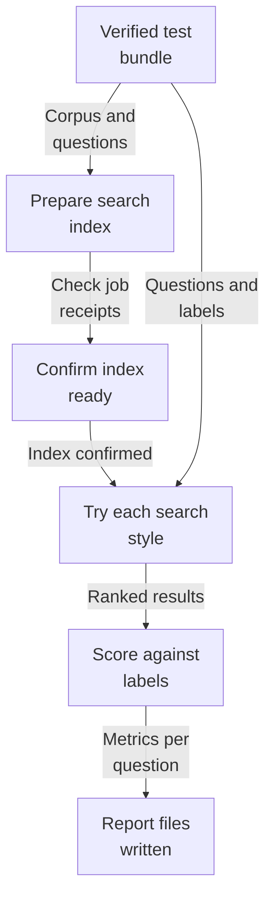
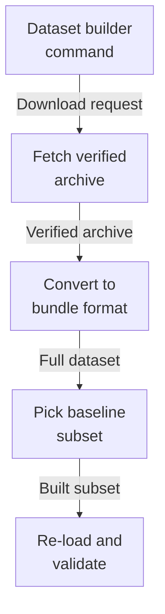
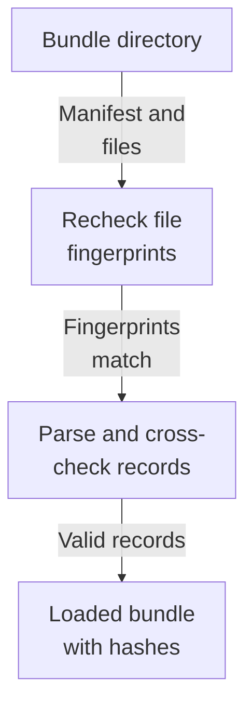
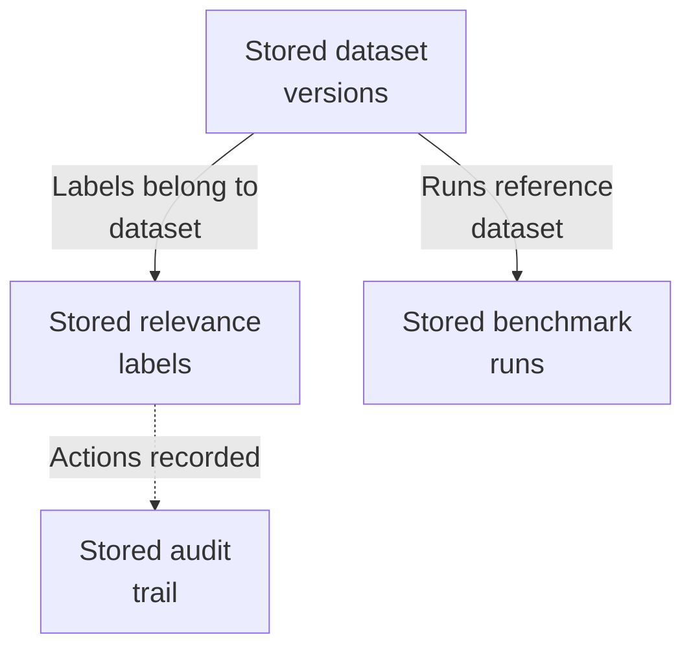

# Repository map

This area measures how good the search is. It loads versioned test bundles whose files are hash-checked, prepares each bundle into its own isolated search index, asks every test question in four search styles, compares the ranked results against human relevance labels, and writes repeatable JSON and Markdown reports. A command-line tool builds the SciFact test set. It is a command-line tool, not a service; the old debug web route is retired, and database tables for runs exist but nothing yet moves a run beyond 'queued'.

Commit: `e4abb88a149b365c2838b0f2f0606dff0127b1ab` | Generated: 2026-10-22T15:19:07.046360+00:00

[Open PDF](repository-map.pdf)

**AI-generated analysis. Source references are checked for existence and supplied scope; this does not prove semantic correctness.**

## Scope

Tracked, eligible text only; bounded excerpts, not exhaustive.

19/19 eligible files analyzed; 241 tracked files excluded by policy.

7 API calls. See coverage.json for budgets, exclusions, and usage.

## How a dataset becomes a scored report

A hash-verified test bundle is prepared into its own search index, every test question is searched four ways, results are scored against human relevance labels, and repeatable report files are written.

PNG fallback

Read from top to bottom; arrows show what happens next or what is passed along.

### Source evidence

- **F0017**: load_dataset reads a four-file dataset directory (manifest.json plus corpus.jsonl, queries.jsonl, judgments.jsonl), verifies each listed file's SHA-256 against the manifest before parsing, and rejects blank lines, non-object JSON lines, duplicate corpus/query IDs, judgments referencing unknown queries or targets, target type mismatches, queries with no judgment, and queries without any positive judgment (DatasetValidationError). (<a href="https://github.com/Justin-Mendoza/Afterclass/blob/e4abb88a149b365c2838b0f2f0606dff0127b1ab/backend/src/hybrid_rag_search/evaluation/datasets.py#L1-L195">backend/src/hybrid_rag_search/evaluation/datasets.py:1-195</a>)
- **F0019**: selected_dataset maps three fixed names ('synthetic-workspace', 'scifact', 'scifact-subset') to local dataset directories and raises ValueError for unknown names; it delegates to load_dataset. (<a href="https://github.com/Justin-Mendoza/Afterclass/blob/e4abb88a149b365c2838b0f2f0606dff0127b1ab/backend/src/hybrid_rag_search/evaluation/corpus.py#L1-L264">backend/src/hybrid_rag_search/evaluation/corpus.py:1-264</a>)
- **F0029**: The manifest requires schema_version 'evaluation-dataset-v1', purpose 'evaluation', and must list the three data files exactly once each; loading reads all files into memory and hashes them before validation, so failures occur before any mutation of the directory. (<a href="https://github.com/Justin-Mendoza/Afterclass/blob/e4abb88a149b365c2838b0f2f0606dff0127b1ab/backend/src/hybrid_rag_search/evaluation/datasets.py#L1-L195">backend/src/hybrid_rag_search/evaluation/datasets.py:1-195</a>)
- **F0022**: prepare_corpus is the orchestrator: it applies the isolated index settings, ensures the index exists, then within one DB transaction inserts the evaluation Tenant and Collection idempotently (on_conflict_do_nothing), and finally disposes the async engine and advances to corpus compaction and verification. document_delay must be nonnegative. (<a href="https://github.com/Justin-Mendoza/Afterclass/blob/e4abb88a149b365c2838b0f2f0606dff0127b1ab/backend/src/hybrid_rag_search/evaluation/corpus.py#L1-L264">backend/src/hybrid_rag_search/evaluation/corpus.py:1-264</a>)
- **F0023**: For each corpus record, prepare_corpus builds content from title + text, computes its SHA-256, saves it via LocalFileStorage at a tenant/document-derived key, and inserts a Document row (recording source_metadata including evaluation_id) only if not already present. If a stored document exists with a different content_hash or metadata, it raises 'Prepared evaluation document differs from dataset' to enforce bundle immutability. (<a href="https://github.com/Justin-Mendoza/Afterclass/blob/e4abb88a149b365c2838b0f2f0606dff0127b1ab/backend/src/hybrid_rag_search/evaluation/corpus.py#L1-L264">backend/src/hybrid_rag_search/evaluation/corpus.py:1-264</a>)
- **F0024**: Document ingestion for evaluation reuses the durable pipeline: IngestionJobService.enqueue_document is called per document, and only when the job did not already succeed does the code run it inline via run_configured_job with a ManualActor (synchronous CLI actor) and a ManualPublisher that does nothing; a non-SUCCEEDED JobRunResult raises. This means evaluation preparation executes durable jobs inline in the CLI process, not through a separate worker. (<a href="https://github.com/Justin-Mendoza/Afterclass/blob/e4abb88a149b365c2838b0f2f0606dff0127b1ab/backend/src/hybrid_rag_search/evaluation/corpus.py#L1-L264">backend/src/hybrid_rag_search/evaluation/corpus.py:1-264</a>)
- **F0026**: verify_prepared fails closed: it counts succeeded IngestionJob rows for the scope's tenant/documents/pipeline_version and requires exactly one per corpus record, validates that each job's checkpoint.index receipt holds a string generation_id and integer chunk_count, then aggregates the OpenSearch read alias by document_id and generation_id and requires the live index to match the expected generation and chunk count exactly; otherwise it raises 'rebuild before running'. It returns the total chunk count. (<a href="https://github.com/Justin-Mendoza/Afterclass/blob/e4abb88a149b365c2838b0f2f0606dff0127b1ab/backend/src/hybrid_rag_search/evaluation/corpus.py#L1-L264">backend/src/hybrid_rag_search/evaluation/corpus.py:1-264</a>)
- **F0067**: verify_prepared confirms the dataset is ready by loading each scoped document's IngestionJob, requiring a checkpoint with index.generation_id and chunk_count, querying OpenSearch aggregations for each document's generations, and returning the document count (16 in the test). It raises ValueError when no jobs exist ("not prepared"), when a checkpoint receipt is missing, or when the observed index generation differs from the recorded one. (<a href="https://github.com/Justin-Mendoza/Afterclass/blob/e4abb88a149b365c2838b0f2f0606dff0127b1ab/backend/tests/test_evaluation_corpus.py#L1-L154">backend/tests/test_evaluation_corpus.py:1-154</a>)
- **F0004**: EvaluationSearch.search supports four modes ('bm25', 'dense', 'hybrid', 'hybrid_rerank') and raises ValueError for an unknown mode; lexical retrieval is created eagerly in __init__ while dense, hybrid and reranked retrievers are created lazily on first non-bm25 use. (<a href="https://github.com/Justin-Mendoza/Afterclass/blob/e4abb88a149b365c2838b0f2f0606dff0127b1ab/backend/src/hybrid_rag_search/evaluation/search.py#L1-L139">backend/src/hybrid_rag_search/evaluation/search.py:1-139</a>)
- **F0005**: Each query derives its tenant, collection and document scope from the dataset, and every returned evidence item is validated against that scope (tenant, collection, document id and pipeline version); a mismatch raises ValueError, so search cannot return evidence outside the prepared evaluation scope. (<a href="https://github.com/Justin-Mendoza/Afterclass/blob/e4abb88a149b365c2838b0f2f0606dff0127b1ab/backend/src/hybrid_rag_search/evaluation/search.py#L1-L139">backend/src/hybrid_rag_search/evaluation/search.py:1-139</a>)
- **F0007**: EvaluationSearch returns a dict containing the mode, a per-chunk list (with rank and a mapped evaluation_document_id), a deduplicated document-level list (first chunk per document, renumbered rank) and an asdict-serialized trace from the underlying retriever. (<a href="https://github.com/Justin-Mendoza/Afterclass/blob/e4abb88a149b365c2838b0f2f0606dff0127b1ab/backend/src/hybrid_rag_search/evaluation/search.py#L1-L139">backend/src/hybrid_rag_search/evaluation/search.py:1-139</a>)
- **F0032**: evaluate() is the core scoring loop: for each dataset query it runs every search mode, records each mode's metrics, elapsed time, chunk and document counts, and the full search result, then compares each mode against bm25 as a reference. (<a href="https://github.com/Justin-Mendoza/Afterclass/blob/e4abb88a149b365c2838b0f2f0606dff0127b1ab/backend/src/hybrid_rag_search/evaluation/runner.py#L1-L301">backend/src/hybrid_rag_search/evaluation/runner.py:1-301</a>)
- **F0001**: score_ranking in evaluation/metrics.py computes retrieval quality for one query: it deduplicates a ranked list of document keys before applying cutoffs, then returns recall at cutoffs 5, 10 and 50, mean reciprocal rank at 10, and nDCG at 10, using graded judgments where unjudged results receive no credit. (<a href="https://github.com/Justin-Mendoza/Afterclass/blob/e4abb88a149b365c2838b0f2f0606dff0127b1ab/backend/src/hybrid_rag_search/evaluation/metrics.py#L1-L30">backend/src/hybrid_rag_search/evaluation/metrics.py:1-30</a>)
- **F0034**: The scoring path calls score_ranking(ranking, judgments[query.id]) over a list of document_id values, and per-query deltas versus the bm25 mode are computed as metric differences. (<a href="https://github.com/Justin-Mendoza/Afterclass/blob/e4abb88a149b365c2838b0f2f0606dff0127b1ab/backend/src/hybrid_rag_search/evaluation/runner.py#L1-L301">backend/src/hybrid_rag_search/evaluation/runner.py:1-301</a>)
- **F0035**: Aggregate metrics are the arithmetic mean of each per-query metric across all queries, keyed by search mode. (<a href="https://github.com/Justin-Mendoza/Afterclass/blob/e4abb88a149b365c2838b0f2f0606dff0127b1ab/backend/src/hybrid_rag_search/evaluation/runner.py#L1-L301">backend/src/hybrid_rag_search/evaluation/runner.py:1-301</a>)
- **F0040**: save_report() writes two files into an output directory: report.json (jsonable_encoder-serialized, indented, sorted keys) and report.md generated by markdown_report(). (<a href="https://github.com/Justin-Mendoza/Afterclass/blob/e4abb88a149b365c2838b0f2f0606dff0127b1ab/backend/src/hybrid_rag_search/evaluation/runner.py#L1-L301">backend/src/hybrid_rag_search/evaluation/runner.py:1-301</a>)
- **F0041**: markdown_report() renders a human-readable version with aggregate scores and per-query differences against BM25, and notes that unjudged documents earn zero credit. (<a href="https://github.com/Justin-Mendoza/Afterclass/blob/e4abb88a149b365c2838b0f2f0606dff0127b1ab/backend/src/hybrid_rag_search/evaluation/runner.py#L1-L301">backend/src/hybrid_rag_search/evaluation/runner.py:1-301</a>)
- **F0077**: save_report writes a JSON report.json (including per-query per-mode deltas) and a human-readable report.md containing a "Per-query differences" section, giving both machine and reader outputs. (<a href="https://github.com/Justin-Mendoza/Afterclass/blob/e4abb88a149b365c2838b0f2f0606dff0127b1ab/backend/tests/test_evaluation_runner.py#L1-L174">backend/tests/test_evaluation_runner.py:1-174</a>)
- **F0036**: run_baseline() orchestrates a full reproducible run: it loads benchmark settings, selects the dataset, applies evaluation index settings, verifies the prepared corpus, determines evaluation scope, then runs the search evaluation. (<a href="https://github.com/Justin-Mendoza/Afterclass/blob/e4abb88a149b365c2838b0f2f0606dff0127b1ab/backend/src/hybrid_rag_search/evaluation/runner.py#L1-L301">backend/src/hybrid_rag_search/evaluation/runner.py:1-301</a>)
- **F0033**: evaluate() assembles per-query judgments from dataset.judgments, requiring one unique document judgment per query per target and rejecting duplicates or non-document targets with ValueError. (<a href="https://github.com/Justin-Mendoza/Afterclass/blob/e4abb88a149b365c2838b0f2f0606dff0127b1ab/backend/src/hybrid_rag_search/evaluation/runner.py#L1-L301">backend/src/hybrid_rag_search/evaluation/runner.py:1-301</a>)

## How the SciFact test set is built

A pinned public archive is downloaded and hash-checked, converted into the shared bundle format, trimmed to a deterministic 30-question, 500-document baseline, and re-loaded to prove it is valid.

PNG fallback

Read from top to bottom; arrows show what happens next or what is passed along.

### Source evidence

- **F0047**: SciFact evaluation module is a command-line tool (S0009 main) with three subcommands: download (fetch the pinned archive and convert it), subset (build a deterministic baseline subset from a converted dataset), and validate (load and summarize an existing dataset directory); the command prints a one-line summary with counts and hashes. (<a href="https://github.com/Justin-Mendoza/Afterclass/blob/e4abb88a149b365c2838b0f2f0606dff0127b1ab/backend/src/hybrid_rag_search/evaluation/scifact.py#L1-L222">backend/src/hybrid_rag_search/evaluation/scifact.py:1-222</a>)
- **F0080**: A scifact module under the evaluation package provides a CLI (scifact.main) with 'download' and 'validate' subcommands operating on an --output dataset directory. The download command fetches and converts an archive and prints a line like 'corpus=2 queries=1 judgments=1'; the validate command prints 'dataset=scifact' and 'dataset_hash=' from the built manifest.json. (<a href="https://github.com/Justin-Mendoza/Afterclass/blob/e4abb88a149b365c2838b0f2f0606dff0127b1ab/backend/tests/test_scifact_dataset.py#L1-L100">backend/tests/test_scifact_dataset.py:1-100</a>)
- **F0048**: download_archive fetches the fixed BEIR SciFact URL over HTTP with redirects followed, writes to a '.partial' temp file, then verifies the whole archive SHA-256 against a hard-coded pin and only then renames it into place; a mismatch raises ValueError and the temp file is always deleted. (<a href="https://github.com/Justin-Mendoza/Afterclass/blob/e4abb88a149b365c2838b0f2f0606dff0127b1ab/backend/src/hybrid_rag_search/evaluation/scifact.py#L1-L222">backend/src/hybrid_rag_search/evaluation/scifact.py:1-222</a>)
- **F0081**: scifact.download_archive(destination) performs an HTTP GET via httpx, checks the downloaded bytes against a module-level constant SCIFACT_ARCHIVE_SHA256, and returns the destination path. On hash mismatch it raises ValueError('SHA-256 mismatch') and leaves no 'scifact.partial' temp file behind, implying a partial-then-rename write strategy. (<a href="https://github.com/Justin-Mendoza/Afterclass/blob/e4abb88a149b365c2838b0f2f0606dff0127b1ab/backend/tests/test_scifact_dataset.py#L1-L100">backend/tests/test_scifact_dataset.py:1-100</a>)
- **F0049**: convert_archive re-verifies the pinned hash of the local archive, unzips it in memory, reads qrels/test.tsv plus corpus.jsonl and queries.jsonl, and writes a shared three-file contract (corpus.jsonl, queries.jsonl, judgments.jsonl) plus a manifest with schema_version evaluation-dataset-v1, dataset_id 'scifact', source license, and per-file SHA-256. (<a href="https://github.com/Justin-Mendoza/Afterclass/blob/e4abb88a149b365c2838b0f2f0606dff0127b1ab/backend/src/hybrid_rag_search/evaluation/scifact.py#L1-L222">backend/src/hybrid_rag_search/evaluation/scifact.py:1-222</a>)
- **F0050**: Conversion re-keys identifiers with prefixes ('scifact-doc-', 'scifact-query-'), keeps only queries that appear in qrels, maps qrels score&gt;0 to relevance_grade 3 and 0 otherwise, and sorts all output by id, so the result is a deterministic, reproducible bundle. (<a href="https://github.com/Justin-Mendoza/Afterclass/blob/e4abb88a149b365c2838b0f2f0606dff0127b1ab/backend/src/hybrid_rag_search/evaluation/scifact.py#L1-L222">backend/src/hybrid_rag_search/evaluation/scifact.py:1-222</a>)
- **F0082**: scifact.convert_archive(archive, output_dir) unzips a SciFact archive containing corpus.jsonl, queries.jsonl and qrels/test.tsv, converts them into the shared dataset bundle format, and is deterministic: converting the same archive to two different destinations yields bundles that load equal via load_dataset. (<a href="https://github.com/Justin-Mendoza/Afterclass/blob/e4abb88a149b365c2838b0f2f0606dff0127b1ab/backend/tests/test_scifact_dataset.py#L1-L100">backend/tests/test_scifact_dataset.py:1-100</a>)
- **F0012**: scifact.build_subset in evaluation/scifact.py builds a deterministic SciFact subset from a source dataset directory: it is repeatable (identical output across runs and independent of input ordering), selects 30 queries chosen by SHA-256 hash of 'scifact-subset-v1:&lt;query_id&gt;', caps required documents at 500, and preserves all judgments for selected queries. (<a href="https://github.com/Justin-Mendoza/Afterclass/blob/e4abb88a149b365c2838b0f2f0606dff0127b1ab/backend/tests/test_scifact_subset.py#L1-L95">backend/tests/test_scifact_subset.py:1-95</a>)
- **F0051**: build_subset selects 30 queries and 500 documents using a stable salted SHA-256 ordering ('scifact-subset-v1:&lt;id&gt;'), takes all judgments for the chosen queries, fills the corpus to 500 via the same ordering, refuses to proceed if the source has fewer than 30 queries or 500 documents or if judgments need more than 500 documents, and re-runs load_dataset on its own output as a validation step. (<a href="https://github.com/Justin-Mendoza/Afterclass/blob/e4abb88a149b365c2838b0f2f0606dff0127b1ab/backend/src/hybrid_rag_search/evaluation/scifact.py#L1-L222">backend/src/hybrid_rag_search/evaluation/scifact.py:1-222</a>)
- **F0013**: build_subset enforces input constraints by raising ValueError when the source has fewer than 30 queries or when more than 500 documents are required by selected judgments. (<a href="https://github.com/Justin-Mendoza/Afterclass/blob/e4abb88a149b365c2838b0f2f0606dff0127b1ab/backend/tests/test_scifact_subset.py#L1-L95">backend/tests/test_scifact_subset.py:1-95</a>)

## How one bundle file set is checked

A bundle directory is read with its manifest, each listed file's fingerprint is recomputed and compared, then the records are parsed and cross-checked for broken or missing relevance labels.

PNG fallback

Read from top to bottom; arrows show what happens next or what is passed along.

### Source evidence

- **F0017**: load_dataset reads a four-file dataset directory (manifest.json plus corpus.jsonl, queries.jsonl, judgments.jsonl), verifies each listed file's SHA-256 against the manifest before parsing, and rejects blank lines, non-object JSON lines, duplicate corpus/query IDs, judgments referencing unknown queries or targets, target type mismatches, queries with no judgment, and queries without any positive judgment (DatasetValidationError). (<a href="https://github.com/Justin-Mendoza/Afterclass/blob/e4abb88a149b365c2838b0f2f0606dff0127b1ab/backend/src/hybrid_rag_search/evaluation/datasets.py#L1-L195">backend/src/hybrid_rag_search/evaluation/datasets.py:1-195</a>)
- **F0070**: load_dataset reads a versioned dataset bundle from a directory, verifying every listed file against its SHA-256 in manifest.json and producing a deterministic EvaluationDataset (same input yields equal output). The synthetic-workspace v1 bundle holds 8 corpus documents and 12 queries across categories exact-match, paraphrase, stale-version, and conflicting-evidence, with a fixed corpus_hash. (<a href="https://github.com/Justin-Mendoza/Afterclass/blob/e4abb88a149b365c2838b0f2f0606dff0127b1ab/backend/tests/test_evaluation_datasets.py#L1-L147">backend/tests/test_evaluation_datasets.py:1-147</a>)
- **F0071**: load_dataset enforces data contracts and raises DatasetValidationError for: a file whose hash does not match the manifest, malformed JSON lines, blank lines, judgments referencing unknown queries or targets, judgment target type mismatch, duplicate query IDs, queries lacking any judgment, queries lacking a positive (grade &gt; 0) judgment, and an invalid manifest. It also fails when a listed file is missing or unreadable. (<a href="https://github.com/Justin-Mendoza/Afterclass/blob/e4abb88a149b365c2838b0f2f0606dff0127b1ab/backend/tests/test_evaluation_datasets.py#L1-L147">backend/tests/test_evaluation_datasets.py:1-147</a>)
- **F0028**: Dataset contracts are strict and frozen (extra fields forbidden) with constrained types: identifiers must match a lowercase slug pattern, hashes must be 64 hex chars, corpus records are either 'document' or 'chunk' (chunks require document_id, documents must not have one), and judgment relevance grades are 0-3. (<a href="https://github.com/Justin-Mendoza/Afterclass/blob/e4abb88a149b365c2838b0f2f0606dff0127b1ab/backend/src/hybrid_rag_search/evaluation/datasets.py#L1-L195">backend/src/hybrid_rag_search/evaluation/datasets.py:1-195</a>)
- **F0072**: CorpusRecord and DatasetManifest are contract types: a chunk record must carry a document_id and a document record must not, and a manifest must list the expected set of files. Violations raise pydantic ValidationError. (<a href="https://github.com/Justin-Mendoza/Afterclass/blob/e4abb88a149b365c2838b0f2f0606dff0127b1ab/backend/tests/test_evaluation_datasets.py#L1-L147">backend/tests/test_evaluation_datasets.py:1-147</a>)
- **F0018**: The loader produces an EvaluationDataset carrying immutable validated manifest/corpus/queries/judgments plus two derived content hashes: corpus_hash (SHA-256 of corpus.jsonl only) and dataset_hash (SHA-256 over schema version, dataset id, version, and sorted per-file hashes), which later serve as the identity inputs for scope derivation. (<a href="https://github.com/Justin-Mendoza/Afterclass/blob/e4abb88a149b365c2838b0f2f0606dff0127b1ab/backend/src/hybrid_rag_search/evaluation/datasets.py#L1-L195">backend/src/hybrid_rag_search/evaluation/datasets.py:1-195</a>)
- **F0086**: The dataset bundle loader load_dataset(path) reads a converted bundle directory and returns an object exposing .corpus, .queries and .judgments collections; each corpus/query record has an id, each judgment has a relevance_grade, and two independently converted bundles can be compared for structural and value equality with ==. (<a href="https://github.com/Justin-Mendoza/Afterclass/blob/e4abb88a149b365c2838b0f2f0606dff0127b1ab/backend/tests/test_scifact_dataset.py#L1-L100">backend/tests/test_scifact_dataset.py:1-100</a>)

## How stored evaluation records are shaped

Database tables hold per-tenant dataset bundles, their relevance labels, benchmark runs, and an audit trail; the tables only store and constrain data, and the code that moves a run through its statuses is not shown.

PNG fallback

Read from top to bottom. Dashed arrows show connections that need confirmation.

### Source evidence

- **F0054**: S0010 defines SQLAlchemy ORM tables for the evaluation subsystem: evaluation_datasets, judgments, evaluation_runs, and audit_events, all keyed by tenant_id and mostly using composite (tenant_id, id) constraints and foreign keys. (<a href="https://github.com/Justin-Mendoza/Afterclass/blob/e4abb88a149b365c2838b0f2f0606dff0127b1ab/backend/src/hybrid_rag_search/models/evaluation.py#L1-L172">backend/src/hybrid_rag_search/models/evaluation.py:1-172</a>)
- **F0055**: EvaluationDataset stores a named versioned dataset per tenant with a required SHA-256 corpus_hash (regex-checked), free-text description, arbitrary JSONB metadata constrained to be an object, and unique (tenant_id, name, version). (<a href="https://github.com/Justin-Mendoza/Afterclass/blob/e4abb88a149b365c2838b0f2f0606dff0127b1ab/backend/src/hybrid_rag_search/models/evaluation.py#L1-L172">backend/src/hybrid_rag_search/models/evaluation.py:1-172</a>)
- **F0056**: Judgment stores a query (key and text) and a target (type 'document' or 'chunk', id) with relevance_grade constrained to 0..3, optional expected_answer, JSONB key_facts (array) and metadata_filters (object), unique per tenant/dataset/query/target, and cascades when its dataset is deleted. (<a href="https://github.com/Justin-Mendoza/Afterclass/blob/e4abb88a149b365c2838b0f2f0606dff0127b1ab/backend/src/hybrid_rag_search/models/evaluation.py#L1-L172">backend/src/hybrid_rag_search/models/evaluation.py:1-172</a>)
- **F0059**: JudgmentTarget and EvaluationRunStatus are StrEnum symbol tables mirroring the database CHECK constraints for target type and run status, acting as the in-code vocabulary for those allowed values. (<a href="https://github.com/Justin-Mendoza/Afterclass/blob/e4abb88a149b365c2838b0f2f0606dff0127b1ab/backend/src/hybrid_rag_search/models/evaluation.py#L1-L172">backend/src/hybrid_rag_search/models/evaluation.py:1-172</a>)
- **F0057**: EvaluationRun links a dataset and a retrieval config (both per-tenant foreign keys with RESTRICT delete) plus a non-negative seed, carries a status constrained to queued/running/succeeded/failed/cancelled, JSONB metrics (object), optional error_message, started_at/finished_at timestamps and created/updated timestamps; it defaults to 'queued'. (<a href="https://github.com/Justin-Mendoza/Afterclass/blob/e4abb88a149b365c2838b0f2f0606dff0127b1ab/backend/src/hybrid_rag_search/models/evaluation.py#L1-L172">backend/src/hybrid_rag_search/models/evaluation.py:1-172</a>)
- **F0058**: AuditEvent records tenant-scoped actions with optional actor membership (composite FK to memberships), a namespaced action pattern like 'resource.verb', an entity type/id, JSONB details, and an occurred_at timestamp; referenced rows are protected by RESTRICT deletes. (<a href="https://github.com/Justin-Mendoza/Afterclass/blob/e4abb88a149b365c2838b0f2f0606dff0127b1ab/backend/src/hybrid_rag_search/models/evaluation.py#L1-L172">backend/src/hybrid_rag_search/models/evaluation.py:1-172</a>)

## Uncertainties and untraced areas

- How the scored report or saved run reaches any user-facing output is not shown; the old debug web route now returns 404.
- How an on-disk bundle is loaded into the stored dataset and relevance-label tables is not shown.
- Nothing here moves a stored benchmark run beyond its default 'queued' status or writes its metrics.
- Whether prepared corpus work always runs inline in the command process or can also be handled by a separate worker is not traced.
- The exact callers of the evaluation search boundary, and the code that writes the report stage after preparation, are inferred from tests rather than production code.
