# Repository map

This area is the shared foundation of a multi-tenant document search service. It starts the web application with health and readiness checks, handles errors and request tracking uniformly, decides who may do what using a demo-identity login scheme backed by real database permissions, and stores uploaded documents with duplicate detection and safe deletion. The main inputs are incoming web requests plus an uploaded file; the useful results are authorized access, a stored document record with a status, and database schema helper commands for local development.

Commit: `e4abb88a149b365c2838b0f2f0606dff0127b1ab` | Generated: 2026-10-22T15:19:39.874971+00:00

[Open PDF](repository-map.pdf)

**AI-generated analysis. Source references are checked for existence and supplied scope; this does not prove semantic correctness.**

## Scope

Tracked, eligible text only; bounded excerpts, not exhaustive.

10/55 eligible files analyzed; 205 tracked files excluded by policy.

3 API calls. See coverage.json for budgets, exclusions, and usage.

## How a request becomes a result

An incoming web request is identified, checked for permission against the caller's tenant and collections, then handled so it either produces a result or a consistent error reply.

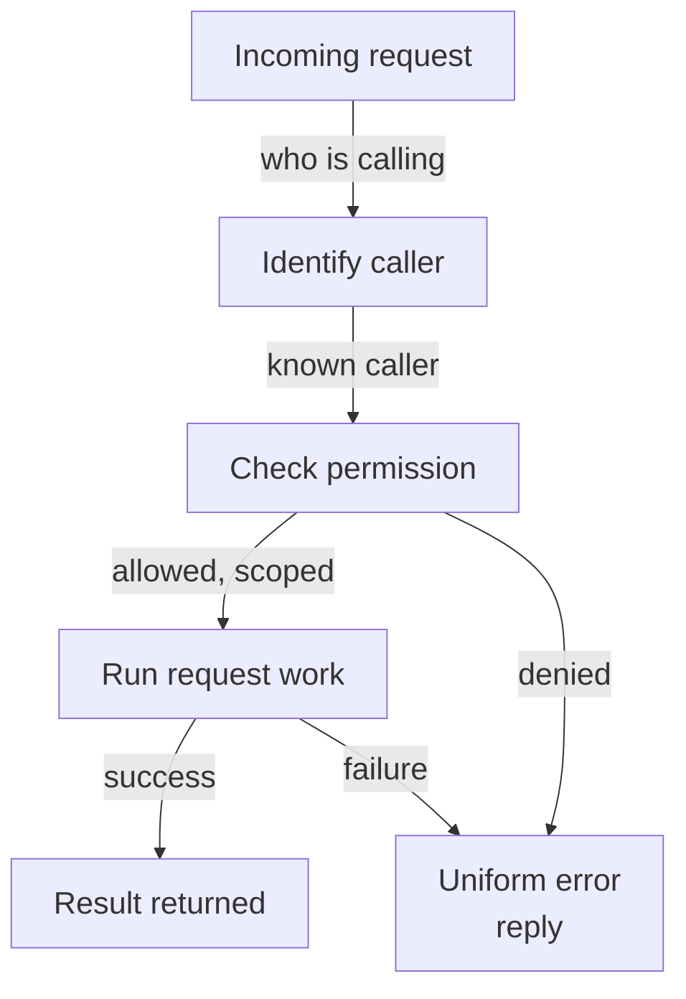

PNG fallback

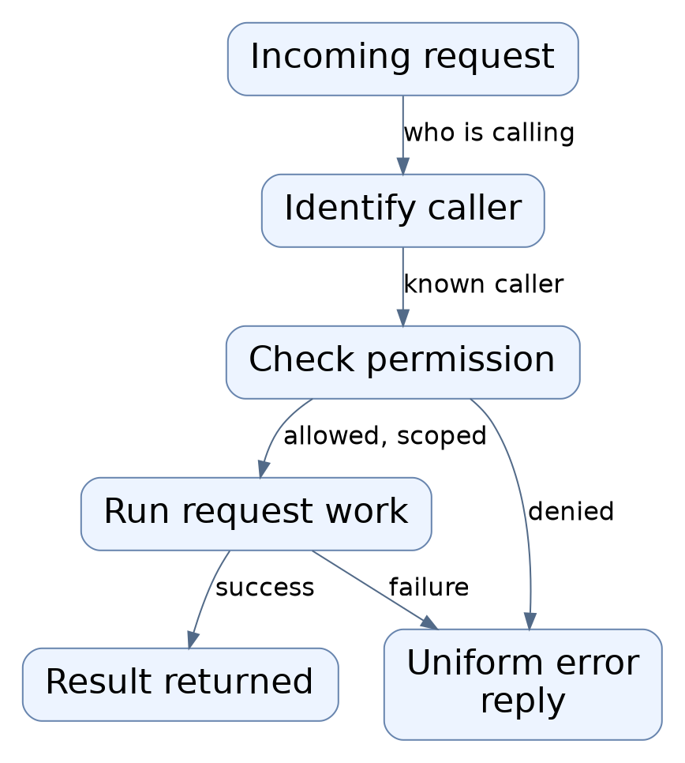

Read from top to bottom; arrows show what happens next or what is passed along.

### Source evidence

- **F0001**: The application factory create_app in hybrid_rag_search.main assembles the FastAPI service, installing error handlers, four routers (product/search api, answer streaming answer_stream, answer answer_api, management management_api), and health routes, then module-level `app = create_app()` makes it the ASGI entry point referenced by the Makefile uvicorn command. (<a href="https://github.com/Justin-Mendoza/Afterclass/blob/e4abb88a149b365c2838b0f2f0606dff0127b1ab/backend/src/hybrid_rag_search/main.py#L1-L55">backend/src/hybrid_rag_search/main.py:1-55</a>, <a href="https://github.com/Justin-Mendoza/Afterclass/blob/e4abb88a149b365c2838b0f2f0606dff0127b1ab/Makefile#L1-L149">Makefile:1-149</a>)
- **F0004**: install_errors registers a per-request middleware assigning a UUID request id, returning it in the X-Request-ID header, and handlers for AccessDenied, APIError, Starlette HTTPException, RequestValidationError, and SQLAlchemyError that emit a uniform {"error": {code, message, request_id}} body. (<a href="https://github.com/Justin-Mendoza/Afterclass/blob/e4abb88a149b365c2838b0f2f0606dff0127b1ab/backend/src/hybrid_rag_search/api_errors.py#L1-L70">backend/src/hybrid_rag_search/api_errors.py:1-70</a>, <a href="https://github.com/Justin-Mendoza/Afterclass/blob/e4abb88a149b365c2838b0f2f0606dff0127b1ab/backend/src/hybrid_rag_search/main.py#L1-L55">backend/src/hybrid_rag_search/main.py:1-55</a>)
- **F0007**: The /v1 router in hybrid_rag_search.api documents itself as a local demo API using simulated identity selection with real database authorization; a caller supplies identity via the X-Demo-User-ID header (Optional UUID). (<a href="https://github.com/Justin-Mendoza/Afterclass/blob/e4abb88a149b365c2838b0f2f0606dff0127b1ab/backend/src/hybrid_rag_search/api.py#L1-L94">backend/src/hybrid_rag_search/api.py:1-94</a>)
- **F0017**: Authorization.user resolves a demo identity and rejects missing, unknown, or non-demo user IDs with a 401 AccessDenied; only IDs in the seeded DEMO_USER_IDS set are accepted. (<a href="https://github.com/Justin-Mendoza/Afterclass/blob/e4abb88a149b365c2838b0f2f0606dff0127b1ab/backend/src/hybrid_rag_search/authorization.py#L1-L160">backend/src/hybrid_rag_search/authorization.py:1-160</a>)
- **F0019**: Authorization.scope builds a per-request AuthorizedScope: it checks membership in the tenant, collects allowed collection IDs, and for 'member' role restricts collections via CollectionGrant with read/write/manage permission. (<a href="https://github.com/Justin-Mendoza/Afterclass/blob/e4abb88a149b365c2838b0f2f0606dff0127b1ab/backend/src/hybrid_rag_search/authorization.py#L1-L160">backend/src/hybrid_rag_search/authorization.py:1-160</a>)
- **F0022**: Authorization.require enforces an action level: owners/admins pass unconditionally; a member with a collection-level grant must meet or exceed the requested permission using the read&lt;write&lt;manage ranking, otherwise a 403 is raised. (<a href="https://github.com/Justin-Mendoza/Afterclass/blob/e4abb88a149b365c2838b0f2f0606dff0127b1ab/backend/src/hybrid_rag_search/authorization.py#L1-L160">backend/src/hybrid_rag_search/authorization.py:1-160</a>)
- **F0010**: POST /v1/search accepts a SearchRequest (workspace_id, query 1-4096 chars, optional collection_id, mode defaulting to 'hybrid_rerank', debug flag, extra fields forbidden); it resolves an authorization scope via policy.scope, then runs an AuthorizedSearch.search and returns its result dictionary. (<a href="https://github.com/Justin-Mendoza/Afterclass/blob/e4abb88a149b365c2838b0f2f0606dff0127b1ab/backend/src/hybrid_rag_search/api.py#L1-L94">backend/src/hybrid_rag_search/api.py:1-94</a>)
- **F0006**: Database failures surfaced as SQLAlchemyError are converted to a 503 'database_unavailable' response rather than leaking exception details, and validation failures are collapsed to a generic 422 'invalid_request'. (<a href="https://github.com/Justin-Mendoza/Afterclass/blob/e4abb88a149b365c2838b0f2f0606dff0127b1ab/backend/src/hybrid_rag_search/api_errors.py#L1-L70">backend/src/hybrid_rag_search/api_errors.py:1-70</a>)
- **F0005**: Authorization failures are mapped by status code to stable slugs (401 identity_required, 403 access_denied, 404 not_found), and generic HTTP statuses are mapped to slugs such as method_not_allowed, conflict, and dependency_unavailable with an unmatched default of request_failed. (<a href="https://github.com/Justin-Mendoza/Afterclass/blob/e4abb88a149b365c2838b0f2f0606dff0127b1ab/backend/src/hybrid_rag_search/api_errors.py#L1-L70">backend/src/hybrid_rag_search/api_errors.py:1-70</a>)
- **F0021**: Authorization.document_scope converts a 403 workspace denial into a 404 'Document not found', while preserving 401, so unauthorized users cannot learn a document exists. (<a href="https://github.com/Justin-Mendoza/Afterclass/blob/e4abb88a149b365c2838b0f2f0606dff0127b1ab/backend/src/hybrid_rag_search/authorization.py#L1-L160">backend/src/hybrid_rag_search/authorization.py:1-160</a>)

## How an uploaded file becomes a stored document

A caller supplies an authorized tenant and collection scope with file bytes. The service fingerprint-checks for duplicates, saves the file off the request loop, and records document status.

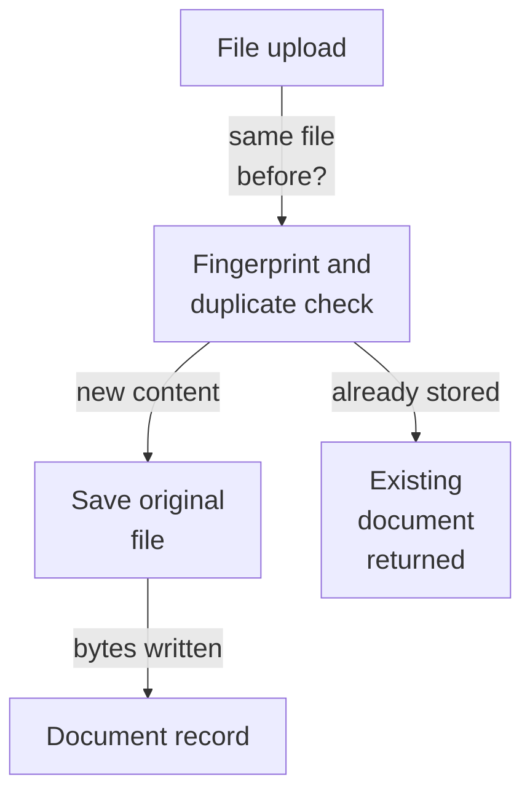

PNG fallback

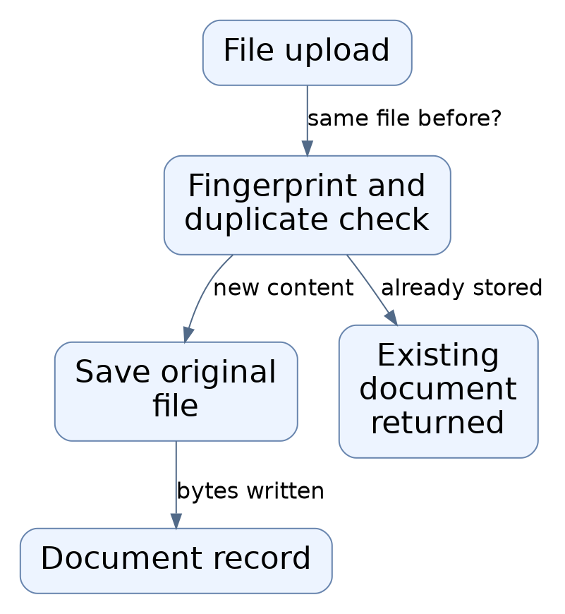

Read from top to bottom; arrows show what happens next or what is passed along.

### Source evidence

- **F0027**: DocumentService.upload computes a SHA-256 content hash, locks the target collection row (with_for_update) to serialize duplicate checks, and returns an existing document as duplicate when an active document with the same hash already exists in the collection. (<a href="https://github.com/Justin-Mendoza/Afterclass/blob/e4abb88a149b365c2838b0f2f0606dff0127b1ab/backend/src/hybrid_rag_search/documents.py#L1-L140">backend/src/hybrid_rag_search/documents.py:1-140</a>)
- **F0028**: For new content, DocumentService creates a Document row with status PENDING, flushes it, then writes the original bytes to storage via asyncio.to_thread so filesystem work runs off the event loop. (<a href="https://github.com/Justin-Mendoza/Afterclass/blob/e4abb88a149b365c2838b0f2f0606dff0127b1ab/backend/src/hybrid_rag_search/documents.py#L1-L140">backend/src/hybrid_rag_search/documents.py:1-140</a>)
- **F0029**: DocumentService runs inside caller-supplied transactions (upload_in_session) so document creation can commit together with a caller's upload receipt/job, and it requires an already-authorized tenant/collection scope. (<a href="https://github.com/Justin-Mendoza/Afterclass/blob/e4abb88a149b365c2838b0f2f0606dff0127b1ab/backend/src/hybrid_rag_search/documents.py#L1-L140">backend/src/hybrid_rag_search/documents.py:1-140</a>)

## How a document is fetched or removed (1/2)

Fetching returns stored bytes only for available documents. Deletion is two steps: first the intent is saved, then the file is removed and the record marked deleted; failure leaves a retryable state.

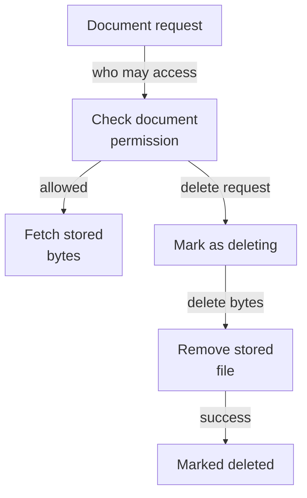

PNG fallback

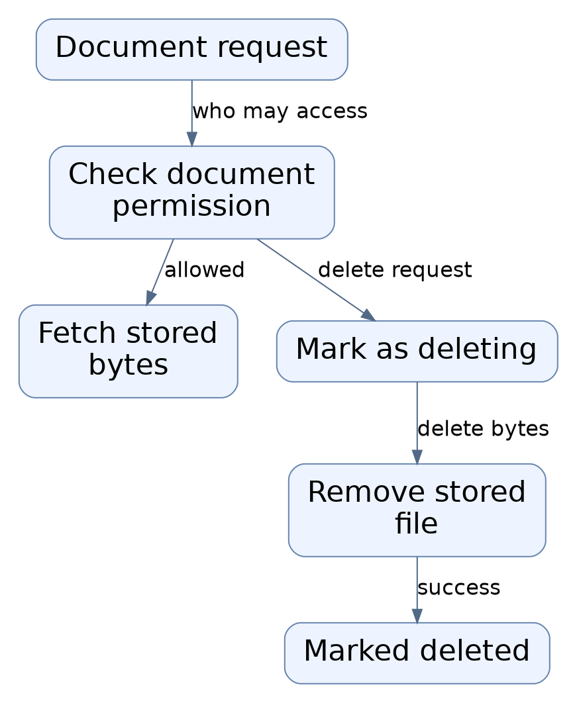

Read from top to bottom; arrows show what happens next or what is passed along.

### Source evidence

- **F0012**: GET /v1/workspaces/{workspace_id}/documents/{document_id}/content checks document_scope authorization, then uses DocumentService with LocalFileStorage(settings.storage_root) to fetch bytes and return them as an application/octet-stream attachment; missing or unavailable documents become 404 and OSError becomes a 503 storage_unavailable error. (<a href="https://github.com/Justin-Mendoza/Afterclass/blob/e4abb88a149b365c2838b0f2f0606dff0127b1ab/backend/src/hybrid_rag_search/api.py#L1-L94">backend/src/hybrid_rag_search/api.py:1-94</a>)
- **F0032**: DocumentService.fetch raises DocumentUnavailable for documents in DELETING or DELETED status and returns the stored bytes otherwise. (<a href="https://github.com/Justin-Mendoza/Afterclass/blob/e4abb88a149b365c2838b0f2f0606dff0127b1ab/backend/src/hybrid_rag_search/documents.py#L1-L140">backend/src/hybrid_rag_search/documents.py:1-140</a>)
- **F0021**: Authorization.document_scope converts a 403 workspace denial into a 404 'Document not found', while preserving 401, so unauthorized users cannot learn a document exists. (<a href="https://github.com/Justin-Mendoza/Afterclass/blob/e4abb88a149b365c2838b0f2f0606dff0127b1ab/backend/src/hybrid_rag_search/authorization.py#L1-L160">backend/src/hybrid_rag_search/authorization.py:1-160</a>)
- **F0031**: DocumentService.delete is two-phase: first commit status DELETING, then remove the stored file and mark DELETED with a timestamp; an I/O failure leaves a durable DELETING state that can be retried. (<a href="https://github.com/Justin-Mendoza/Afterclass/blob/e4abb88a149b365c2838b0f2f0606dff0127b1ab/backend/src/hybrid_rag_search/documents.py#L1-L140">backend/src/hybrid_rag_search/documents.py:1-140</a>)

## How a document is fetched or removed (2/2)

Fetching returns stored bytes only for available documents. Deletion is two steps: first the intent is saved, then the file is removed and the record marked deleted; failure leaves a retryable state.

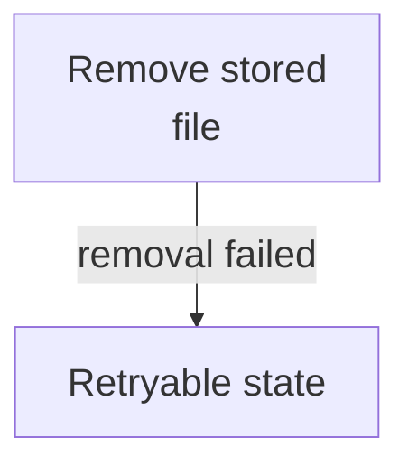

PNG fallback

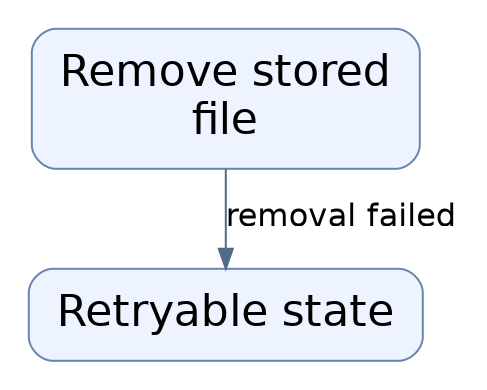

Read from top to bottom; arrows show what happens next or what is passed along.

### Source evidence

- **F0031**: DocumentService.delete is two-phase: first commit status DELETING, then remove the stored file and mark DELETED with a timestamp; an I/O failure leaves a durable DELETING state that can be retried. (<a href="https://github.com/Justin-Mendoza/Afterclass/blob/e4abb88a149b365c2838b0f2f0606dff0127b1ab/backend/src/hybrid_rag_search/documents.py#L1-L140">backend/src/hybrid_rag_search/documents.py:1-140</a>)

## How the service reports its health

Liveness answers whether the process is running. Readiness asks each configured dependency whether it is reachable and reports ready only when all reply true.

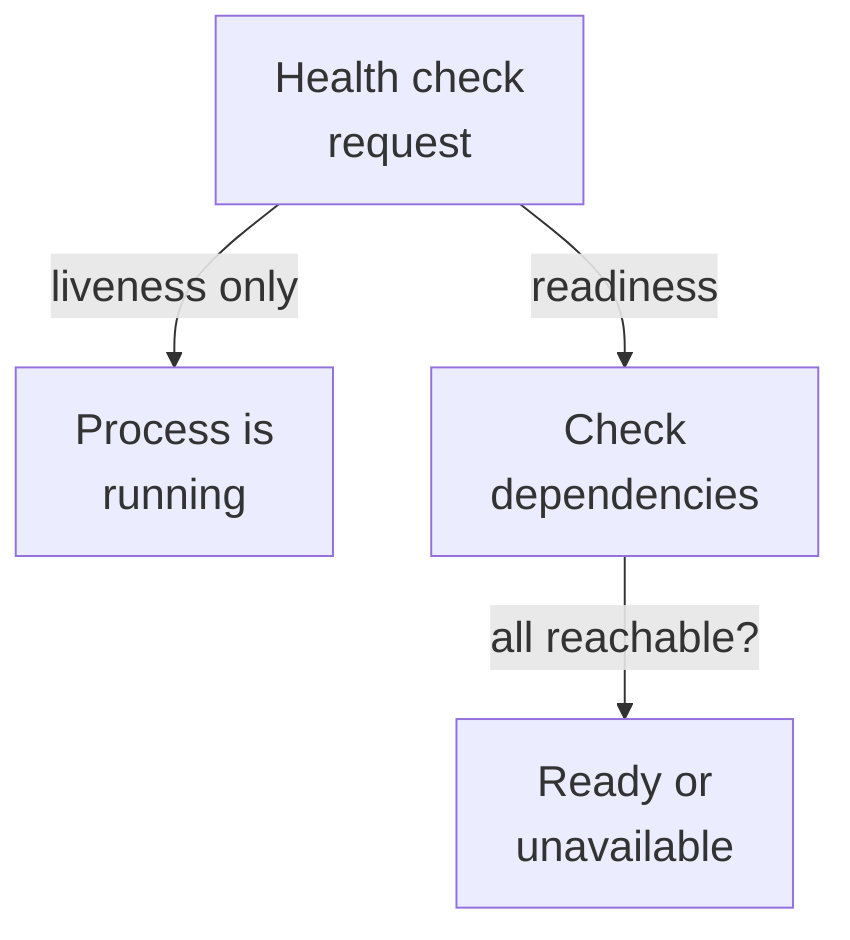

PNG fallback

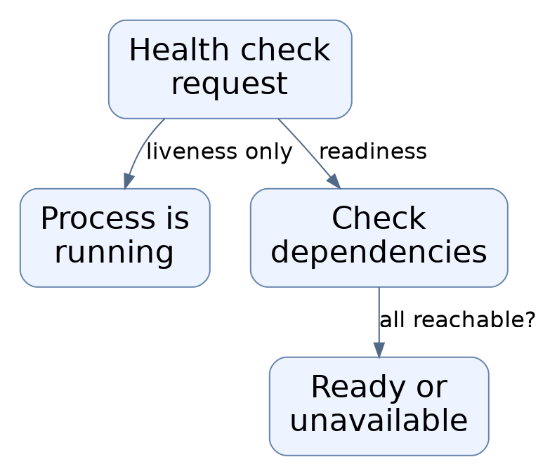

Read from top to bottom; arrows show what happens next or what is passed along.

### Source evidence

- **F0002**: Two liveness routes (/health and /health/live) return a fixed ok status plus the configured environment name; neither probes dependencies, so they only confirm the process is running. (<a href="https://github.com/Justin-Mendoza/Afterclass/blob/e4abb88a149b365c2838b0f2f0606dff0127b1ab/backend/src/hybrid_rag_search/main.py#L1-L55">backend/src/hybrid_rag_search/main.py:1-55</a>)
- **F0003**: The readiness route /health/ready calls dependency_status(settings); when any dependency reports false the HTTP response status is set to 503 with status 'not_ready', otherwise 'ready' with the per-dependency boolean map. (<a href="https://github.com/Justin-Mendoza/Afterclass/blob/e4abb88a149b365c2838b0f2f0606dff0127b1ab/backend/src/hybrid_rag_search/main.py#L1-L55">backend/src/hybrid_rag_search/main.py:1-55</a>)

## How the stored structure is shaped

Database migrations create the tables behind uploads and stored answers, keeping rows tenant-scoped and adding uniqueness rules that prevent duplicate records.

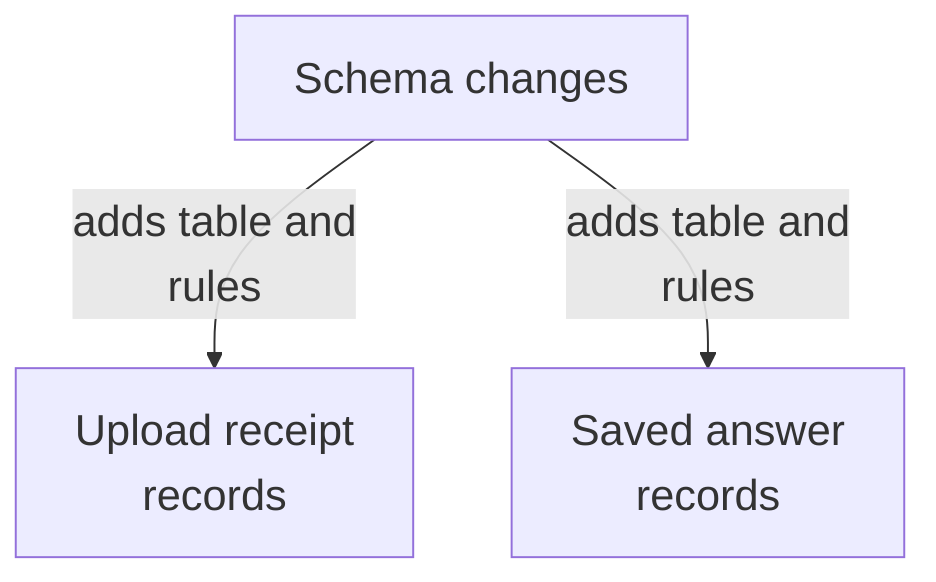

PNG fallback

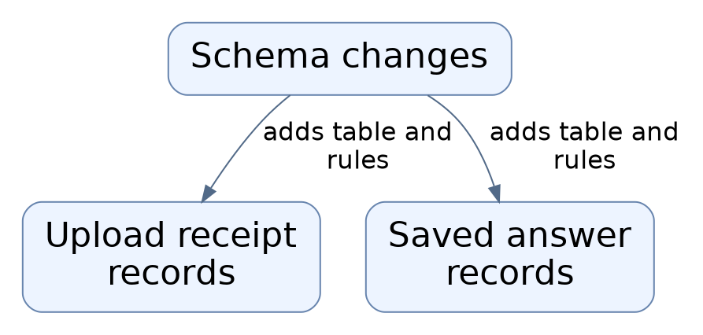

Read from top to bottom; arrows show what happens next or what is passed along.

### Source evidence

- **F0013**: Migration 20261013_09 adds a unique constraint on (tenant_id, id) for ingestion_jobs and creates an upload_receipts table keyed by id with a unique (tenant_id, collection_id, membership_id, key) constraint and tenant-scoped foreign keys to collections, memberships, documents, and ingestion_jobs, recording fingerprint, duplicate flag, and creation time. (<a href="https://github.com/Justin-Mendoza/Afterclass/blob/e4abb88a149b365c2838b0f2f0606dff0127b1ab/backend/migrations/versions/20261013_09_upload_receipts.py#L1-L55">backend/migrations/versions/20261013_09_upload_receipts.py:1-55</a>)
- **F0014**: Migration 20261015_10 creates saved_answers holding tenant_id, author_user_id, question text, a JSONB result object, and created_at, constrained so the question is 1-4096 trimmed characters and the result is a JSON object, with a cascade foreign key to memberships and an index ordered by (tenant_id, author_user_id, created_at, id) for per-author history. (<a href="https://github.com/Justin-Mendoza/Afterclass/blob/e4abb88a149b365c2838b0f2f0606dff0127b1ab/backend/migrations/versions/20261015_10_answer_history.py#L1-L46">backend/migrations/versions/20261015_10_answer_history.py:1-46</a>)

## Layout notes

- Split "How a document is fetched or removed" into 2 readable views. Repeated node IDs connect the views; all nodes, arrows, and evidence are retained.

## Uncertainties and untraced areas

- The search API, answer streaming, and management routers are mounted by the application factory, but their internal behavior is not shown here (F0001).
- No HTTP route for upload, deletion, or listing documents is evidenced; only direct service calls and a content-download route appear (F0012).
- Nothing shows who advances a document from its pending status or who processes upload job records at runtime (F0027, F0028).
- The actual behavior of the operational and evaluation commands listed in the Makefile is not shown (F0015, F0016).
- How the per-request database connections are sized or pooled in practice, and whether that scales, is not evidenced (F0008).
- Only demo identities from a seeded set are accepted for login, so how real user identity would be supplied is not shown (F0007, F0017).
