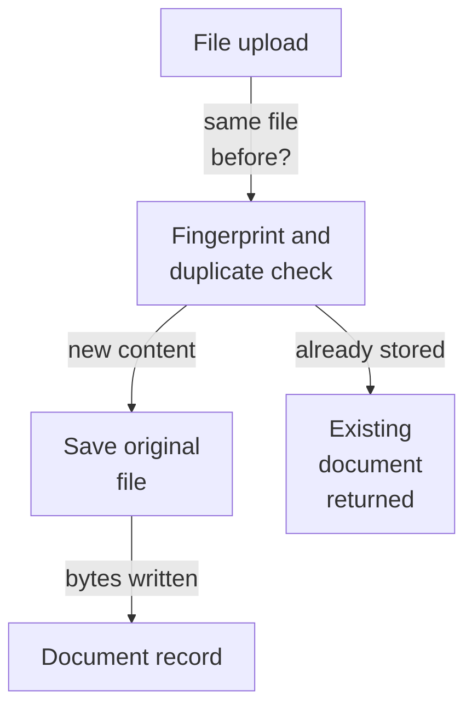
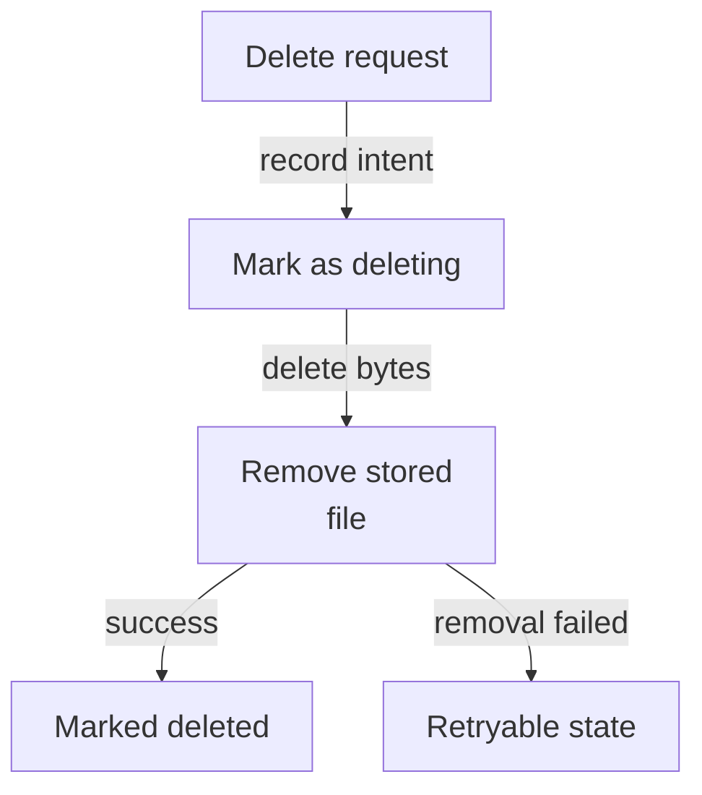
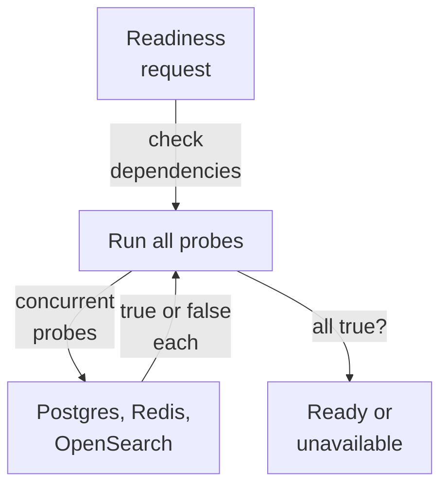
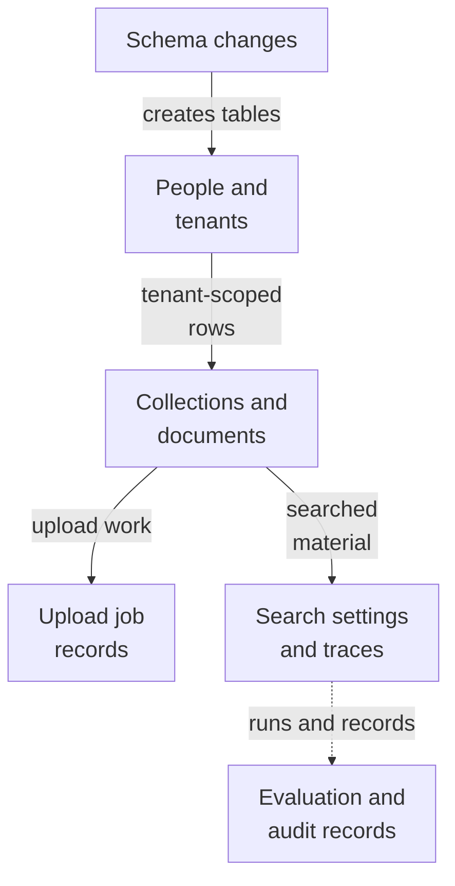
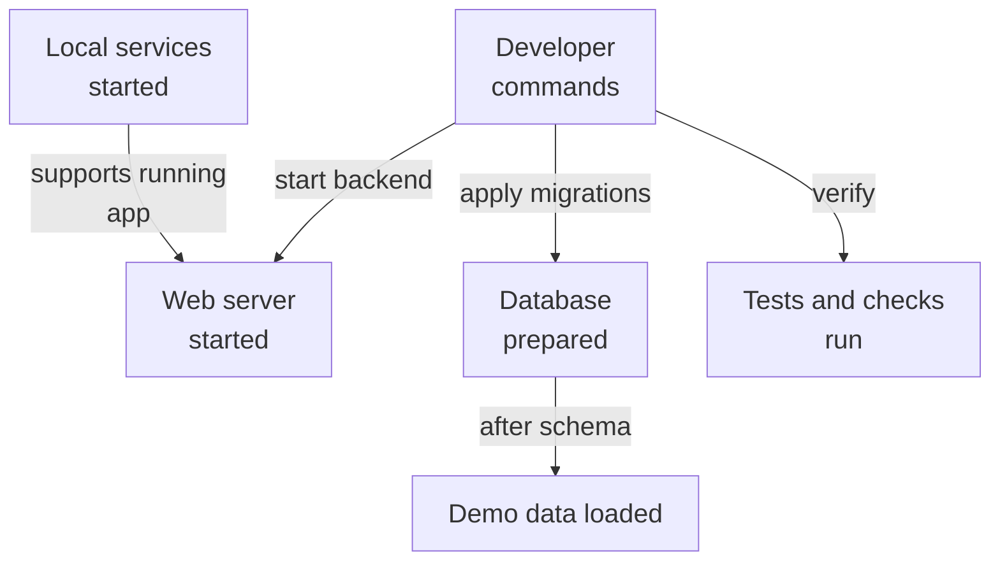

# Repository map

This area is the shared foundation of a multi-tenant document search service. It starts the web application (health and readiness checks), stores documents people upload, deduplicates identical files, and keeps tenants, collections, and upload records separated in PostgreSQL. The main input is an uploaded file plus an already-approved tenant and collection; the useful result is a stored, deduplicated document record with a status, plus database schema and setup commands for local development.

Commit: `3537e913c1eeec5b5f34d6cbdbf4dc3f8bc74b25` | Generated: 2026-10-19T00:24:13.306739+00:00

[Open PDF](repository-map.pdf)

**AI-generated analysis. Source references are checked for existence and supplied scope; this does not prove semantic correctness.**

## Scope

Tracked, eligible text only; bounded excerpts, not exhaustive.

35/39 eligible files analyzed; 184 tracked files excluded by policy.

7 API calls. See coverage.json for budgets, exclusions, and usage.

## How an uploaded file becomes a stored document

A caller supplies an authorized tenant and collection scope with file bytes. The service fingerprint-checks for duplicates, saves the file, and records its status.

PNG fallback

Read from top to bottom; arrows show what happens next or what is passed along.

### Source evidence

- **F0051**: DocumentService owns the original-file lifecycle for documents. Starting actor is an external caller that must already have supplied an authorized tenant/collection scope; the service itself performs no authorization. (<a href="https://github.com/Justin-Mendoza/hybrid-rag-search/blob/3537e913c1eeec5b5f34d6cbdbf4dc3f8bc74b25/backend/src/hybrid_rag_search/documents.py#L1-L126">backend/src/hybrid_rag_search/documents.py:1-126</a>)
- **F0052**: DocumentService.upload hashes file content with SHA-256, locks the target collection row with FOR UPDATE to serialize duplicate checks across concurrent uploads, verifies the collection exists within the tenant, and returns an existing non-deleted document with the same content hash as a duplicate instead of creating a new row. (<a href="https://github.com/Justin-Mendoza/hybrid-rag-search/blob/3537e913c1eeec5b5f34d6cbdbf4dc3f8bc74b25/backend/src/hybrid_rag_search/documents.py#L1-L126">backend/src/hybrid_rag_search/documents.py:1-126</a>)
- **F0091**: DocumentService.upload validates the filename, computes a SHA-256 content hash, and performs a dedupe lookup; on a first upload it creates a Document row with size, media type, original filename, PENDING status, and a tenant/document-derived storage_key and saves bytes through storage. On an existing content match it returns the prior document id with duplicate=true without a second insert. (<a href="https://github.com/Justin-Mendoza/hybrid-rag-search/blob/3537e913c1eeec5b5f34d6cbdbf4dc3f8bc74b25/backend/tests/test_documents.py#L1-L106">backend/tests/test_documents.py:1-106</a>, <a href="https://github.com/Justin-Mendoza/hybrid-rag-search/blob/3537e913c1eeec5b5f34d6cbdbf4dc3f8bc74b25/backend/tests/test_documents_integration.py#L1-L121">backend/tests/test_documents_integration.py:1-121</a>)
- **F0053**: On a non-duplicate upload, DocumentService inserts a Document row (status PENDING, storage_key derived from tenant and document id, content_hash, size_bytes) and then writes the bytes to FileStorage via asyncio.to_thread, so filesystem I/O runs off the event loop; a crash or commit failure may leave an orphan file but never deletes a possibly committed original. (<a href="https://github.com/Justin-Mendoza/hybrid-rag-search/blob/3537e913c1eeec5b5f34d6cbdbf4dc3f8bc74b25/backend/src/hybrid_rag_search/documents.py#L1-L126">backend/src/hybrid_rag_search/documents.py:1-126</a>)
- **F0074**: File storage is abstracted behind a small FileStorage Protocol (save/fetch/delete) with storage_key(tenant_id, document_id) returning 'tenant_uuid/document_uuid', so original uploads are addressed by tenant/document identity and never by any upload filename. (<a href="https://github.com/Justin-Mendoza/hybrid-rag-search/blob/3537e913c1eeec5b5f34d6cbdbf4dc3f8bc74b25/backend/src/hybrid_rag_search/storage.py#L1-L58">backend/src/hybrid_rag_search/storage.py:1-58</a>)
- **F0075**: LocalFileStorage writes atomically and create-only: it resolves the root, validates keys against a canonical-UUID pattern, rejects symlink components, and in save() writes to a NamedTemporaryFile, fsyncs it, then hard-links it to the destination, which fails if an original already exists and ensures only complete files are published. fetch() reads bytes and delete() uses unlink(missing_ok=True). (<a href="https://github.com/Justin-Mendoza/hybrid-rag-search/blob/3537e913c1eeec5b5f34d6cbdbf4dc3f8bc74b25/backend/src/hybrid_rag_search/storage.py#L1-L58">backend/src/hybrid_rag_search/storage.py:1-58</a>)
- **F0094**: Storage failures during upload are transactional: if saving bytes raises (for example disk full), no Document row is persisted, leaving no orphaned database record. Storage is abstracted behind a FileStorage interface with a LocalFileStorage implementation used in tests, and a storage_key that encodes tenant identity is validated so a mismatched key raises an identity error. (<a href="https://github.com/Justin-Mendoza/hybrid-rag-search/blob/3537e913c1eeec5b5f34d6cbdbf4dc3f8bc74b25/backend/tests/test_documents.py#L1-L106">backend/tests/test_documents.py:1-106</a>, <a href="https://github.com/Justin-Mendoza/hybrid-rag-search/blob/3537e913c1eeec5b5f34d6cbdbf4dc3f8bc74b25/backend/tests/test_documents_integration.py#L1-L121">backend/tests/test_documents_integration.py:1-121</a>)

## How a document is removed

Deletion is two steps: first the intent is saved, then the stored file is removed and the record marked deleted. If removal fails, the document stays unavailable and can be retried.

PNG fallback

Read from top to bottom; arrows show what happens next or what is passed along.

### Source evidence

- **F0055**: DocumentService.delete commits the DELETING intent in one transaction, then in a second transaction removes the stored file and sets status DELETED with deleted_at and cleared error_message; this two-phase design makes an I/O failure leave a durable retryable state. Deleting an already DELETED document is a no-op. (<a href="https://github.com/Justin-Mendoza/hybrid-rag-search/blob/3537e913c1eeec5b5f34d6cbdbf4dc3f8bc74b25/backend/src/hybrid_rag_search/documents.py#L1-L126">backend/src/hybrid_rag_search/documents.py:1-126</a>)
- **F0093**: DocumentService.delete marks a document DELETING, removes the stored bytes, and on success sets DELETED with deleted_at; if storage deletion raises, the status stays DELETING and subsequent fetch raises DocumentUnavailable, so the document is unavailable until deletion is retried. Deletion is idempotent, and a deleted document's bytes are gone from storage. (<a href="https://github.com/Justin-Mendoza/hybrid-rag-search/blob/3537e913c1eeec5b5f34d6cbdbf4dc3f8bc74b25/backend/tests/test_documents.py#L1-L106">backend/tests/test_documents.py:1-106</a>, <a href="https://github.com/Justin-Mendoza/hybrid-rag-search/blob/3537e913c1eeec5b5f34d6cbdbf4dc3f8bc74b25/backend/tests/test_documents_integration.py#L1-L121">backend/tests/test_documents_integration.py:1-121</a>)

## How readiness is answered

The readiness check probes three external services at once and reports ready only when every probe succeeds, otherwise it answers unavailable.

PNG fallback

Read from top to bottom; arrows show what happens next or what is passed along.

### Source evidence

- **F0003**: The '/health/ready' route calls dependency_status(settings) to obtain a mapping of dependency name to boolean, treats readiness as all(values), and rewrites the HTTP status to 503 SERVICE_UNAVAILABLE when any dependency is false, returning status 'ready' or 'not_ready' plus the per-dependency booleans. (<a href="https://github.com/Justin-Mendoza/hybrid-rag-search/blob/3537e913c1eeec5b5f34d6cbdbf4dc3f8bc74b25/backend/src/hybrid_rag_search/main.py#L1-L47">backend/src/hybrid_rag_search/main.py:1-47</a>)
- **F0095**: The FastAPI app exposes GET /health and /health/live returning 200 with {status: ok, environment: development}, and GET /health/ready returning 200 with {status: ready, dependencies: {...}} when all dependencies report true, or 503 with status not_ready when any dependency is false. Readiness depends on live dependency_status results, so partial dependency failure is surfaced rather than consumed. (<a href="https://github.com/Justin-Mendoza/hybrid-rag-search/blob/3537e913c1eeec5b5f34d6cbdbf4dc3f8bc74b25/backend/tests/test_health.py#L1-L48">backend/tests/test_health.py:1-48</a>)
- **F0058**: run_check converts any exception from a probe into a False result rather than propagating it, and dependency_status runs the three probes concurrently via asyncio.gather and returns a dict keyed postgres, redis, opensearch with their boolean outcomes. (<a href="https://github.com/Justin-Mendoza/hybrid-rag-search/blob/3537e913c1eeec5b5f34d6cbdbf4dc3f8bc74b25/backend/src/hybrid_rag_search/health.py#L1-L50">backend/src/hybrid_rag_search/health.py:1-50</a>)
- **F0089**: dependency_status runs the three probes and returns a named boolean map keyed postgres, redis, opensearch, so a caller (the readiness route) can decide overall readiness from individual dependency results. (<a href="https://github.com/Justin-Mendoza/hybrid-rag-search/blob/3537e913c1eeec5b5f34d6cbdbf4dc3f8bc74b25/backend/tests/test_dependency_health.py#L1-L95">backend/tests/test_dependency_health.py:1-95</a>)
- **F0057**: health.py probes three external dependencies from Settings: check_postgres opens an asyncpg connection with a 2s timeout and runs SELECT 1, check_redis pings a Redis client built from settings.redis_url, and check_opensearch GETs {opensearch_url}/_cluster/health with a 2s httpx timeout and raises on non-2xx. (<a href="https://github.com/Justin-Mendoza/hybrid-rag-search/blob/3537e913c1eeec5b5f34d6cbdbf4dc3f8bc74b25/backend/src/hybrid_rag_search/health.py#L1-L50">backend/src/hybrid_rag_search/health.py:1-50</a>)
- **F0088**: check_postgres opens an asyncpg connection from Settings, executes "SELECT 1", and closes the connection. check_redis builds a Redis client from the configured URL, pings it, and closes it, raising ConnectionError when the ping returns false. check_opensearch issues GET http://localhost:9200/_cluster/health and calls raise_for_status. These three probes therefore exercise the same Postgres, Redis, and OpenSearch services the rest of the system expects. (<a href="https://github.com/Justin-Mendoza/hybrid-rag-search/blob/3537e913c1eeec5b5f34d6cbdbf4dc3f8bc74b25/backend/tests/test_dependency_health.py#L1-L95">backend/tests/test_dependency_health.py:1-95</a>)
- **F0087**: health.run_check wraps an async probe and converts any raised exception into False, isolating dependency failures instead of propagating them. (<a href="https://github.com/Justin-Mendoza/hybrid-rag-search/blob/3537e913c1eeec5b5f34d6cbdbf4dc3f8bc74b25/backend/tests/test_dependency_health.py#L1-L95">backend/tests/test_dependency_health.py:1-95</a>)

## How the stored structure stays consistent

Database migrations create the tables that hold tenants, collections, documents, upload jobs, retrieval settings, evaluation labels, and audit entries. Database rules keep tenant boundaries and append-only records enforced.

PNG fallback

Read from top to bottom. Dashed arrows show connections that need confirmation.

### Source evidence

- **F0004**: Schema management uses Alembic; env.py loads application models so Base.metadata is the migration target, derives the database URL from cached Settings via async_database_url(), and configures Alembic with the application's async engine when not in offline mode. (<a href="https://github.com/Justin-Mendoza/hybrid-rag-search/blob/3537e913c1eeec5b5f34d6cbdbf4dc3f8bc74b25/backend/migrations/env.py#L1-L60">backend/migrations/env.py:1-60</a>)
- **F0031**: The three migrations form a linear Alembic chain (01 then 02 then 03) whose downgrade functions drop the created tables and the introduced functions/triggers in reverse dependency order, providing a supported rollback path. (<a href="https://github.com/Justin-Mendoza/hybrid-rag-search/blob/3537e913c1eeec5b5f34d6cbdbf4dc3f8bc74b25/backend/migrations/versions/20260915_01_identity.py#L1-L102">backend/migrations/versions/20260915_01_identity.py:1-102</a>, <a href="https://github.com/Justin-Mendoza/hybrid-rag-search/blob/3537e913c1eeec5b5f34d6cbdbf4dc3f8bc74b25/backend/migrations/versions/20260915_02_content.py#L1-L197">backend/migrations/versions/20260915_02_content.py:1-197</a>, <a href="https://github.com/Justin-Mendoza/hybrid-rag-search/blob/3537e913c1eeec5b5f34d6cbdbf4dc3f8bc74b25/backend/migrations/versions/20260915_03_retrieval.py#L1-L146">backend/migrations/versions/20260915_03_retrieval.py:1-146</a>)
- **F0017**: Migration 20260915_01 is the baseline Alembic revision (down_revision None) that creates the identity schema: tenants, users, and memberships tables, confirming a multi-tenant identity foundation whose tenant ownership is expressed structurally. (<a href="https://github.com/Justin-Mendoza/hybrid-rag-search/blob/3537e913c1eeec5b5f34d6cbdbf4dc3f8bc74b25/backend/migrations/versions/20260915_01_identity.py#L1-L102">backend/migrations/versions/20260915_01_identity.py:1-102</a>)
- **F0018**: The tenants table enforces a non-blank name and a slug format (lowercase alphanumerics with hyphen separators) via check constraints, plus a unique slug; users enforce lowercased/trimmed email and unique email; memberships carry a role restricted to owner/admin/member defaulting to member. (<a href="https://github.com/Justin-Mendoza/hybrid-rag-search/blob/3537e913c1eeec5b5f34d6cbdbf4dc3f8bc74b25/backend/migrations/versions/20260915_01_identity.py#L1-L102">backend/migrations/versions/20260915_01_identity.py:1-102</a>)
- **F0068**: Identity is modeled as Tenant (unique slug constrained to a lowercase-hyphen format), User (globally unique email required to be already normalized to lower/trimmed), and Membership joining user to tenant with one of three roles (MembershipRole: owner/admin/member). A (tenant_id, user_id) uniqueness constraint means a user has at most one membership per tenant, and each membership row is unique per (tenant_id, id) to support composite tenant-scoped reference from other tables. (<a href="https://github.com/Justin-Mendoza/hybrid-rag-search/blob/3537e913c1eeec5b5f34d6cbdbf4dc3f8bc74b25/backend/src/hybrid_rag_search/models/identity.py#L1-L72">backend/src/hybrid_rag_search/models/identity.py:1-72</a>)
- **F0021**: Migration 20260915_02 builds on the identity revision and creates content tables: collections, collection_grants, documents, and ingestion_jobs, each carrying tenant_id and timestamp columns. (<a href="https://github.com/Justin-Mendoza/hybrid-rag-search/blob/3537e913c1eeec5b5f34d6cbdbf4dc3f8bc74b25/backend/migrations/versions/20260915_02_content.py#L1-L197">backend/migrations/versions/20260915_02_content.py:1-197</a>)
- **F0023**: documents records per-file metadata (source_key, storage_key, original_filename, media_type, content_hash, size_bytes, JSONB source_metadata), a lifecycle status among pending/processing/ready/failed/deleting/deleted, an index_version, an error_message, and deleted_at; constraints require 64-hex content hashes, non-negative sizes and versions, and that deleted status exactly matches presence of deleted_at. (<a href="https://github.com/Justin-Mendoza/hybrid-rag-search/blob/3537e913c1eeec5b5f34d6cbdbf4dc3f8bc74b25/backend/migrations/versions/20260915_02_content.py#L1-L197">backend/migrations/versions/20260915_02_content.py:1-197</a>)
- **F0061**: Collection, Document, and IngestionJob use composite tenant-scoped foreign keys and unique constraints (e.g. collections(tenant_id, id), documents(tenant_id, collection_id, source_key), ingestion_jobs(tenant_id, document_id, content_hash, pipeline_version)) so PostgreSQL itself rejects cross-tenant references. CollectionGrant links collections to memberships within a tenant with a permission check constraint. (<a href="https://github.com/Justin-Mendoza/hybrid-rag-search/blob/3537e913c1eeec5b5f34d6cbdbf4dc3f8bc74b25/backend/src/hybrid_rag_search/models/content.py#L1-L225">backend/src/hybrid_rag_search/models/content.py:1-225</a>)
- **F0025**: ingestion_jobs track per-document work with status queued/running/succeeded/failed/cancelled, attempt counters bounded by max_attempts (default 3), a JSONB checkpoint, error_code/error_message, and started_at/finished_at timestamps, with a CASCADE link to the owning document and an index on (tenant_id, status). (<a href="https://github.com/Justin-Mendoza/hybrid-rag-search/blob/3537e913c1eeec5b5f34d6cbdbf4dc3f8bc74b25/backend/migrations/versions/20260915_02_content.py#L1-L197">backend/migrations/versions/20260915_02_content.py:1-197</a>)
- **F0039**: Migration 20260918_05 adds a stage column to ingestion_jobs (default 'parse'), backfills 'complete' for already-succeeded jobs, and constrains stage to parse/chunk/embed/index/complete plus a consistency check that status='succeeded' if and only if stage='complete'. (<a href="https://github.com/Justin-Mendoza/hybrid-rag-search/blob/3537e913c1eeec5b5f34d6cbdbf4dc3f8bc74b25/backend/migrations/versions/20260918_05_ingestion_stage.py#L1-L47">backend/migrations/versions/20260918_05_ingestion_stage.py:1-47</a>)
- **F0040**: Migration 20260918_06 adds content_hash and pipeline_version to ingestion_jobs, backfills content_hash from the linked documents row, assigns legacy jobs a unique synthetic pipeline_version derived from their own id, then makes both NOT NULL with format checks (SHA-256 for content_hash, 'pipe_'+64 hex for pipeline_version) and adds a unique (tenant_id, document_id, content_hash, pipeline_version) constraint. (<a href="https://github.com/Justin-Mendoza/hybrid-rag-search/blob/3537e913c1eeec5b5f34d6cbdbf4dc3f8bc74b25/backend/migrations/versions/20260918_06_ingestion_identity.py#L1-L67">backend/migrations/versions/20260918_06_ingestion_identity.py:1-67</a>)
- **F0026**: Migration 20260915_03 creates a prevent_mutation() trigger function that raises an exception, then attaches it to retrieval_configs as an append-only guard blocking UPDATE and DELETE. (<a href="https://github.com/Justin-Mendoza/hybrid-rag-search/blob/3537e913c1eeec5b5f34d6cbdbf4dc3f8bc74b25/backend/migrations/versions/20260915_03_retrieval.py#L1-L146">backend/migrations/versions/20260915_03_retrieval.py:1-146</a>)
- **F0027**: retrieval_configs store per-tenant named, versioned retrieval settings including JSONB parameters plus embedding_model and optional rerank_model; constraints require a positive version, object-typed parameters, non-blank name and model, and uniqueness on (tenant_id, name, version). (<a href="https://github.com/Justin-Mendoza/hybrid-rag-search/blob/3537e913c1eeec5b5f34d6cbdbf4dc3f8bc74b25/backend/migrations/versions/20260915_03_retrieval.py#L1-L146">backend/migrations/versions/20260915_03_retrieval.py:1-146</a>)
- **F0028**: query_traces record a single retrieval call: tenant, collection, and retrieval_config references (both RESTRICT on delete), an optional query_text gated by a content_captured policy, a 64-hex normalized_query_hash, the selected_path, latency, and JSONB timings/rankings/usage/fallbacks/error. (<a href="https://github.com/Justin-Mendoza/hybrid-rag-search/blob/3537e913c1eeec5b5f34d6cbdbf4dc3f8bc74b25/backend/migrations/versions/20260915_03_retrieval.py#L1-L146">backend/migrations/versions/20260915_03_retrieval.py:1-146</a>)
- **F0033**: Migration 20260915_04 (down_revision 20260915_03) creates four application tables: evaluation_datasets, judgments, evaluation_runs, and audit_events. (<a href="https://github.com/Justin-Mendoza/hybrid-rag-search/blob/3537e913c1eeec5b5f34d6cbdbf4dc3f8bc74b25/backend/migrations/versions/20260915_04_evaluation_audit.py#L1-L213">backend/migrations/versions/20260915_04_evaluation_audit.py:1-213</a>)
- **F0036**: evaluation_runs records an evaluation execution against an evaluation dataset and a retrieval_config: status defaults 'queued' with allowed values queued/running/succeeded/failed/cancelled, non-negative seed, JSONB metrics, error_message, and started/finished timestamps; datasets and retrieval configs are RESTRICT-deleted to preserve run history. (<a href="https://github.com/Justin-Mendoza/hybrid-rag-search/blob/3537e913c1eeec5b5f34d6cbdbf4dc3f8bc74b25/backend/migrations/versions/20260915_04_evaluation_audit.py#L1-L213">backend/migrations/versions/20260915_04_evaluation_audit.py:1-213</a>)
- **F0037**: audit_events is an append-only record of tenant activity: namespaced action matching 'domain.event', entity_type/entity_id, JSONB details, occurred_at, and an optional actor_membership_id that is RESTRICT-bound to a tenant-scoped membership. (<a href="https://github.com/Justin-Mendoza/hybrid-rag-search/blob/3537e913c1eeec5b5f34d6cbdbf4dc3f8bc74b25/backend/migrations/versions/20260915_04_evaluation_audit.py#L1-L213">backend/migrations/versions/20260915_04_evaluation_audit.py:1-213</a>)
- **F0077** (inferred): Evaluation and audit tables define a foreign-key chain across subsystems: EvaluationRun requires both an EvaluationDataset and a RetrievalConfig (both RESTRICT), and QueryTrace and EvaluationRun reference tenant-scoped collections/configs, so evaluation execution ties retrieval configuration to a labeled dataset with no orphaned references. (<a href="https://github.com/Justin-Mendoza/hybrid-rag-search/blob/3537e913c1eeec5b5f34d6cbdbf4dc3f8bc74b25/backend/src/hybrid_rag_search/models/evaluation.py#L1-L172">backend/src/hybrid_rag_search/models/evaluation.py:1-172</a>, <a href="https://github.com/Justin-Mendoza/hybrid-rag-search/blob/3537e913c1eeec5b5f34d6cbdbf4dc3f8bc74b25/backend/src/hybrid_rag_search/models/retrieval.py#L1-L86">backend/src/hybrid_rag_search/models/retrieval.py:1-86</a>)

## How developers run and check the service

Commands start the web server, prepare the database, load demo data, and run checks. Local orchestration starts the supporting services the application expects.

PNG fallback

Read from top to bottom; arrows show what happens next or what is passed along.

### Source evidence

- **F0005**: Alembic migrations can be driven from the repository root through Makefile targets: db-upgrade (upgrade head), db-downgrade (downgrade -1) and db-current, all using backend/alembic.ini; db-revision requires a MESSAGE argument and autogenerates a revision from the models. (<a href="https://github.com/Justin-Mendoza/hybrid-rag-search/blob/3537e913c1eeec5b5f34d6cbdbf4dc3f8bc74b25/backend/migrations/README.md#L1-L5">backend/migrations/README.md:1-5</a>, <a href="https://github.com/Justin-Mendoza/hybrid-rag-search/blob/3537e913c1eeec5b5f34d6cbdbf4dc3f8bc74b25/Makefile#L1-L139">Makefile:1-139</a>)
- **F0016**: Developer tooling is wired through pre-commit and Makefile tasks: pre-commit runs local ruff check --fix and ruff format on Python files and a Prettier check on frontend files, and Makefile format/lint/typecheck/test/build/check combine ruff, mypy on backend/src, pytest, and the frontend npm scripts. (<a href="https://github.com/Justin-Mendoza/hybrid-rag-search/blob/3537e913c1eeec5b5f34d6cbdbf4dc3f8bc74b25/.pre-commit-config.yaml#L1-L18">.pre-commit-config.yaml:1-18</a>, <a href="https://github.com/Justin-Mendoza/hybrid-rag-search/blob/3537e913c1eeec5b5f34d6cbdbf4dc3f8bc74b25/Makefile#L1-L139">Makefile:1-139</a>)
- **F0001**: The backend service is started by running the uvicorn ASGI server against the module-level FastAPI instance in hybrid_rag_search.main (module attribute app created by create_app()); the Dockerfile's CMD launches it on 0.0.0.0:8000 with app-dir /app/src, and the Makefile backend-dev does the same with --reload on port 8000. (<a href="https://github.com/Justin-Mendoza/hybrid-rag-search/blob/3537e913c1eeec5b5f34d6cbdbf4dc3f8bc74b25/backend/Dockerfile#L1-L13">backend/Dockerfile:1-13</a>, <a href="https://github.com/Justin-Mendoza/hybrid-rag-search/blob/3537e913c1eeec5b5f34d6cbdbf4dc3f8bc74b25/backend/src/hybrid_rag_search/main.py#L1-L47">backend/src/hybrid_rag_search/main.py:1-47</a>, <a href="https://github.com/Justin-Mendoza/hybrid-rag-search/blob/3537e913c1eeec5b5f34d6cbdbf4dc3f8bc74b25/Makefile#L1-L139">Makefile:1-139</a>)
- **F0004**: Schema management uses Alembic; env.py loads application models so Base.metadata is the migration target, derives the database URL from cached Settings via async_database_url(), and configures Alembic with the application's async engine when not in offline mode. (<a href="https://github.com/Justin-Mendoza/hybrid-rag-search/blob/3537e913c1eeec5b5f34d6cbdbf4dc3f8bc74b25/backend/migrations/env.py#L1-L60">backend/migrations/env.py:1-60</a>)
- **F0006**: Local development data is seeded by running the module hybrid_rag_search.seed (Makefile db-seed, and twice in CI), described in migrations/README as loading deterministic development records; downgrades may delete data introduced by a reverted revision. (<a href="https://github.com/Justin-Mendoza/hybrid-rag-search/blob/3537e913c1eeec5b5f34d6cbdbf4dc3f8bc74b25/backend/migrations/README.md#L1-L5">backend/migrations/README.md:1-5</a>, <a href="https://github.com/Justin-Mendoza/hybrid-rag-search/blob/3537e913c1eeec5b5f34d6cbdbf4dc3f8bc74b25/.github/workflows/ci.yml#L1-L83">.github/workflows/ci.yml:1-83</a>, <a href="https://github.com/Justin-Mendoza/hybrid-rag-search/blob/3537e913c1eeec5b5f34d6cbdbf4dc3f8bc74b25/Makefile#L1-L139">Makefile:1-139</a>)
- **F0072**: The seed CLI (seed.py) idempotently inserts a demo tenant, owner user, membership, collection, and manage grant using deterministic UUIDs and PostgreSQL ON CONFLICT DO UPDATE on primary key. seed_database builds an async engine from a database URL, executes all statements in one engine.begin() transaction, then disposes the engine; main runs it via asyncio.run and prints a confirmation. (<a href="https://github.com/Justin-Mendoza/hybrid-rag-search/blob/3537e913c1eeec5b5f34d6cbdbf4dc3f8bc74b25/backend/src/hybrid_rag_search/seed.py#L1-L95">backend/src/hybrid_rag_search/seed.py:1-95</a>)
- **F0007**: Integration testing against real PostgreSQL is gated behind applied migrations: Makefile db-test depends on db-upgrade then runs pytest with marker integration and --no-cov; the pyproject pytest config excludes integration and live markers from the default run and enforces 100% coverage. (<a href="https://github.com/Justin-Mendoza/hybrid-rag-search/blob/3537e913c1eeec5b5f34d6cbdbf4dc3f8bc74b25/backend/pyproject.toml#L1-L50">backend/pyproject.toml:1-50</a>, <a href="https://github.com/Justin-Mendoza/hybrid-rag-search/blob/3537e913c1eeec5b5f34d6cbdbf4dc3f8bc74b25/Makefile#L1-L139">Makefile:1-139</a>)
- **F0012**: CI for the backend runs static checks and tests on Python 3.12 and 3.13 against service containers for PostgreSQL 17.11 and OpenSearch 3.6.0 (single node, security plugin disabled), applies migrations to head, verifies no pending model changes, downgrades to base, re-applies migrations, runs the seed module twice for idempotency, and then runs the integration-marked test suite without coverage. (<a href="https://github.com/Justin-Mendoza/hybrid-rag-search/blob/3537e913c1eeec5b5f34d6cbdbf4dc3f8bc74b25/.github/workflows/ci.yml#L1-L83">.github/workflows/ci.yml:1-83</a>)
- **F0011**: The local stack is orchestrated with docker compose through Makefile targets stack-up (build, start, wait for health), stack-down, stack-status, stack-logs, and stack-reset which refuses to delete volumes unless CONFIRM=1; infra/README states ports bind to 127.0.0.1 and that the pinned services are Python 3.12.14, Node 22, PostgreSQL 17.11, Redis 8.10.1, and OpenSearch 3.6.0 LTS with security disabled only locally. (<a href="https://github.com/Justin-Mendoza/hybrid-rag-search/blob/3537e913c1eeec5b5f34d6cbdbf4dc3f8bc74b25/infra/README.md#L1-L12">infra/README.md:1-12</a>, <a href="https://github.com/Justin-Mendoza/hybrid-rag-search/blob/3537e913c1eeec5b5f34d6cbdbf4dc3f8bc74b25/Makefile#L1-L139">Makefile:1-139</a>)

## Uncertainties and untraced areas

- No web page or HTTP route for uploading, fetching, or deleting documents is shown; only tests call the document service directly (F0096).
- Nothing shows who advances a document from pending or who creates and processes upload job records at runtime (F0032, F0063, F0064).
- It is not clear which file storage implementation the running service actually uses (F0080, F0094).
- How background workers are started and how queue service and job leases connect to real upload work is not shown (F0090).
- Who writes search traces, evaluation labels, and audit entries, and how those records are later used, is not evidenced (F0080).
- Whether the stored database schema or the code models are the authoritative structure is not directly evidenced (F0032).
