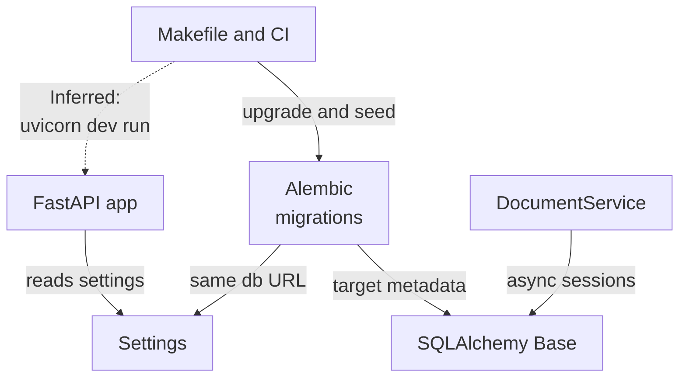
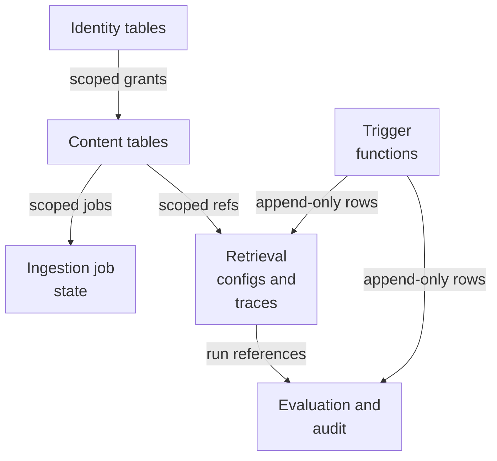
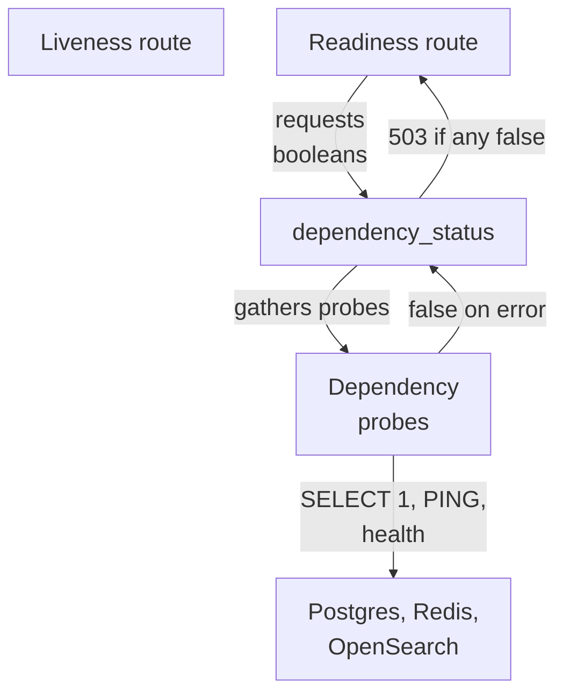
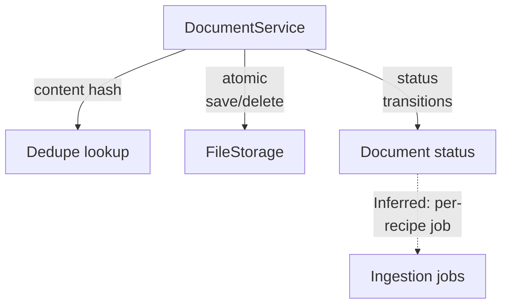
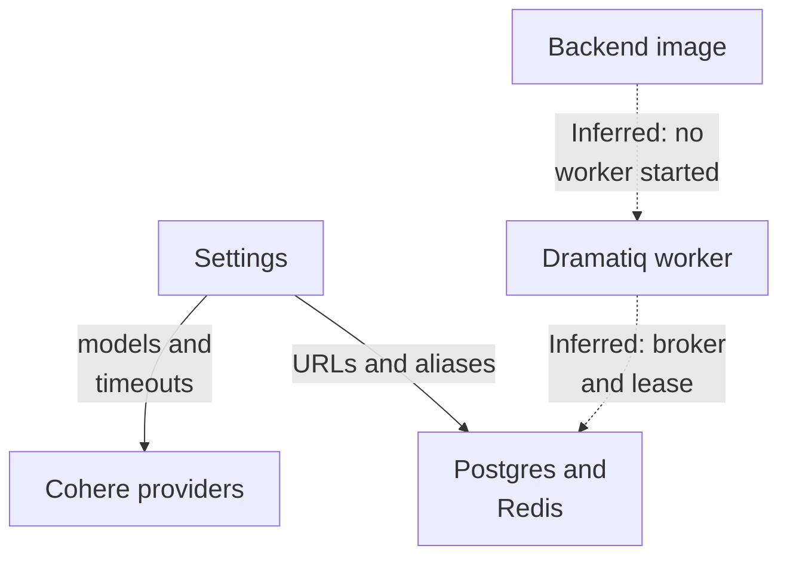

# Repository map

The foundation subsystem is the shared base layer of a multi-tenant hybrid RAG service: a create_app FastAPI entry point exposing health/readiness and an evaluation router, a cached typed Settings boundary, an async SQLAlchemy Base, a tenant-scoped DocumentService over replaceable file storage, and a linear Alembic chain defining identity, content, retrieval, evaluation/audit, and ingestion-job schema. Migrations push authorization, lifecycle, lease, and immutability invariants into PostgreSQL, while a Dockerfile, Makefile, Compose, and CI provide orchestration and verification.

Commit: `f8493c1d264c525948d9d33ffaf2dd197be97e26` | Generated: 2026-10-18T18:35:12.194254+00:00

[Open PDF](repository-map.pdf)

**AI-generated analysis. Source references are checked for existence and supplied scope; this does not prove semantic correctness.**

## Scope

Tracked, eligible text only; bounded excerpts, not exhaustive.

35/39 eligible files analyzed; 184 tracked files excluded by policy.

7 API calls. See coverage.json for budgets, exclusions, and usage.

## Architecture

The FastAPI app reads shared Settings and mounts health and evaluation routes; the same Settings feeds schema management and dependency probes. Makefile, Compose, and CI form the orchestration boundary around app, schema, and tests.

PNG fallback

### Source evidence

- **F0001**: The backend ships as a single uvicorn-served FastAPI application created by create_app and exposed as hybrid_rag_search.main:app, with PYTHONPATH and --app-dir pointing at /app/src so the installed package is importable (S0001, S0004). (<a href="https://github.com/Justin-Mendoza/hybrid-rag-search/blob/f8493c1d264c525948d9d33ffaf2dd197be97e26/backend/Dockerfile#L1-L13">backend/Dockerfile:1-13</a>, <a href="https://github.com/Justin-Mendoza/hybrid-rag-search/blob/f8493c1d264c525948d9d33ffaf2dd197be97e26/backend/src/hybrid_rag_search/main.py#L1-L47">backend/src/hybrid_rag_search/main.py:1-47</a>)
- **F0002**: create_app wires two route groups: liveness responses shared by /health and /health/live, a /health/ready readiness handler that returns 503 when dependency_status(settings) reports any false dependency, and the evaluation router mounted via include_router (S0004). (<a href="https://github.com/Justin-Mendoza/hybrid-rag-search/blob/f8493c1d264c525948d9d33ffaf2dd197be97e26/backend/src/hybrid_rag_search/main.py#L1-L47">backend/src/hybrid_rag_search/main.py:1-47</a>)
- **F0043**: Settings (backend/src/hybrid_rag_search/config.py) is a cached (lru_cache on get_settings) Pydantic BaseSettings loaded from environment/.env, exposing database_url, redis_url, opensearch_url, storage/tokenizer/ingestion artifact roots, and Cohere embedding/rerank/generation parameters with timeouts and pricing. (<a href="https://github.com/Justin-Mendoza/hybrid-rag-search/blob/f8493c1d264c525948d9d33ffaf2dd197be97e26/backend/src/hybrid_rag_search/config.py#L1-L85">backend/src/hybrid_rag_search/config.py:1-85</a>)
- **F0045**: Settings.validate_cross_field_settings enforces startup invariants across configuration: embed-english-light-v3.0 requires cohere_embed_dimensions == 384, rerank_result_limit may not exceed rerank_candidate_limit, and cohere_rerank_timeout_seconds may not exceed retrieval_deadline_seconds. (<a href="https://github.com/Justin-Mendoza/hybrid-rag-search/blob/f8493c1d264c525948d9d33ffaf2dd197be97e26/backend/src/hybrid_rag_search/config.py#L1-L85">backend/src/hybrid_rag_search/config.py:1-85</a>)
- **F0049**: database.py defines a shared SQLAlchemy DeclarativeBase named Base whose MetaData uses a NAMING_CONVENTION for indexes, unique, check, foreign key, and primary key constraints; the docstring states it is shared by application models and Alembic. (<a href="https://github.com/Justin-Mendoza/hybrid-rag-search/blob/f8493c1d264c525948d9d33ffaf2dd197be97e26/backend/src/hybrid_rag_search/database.py#L1-L25">backend/src/hybrid_rag_search/database.py:1-25</a>)
- **F0065**: The evaluation, identity, and retrieval ORM modules all declare SQLAlchemy models against the shared hybrid_rag_search.database.Base registry, making Base the single metadata aggregation point for these persistence domains. (<a href="https://github.com/Justin-Mendoza/hybrid-rag-search/blob/f8493c1d264c525948d9d33ffaf2dd197be97e26/backend/src/hybrid_rag_search/models/evaluation.py#L1-L172">backend/src/hybrid_rag_search/models/evaluation.py:1-172</a>, <a href="https://github.com/Justin-Mendoza/hybrid-rag-search/blob/f8493c1d264c525948d9d33ffaf2dd197be97e26/backend/src/hybrid_rag_search/models/identity.py#L1-L72">backend/src/hybrid_rag_search/models/identity.py:1-72</a>, <a href="https://github.com/Justin-Mendoza/hybrid-rag-search/blob/f8493c1d264c525948d9d33ffaf2dd197be97e26/backend/src/hybrid_rag_search/models/retrieval.py#L1-L86">backend/src/hybrid_rag_search/models/retrieval.py:1-86</a>)
- **F0056**: DocumentService owns its transactions and requires callers to supply an already authorized tenant/collection scope, delegating duplicate detection, upload, fetch, and delete without performing authorization itself. (<a href="https://github.com/Justin-Mendoza/hybrid-rag-search/blob/f8493c1d264c525948d9d33ffaf2dd197be97e26/backend/src/hybrid_rag_search/documents.py#L1-L126">backend/src/hybrid_rag_search/documents.py:1-126</a>)
- **F0064**: The module docstring of documents.py describes the file as original-file lifecycle independent of HTTP and future ingestion workers, indicating the service is intended as a domain layer decoupled from transport and worker orchestration. (<a href="https://github.com/Justin-Mendoza/hybrid-rag-search/blob/f8493c1d264c525948d9d33ffaf2dd197be97e26/backend/src/hybrid_rag_search/documents.py#L1-L126">backend/src/hybrid_rag_search/documents.py:1-126</a>)
- **F0007**: The Makefile is the local orchestration boundary: it provisions the venv and dependencies (setup), runs backend and frontend dev servers together with uvicorn over the backend/src layout, and exposes Docker Compose stack targets for the local environment (S0009). (<a href="https://github.com/Justin-Mendoza/hybrid-rag-search/blob/f8493c1d264c525948d9d33ffaf2dd197be97e26/Makefile#L1-L139">Makefile:1-139</a>)
- **F0010**: CI runs the backend as a separate job against service containers for OpenSearch 3.6.0 (single-node, security disabled) and PostgreSQL 17.11, with DATABASE_URL pointing at the service Postgres, then lints, type-checks, runs pytest, exercises Alembic upgrade/check/downgrade/upgrade, seeds twice, and runs integration-marked tests (S0006). (<a href="https://github.com/Justin-Mendoza/hybrid-rag-search/blob/f8493c1d264c525948d9d33ffaf2dd197be97e26/.github/workflows/ci.yml#L1-L83">.github/workflows/ci.yml:1-83</a>)
- **F0011**: CI runs a parallel frontend job over frontend/ with npm ci, format check, lint, typecheck, test, and build, indicating the frontend is built and validated independently of the Python backend (S0006). (<a href="https://github.com/Justin-Mendoza/hybrid-rag-search/blob/f8493c1d264c525948d9d33ffaf2dd197be97e26/.github/workflows/ci.yml#L1-L83">.github/workflows/ci.yml:1-83</a>)
- **F0004**: Alembic migration environment derives its async SQLAlchemy URL from the same get_settings().database_url used by the application, converting it via async_database_url and setting target_metadata to the shared Base.metadata (S0010). (<a href="https://github.com/Justin-Mendoza/hybrid-rag-search/blob/f8493c1d264c525948d9d33ffaf2dd197be97e26/backend/migrations/env.py#L1-L60">backend/migrations/env.py:1-60</a>)
- **F0005**: migrations/env.py supports both offline literal-bind generation and online execution through async_engine_from_config with NullPool, running migrations inside run_sync(do_run_migrations) (S0010). (<a href="https://github.com/Justin-Mendoza/hybrid-rag-search/blob/f8493c1d264c525948d9d33ffaf2dd197be97e26/backend/migrations/env.py#L1-L60">backend/migrations/env.py:1-60</a>)
- **F0029**: The three migrations form a linear revision chain (20260915_01 -&gt; 20260915_02 -&gt; 20260915_03) with each downgrade dropping its tables and trigger functions in reverse order, and downgrade of 20260915_03 drops the immutable trigger before the retrieval_configs table. (<a href="https://github.com/Justin-Mendoza/hybrid-rag-search/blob/f8493c1d264c525948d9d33ffaf2dd197be97e26/backend/migrations/versions/20260915_01_identity.py#L1-L102">backend/migrations/versions/20260915_01_identity.py:1-102</a>, <a href="https://github.com/Justin-Mendoza/hybrid-rag-search/blob/f8493c1d264c525948d9d33ffaf2dd197be97e26/backend/migrations/versions/20260915_02_content.py#L1-L197">backend/migrations/versions/20260915_02_content.py:1-197</a>, <a href="https://github.com/Justin-Mendoza/hybrid-rag-search/blob/f8493c1d264c525948d9d33ffaf2dd197be97e26/backend/migrations/versions/20260915_03_retrieval.py#L1-L146">backend/migrations/versions/20260915_03_retrieval.py:1-146</a>)
- **F0003**: The application reads configuration once per create_app call through get_settings(); liveness and readiness both depend on that settings object for environment and dependency probing (S0004). (<a href="https://github.com/Justin-Mendoza/hybrid-rag-search/blob/f8493c1d264c525948d9d33ffaf2dd197be97e26/backend/src/hybrid_rag_search/main.py#L1-L47">backend/src/hybrid_rag_search/main.py:1-47</a>)
- **F0063**: DocumentService receives an async_sessionmaker[AsyncSession] and a FileStorage collaborator plus a storage_key helper from hybrid_rag_search.storage, establishing storage as a separate subsystem that DocumentService calls off the event loop. (<a href="https://github.com/Justin-Mendoza/hybrid-rag-search/blob/f8493c1d264c525948d9d33ffaf2dd197be97e26/backend/src/hybrid_rag_search/documents.py#L1-L126">backend/src/hybrid_rag_search/documents.py:1-126</a>)
- **F0081**: DocumentService is constructed with an async session factory and a storage backend, and tests instantiate it directly over async_sessionmaker plus LocalFileStorage, placing transaction ownership inside the service rather than in a router. (<a href="https://github.com/Justin-Mendoza/hybrid-rag-search/blob/f8493c1d264c525948d9d33ffaf2dd197be97e26/backend/tests/test_documents.py#L1-L106">backend/tests/test_documents.py:1-106</a>, <a href="https://github.com/Justin-Mendoza/hybrid-rag-search/blob/f8493c1d264c525948d9d33ffaf2dd197be97e26/backend/tests/test_documents_integration.py#L1-L121">backend/tests/test_documents_integration.py:1-121</a>)
- **F0006**: The migration workflow is documented as a Make/Alembic-driven lifecycle: db-revision autogenerates, db-upgrade applies head, db-downgrade reverts one revision, and db-seed loads deterministic dev records (S0002, S0009). (<a href="https://github.com/Justin-Mendoza/hybrid-rag-search/blob/f8493c1d264c525948d9d33ffaf2dd197be97e26/backend/migrations/README.md#L1-L5">backend/migrations/README.md:1-5</a>, <a href="https://github.com/Justin-Mendoza/hybrid-rag-search/blob/f8493c1d264c525948d9d33ffaf2dd197be97e26/Makefile#L1-L139">Makefile:1-139</a>)
- **F0016** (inferred): The Dockerfile installs the package from pyproject.toml and src and then launches uvicorn as the container CMD; there is no evidence in these sources of a Dramatiq worker process being launched by the same image (S0001). (<a href="https://github.com/Justin-Mendoza/hybrid-rag-search/blob/f8493c1d264c525948d9d33ffaf2dd197be97e26/backend/Dockerfile#L1-L13">backend/Dockerfile:1-13</a>)

## Tenancy and persistence

Tenant ownership is structural: composite tenant-scoped foreign keys and uniqueness let PostgreSQL reject cross-tenant references, while immutability triggers and status checks push lifecycle invariants out of application code.

PNG fallback

### Source evidence

- **F0017**: Migration 20260915_01 creates the identity schema (tenants, users, memberships) and defines a set_updated_at() PL/pgSQL trigger function that sets updated_at on BEFORE UPDATE for each of the three tables. (<a href="https://github.com/Justin-Mendoza/hybrid-rag-search/blob/f8493c1d264c525948d9d33ffaf2dd197be97e26/backend/migrations/versions/20260915_01_identity.py#L1-L102">backend/migrations/versions/20260915_01_identity.py:1-102</a>)
- **F0018**: Tenants enforce a lowercase hyphenated slug format via ck_tenants_slug_format and a unique constraint uq_tenants_slug, while users enforce normalized lowercase email via ck_users_email_normalized and uq_users_email. (<a href="https://github.com/Justin-Mendoza/hybrid-rag-search/blob/f8493c1d264c525948d9d33ffaf2dd197be97e26/backend/migrations/versions/20260915_01_identity.py#L1-L102">backend/migrations/versions/20260915_01_identity.py:1-102</a>)
- **F0069**: Identity models define Tenant, User, and Membership with a tenant_id+user_id uniqueness constraint on memberships and a role CheckConstraint restricting roles to 'owner','admin','member' matching the MembershipRole StrEnum. (<a href="https://github.com/Justin-Mendoza/hybrid-rag-search/blob/f8493c1d264c525948d9d33ffaf2dd197be97e26/backend/src/hybrid_rag_search/models/identity.py#L1-L72">backend/src/hybrid_rag_search/models/identity.py:1-72</a>)
- **F0020**: Migration 20260915_02 revises 20260915_01 and creates collections, collection_grants, documents, and ingestion_jobs, reusing set_updated_at() triggers across all four new tables. (<a href="https://github.com/Justin-Mendoza/hybrid-rag-search/blob/f8493c1d264c525948d9d33ffaf2dd197be97e26/backend/migrations/versions/20260915_02_content.py#L1-L197">backend/migrations/versions/20260915_02_content.py:1-197</a>)
- **F0052**: content.py models enforce multi-tenant ownership via composite, tenant-scoped foreign keys: CollectionGrant references [tenant_id, collection_id] and [tenant_id, membership_id], Document references [tenant_id, collection_id], and IngestionJob references [tenant_id, document_id]. (<a href="https://github.com/Justin-Mendoza/hybrid-rag-search/blob/f8493c1d264c525948d9d33ffaf2dd197be97e26/backend/src/hybrid_rag_search/models/content.py#L1-L225">backend/src/hybrid_rag_search/models/content.py:1-225</a>)
- **F0038**: Migration 20260918_05 adds a durable 'stage' column to ingestion_jobs constrained to parse/chunk/embed/index/complete, and ck_ingestion_jobs_completion_matches_status ties (status = 'succeeded') to (stage = 'complete') so success and completion cannot diverge. (<a href="https://github.com/Justin-Mendoza/hybrid-rag-search/blob/f8493c1d264c525948d9d33ffaf2dd197be97e26/backend/migrations/versions/20260918_05_ingestion_stage.py#L1-L47">backend/migrations/versions/20260918_05_ingestion_stage.py:1-47</a>)
- **F0040**: Ingestion worker ownership is an expiring lease: migration 20260918_07 adds lease_token and lease_expires_at with ck_ingestion_jobs_lease_matches_running requiring (status = 'running') to equal both lease columns being NOT NULL, plus ix_ingestion_jobs_status_lease for scanning expired leases. (<a href="https://github.com/Justin-Mendoza/hybrid-rag-search/blob/f8493c1d264c525948d9d33ffaf2dd197be97e26/backend/migrations/versions/20260918_07_ingestion_lease.py#L1-L51">backend/migrations/versions/20260918_07_ingestion_lease.py:1-51</a>)
- **F0041**: Retry scheduling is durable in the database: next_attempt_at with ck_ingestion_jobs_retry_time_requires_queued (a retry time may only exist when status = 'queued') and index ix_ingestion_jobs_status_retry. (<a href="https://github.com/Justin-Mendoza/hybrid-rag-search/blob/f8493c1d264c525948d9d33ffaf2dd197be97e26/backend/migrations/versions/20260918_08_ingestion_retry_time.py#L1-L42">backend/migrations/versions/20260918_08_ingestion_retry_time.py:1-42</a>)
- **F0025**: Migration 20260915_03 revises 20260915_02 and introduces a prevent_mutation() PL/pgSQL function that raises an integrity_constraint_violation exception for BEFORE UPDATE OR DELETE, used to make retrieval_configs append-only. (<a href="https://github.com/Justin-Mendoza/hybrid-rag-search/blob/f8493c1d264c525948d9d33ffaf2dd197be97e26/backend/migrations/versions/20260915_03_retrieval.py#L1-L146">backend/migrations/versions/20260915_03_retrieval.py:1-146</a>)
- **F0026**: retrieval_configs store per-tenant versioned retrieval parameters as JSONB (validated as an object), an embedding_model required non-blank, an optional rerank_model, and uniqueness on (tenant_id, name, version); the immutability trigger blocks updates and deletes. (<a href="https://github.com/Justin-Mendoza/hybrid-rag-search/blob/f8493c1d264c525948d9d33ffaf2dd197be97e26/backend/migrations/versions/20260915_03_retrieval.py#L1-L146">backend/migrations/versions/20260915_03_retrieval.py:1-146</a>)
- **F0073**: QueryTrace models a per-query observability record with selected_path, timings, rankings, usage, fallbacks, and error fields, and enforces a capture policy: 'content_captured OR query_text IS NULL' so raw query text is only stored when content capture is enabled. (<a href="https://github.com/Justin-Mendoza/hybrid-rag-search/blob/f8493c1d264c525948d9d33ffaf2dd197be97e26/backend/src/hybrid_rag_search/models/retrieval.py#L1-L86">backend/src/hybrid_rag_search/models/retrieval.py:1-86</a>)
- **F0033**: Migration 20260915_04 creates the evaluation_datasets, judgments, evaluation_runs, and audit_events tables, forming the evaluation and audit schema domain in the linear Alembic chain (down_revision 20260915_03). (<a href="https://github.com/Justin-Mendoza/hybrid-rag-search/blob/f8493c1d264c525948d9d33ffaf2dd197be97e26/backend/migrations/versions/20260915_04_evaluation_audit.py#L1-L213">backend/migrations/versions/20260915_04_evaluation_audit.py:1-213</a>)
- **F0035**: Evaluation datasets, judgments, and audit_events are declared immutable: the migration attaches a BEFORE UPDATE OR DELETE trigger executing prevent_mutation() to each of those three tables, so rows are append-only once written. (<a href="https://github.com/Justin-Mendoza/hybrid-rag-search/blob/f8493c1d264c525948d9d33ffaf2dd197be97e26/backend/migrations/versions/20260915_04_evaluation_audit.py#L1-L213">backend/migrations/versions/20260915_04_evaluation_audit.py:1-213</a>)
- **F0078**: AuditEvent is modeled as an append-only-style record (entity_type/entity_id/action/details JSONB plus occurred_at) whose actor is optional via a nullable actor_membership_id, allowing events without an authenticated membership actor. (<a href="https://github.com/Justin-Mendoza/hybrid-rag-search/blob/f8493c1d264c525948d9d33ffaf2dd197be97e26/backend/src/hybrid_rag_search/models/evaluation.py#L1-L172">backend/src/hybrid_rag_search/models/evaluation.py:1-172</a>)
- **F0021**: collection_grants references collections and memberships through tenant-scoped composite foreign keys (tenant_id, collection_id) and (tenant_id, membership_id), both cascade-delete, with permission constrained to read/write/manage. (<a href="https://github.com/Justin-Mendoza/hybrid-rag-search/blob/f8493c1d264c525948d9d33ffaf2dd197be97e26/backend/migrations/versions/20260915_02_content.py#L1-L197">backend/migrations/versions/20260915_02_content.py:1-197</a>)
- **F0024**: ingestion_jobs belong to a document via tenant-scoped composite FK that cascades on delete, track status (queued/running/succeeded/failed/cancelled), attempts bounded by max_attempts via ck_ingestion_jobs_attempts_within_limit, a JSONB checkpoint defaulting to '{}', and started_at/finished_at timestamps. (<a href="https://github.com/Justin-Mendoza/hybrid-rag-search/blob/f8493c1d264c525948d9d33ffaf2dd197be97e26/backend/migrations/versions/20260915_02_content.py#L1-L197">backend/migrations/versions/20260915_02_content.py:1-197</a>)
- **F0039**: Migration 20260918_06 makes ingestion identity content-addressed and pipeline-versioned: content_hash (backfilled from documents.content_hash) and pipeline_version become NOT NULL with format checks, and uq_ingestion_jobs_document_recipe makes (tenant_id, document_id, content_hash, pipeline_version) unique, defining job reuse per document recipe. (<a href="https://github.com/Justin-Mendoza/hybrid-rag-search/blob/f8493c1d264c525948d9d33ffaf2dd197be97e26/backend/migrations/versions/20260918_06_ingestion_identity.py#L1-L67">backend/migrations/versions/20260918_06_ingestion_identity.py:1-67</a>)
- **F0028**: query_traces reference collections and retrieval_configs via tenant-scoped composite foreign keys with ondelete RESTRICT, so trace history preserves the collection and retrieval config it was produced against. (<a href="https://github.com/Justin-Mendoza/hybrid-rag-search/blob/f8493c1d264c525948d9d33ffaf2dd197be97e26/backend/migrations/versions/20260915_03_retrieval.py#L1-L146">backend/migrations/versions/20260915_03_retrieval.py:1-146</a>)
- **F0067**: Cross-module ownership is enforced through tenant-scoped composite foreign keys: Judgment and EvaluationRun reference evaluation_datasets via (tenant_id, dataset_id), QueryTrace references collections and retrieval_configs via (tenant_id, x_id), and AuditEvent references memberships via (tenant_id, actor_membership_id). (<a href="https://github.com/Justin-Mendoza/hybrid-rag-search/blob/f8493c1d264c525948d9d33ffaf2dd197be97e26/backend/src/hybrid_rag_search/models/evaluation.py#L1-L172">backend/src/hybrid_rag_search/models/evaluation.py:1-172</a>, <a href="https://github.com/Justin-Mendoza/hybrid-rag-search/blob/f8493c1d264c525948d9d33ffaf2dd197be97e26/backend/src/hybrid_rag_search/models/retrieval.py#L1-L86">backend/src/hybrid_rag_search/models/retrieval.py:1-86</a>)
- **F0034**: Tenant ownership is enforced structurally: judgments and evaluation_runs reference evaluation_datasets via composite (tenant_id, dataset_id) foreign keys, so a judgment or run can only attach to a dataset of the same tenant. (<a href="https://github.com/Justin-Mendoza/hybrid-rag-search/blob/f8493c1d264c525948d9d33ffaf2dd197be97e26/backend/migrations/versions/20260915_04_evaluation_audit.py#L1-L213">backend/migrations/versions/20260915_04_evaluation_audit.py:1-213</a>)
- **F0071**: EvaluationRun references its dataset and retrieval config with ondelete='RESTRICT', meaning a dataset or retrieval config that has been evaluated cannot be deleted while a run exists. (<a href="https://github.com/Justin-Mendoza/hybrid-rag-search/blob/f8493c1d264c525948d9d33ffaf2dd197be97e26/backend/src/hybrid_rag_search/models/evaluation.py#L1-L172">backend/src/hybrid_rag_search/models/evaluation.py:1-172</a>)

## Health and dependency probing

Liveness is a static response; readiness fans out concurrent probes against configured external dependencies and returns 503 when any probe reports false, isolating partial failure.

PNG fallback

### Source evidence

- **F0002**: create_app wires two route groups: liveness responses shared by /health and /health/live, a /health/ready readiness handler that returns 503 when dependency_status(settings) reports any false dependency, and the evaluation router mounted via include_router (S0004). (<a href="https://github.com/Justin-Mendoza/hybrid-rag-search/blob/f8493c1d264c525948d9d33ffaf2dd197be97e26/backend/src/hybrid_rag_search/main.py#L1-L47">backend/src/hybrid_rag_search/main.py:1-47</a>)
- **F0095**: create_app() builds the FastAPI application used by tests via TestClient, serving /health, /health/live (both {"status":"ok","environment":"development"}) and /health/ready. (<a href="https://github.com/Justin-Mendoza/hybrid-rag-search/blob/f8493c1d264c525948d9d33ffaf2dd197be97e26/backend/tests/test_health.py#L1-L48">backend/tests/test_health.py:1-48</a>)
- **F0094**: dependency_status fans the three named probes into a {postgres, redis, opensearch: bool} mapping, and the readiness endpoint returns 200 with status ready when all are true and 503 with not_ready when any probe is false. (<a href="https://github.com/Justin-Mendoza/hybrid-rag-search/blob/f8493c1d264c525948d9d33ffaf2dd197be97e26/backend/tests/test_dependency_health.py#L1-L95">backend/tests/test_dependency_health.py:1-95</a>, <a href="https://github.com/Justin-Mendoza/hybrid-rag-search/blob/f8493c1d264c525948d9d33ffaf2dd197be97e26/backend/tests/test_health.py#L1-L48">backend/tests/test_health.py:1-48</a>)
- **F0060**: health.py provides check_postgres (asyncpg SELECT 1), check_redis (Redis PING), and check_opensearch (HTTP GET /_cluster/health with raise_for_status), and dependency_status fans these out concurrently via asyncio.gather, returning booleans keyed by 'postgres', 'redis', 'opensearch'. (<a href="https://github.com/Justin-Mendoza/hybrid-rag-search/blob/f8493c1d264c525948d9d33ffaf2dd197be97e26/backend/src/hybrid_rag_search/health.py#L1-L50">backend/src/hybrid_rag_search/health.py:1-50</a>)
- **F0093**: The health module exposes per-dependency probes (check_postgres executing SELECT 1 and closing its asyncpg connection, check_redis pinging and rejecting a false ping, check_opensearch requesting &lt;host&gt;/_cluster/health) plus run_check, which converts a probe exception into False and success into True. (<a href="https://github.com/Justin-Mendoza/hybrid-rag-search/blob/f8493c1d264c525948d9d33ffaf2dd197be97e26/backend/tests/test_dependency_health.py#L1-L95">backend/tests/test_dependency_health.py:1-95</a>)
- **F0044**: External integrations are configurable through Settings: PostgreSQL (database_url), Redis (redis_url), OpenSearch (opensearch_url plus read/write aliases and index schema version), and Cohere (COHERE_API_KEY or COHERE_TRIAL_KEY secret, models, timeouts, and USD pricing for embedding, rerank, and generation tokens). (<a href="https://github.com/Justin-Mendoza/hybrid-rag-search/blob/f8493c1d264c525948d9d33ffaf2dd197be97e26/backend/src/hybrid_rag_search/config.py#L1-L85">backend/src/hybrid_rag_search/config.py:1-85</a>)
- **F0092**: async_database_url rewrites a plain postgresql URL to the postgresql+asyncpg driver and leaves an already-async URL unchanged, matching the health check which connects with asyncpg.connect. (<a href="https://github.com/Justin-Mendoza/hybrid-rag-search/blob/f8493c1d264c525948d9d33ffaf2dd197be97e26/backend/tests/test_database.py#L1-L119">backend/tests/test_database.py:1-119</a>, <a href="https://github.com/Justin-Mendoza/hybrid-rag-search/blob/f8493c1d264c525948d9d33ffaf2dd197be97e26/backend/tests/test_dependency_health.py#L1-L95">backend/tests/test_dependency_health.py:1-95</a>)
- **F0061**: run_check isolates probe failure by catching Exception and returning False, so an unreachable dependency yields a false status rather than propagating an error to callers. (<a href="https://github.com/Justin-Mendoza/hybrid-rag-search/blob/f8493c1d264c525948d9d33ffaf2dd197be97e26/backend/src/hybrid_rag_search/health.py#L1-L50">backend/src/hybrid_rag_search/health.py:1-50</a>)

## Document lifecycle service

DocumentService owns transactions and requires an already authorized tenant/collection scope. Upload locks the collection to serialize dedupe and stages the file off the event loop; delete commits intent before removing storage, accepting non-atomic DB and disk.

PNG fallback

### Source evidence

- **F0056**: DocumentService owns its transactions and requires callers to supply an already authorized tenant/collection scope, delegating duplicate detection, upload, fetch, and delete without performing authorization itself. (<a href="https://github.com/Justin-Mendoza/hybrid-rag-search/blob/f8493c1d264c525948d9d33ffaf2dd197be97e26/backend/src/hybrid_rag_search/documents.py#L1-L126">backend/src/hybrid_rag_search/documents.py:1-126</a>)
- **F0064**: The module docstring of documents.py describes the file as original-file lifecycle independent of HTTP and future ingestion workers, indicating the service is intended as a domain layer decoupled from transport and worker orchestration. (<a href="https://github.com/Justin-Mendoza/hybrid-rag-search/blob/f8493c1d264c525948d9d33ffaf2dd197be97e26/backend/src/hybrid_rag_search/documents.py#L1-L126">backend/src/hybrid_rag_search/documents.py:1-126</a>)
- **F0057**: DocumentService.upload hashes content, takes a row lock on the collection via with_for_update() to serialize duplicate checks across concurrent uploads, returns an existing non-deleting document as a duplicate, and otherwise inserts a PENDING Document then saves the file via asyncio.to_thread outside the event loop. (<a href="https://github.com/Justin-Mendoza/hybrid-rag-search/blob/f8493c1d264c525948d9d33ffaf2dd197be97e26/backend/src/hybrid_rag_search/documents.py#L1-L126">backend/src/hybrid_rag_search/documents.py:1-126</a>)
- **F0083**: DocumentService.upload performs a deduplication lookup via session.scalar keyed on content hash and returns the existing document with duplicate=true instead of inserting again; a second upload of identical bytes adds no new row. (<a href="https://github.com/Justin-Mendoza/hybrid-rag-search/blob/f8493c1d264c525948d9d33ffaf2dd197be97e26/backend/tests/test_documents.py#L1-L106">backend/tests/test_documents.py:1-106</a>, <a href="https://github.com/Justin-Mendoza/hybrid-rag-search/blob/f8493c1d264c525948d9d33ffaf2dd197be97e26/backend/tests/test_documents_integration.py#L1-L121">backend/tests/test_documents_integration.py:1-121</a>)
- **F0063**: DocumentService receives an async_sessionmaker[AsyncSession] and a FileStorage collaborator plus a storage_key helper from hybrid_rag_search.storage, establishing storage as a separate subsystem that DocumentService calls off the event loop. (<a href="https://github.com/Justin-Mendoza/hybrid-rag-search/blob/f8493c1d264c525948d9d33ffaf2dd197be97e26/backend/src/hybrid_rag_search/documents.py#L1-L126">backend/src/hybrid_rag_search/documents.py:1-126</a>)
- **F0076**: storage.py defines a FileStorage Protocol (save/fetch/delete) as a replaceable storage boundary; storage_key(tenant_id, document_id) returns '{tenant_id}/{document_id}' and explicitly excludes upload filenames from keys. (<a href="https://github.com/Justin-Mendoza/hybrid-rag-search/blob/f8493c1d264c525948d9d33ffaf2dd197be97e26/backend/src/hybrid_rag_search/storage.py#L1-L58">backend/src/hybrid_rag_search/storage.py:1-58</a>)
- **F0053**: Document lifecycle state is a constrained text column whose allowed values are pending, processing, ready, failed, deleting, deleted, with a CHECK enforcing that deleted_at is non-null exactly when status is 'deleted'. (<a href="https://github.com/Justin-Mendoza/hybrid-rag-search/blob/f8493c1d264c525948d9d33ffaf2dd197be97e26/backend/src/hybrid_rag_search/models/content.py#L1-L225">backend/src/hybrid_rag_search/models/content.py:1-225</a>)
- **F0086**: Document deletion is two-phase: the document is first marked DocumentStatus.DELETING, then the storage delete runs; if storage.delete raises OSError the status remains DELETING and fetch raises DocumentUnavailable, and a retry completes with DocumentStatus.DELETED plus deleted_at set. (<a href="https://github.com/Justin-Mendoza/hybrid-rag-search/blob/f8493c1d264c525948d9d33ffaf2dd197be97e26/backend/tests/test_documents.py#L1-L106">backend/tests/test_documents.py:1-106</a>, <a href="https://github.com/Justin-Mendoza/hybrid-rag-search/blob/f8493c1d264c525948d9d33ffaf2dd197be97e26/backend/tests/test_documents_integration.py#L1-L121">backend/tests/test_documents_integration.py:1-121</a>)
- **F0055**: IngestionJob schema carries queued/running/succeeded/failed/cancelled status, parse/chunk/embed/index/complete stages, attempts and max_attempts, checkpoint JSONB, and lease fields, with CHECK constraints tying running status to a live lease and succeeded status to the complete stage; the unique key is (tenant_id, document_id, content_hash, pipeline_version). (<a href="https://github.com/Justin-Mendoza/hybrid-rag-search/blob/f8493c1d264c525948d9d33ffaf2dd197be97e26/backend/src/hybrid_rag_search/models/content.py#L1-L225">backend/src/hybrid_rag_search/models/content.py:1-225</a>)
- **F0089**: IngestionJob schema constrains its state machine in PostgreSQL: stage defaults to "parse" with ck_ingestion_jobs_stage_allowed, plus ck_ingestion_jobs_completion_matches_status, ck_ingestion_jobs_content_hash_sha256, ck_ingestion_jobs_pipeline_version_format, uq_ingestion_jobs_document_recipe, ck_ingestion_jobs_lease_matches_running, and ck_ingestion_jobs_retry_time_requires_queued. (<a href="https://github.com/Justin-Mendoza/hybrid-rag-search/blob/f8493c1d264c525948d9d33ffaf2dd197be97e26/backend/tests/test_database.py#L1-L119">backend/tests/test_database.py:1-119</a>)
- **F0082**: DocumentService.upload-hashes content (sha256, e.g. the hash of b"hello" is asserted), records original_filename, size_bytes, media_type and content_hash, and persists the document with DocumentStatus.PENDING. (<a href="https://github.com/Justin-Mendoza/hybrid-rag-search/blob/f8493c1d264c525948d9d33ffaf2dd197be97e26/backend/tests/test_documents.py#L1-L106">backend/tests/test_documents.py:1-106</a>, <a href="https://github.com/Justin-Mendoza/hybrid-rag-search/blob/f8493c1d264c525948d9d33ffaf2dd197be97e26/backend/tests/test_documents_integration.py#L1-L121">backend/tests/test_documents_integration.py:1-121</a>)
- **F0077**: LocalFileStorage implements the protocol with create-only atomic writes: it validates keys against a canonical-UUID pattern, rejects symlinked path components, writes to a sibling tempfile that is fsync'd, then publishes via os.link so an existing original is never overwritten. (<a href="https://github.com/Justin-Mendoza/hybrid-rag-search/blob/f8493c1d264c525948d9d33ffaf2dd197be97e26/backend/src/hybrid_rag_search/storage.py#L1-L58">backend/src/hybrid_rag_search/storage.py:1-58</a>)
- **F0088**: If storage.save fails during upload (OSError), the exception propagates and no Document row for that filename is persisted, indicating the file write is staged before/around the DB write. (<a href="https://github.com/Justin-Mendoza/hybrid-rag-search/blob/f8493c1d264c525948d9d33ffaf2dd197be97e26/backend/tests/test_documents_integration.py#L1-L121">backend/tests/test_documents_integration.py:1-121</a>)
- **F0058**: DocumentService.delete commits DELETING intent in one transaction, then in a second transaction removes the file and marks the document DELETED with deleted_at set; the docstring documents that PostgreSQL and disk cannot commit atomically, so a crash may orphan a file but must not delete a possibly committed original. (<a href="https://github.com/Justin-Mendoza/hybrid-rag-search/blob/f8493c1d264c525948d9d33ffaf2dd197be97e26/backend/src/hybrid_rag_search/documents.py#L1-L126">backend/src/hybrid_rag_search/documents.py:1-126</a>)
- **F0039**: Migration 20260918_06 makes ingestion identity content-addressed and pipeline-versioned: content_hash (backfilled from documents.content_hash) and pipeline_version become NOT NULL with format checks, and uq_ingestion_jobs_document_recipe makes (tenant_id, document_id, content_hash, pipeline_version) unique, defining job reuse per document recipe. (<a href="https://github.com/Justin-Mendoza/hybrid-rag-search/blob/f8493c1d264c525948d9d33ffaf2dd197be97e26/backend/migrations/versions/20260918_06_ingestion_identity.py#L1-L67">backend/migrations/versions/20260918_06_ingestion_identity.py:1-67</a>)

## External integration and async boundary

Settings names every external dependency the backend expects, including Cohere providers and Redis/Dramatiq; however these sources show configuration and a worker actor but no runtime wiring that connects them to ingestion execution.

PNG fallback

### Source evidence

- **F0043**: Settings (backend/src/hybrid_rag_search/config.py) is a cached (lru_cache on get_settings) Pydantic BaseSettings loaded from environment/.env, exposing database_url, redis_url, opensearch_url, storage/tokenizer/ingestion artifact roots, and Cohere embedding/rerank/generation parameters with timeouts and pricing. (<a href="https://github.com/Justin-Mendoza/hybrid-rag-search/blob/f8493c1d264c525948d9d33ffaf2dd197be97e26/backend/src/hybrid_rag_search/config.py#L1-L85">backend/src/hybrid_rag_search/config.py:1-85</a>)
- **F0045**: Settings.validate_cross_field_settings enforces startup invariants across configuration: embed-english-light-v3.0 requires cohere_embed_dimensions == 384, rerank_result_limit may not exceed rerank_candidate_limit, and cohere_rerank_timeout_seconds may not exceed retrieval_deadline_seconds. (<a href="https://github.com/Justin-Mendoza/hybrid-rag-search/blob/f8493c1d264c525948d9d33ffaf2dd197be97e26/backend/src/hybrid_rag_search/config.py#L1-L85">backend/src/hybrid_rag_search/config.py:1-85</a>)
- **F0044**: External integrations are configurable through Settings: PostgreSQL (database_url), Redis (redis_url), OpenSearch (opensearch_url plus read/write aliases and index schema version), and Cohere (COHERE_API_KEY or COHERE_TRIAL_KEY secret, models, timeouts, and USD pricing for embedding, rerank, and generation tokens). (<a href="https://github.com/Justin-Mendoza/hybrid-rag-search/blob/f8493c1d264c525948d9d33ffaf2dd197be97e26/backend/src/hybrid_rag_search/config.py#L1-L85">backend/src/hybrid_rag_search/config.py:1-85</a>)
- **F0046**: Retrieval tuning limits (opensearch_bm25_candidate_limit, opensearch_dense_candidate_limit, rerank_candidate_limit, rerank_result_limit) and retrieval_deadline_seconds are declared as positive bounded settings, providing a shared configuration boundary for the retrieval and rerank stages. (<a href="https://github.com/Justin-Mendoza/hybrid-rag-search/blob/f8493c1d264c525948d9d33ffaf2dd197be97e26/backend/src/hybrid_rag_search/config.py#L1-L85">backend/src/hybrid_rag_search/config.py:1-85</a>)
- **F0092**: async_database_url rewrites a plain postgresql URL to the postgresql+asyncpg driver and leaves an already-async URL unchanged, matching the health check which connects with asyncpg.connect. (<a href="https://github.com/Justin-Mendoza/hybrid-rag-search/blob/f8493c1d264c525948d9d33ffaf2dd197be97e26/backend/tests/test_database.py#L1-L119">backend/tests/test_database.py:1-119</a>, <a href="https://github.com/Justin-Mendoza/hybrid-rag-search/blob/f8493c1d264c525948d9d33ffaf2dd197be97e26/backend/tests/test_dependency_health.py#L1-L95">backend/tests/test_dependency_health.py:1-95</a>)
- **F0096**: The worker module exposes a Dramatiq actor heartbeat whose .fn() returns "ok", imported by the health/dependency test module alongside Settings and health probes. (<a href="https://github.com/Justin-Mendoza/hybrid-rag-search/blob/f8493c1d264c525948d9d33ffaf2dd197be97e26/backend/tests/test_dependency_health.py#L1-L95">backend/tests/test_dependency_health.py:1-95</a>)
- **F0012**: The pyproject declares runtime integrations used by the backend (asyncpg, SQLAlchemy asyncio, Alembic, Redis, Dramatiq[redis], Cohere, httpx, pypdf, markdown-it-py, tokenizers) and defines pytest markers 'integration' (migrated local PostgreSQL) and 'live' (authorized external provider calls) that gate environments with external dependencies (S0003). (<a href="https://github.com/Justin-Mendoza/hybrid-rag-search/blob/f8493c1d264c525948d9d33ffaf2dd197be97e26/backend/pyproject.toml#L1-L50">backend/pyproject.toml:1-50</a>)
- **F0016** (inferred): The Dockerfile installs the package from pyproject.toml and src and then launches uvicorn as the container CMD; there is no evidence in these sources of a Dramatiq worker process being launched by the same image (S0001). (<a href="https://github.com/Justin-Mendoza/hybrid-rag-search/blob/f8493c1d264c525948d9d33ffaf2dd197be97e26/backend/Dockerfile#L1-L13">backend/Dockerfile:1-13</a>)
- **F0040**: Ingestion worker ownership is an expiring lease: migration 20260918_07 adds lease_token and lease_expires_at with ck_ingestion_jobs_lease_matches_running requiring (status = 'running') to equal both lease columns being NOT NULL, plus ix_ingestion_jobs_status_lease for scanning expired leases. (<a href="https://github.com/Justin-Mendoza/hybrid-rag-search/blob/f8493c1d264c525948d9d33ffaf2dd197be97e26/backend/migrations/versions/20260918_07_ingestion_lease.py#L1-L51">backend/migrations/versions/20260918_07_ingestion_lease.py:1-51</a>)

## Uncertainties and untraced areas

- No user-facing retrieval or answers HTTP routes appear in this batch beyond health and the mounted evaluation router, so the wider application surface is untraced (F0002).
- Runtime code that populates documents.storage_key/index_version, ingestion_jobs.checkpoint and pipeline_version, and query_traces fields is absent (F0032, F0064).
- Whether LocalFileStorage is the implementation actually injected into the runtime DocumentService, and whether the ORM models or migrations are the operative schema, is not directly evidenced (F0080).
- How Dramatiq workers are started and how Redis is bound to ingestion job execution is not shown; only a heartbeat actor, the declared dependency, and a local Redis container are evidenced (F0016, F0096).
- Callers that generate AuditEvent.action namespaced strings, and consumers of the content-hash index, are not present in these sources (F0032, F0079).
- Whether FastAPI health and evaluation endpoints are consumed by the frontend or external actors is not evidenced.
