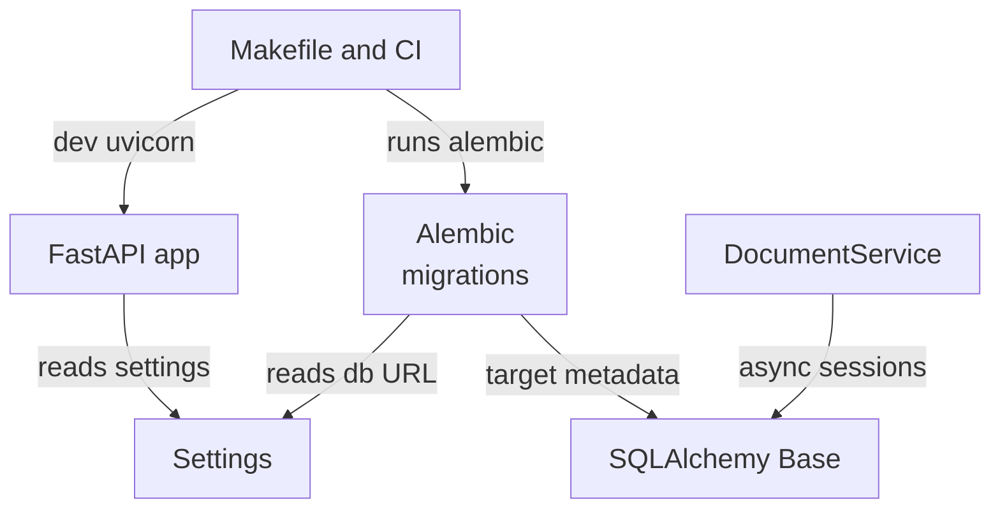
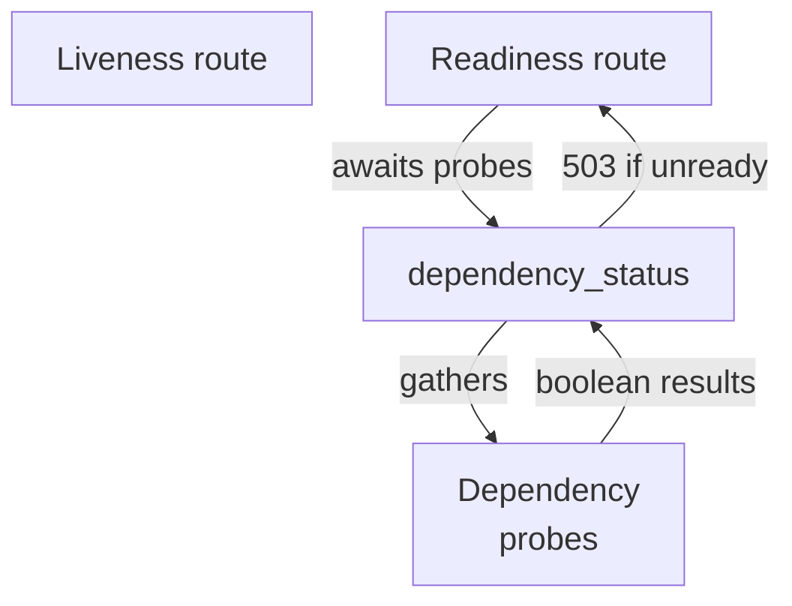
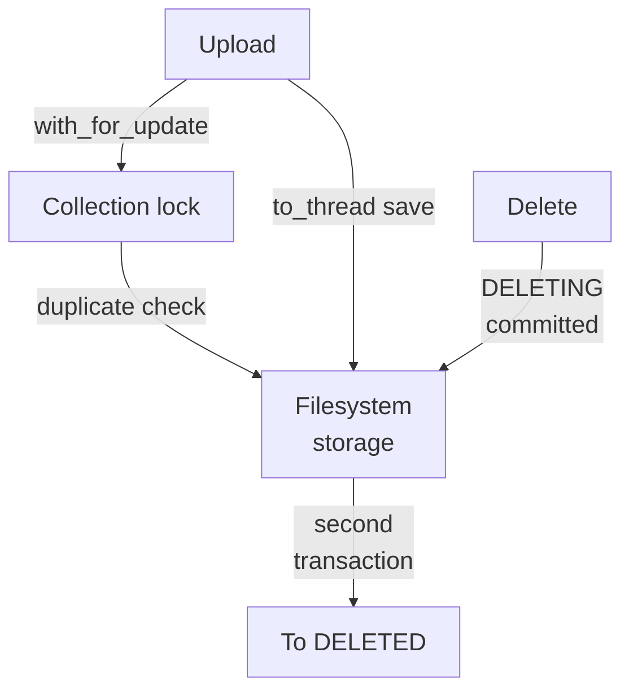
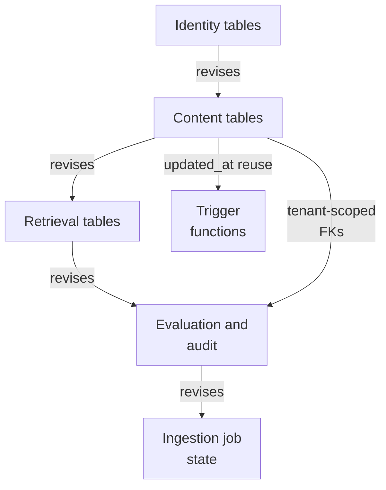
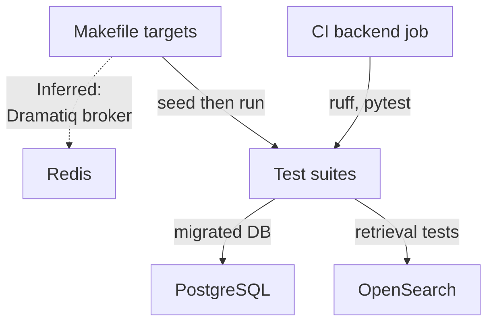

# Repository map

The foundation subsystem is a FastAPI backend for a multi-tenant hybrid RAG service: a create_app entry point exposing health and evaluation routers, a cached typed Settings boundary, an async SQLAlchemy base, a tenant-scoped DocumentService with filesystem storage, and a linear Alembic chain defining identity, content, retrieval, evaluation/audit, and ingestion-job schema. Migrations push authorization, lifecycle, and immutability invariants into PostgreSQL, while containers, Makefile, and CI provide orchestration.

Commit: `56291a0b9cc466341d5d7a4b71aed8b2c5f412bb` | Generated: 2026-10-17T22:58:53.099159+00:00

[Open PDF](repository-map.pdf)

**AI-generated analysis. Source references are checked for existence and supplied scope; this does not prove semantic correctness.**

## Scope

Tracked, eligible text only; bounded excerpts, not exhaustive.

25/39 eligible files analyzed; 184 tracked files excluded by policy.

5 API calls. See coverage.json for budgets, exclusions, and usage.

## Architecture

The FastAPI app reads shared Settings and mounts the evaluation router; the backend image runs it via uvicorn, while Makefile and CI drive migrations and tests against the same Base and config.

PNG fallback

### Source evidence

- **F0002**: create_app() in hybrid_rag_search.main constructs the FastAPI application, reads settings via get_settings(), and mounts the evaluation router (hybrid_rag_search.evaluation.api.router), making evaluation an HTTP-exposed subsystem. (<a href="https://github.com/Justin-Mendoza/hybrid-rag-search/blob/56291a0b9cc466341d5d7a4b71aed8b2c5f412bb/backend/src/hybrid_rag_search/main.py#L1-L47">backend/src/hybrid_rag_search/main.py:1-47</a>)
- **F0003**: module-level `app = create_app()` is the ASGI entry point referenced by both the Docker CMD and the Makefile dev targets. (<a href="https://github.com/Justin-Mendoza/hybrid-rag-search/blob/56291a0b9cc466341d5d7a4b71aed8b2c5f412bb/backend/src/hybrid_rag_search/main.py#L1-L47">backend/src/hybrid_rag_search/main.py:1-47</a>, <a href="https://github.com/Justin-Mendoza/hybrid-rag-search/blob/56291a0b9cc466341d5d7a4b71aed8b2c5f412bb/backend/Dockerfile#L1-L13">backend/Dockerfile:1-13</a>, <a href="https://github.com/Justin-Mendoza/hybrid-rag-search/blob/56291a0b9cc466341d5d7a4b71aed8b2c5f412bb/Makefile#L1-L139">Makefile:1-139</a>)
- **F0046**: Settings (pydantic BaseSettings) defines a single runtime configuration boundary covering database_url, redis_url, and opensearch URLs/aliases, BM25/dense candidate limits, rerank limits, retrieval_deadline_seconds, filesystem roots (storage_root, tokenizer_root, ingestion_artifact_root), and Cohere model/timeout/cost parameters. (<a href="https://github.com/Justin-Mendoza/hybrid-rag-search/blob/56291a0b9cc466341d5d7a4b71aed8b2c5f412bb/backend/src/hybrid_rag_search/config.py#L1-L85">backend/src/hybrid_rag_search/config.py:1-85</a>)
- **F0048**: get_settings() is lru_cache-wrapped, so Settings is constructed once per process as the shared configuration source. (<a href="https://github.com/Justin-Mendoza/hybrid-rag-search/blob/56291a0b9cc466341d5d7a4b71aed8b2c5f412bb/backend/src/hybrid_rag_search/config.py#L1-L85">backend/src/hybrid_rag_search/config.py:1-85</a>)
- **F0049**: database.py provides a shared SQLAlchemy DeclarativeBase subclass `Base` whose MetaData applies a project-wide constraint/index naming convention (ix, uq, ck, fk, pk), and this Base is documented as used by both application models and Alembic migrations. (<a href="https://github.com/Justin-Mendoza/hybrid-rag-search/blob/56291a0b9cc466341d5d7a4b71aed8b2c5f412bb/backend/src/hybrid_rag_search/database.py#L1-L25">backend/src/hybrid_rag_search/database.py:1-25</a>)
- **F0050**: async_database_url rewrites a plain 'postgresql' URL to 'postgresql+asyncpg' and passes through any other driver name unchanged, so callers can supply a synchronous-style URL and get the async driver. (<a href="https://github.com/Justin-Mendoza/hybrid-rag-search/blob/56291a0b9cc466341d5d7a4b71aed8b2c5f412bb/backend/src/hybrid_rag_search/database.py#L1-L25">backend/src/hybrid_rag_search/database.py:1-25</a>)
- **F0052**: DocumentService owns its transactions via an async_sessionmaker and a FileStorage dependency injected in the constructor; callers must pass an already authorized tenant/collection scope, so authorization is a caller responsibility rather than service-internal. (<a href="https://github.com/Justin-Mendoza/hybrid-rag-search/blob/56291a0b9cc466341d5d7a4b71aed8b2c5f412bb/backend/src/hybrid_rag_search/documents.py#L1-L126">backend/src/hybrid_rag_search/documents.py:1-126</a>)
- **F0006**: Alembic env.py derives the database URL from get_settings().database_url through async_database_url(), and sets target_metadata to the SQLAlchemy Base metadata imported from hybrid_rag_search.database, with models imported for side-effect registration. (<a href="https://github.com/Justin-Mendoza/hybrid-rag-search/blob/56291a0b9cc466341d5d7a4b71aed8b2c5f412bb/backend/migrations/env.py#L1-L60">backend/migrations/env.py:1-60</a>)
- **F0007**: Migrations run online asynchronously via async_engine_from_config with NullPool, executing do_run_migrations through connection.run_sync, and offline via literal_binds configuration. (<a href="https://github.com/Justin-Mendoza/hybrid-rag-search/blob/56291a0b9cc466341d5d7a4b71aed8b2c5f412bb/backend/migrations/env.py#L1-L60">backend/migrations/env.py:1-60</a>)
- **F0009**: The Makefile is the central orchestration surface, wiring backend dev (uvicorn main:app), frontend dev, Docker Compose stack lifecycle, Alembic commands, seed/test, tokenizer setup, ingestion recovery, index rebuild start/promote, OpenSearch retrieval integration tests, Cohere live smoke tests, and SciFact/evaluation commands. (<a href="https://github.com/Justin-Mendoza/hybrid-rag-search/blob/56291a0b9cc466341d5d7a4b71aed8b2c5f412bb/Makefile#L1-L139">Makefile:1-139</a>)
- **F0011**: CI defines two jobs: a backend job with postgres:17.11 and opensearch:3.6.0 service containers that runs ruff, mypy, pytest, an alembic upgrade/check/downgrade/upgrade cycle, seed (twice), then integration tests; and a frontend job running npm format check, lint, typecheck, test, and build. (<a href="https://github.com/Justin-Mendoza/hybrid-rag-search/blob/56291a0b9cc466341d5d7a4b71aed8b2c5f412bb/.github/workflows/ci.yml#L1-L83">.github/workflows/ci.yml:1-83</a>)

## Health and readiness

Liveness shares one handler across two paths; readiness fans out concurrent probes whose boolean results decide 200 versus 503, isolating partial dependency failure.

PNG fallback

### Source evidence

- **F0004**: Liveness handler `live` is registered on both /health and /health/live, returning HealthResponse with status 'ok' and the configured app_env. (<a href="https://github.com/Justin-Mendoza/hybrid-rag-search/blob/56291a0b9cc466341d5d7a4b71aed8b2c5f412bb/backend/src/hybrid_rag_search/main.py#L1-L47">backend/src/hybrid_rag_search/main.py:1-47</a>)
- **F0005**: /health/ready awaits dependency_status(settings); when any dependency boolean is false it sets HTTP 503 and reports status 'not_ready' with a per-dependency dict. (<a href="https://github.com/Justin-Mendoza/hybrid-rag-search/blob/56291a0b9cc466341d5d7a4b71aed8b2c5f412bb/backend/src/hybrid_rag_search/main.py#L1-L47">backend/src/hybrid_rag_search/main.py:1-47</a>)
- **F0058**: health.py defines three independent dependency probes—check_postgres (asyncpg connect + SELECT 1), check_redis (Redis PING), check_opensearch (HTTP GET /_cluster/health with raise_for_status)—and dependency_status runs them concurrently via asyncio.gather, mapping results to keys 'postgres','redis','opensearch'. (<a href="https://github.com/Justin-Mendoza/hybrid-rag-search/blob/56291a0b9cc466341d5d7a4b71aed8b2c5f412bb/backend/src/hybrid_rag_search/health.py#L1-L50">backend/src/hybrid_rag_search/health.py:1-50</a>)
- **F0059**: run_check wraps each probe in a broad try/except Exception returning False, so any probe failure degrades that single dependency to an unready result rather than propagating. (<a href="https://github.com/Justin-Mendoza/hybrid-rag-search/blob/56291a0b9cc466341d5d7a4b71aed8b2c5f412bb/backend/src/hybrid_rag_search/health.py#L1-L50">backend/src/hybrid_rag_search/health.py:1-50</a>)

## Document lifecycle

DocumentService owns its transactions: upload locks the collection for dedupe and saves files off the event loop; delete commits intent before removing storage, acknowledging non-atomic DB and disk.

PNG fallback

### Source evidence

- **F0053**: DocumentService.upload computes a SHA-256 content_hash, takes a SELECT ... with_for_update lock on the Collection row to serialize duplicate checks across concurrent uploads, and returns duplicate=True with the existing document ID when a non-deleting document with the same hash exists in that collection. (<a href="https://github.com/Justin-Mendoza/hybrid-rag-search/blob/56291a0b9cc466341d5d7a4b71aed8b2c5f412bb/backend/src/hybrid_rag_search/documents.py#L1-L126">backend/src/hybrid_rag_search/documents.py:1-126</a>)
- **F0054**: DocumentService.upload writes the file via asyncio.to_thread(self.storage.save, ...) inside the session context (after flush), so filesystem I/O runs off the event loop; the class docstring states PostgreSQL and disk cannot commit atomically and a crash may leave an orphan file but must never delete a possibly committed original. (<a href="https://github.com/Justin-Mendoza/hybrid-rag-search/blob/56291a0b9cc466341d5d7a4b71aed8b2c5f412bb/backend/src/hybrid_rag_search/documents.py#L1-L126">backend/src/hybrid_rag_search/documents.py:1-126</a>)
- **F0055**: DocumentService.delete uses two separate transactions: first committing status DELETING, then deleting the storage object and marking DELETED with deleted_at set, a sequence the code comments describe as committing intent first so an I/O failure leaves a durable retryable state. (<a href="https://github.com/Justin-Mendoza/hybrid-rag-search/blob/56291a0b9cc466341d5d7a4b71aed8b2c5f412bb/backend/src/hybrid_rag_search/documents.py#L1-L126">backend/src/hybrid_rag_search/documents.py:1-126</a>)

## Schema ownership

Linear Alembic revisions add schema domains; tenant-scoped composite foreign keys enforce ownership, while immutability triggers push retrieval-config, evaluation, judgment, and audit invariants into PostgreSQL.

PNG fallback

### Source evidence

- **F0017**: The Alembic migration chain is linear: revision 20260915_01 (identity) has down_revision None, and 20260915_02 (content) and 20260915_03 (retrieval) declare down_revision 20260915_01 and 20260915_02 respectively, so upgrades must apply identity, then content, then retrieval in that order. (<a href="https://github.com/Justin-Mendoza/hybrid-rag-search/blob/56291a0b9cc466341d5d7a4b71aed8b2c5f412bb/backend/migrations/versions/20260915_01_identity.py#L1-L102">backend/migrations/versions/20260915_01_identity.py:1-102</a>, <a href="https://github.com/Justin-Mendoza/hybrid-rag-search/blob/56291a0b9cc466341d5d7a4b71aed8b2c5f412bb/backend/migrations/versions/20260915_02_content.py#L1-L197">backend/migrations/versions/20260915_02_content.py:1-197</a>, <a href="https://github.com/Justin-Mendoza/hybrid-rag-search/blob/56291a0b9cc466341d5d7a4b71aed8b2c5f412bb/backend/migrations/versions/20260915_03_retrieval.py#L1-L146">backend/migrations/versions/20260915_03_retrieval.py:1-146</a>)
- **F0018**: Migration 20260915_01 defines the identity foundation: tenants, users, and memberships tables, with a membership uniquely identifying a (tenant_id, user_id) pair and a role constrained to owner/admin/member. (<a href="https://github.com/Justin-Mendoza/hybrid-rag-search/blob/56291a0b9cc466341d5d7a4b71aed8b2c5f412bb/backend/migrations/versions/20260915_01_identity.py#L1-L102">backend/migrations/versions/20260915_01_identity.py:1-102</a>)
- **F0019**: Tenant scoping is enforced at the schema level: collections, collection_grants, documents, and query_traces all carry a tenant_id and reference parent tables via composite foreign keys on (tenant_id, id), so a row cannot reference a parent owned by a different tenant. (<a href="https://github.com/Justin-Mendoza/hybrid-rag-search/blob/56291a0b9cc466341d5d7a4b71aed8b2c5f412bb/backend/migrations/versions/20260915_02_content.py#L1-L197">backend/migrations/versions/20260915_02_content.py:1-197</a>, <a href="https://github.com/Justin-Mendoza/hybrid-rag-search/blob/56291a0b9cc466341d5d7a4b71aed8b2c5f412bb/backend/migrations/versions/20260915_03_retrieval.py#L1-L146">backend/migrations/versions/20260915_03_retrieval.py:1-146</a>)
- **F0021**: Documents are owned by a (tenant_id, collection_id) with a composite RESTRICT foreign key to collections, meaning a collection with documents cannot be deleted while those documents exist. (<a href="https://github.com/Justin-Mendoza/hybrid-rag-search/blob/56291a0b9cc466341d5d7a4b71aed8b2c5f412bb/backend/migrations/versions/20260915_02_content.py#L1-L197">backend/migrations/versions/20260915_02_content.py:1-197</a>)
- **F0022**: Document deduplication/identity is anchored by content_hash constrained to a 64-character lowercase hex SHA-256 pattern and indexed via ix_documents_content_hash, and by unique (tenant_id, collection_id, source_key). (<a href="https://github.com/Justin-Mendoza/hybrid-rag-search/blob/56291a0b9cc466341d5d7a4b71aed8b2c5f412bb/backend/migrations/versions/20260915_02_content.py#L1-L197">backend/migrations/versions/20260915_02_content.py:1-197</a>)
- **F0025**: retrieval_configs are versioned and immutable: rows are uniquely keyed by (tenant_id, name, version) with version &gt; 0, parameters constrained to a JSONB object, embedding_model nonblank and optional rerank_model, and a trigger trg_retrieval_configs_immutable that calls prevent_mutation() on UPDATE or DELETE to reject any modification. (<a href="https://github.com/Justin-Mendoza/hybrid-rag-search/blob/56291a0b9cc466341d5d7a4b71aed8b2c5f412bb/backend/migrations/versions/20260915_03_retrieval.py#L1-L146">backend/migrations/versions/20260915_03_retrieval.py:1-146</a>)
- **F0026**: query_traces records each retrieval run by referencing both (tenant_id, collection_id) and (tenant_id, retrieval_config_id) with RESTRICT delete semantics, so neither a collection nor a retrieval config can be deleted while traces reference it; a trace stores selected_path, timings, rankings, usage, fallbacks, and an optional error JSONB. (<a href="https://github.com/Justin-Mendoza/hybrid-rag-search/blob/56291a0b9cc466341d5d7a4b71aed8b2c5f412bb/backend/migrations/versions/20260915_03_retrieval.py#L1-L146">backend/migrations/versions/20260915_03_retrieval.py:1-146</a>)
- **F0033**: Migration 20260915_04 creates four tables: evaluation_datasets, judgments, evaluation_runs, and audit_events, defining the evaluation and audit persistence layer. (<a href="https://github.com/Justin-Mendoza/hybrid-rag-search/blob/56291a0b9cc466341d5d7a4b71aed8b2c5f412bb/backend/migrations/versions/20260915_04_evaluation_audit.py#L1-L213">backend/migrations/versions/20260915_04_evaluation_audit.py:1-213</a>)
- **F0036**: evaluation_runs reference evaluation_datasets and retrieval_configs via composite (tenant_id, ...) foreign keys with ON DELETE RESTRICT, and carry a status constrained to queued/running/succeeded/failed/cancelled plus seed, metrics JSONB, error_message, started_at/finished_at. (<a href="https://github.com/Justin-Mendoza/hybrid-rag-search/blob/56291a0b9cc466341d5d7a4b71aed8b2c5f412bb/backend/migrations/versions/20260915_04_evaluation_audit.py#L1-L213">backend/migrations/versions/20260915_04_evaluation_audit.py:1-213</a>)
- **F0037**: audit_events records actor_membership_id (nullable) and enforces a namespaced action regex plus entity_type format, with foreign keys to tenants and memberships using ON DELETE RESTRICT. (<a href="https://github.com/Justin-Mendoza/hybrid-rag-search/blob/56291a0b9cc466341d5d7a4b71aed8b2c5f412bb/backend/migrations/versions/20260915_04_evaluation_audit.py#L1-L213">backend/migrations/versions/20260915_04_evaluation_audit.py:1-213</a>)
- **F0039**: Migration 20260918_05 adds a durable 'stage' column to ingestion_jobs defaulting to 'parse', backfilling succeeded jobs to 'complete', and constraining stage to parse/chunk/embed/index/complete with the invariant (status = 'succeeded') = (stage = 'complete'). (<a href="https://github.com/Justin-Mendoza/hybrid-rag-search/blob/56291a0b9cc466341d5d7a4b71aed8b2c5f412bb/backend/migrations/versions/20260918_05_ingestion_stage.py#L1-L47">backend/migrations/versions/20260918_05_ingestion_stage.py:1-47</a>)
- **F0040**: Migration 20260918_06 adds content_hash and pipeline_version to ingestion_jobs, backfills content_hash from documents.content_hash, and enforces a unique (tenant_id, document_id, content_hash, pipeline_version) identity for reusable ingestion recipes. (<a href="https://github.com/Justin-Mendoza/hybrid-rag-search/blob/56291a0b9cc466341d5d7a4b71aed8b2c5f412bb/backend/migrations/versions/20260918_06_ingestion_identity.py#L1-L67">backend/migrations/versions/20260918_06_ingestion_identity.py:1-67</a>)
- **F0042**: Migration 20260918_07 adds expiring worker ownership to ingestion_jobs via lease_token and lease_expires_at, constraining (status = 'running') = (lease_token IS NOT NULL AND lease_expires_at IS NOT NULL) and indexing (status, lease_expires_at). (<a href="https://github.com/Justin-Mendoza/hybrid-rag-search/blob/56291a0b9cc466341d5d7a4b71aed8b2c5f412bb/backend/migrations/versions/20260918_07_ingestion_lease.py#L1-L51">backend/migrations/versions/20260918_07_ingestion_lease.py:1-51</a>)
- **F0044**: Migration 20260918_08 adds next_attempt_at to ingestion_jobs with a check that it may only be set while status = 'queued', and indexes (status, next_attempt_at) for retry eligibility scanning. (<a href="https://github.com/Justin-Mendoza/hybrid-rag-search/blob/56291a0b9cc466341d5d7a4b71aed8b2c5f412bb/backend/migrations/versions/20260918_08_ingestion_retry_time.py#L1-L42">backend/migrations/versions/20260918_08_ingestion_retry_time.py:1-42</a>)
- **F0028**: Migration 20260915_01 creates the set_updated_at() plpgsql trigger function and attaches BEFORE UPDATE triggers to tenants, users, and memberships so updated_at is refreshed server-side on each row update. (<a href="https://github.com/Justin-Mendoza/hybrid-rag-search/blob/56291a0b9cc466341d5d7a4b71aed8b2c5f412bb/backend/migrations/versions/20260915_01_identity.py#L1-L102">backend/migrations/versions/20260915_01_identity.py:1-102</a>)
- **F0029**: Migration 20260915_02 reuses the set_updated_at() function created by 20260915_01 and attaches the same BEFORE UPDATE trigger to collections, collection_grants, documents, and ingestion_jobs, so these tables depend on the function being defined by the earlier revision. (<a href="https://github.com/Justin-Mendoza/hybrid-rag-search/blob/56291a0b9cc466341d5d7a4b71aed8b2c5f412bb/backend/migrations/versions/20260915_01_identity.py#L1-L102">backend/migrations/versions/20260915_01_identity.py:1-102</a>, <a href="https://github.com/Justin-Mendoza/hybrid-rag-search/blob/56291a0b9cc466341d5d7a4b71aed8b2c5f412bb/backend/migrations/versions/20260915_02_content.py#L1-L197">backend/migrations/versions/20260915_02_content.py:1-197</a>)
- **F0030**: Migration 20260915_03 defines an additional prevent_mutation() plpgsql function that raises an integrity_constraint_violation, used only by the retrieval_configs immutability trigger, and its downgrade drops both the trigger and the function. (<a href="https://github.com/Justin-Mendoza/hybrid-rag-search/blob/56291a0b9cc466341d5d7a4b71aed8b2c5f412bb/backend/migrations/versions/20260915_03_retrieval.py#L1-L146">backend/migrations/versions/20260915_03_retrieval.py:1-146</a>)
- **F0045**: The Alembic chain is linear: 20260915_04 revises 20260915_03, and the ingestion-job migrations form 20260918_05 → 06 → 07 → 08 each revising its predecessor. (<a href="https://github.com/Justin-Mendoza/hybrid-rag-search/blob/56291a0b9cc466341d5d7a4b71aed8b2c5f412bb/backend/migrations/versions/20260915_04_evaluation_audit.py#L1-L213">backend/migrations/versions/20260915_04_evaluation_audit.py:1-213</a>, <a href="https://github.com/Justin-Mendoza/hybrid-rag-search/blob/56291a0b9cc466341d5d7a4b71aed8b2c5f412bb/backend/migrations/versions/20260918_05_ingestion_stage.py#L1-L47">backend/migrations/versions/20260918_05_ingestion_stage.py:1-47</a>, <a href="https://github.com/Justin-Mendoza/hybrid-rag-search/blob/56291a0b9cc466341d5d7a4b71aed8b2c5f412bb/backend/migrations/versions/20260918_06_ingestion_identity.py#L1-L67">backend/migrations/versions/20260918_06_ingestion_identity.py:1-67</a>, <a href="https://github.com/Justin-Mendoza/hybrid-rag-search/blob/56291a0b9cc466341d5d7a4b71aed8b2c5f412bb/backend/migrations/versions/20260918_07_ingestion_lease.py#L1-L51">backend/migrations/versions/20260918_07_ingestion_lease.py:1-51</a>, <a href="https://github.com/Justin-Mendoza/hybrid-rag-search/blob/56291a0b9cc466341d5d7a4b71aed8b2c5f412bb/backend/migrations/versions/20260918_08_ingestion_retry_time.py#L1-L42">backend/migrations/versions/20260918_08_ingestion_retry_time.py:1-42</a>)

## Local and CI verification

Makefile and CI share a local PostgreSQL plus OpenSearch service topology: migrations run first, then seed, then integration and live-provider tests are exercised.

PNG fallback

### Source evidence

- **F0009**: The Makefile is the central orchestration surface, wiring backend dev (uvicorn main:app), frontend dev, Docker Compose stack lifecycle, Alembic commands, seed/test, tokenizer setup, ingestion recovery, index rebuild start/promote, OpenSearch retrieval integration tests, Cohere live smoke tests, and SciFact/evaluation commands. (<a href="https://github.com/Justin-Mendoza/hybrid-rag-search/blob/56291a0b9cc466341d5d7a4b71aed8b2c5f412bb/Makefile#L1-L139">Makefile:1-139</a>)
- **F0011**: CI defines two jobs: a backend job with postgres:17.11 and opensearch:3.6.0 service containers that runs ruff, mypy, pytest, an alembic upgrade/check/downgrade/upgrade cycle, seed (twice), then integration tests; and a frontend job running npm format check, lint, typecheck, test, and build. (<a href="https://github.com/Justin-Mendoza/hybrid-rag-search/blob/56291a0b9cc466341d5d7a4b71aed8b2c5f412bb/.github/workflows/ci.yml#L1-L83">.github/workflows/ci.yml:1-83</a>)
- **F0014**: Local infrastructure is owned by infra/ with root compose.yaml as entry point, pinning ARM64 images for Python, Node, PostgreSQL, Redis, and OpenSearch, with OpenSearch security disabled and published ports bound to 127.0.0.1 for local use only. (<a href="https://github.com/Justin-Mendoza/hybrid-rag-search/blob/56291a0b9cc466341d5d7a4b71aed8b2c5f412bb/infra/README.md#L1-L12">infra/README.md:1-12</a>)
- **F0013**: The project depends on FastAPI/uvicorn for HTTP, SQLAlchemy asyncio with asyncpg and Alembic for persistence, Dramatiq with Redis for background work, Cohere for external provider calls, httpx, pypdf, markdown-it-py, and tokenizers for ingestion and retrieval concerns. (<a href="https://github.com/Justin-Mendoza/hybrid-rag-search/blob/56291a0b9cc466341d5d7a4b71aed8b2c5f412bb/backend/pyproject.toml#L1-L50">backend/pyproject.toml:1-50</a>)
- **F0010**: make db-test depends on db-upgrade and runs only pytest -m integration, so integration tests assume a migrated local PostgreSQL. (<a href="https://github.com/Justin-Mendoza/hybrid-rag-search/blob/56291a0b9cc466341d5d7a4b71aed8b2c5f412bb/Makefile#L1-L139">Makefile:1-139</a>)
- **F0012**: The integration test marker is documented in pyproject.toml as requiring the migrated local PostgreSQL database, and the live marker as making explicitly authorized external provider calls; default pytest runs exclude both and enforce 100% coverage on hybrid_rag_search. (<a href="https://github.com/Justin-Mendoza/hybrid-rag-search/blob/56291a0b9cc466341d5d7a4b71aed8b2c5f412bb/backend/pyproject.toml#L1-L50">backend/pyproject.toml:1-50</a>)

## Uncertainties and untraced areas

- No user-facing retrieval or answers HTTP routes are shown in this batch beyond health and the evaluation router mount; the wider application surface is untraced.
- Runtime code that populates documents.storage_key/index_version, ingestion_jobs.checkpoint and pipeline_version, and query_traces fields is not present in these sources (F0032, F0064).
- Whether the FastAPI health and evaluation endpoints are consumed by a frontend or by external actors is not evidenced.
- How Dramatiq workers are started or how Redis is bound to ingestion jobs at runtime is not shown; only the dependency and local Redis container are evidenced (F0042).
- The set_updated_at()/prevent_mutation() trigger reuse across later revisions is stated in migration sources, but runtime callers of the affected tables are not present.
