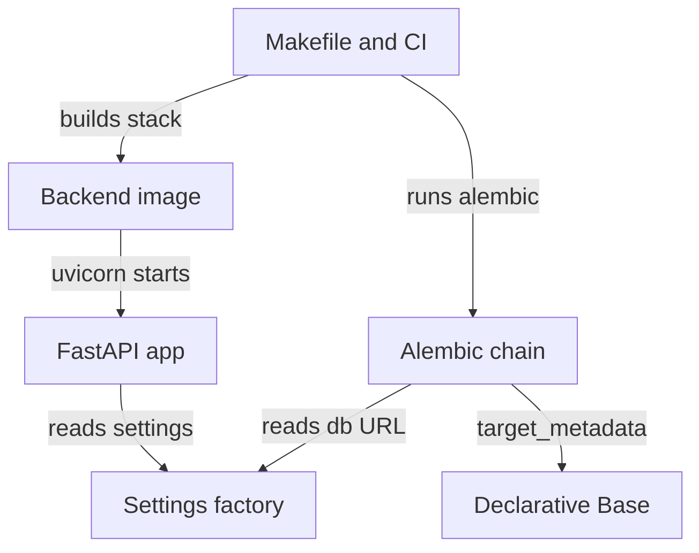
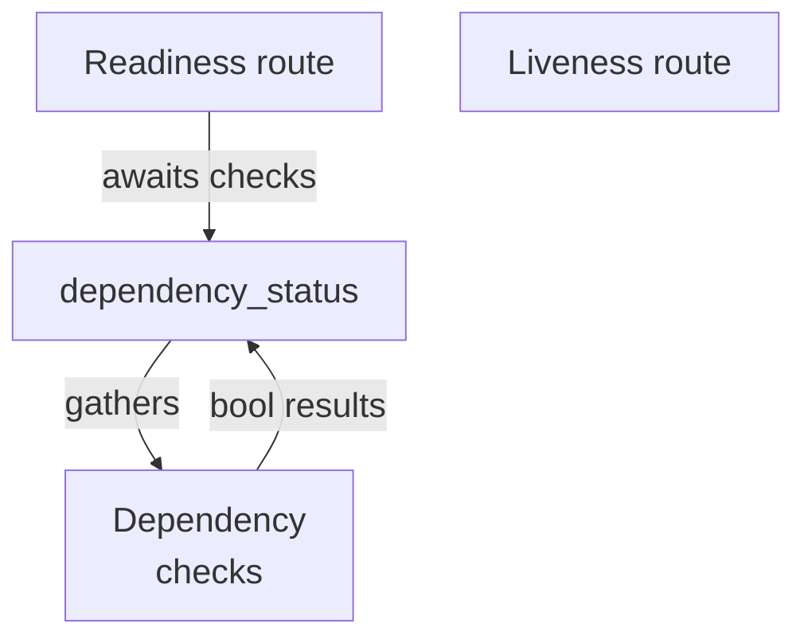
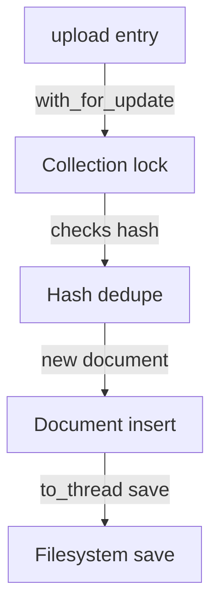
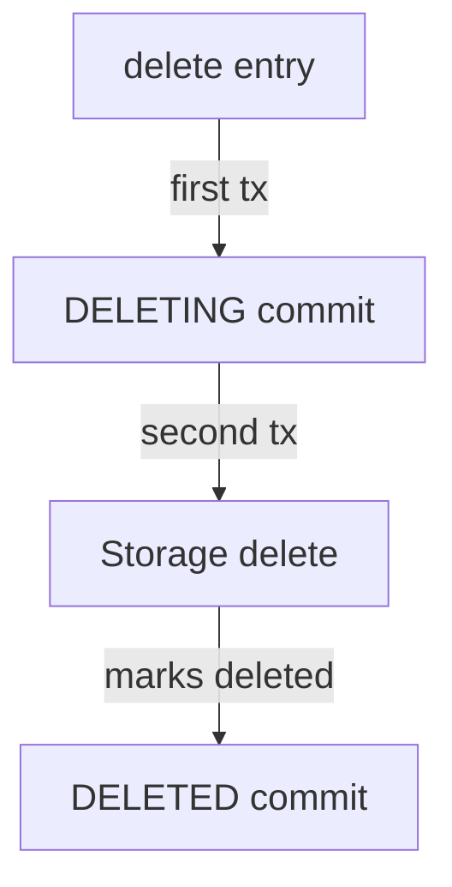
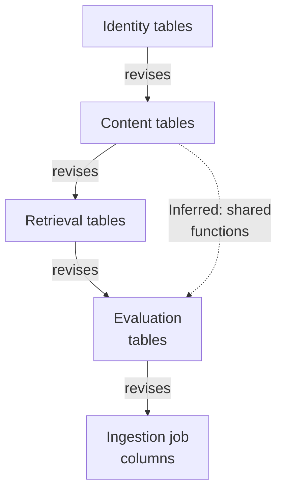

# Repository map

This batch maps the foundation layer of a hybrid RAG service: a FastAPI app entry point with health/readiness endpoints, typed settings, a SQLAlchemy async database base, document storage service, and a linear Alembic migration chain building identity, content, retrieval, evaluation/audit, and ingestion-job schema. Container, Makefile, and CI workflows build and verify the backend.

Commit: `05fb919153379762ce04a644ff9f6ef3e3413ff1` | Generated: 2026-10-17T22:42:05.758837+00:00

[Open PDF](repository-map.pdf)

**AI-generated analysis. Source references are checked for existence and supplied scope; this does not prove semantic correctness.**

## Scope

Tracked, eligible text only; bounded excerpts, not exhaustive.

25/39 eligible files analyzed; 184 tracked files excluded by policy.

5 API calls. See coverage.json for budgets, exclusions, and usage.

## Architecture

FastAPI app, config, database base, and migration chain form the backend foundation; multiple entry points and tooling invoke them.

PNG fallback

### Source evidence

- **F0002**: backend/src/hybrid_rag_search/main.py defines create_app(), which instantiates FastAPI, reads settings via get_settings(), and includes the evaluation router before registering the /health, /health/live, and /health/ready routes. (<a href="https://github.com/Justin-Mendoza/hybrid-rag-search/blob/05fb919153379762ce04a644ff9f6ef3e3413ff1/backend/src/hybrid_rag_search/main.py#L1-L47">backend/src/hybrid_rag_search/main.py:1-47</a>, <a href="https://github.com/Justin-Mendoza/hybrid-rag-search/blob/05fb919153379762ce04a644ff9f6ef3e3413ff1/backend/migrations/env.py#L1-L60">backend/migrations/env.py:1-60</a>)
- **F0040**: Settings in hybrid_rag_search/config.py defines typed runtime settings with defaults for database_url, redis_url, opensearch_url, OpenSearch alias/index names, BM25/dense/rerank candidate and result limits, storage/tokenizer/ingestion artifact roots, Cohere model/timeout/price settings, and a Cohere API key alias-resolved from COHERE_API_KEY or COHERE_TRIAL_KEY. (<a href="https://github.com/Justin-Mendoza/hybrid-rag-search/blob/05fb919153379762ce04a644ff9f6ef3e3413ff1/backend/src/hybrid_rag_search/config.py#L1-L85">backend/src/hybrid_rag_search/config.py:1-85</a>)
- **F0042**: get_settings() is an lru_cache-decorated factory returning a new Settings() instance, so settings are constructed once per process; Settings uses SettingsConfigDict(env_file='.env', extra='ignore') so unknown environment variables are ignored rather than rejected. (<a href="https://github.com/Justin-Mendoza/hybrid-rag-search/blob/05fb919153379762ce04a644ff9f6ef3e3413ff1/backend/src/hybrid_rag_search/config.py#L1-L85">backend/src/hybrid_rag_search/config.py:1-85</a>)
- **F0049**: database.py defines a shared declarative Base whose metadata applies a naming convention for indexes, unique constraints, check constraints, foreign keys and primary keys; content models import this Base. (<a href="https://github.com/Justin-Mendoza/hybrid-rag-search/blob/05fb919153379762ce04a644ff9f6ef3e3413ff1/backend/src/hybrid_rag_search/database.py#L1-L25">backend/src/hybrid_rag_search/database.py:1-25</a>, <a href="https://github.com/Justin-Mendoza/hybrid-rag-search/blob/05fb919153379762ce04a644ff9f6ef3e3413ff1/backend/src/hybrid_rag_search/models/content.py#L1-L225">backend/src/hybrid_rag_search/models/content.py:1-225</a>)
- **F0050**: async_database_url rewrites a plain 'postgresql' driver name to 'postgresql+asyncpg' and leaves other driver names unchanged. (<a href="https://github.com/Justin-Mendoza/hybrid-rag-search/blob/05fb919153379762ce04a644ff9f6ef3e3413ff1/backend/src/hybrid_rag_search/database.py#L1-L25">backend/src/hybrid_rag_search/database.py:1-25</a>)
- **F0005**: backend/migrations/env.py sets the SQLAlchemy URL from async_database_url(get_settings().database_url), wires target_metadata to Base.metadata, and dispatches to run_migrations_offline() or an asyncio run of run_migrations_online() based on context.is_offline_mode(). (<a href="https://github.com/Justin-Mendoza/hybrid-rag-search/blob/05fb919153379762ce04a644ff9f6ef3e3413ff1/backend/migrations/env.py#L1-L60">backend/migrations/env.py:1-60</a>)
- **F0019**: Migration 20260915_02 has down_revision '20260915_01', forming a linear revision chain after the identity migration. (<a href="https://github.com/Justin-Mendoza/hybrid-rag-search/blob/05fb919153379762ce04a644ff9f6ef3e3413ff1/backend/migrations/versions/20260915_02_content.py#L1-L197">backend/migrations/versions/20260915_02_content.py:1-197</a>)
- **F0043**: The alembic revision chain in these files is linear: 20260915_04 revises 20260915_03; 20260918_05 revises 20260915_04; 20260918_06 revises 20260918_05; 20260918_07 revises 20260918_06; 20260918_08 revises 20260918_07. (<a href="https://github.com/Justin-Mendoza/hybrid-rag-search/blob/05fb919153379762ce04a644ff9f6ef3e3413ff1/backend/migrations/versions/20260915_04_evaluation_audit.py#L1-L213">backend/migrations/versions/20260915_04_evaluation_audit.py:1-213</a>, <a href="https://github.com/Justin-Mendoza/hybrid-rag-search/blob/05fb919153379762ce04a644ff9f6ef3e3413ff1/backend/migrations/versions/20260918_05_ingestion_stage.py#L1-L47">backend/migrations/versions/20260918_05_ingestion_stage.py:1-47</a>, <a href="https://github.com/Justin-Mendoza/hybrid-rag-search/blob/05fb919153379762ce04a644ff9f6ef3e3413ff1/backend/migrations/versions/20260918_06_ingestion_identity.py#L1-L67">backend/migrations/versions/20260918_06_ingestion_identity.py:1-67</a>, <a href="https://github.com/Justin-Mendoza/hybrid-rag-search/blob/05fb919153379762ce04a644ff9f6ef3e3413ff1/backend/migrations/versions/20260918_07_ingestion_lease.py#L1-L51">backend/migrations/versions/20260918_07_ingestion_lease.py:1-51</a>, <a href="https://github.com/Justin-Mendoza/hybrid-rag-search/blob/05fb919153379762ce04a644ff9f6ef3e3413ff1/backend/migrations/versions/20260918_08_ingestion_retry_time.py#L1-L42">backend/migrations/versions/20260918_08_ingestion_retry_time.py:1-42</a>)
- **F0001**: backend/Dockerfile builds the image from python:3.12.14-slim-bookworm, copies pyproject.toml and src, installs the package with pip, and starts the API via CMD running uvicorn on hybrid_rag_search.main:app with app-dir /app/src on host 0.0.0.0 port 8000. (<a href="https://github.com/Justin-Mendoza/hybrid-rag-search/blob/05fb919153379762ce04a644ff9f6ef3e3413ff1/backend/Dockerfile#L1-L13">backend/Dockerfile:1-13</a>)
- **F0010**: The root Makefile wires development and operations targets: dev runs uvicorn with --reload alongside the frontend dev server; db-upgrade/db-downgrade/db-revision/db-current invoke alembic against backend/alembic.ini; db-seed runs python -m hybrid_rag_search.seed; and db-test promotes DB state then runs integration tests. (<a href="https://github.com/Justin-Mendoza/hybrid-rag-search/blob/05fb919153379762ce04a644ff9f6ef3e3413ff1/Makefile#L1-L139">Makefile:1-139</a>)
- **F0014**: .github/workflows/ci.yml runs a Python matrix of 3.12/3.13 against postgres and opensearch service containers, then executes ruff format check, ruff check, mypy, pytest, alembic upgrade/check/downgrade/upgrade, two seed runs, and integration pytest. (<a href="https://github.com/Justin-Mendoza/hybrid-rag-search/blob/05fb919153379762ce04a644ff9f6ef3e3413ff1/.github/workflows/ci.yml#L1-L83">.github/workflows/ci.yml:1-83</a>)
- **F0013**: Makefile stack-reset refuses to delete volumes unless CONFIRM=1 is provided, then runs docker compose down --volumes --remove-orphans; stack-up runs docker compose up --build --detach --wait. (<a href="https://github.com/Justin-Mendoza/hybrid-rag-search/blob/05fb919153379762ce04a644ff9f6ef3e3413ff1/Makefile#L1-L139">Makefile:1-139</a>, <a href="https://github.com/Justin-Mendoza/hybrid-rag-search/blob/05fb919153379762ce04a644ff9f6ef3e3413ff1/infra/README.md#L1-L12">infra/README.md:1-12</a>)

## Health and readiness flow

Readiness probes three dependencies concurrently and returns 503 when any check fails; liveness shares one handler.

PNG fallback

### Source evidence

- **F0003**: The /health/ready handler in main.py awaits dependency_status(settings), marks the response 503 HTTP_SERVICE_UNAVAILABLE when any dependency is false, and returns ReadinessResponse with status ready or not_ready plus a per-dependency boolean map. (<a href="https://github.com/Justin-Mendoza/hybrid-rag-search/blob/05fb919153379762ce04a644ff9f6ef3e3413ff1/backend/src/hybrid_rag_search/main.py#L1-L47">backend/src/hybrid_rag_search/main.py:1-47</a>)
- **F0004**: main.py defines an inner async live() returning HealthResponse with the configured app_env, and this same function object is registered for both GET /health and GET /health/live. (<a href="https://github.com/Justin-Mendoza/hybrid-rag-search/blob/05fb919153379762ce04a644ff9f6ef3e3413ff1/backend/src/hybrid_rag_search/main.py#L1-L47">backend/src/hybrid_rag_search/main.py:1-47</a>)
- **F0056**: health.check_postgres opens an asyncpg connection using settings.database_url with a 2-second timeout, issues 'SELECT 1', and always closes the connection in a finally block. (<a href="https://github.com/Justin-Mendoza/hybrid-rag-search/blob/05fb919153379762ce04a644ff9f6ef3e3413ff1/backend/src/hybrid_rag_search/health.py#L1-L50">backend/src/hybrid_rag_search/health.py:1-50</a>)
- **F0057**: health.check_redis pings Redis built from settings.redis_url and raises ConnectionError when PING is falsy, closing the client in a finally block via aclose(). (<a href="https://github.com/Justin-Mendoza/hybrid-rag-search/blob/05fb919153379762ce04a644ff9f6ef3e3413ff1/backend/src/hybrid_rag_search/health.py#L1-L50">backend/src/hybrid_rag_search/health.py:1-50</a>)
- **F0058**: health.check_opensearch performs an HTTP GET to {settings.opensearch_url}/_cluster/health with a 2-second timeout and calls response.raise_for_status(). (<a href="https://github.com/Justin-Mendoza/hybrid-rag-search/blob/05fb919153379762ce04a644ff9f6ef3e3413ff1/backend/src/hybrid_rag_search/health.py#L1-L50">backend/src/hybrid_rag_search/health.py:1-50</a>)
- **F0059**: dependency_status concurrently runs the postgres, redis and opensearch checks via asyncio.gather wrapped in run_check, which converts any exception into False, and returns a dict keyed by 'postgres', 'redis', 'opensearch'. (<a href="https://github.com/Justin-Mendoza/hybrid-rag-search/blob/05fb919153379762ce04a644ff9f6ef3e3413ff1/backend/src/hybrid_rag_search/health.py#L1-L50">backend/src/hybrid_rag_search/health.py:1-50</a>)

## Document upload flow

Upload hashes bytes, locks the collection row, dedupes on content hash, and writes storage off the event loop.

PNG fallback

### Source evidence

- **F0051**: DocumentService.upload computes a SHA-256 digest of the uploaded bytes and, inside a single session transaction, locks the collection row with with_for_update() before checking for an existing non-deleting/non-deleted Document with the same tenant, collection and content_hash; a match returns UploadResult with duplicate=True and no new file write. (<a href="https://github.com/Justin-Mendoza/hybrid-rag-search/blob/05fb919153379762ce04a644ff9f6ef3e3413ff1/backend/src/hybrid_rag_search/documents.py#L1-L126">backend/src/hybrid_rag_search/documents.py:1-126</a>)
- **F0052**: On a non-duplicate upload, DocumentService.upload inserts a Document with status PENDING and a storage key derived via storage_key(tenant_id, document_id), flushes the session, then performs the filesystem save via asyncio.to_thread so file I/O runs off the event loop. (<a href="https://github.com/Justin-Mendoza/hybrid-rag-search/blob/05fb919153379762ce04a644ff9f6ef3e3413ff1/backend/src/hybrid_rag_search/documents.py#L1-L126">backend/src/hybrid_rag_search/documents.py:1-126</a>)

## Document delete flow

Deletion uses two transactions: durable DELETING intent, then storage removal with DELETED status.

PNG fallback

### Source evidence

- **F0055**: DocumentService.delete uses two separate transactions: the first commits status DELETING as durable intent, the second performs storage.delete (off-loop) then sets status DELETED, deleted_at and clears error_message; an already-DELETED document returns early. (<a href="https://github.com/Justin-Mendoza/hybrid-rag-search/blob/05fb919153379762ce04a644ff9f6ef3e3413ff1/backend/src/hybrid_rag_search/documents.py#L1-L126">backend/src/hybrid_rag_search/documents.py:1-126</a>)

## Schema evolution

Linear Alembic revisions build identity, content, retrieval, evaluation/audit, then incremental ingestion-job columns with triggers.

PNG fallback

### Source evidence

- **F0017**: Migration 20260915_01 upgrade() defines a PostgreSQL trigger function set_updated_at() and attaches trg_&lt;table&gt;_updated_at BEFORE UPDATE triggers that set updated_at = CURRENT_TIMESTAMP on tenants, users, and memberships. (<a href="https://github.com/Justin-Mendoza/hybrid-rag-search/blob/05fb919153379762ce04a644ff9f6ef3e3413ff1/backend/migrations/versions/20260915_01_identity.py#L1-L102">backend/migrations/versions/20260915_01_identity.py:1-102</a>)
- **F0018**: Migration 20260915_01 creates the identity tables tenants, users, and memberships with CHECK constraints for non-blank names, slug format, normalized email, and allowed roles ('owner','admin','member'), plus FK constraints ontenant migrations to tenants.id and users.id with ondelete CASCADE. (<a href="https://github.com/Justin-Mendoza/hybrid-rag-search/blob/05fb919153379762ce04a644ff9f6ef3e3413ff1/backend/migrations/versions/20260915_01_identity.py#L1-L102">backend/migrations/versions/20260915_01_identity.py:1-102</a>)
- **F0020**: Migration 20260915_02 creates collections, collection_grants, documents, and ingestion_jobs; collection_grants enforces a permission enum ('read','write','manage') and composite FKs referencing collections(tenant_id,id) and memberships(tenant_id,id), with a unique constraint on (tenant_id, collection_id, membership_id). (<a href="https://github.com/Justin-Mendoza/hybrid-rag-search/blob/05fb919153379762ce04a644ff9f6ef3e3413ff1/backend/migrations/versions/20260915_02_content.py#L1-L197">backend/migrations/versions/20260915_02_content.py:1-197</a>)
- **F0021**: Migration 20260915_02 documents table enforces SHA-256 content_hash format, a status enum ('pending','processing','ready','failed','deleting','deleted'), and a CHECK that ties status='deleted' to non-null deleted_at; its FK to collections uses ondelete RESTRICT. (<a href="https://github.com/Justin-Mendoza/hybrid-rag-search/blob/05fb919153379762ce04a644ff9f6ef3e3413ff1/backend/migrations/versions/20260915_02_content.py#L1-L197">backend/migrations/versions/20260915_02_content.py:1-197</a>)
- **F0026**: Migration 20260915_03 creates retrieval_configs with a (tenant_id, name, version) unique constraint, parameters JSONB constrained to object type, and version &gt; 0, making configs versioned/immutable per revision. (<a href="https://github.com/Justin-Mendoza/hybrid-rag-search/blob/05fb919153379762ce04a644ff9f6ef3e3413ff1/backend/migrations/versions/20260915_03_retrieval.py#L1-L146">backend/migrations/versions/20260915_03_retrieval.py:1-146</a>)
- **F0027**: Migration 20260915_03 creates query_traces with a content_captured boolean defaulting true and a CHECK that query_text may be NULL only when content_captured is false, plus SHA-256 normalized_query_hash check, selected_path, timing/ranking/usage/fallback JSONB fields, and FKs to collections and retrieval_configs both with ondelete RESTRICT. (<a href="https://github.com/Justin-Mendoza/hybrid-rag-search/blob/05fb919153379762ce04a644ff9f6ef3e3413ff1/backend/migrations/versions/20260915_03_retrieval.py#L1-L146">backend/migrations/versions/20260915_03_retrieval.py:1-146</a>)
- **F0033**: Migration 20260915_04 upgrade() creates four tables: evaluation_datasets, judgments, evaluation_runs, and audit_events, with a composite FK from judgments to evaluation_datasets on (tenant_id, dataset_id) and RESTRICT FKs from evaluation_runs and audit_events. (<a href="https://github.com/Justin-Mendoza/hybrid-rag-search/blob/05fb919153379762ce04a644ff9f6ef3e3413ff1/backend/migrations/versions/20260915_04_evaluation_audit.py#L1-L213">backend/migrations/versions/20260915_04_evaluation_audit.py:1-213</a>)
- **F0034**: Upgrade of 20260915_04 installs BEFORE UPDATE OR DELETE triggers named trg_&lt;table&gt;_immutable on evaluation_datasets, judgments, and audit_events that call prevent_mutation(), making those tables append-only at the database level. (<a href="https://github.com/Justin-Mendoza/hybrid-rag-search/blob/05fb919153379762ce04a644ff9f6ef3e3413ff1/backend/migrations/versions/20260915_04_evaluation_audit.py#L1-L213">backend/migrations/versions/20260915_04_evaluation_audit.py:1-213</a>)
- **F0036**: Migration 20260918_05 adds a non-null 'stage' column to ingestion_jobs defaulting to 'parse', backfills stage='complete' for rows with status='succeeded', and adds check constraints restricting stage to parse/chunk/embed/index/complete and tying status='succeeded' to stage='complete' in both directions. (<a href="https://github.com/Justin-Mendoza/hybrid-rag-search/blob/05fb919153379762ce04a644ff9f6ef3e3413ff1/backend/migrations/versions/20260918_05_ingestion_stage.py#L1-L47">backend/migrations/versions/20260918_05_ingestion_stage.py:1-47</a>)
- **F0037**: Migration 20260918_06 adds nullable content_hash and pipeline_version columns to ingestion_jobs, backfills content_hash from the related documents.content_hash, generates synthetic 'pipe_&lt;hex&gt;' pipeline_version values for legacy rows, then enforces NOT NULL plus regex check constraints and a unique constraint uq_ingestion_jobs_document_recipe on (tenant_id, document_id, content_hash, pipeline_version). (<a href="https://github.com/Justin-Mendoza/hybrid-rag-search/blob/05fb919153379762ce04a644ff9f6ef3e3413ff1/backend/migrations/versions/20260918_06_ingestion_identity.py#L1-L67">backend/migrations/versions/20260918_06_ingestion_identity.py:1-67</a>)
- **F0038**: Migration 20260918_07 adds nullable lease_token (UUID) and lease_expires_at columns to ingestion_jobs, resets status='running' rows back to 'queued', adds check constraint ck_ingestion_jobs_lease_matches_running requiring lease_token and lease_expires_at to be non-null exactly when status='running', and creates index ix_ingestion_jobs_status_lease on (status, lease_expires_at). (<a href="https://github.com/Justin-Mendoza/hybrid-rag-search/blob/05fb919153379762ce04a644ff9f6ef3e3413ff1/backend/migrations/versions/20260918_07_ingestion_lease.py#L1-L51">backend/migrations/versions/20260918_07_ingestion_lease.py:1-51</a>)
- **F0039**: Migration 20260918_08 adds nullable next_attempt_at to ingestion_jobs with check constraint ck_ingestion_jobs_retry_time_requires_queued ensuring next_attempt_at is NULL unless status='queued', plus index ix_ingestion_jobs_status_retry on (status, next_attempt_at). (<a href="https://github.com/Justin-Mendoza/hybrid-rag-search/blob/05fb919153379762ce04a644ff9f6ef3e3413ff1/backend/migrations/versions/20260918_08_ingestion_retry_time.py#L1-L42">backend/migrations/versions/20260918_08_ingestion_retry_time.py:1-42</a>)
- **F0019**: Migration 20260915_02 has down_revision '20260915_01', forming a linear revision chain after the identity migration. (<a href="https://github.com/Justin-Mendoza/hybrid-rag-search/blob/05fb919153379762ce04a644ff9f6ef3e3413ff1/backend/migrations/versions/20260915_02_content.py#L1-L197">backend/migrations/versions/20260915_02_content.py:1-197</a>)
- **F0043**: The alembic revision chain in these files is linear: 20260915_04 revises 20260915_03; 20260918_05 revises 20260915_04; 20260918_06 revises 20260918_05; 20260918_07 revises 20260918_06; 20260918_08 revises 20260918_07. (<a href="https://github.com/Justin-Mendoza/hybrid-rag-search/blob/05fb919153379762ce04a644ff9f6ef3e3413ff1/backend/migrations/versions/20260915_04_evaluation_audit.py#L1-L213">backend/migrations/versions/20260915_04_evaluation_audit.py:1-213</a>, <a href="https://github.com/Justin-Mendoza/hybrid-rag-search/blob/05fb919153379762ce04a644ff9f6ef3e3413ff1/backend/migrations/versions/20260918_05_ingestion_stage.py#L1-L47">backend/migrations/versions/20260918_05_ingestion_stage.py:1-47</a>, <a href="https://github.com/Justin-Mendoza/hybrid-rag-search/blob/05fb919153379762ce04a644ff9f6ef3e3413ff1/backend/migrations/versions/20260918_06_ingestion_identity.py#L1-L67">backend/migrations/versions/20260918_06_ingestion_identity.py:1-67</a>, <a href="https://github.com/Justin-Mendoza/hybrid-rag-search/blob/05fb919153379762ce04a644ff9f6ef3e3413ff1/backend/migrations/versions/20260918_07_ingestion_lease.py#L1-L51">backend/migrations/versions/20260918_07_ingestion_lease.py:1-51</a>, <a href="https://github.com/Justin-Mendoza/hybrid-rag-search/blob/05fb919153379762ce04a644ff9f6ef3e3413ff1/backend/migrations/versions/20260918_08_ingestion_retry_time.py#L1-L42">backend/migrations/versions/20260918_08_ingestion_retry_time.py:1-42</a>)
- **F0024**: Migration 20260915_02 attaches trg_&lt;table&gt;_updated_at triggers to the four content tables, reusing the set_updated_at() function created by migration 20260915_01 — a cross-migration dependency not declared via depends_on. (<a href="https://github.com/Justin-Mendoza/hybrid-rag-search/blob/05fb919153379762ce04a644ff9f6ef3e3413ff1/backend/migrations/versions/20260915_02_content.py#L1-L197">backend/migrations/versions/20260915_02_content.py:1-197</a>)
- **F0048** (inferred): The migrations reference helper SQL functions prevent_mutation() and set_updated_at() without defining them in these files, so those functions must be provided by an earlier migration; the connection is inferred from function invocation, not an in-file definition. (<a href="https://github.com/Justin-Mendoza/hybrid-rag-search/blob/05fb919153379762ce04a644ff9f6ef3e3413ff1/backend/migrations/versions/20260915_04_evaluation_audit.py#L1-L213">backend/migrations/versions/20260915_04_evaluation_audit.py:1-213</a>)

## Uncertainties and untraced areas

- No HTTP routes or user-facing actions exist beyond health endpoints in this batch; whether a UI or retrieval/search API exists is untraced (F0030).
- Downstream readers/writers of documents.storage_key, content_hash, and index_version are not present in this batch (F0031).
- The retrieval pipeline that populates query_traces fields (selected_path, rankings, timings, usage, fallback) is not in these sources (F0032).
- Whether helper functions set_updated_at() and prevent_mutation() are truly provided by an earlier migration is inferred from invocation, not an in-file definition (F0048).
- How constants and pipeline_version values for ingestion recipes are derived at runtime is only implied by check constraints (F0064).
