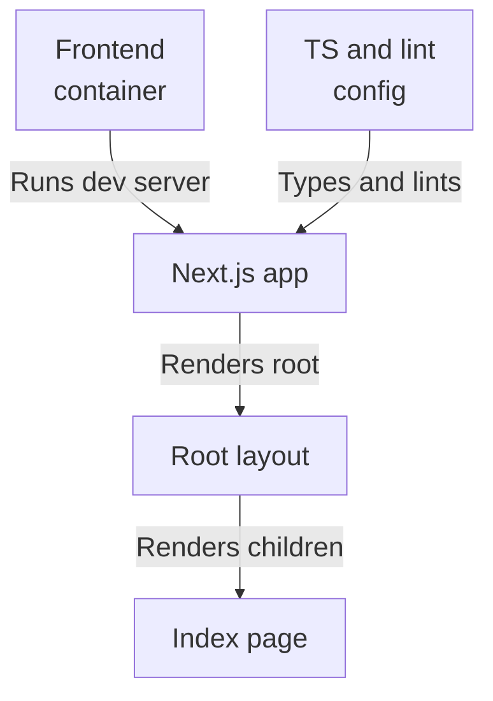
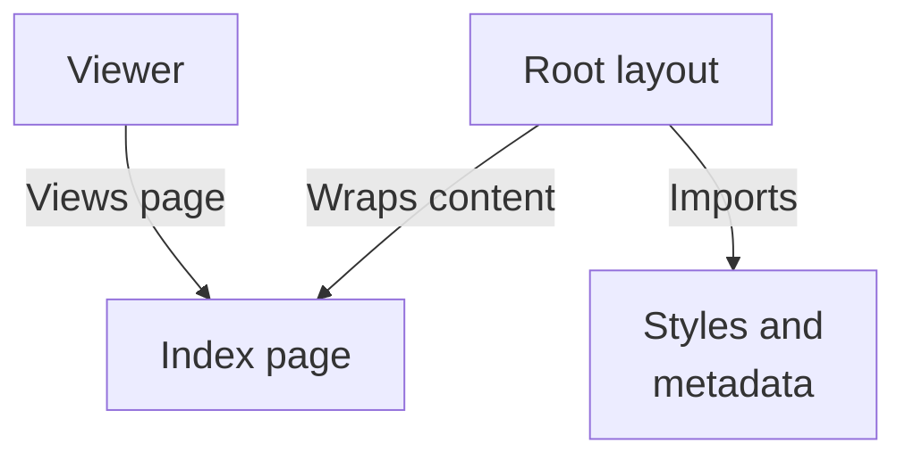
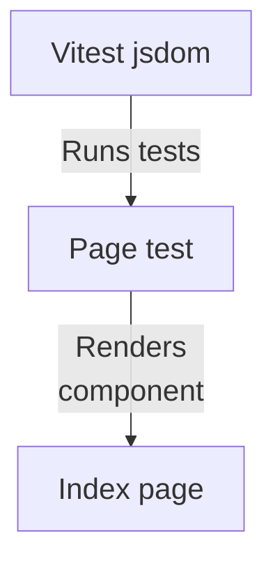

# Repository map

The supplied findings describe a single Next.js App Router frontend: a Docker/build/test setup, a root layout and static index page, and no observable runtime connection to the backend retrieval, answers, or foundation subsystems.

Commit: `05fb919153379762ce04a644ff9f6ef3e3413ff1` | Generated: 2026-10-17T22:42:21.565619+00:00

[Open PDF](repository-map.pdf)

**AI-generated analysis. Source references are checked for existence and supplied scope; this does not prove semantic correctness.**

## Scope

Tracked, eligible text only; bounded excerpts, not exhaustive.

10/10 eligible files analyzed; 213 tracked files excluded by policy.

2 API calls. See coverage.json for budgets, exclusions, and usage.

## Architecture

Frontend container builds the Next.js app whose App Router renders layout and index page; no backend wiring is evidenced.

PNG fallback

### Source evidence

- **F0001**: The frontend Dockerfile builds a Next.js dev server: CMD runs `npm run dev -- --hostname 0.0.0.0`, listening on port 3000 (EXPOSE 3000) rather than a production `next start`. (<a href="https://github.com/Justin-Mendoza/hybrid-rag-search/blob/05fb919153379762ce04a644ff9f6ef3e3413ff1/frontend/Dockerfile#L1-L12">frontend/Dockerfile:1-12</a>, <a href="https://github.com/Justin-Mendoza/hybrid-rag-search/blob/05fb919153379762ce04a644ff9f6ef3e3413ff1/frontend/package.json#L1-L39">frontend/package.json:1-39</a>)
- **F0002**: Dockerfile installs dependencies reproducibly with `npm ci` from package.json and package-lock.json before copying the rest of the source (COPY . .). (<a href="https://github.com/Justin-Mendoza/hybrid-rag-search/blob/05fb919153379762ce04a644ff9f6ef3e3413ff1/frontend/Dockerfile#L1-L12">frontend/Dockerfile:1-12</a>)
- **F0003**: package.json defines the frontend as the Next.js app `hybrid-rag-search-web` (v0.1.0), pinning Node engine &gt;=22 &lt;23 and Next ^16 with React/React-DOM ^19. (<a href="https://github.com/Justin-Mendoza/hybrid-rag-search/blob/05fb919153379762ce04a644ff9f6ef3e3413ff1/frontend/package.json#L1-L39">frontend/package.json:1-39</a>)
- **F0004**: npm scripts expose dev (next dev), build (next build), start (next start), lint (eslint . --max-warnings=0), typecheck (tsc --noEmit), test (vitest run), and Prettier format/format:check commands. (<a href="https://github.com/Justin-Mendoza/hybrid-rag-search/blob/05fb919153379762ce04a644ff9f6ef3e3413ff1/frontend/package.json#L1-L39">frontend/package.json:1-39</a>)
- **F0009**: next.config.ts sets reactStrictMode: true and agentRules: false as the NextConfig; no rewrites, redirects, or API proxying are declared in this excerpt. (<a href="https://github.com/Justin-Mendoza/hybrid-rag-search/blob/05fb919153379762ce04a644ff9f6ef3e3413ff1/frontend/next.config.ts#L1-L7">frontend/next.config.ts:1-7</a>)
- **F0005**: RootLayout in src/app/layout.tsx is the App Router root component: it imports ./styles.css, exports Metadata (title "Hybrid RAG Search") and renders children inside &lt;html lang="en"&gt;&lt;body&gt;. (<a href="https://github.com/Justin-Mendoza/hybrid-rag-search/blob/05fb919153379762ce04a644ff9f6ef3e3413ff1/frontend/src/app/layout.tsx#L1-L19">frontend/src/app/layout.tsx:1-19</a>)
- **F0006**: Home in src/app/page.tsx is the index route component, rendering a static placeholder with an eyebrow "Hybrid RAG Search", an h1 "Evidence-first answers, built for inspection.", and a paragraph about the search workspace awaiting its first collection. (<a href="https://github.com/Justin-Mendoza/hybrid-rag-search/blob/05fb919153379762ce04a644ff9f6ef3e3413ff1/frontend/src/app/page.tsx#L1-L9">frontend/src/app/page.tsx:1-9</a>)
- **F0014**: The index page renders only static text with no user input controls, state, event handlers, or async data loading, so no user actions beyond viewing are implemented in this batch. (<a href="https://github.com/Justin-Mendoza/hybrid-rag-search/blob/05fb919153379762ce04a644ff9f6ef3e3413ff1/frontend/src/app/page.tsx#L1-L9">frontend/src/app/page.tsx:1-9</a>)
- **F0010**: tsconfig.json enables strict TypeScript with jsx "react-jsx", moduleResolution "bundler", next plugin, and a `@/*` path alias to ./src/*, including generated .next/types and .next/dev/types. (<a href="https://github.com/Justin-Mendoza/hybrid-rag-search/blob/05fb919153379762ce04a644ff9f6ef3e3413ff1/frontend/tsconfig.json#L1-L33">frontend/tsconfig.json:1-33</a>)
- **F0011**: next-env.d.ts references next and next/image-types/global types and imports generated route/root-param types from ./.next/dev/types, indicating use of Next's dev-generated route typing. (<a href="https://github.com/Justin-Mendoza/hybrid-rag-search/blob/05fb919153379762ce04a644ff9f6ef3e3413ff1/frontend/next-env.d.ts#L1-L7">frontend/next-env.d.ts:1-7</a>)
- **F0012**: ESLint uses flat config via defineConfig, composing eslint-config-next core-web-vitals and typescript presets and ignoring .next/**, coverage/**, and next-env.d.ts. (<a href="https://github.com/Justin-Mendoza/hybrid-rag-search/blob/05fb919153379762ce04a644ff9f6ef3e3413ff1/frontend/eslint.config.mjs#L1-L9">frontend/eslint.config.mjs:1-9</a>)

## Page render flow

A viewer receives the server-rendered index: root layout imports styles and metadata and wraps the static Home component.

PNG fallback

### Source evidence

- **F0014**: The index page renders only static text with no user input controls, state, event handlers, or async data loading, so no user actions beyond viewing are implemented in this batch. (<a href="https://github.com/Justin-Mendoza/hybrid-rag-search/blob/05fb919153379762ce04a644ff9f6ef3e3413ff1/frontend/src/app/page.tsx#L1-L9">frontend/src/app/page.tsx:1-9</a>)
- **F0005**: RootLayout in src/app/layout.tsx is the App Router root component: it imports ./styles.css, exports Metadata (title "Hybrid RAG Search") and renders children inside &lt;html lang="en"&gt;&lt;body&gt;. (<a href="https://github.com/Justin-Mendoza/hybrid-rag-search/blob/05fb919153379762ce04a644ff9f6ef3e3413ff1/frontend/src/app/layout.tsx#L1-L19">frontend/src/app/layout.tsx:1-19</a>)
- **F0006**: Home in src/app/page.tsx is the index route component, rendering a static placeholder with an eyebrow "Hybrid RAG Search", an h1 "Evidence-first answers, built for inspection.", and a paragraph about the search workspace awaiting its first collection. (<a href="https://github.com/Justin-Mendoza/hybrid-rag-search/blob/05fb919153379762ce04a644ff9f6ef3e3413ff1/frontend/src/app/page.tsx#L1-L9">frontend/src/app/page.tsx:1-9</a>)

## Test flow

Vitest with jsdom and React plugin renders the Home component, and the page test asserts the heading role and text.

PNG fallback

### Source evidence

- **F0008**: Vitest is configured to use the jsdom test environment with the @vitejs/plugin-react plugin, enabling React component tests such as page.test.tsx. (<a href="https://github.com/Justin-Mendoza/hybrid-rag-search/blob/05fb919153379762ce04a644ff9f6ef3e3413ff1/frontend/vitest.config.ts#L1-L7">frontend/vitest.config.ts:1-7</a>, <a href="https://github.com/Justin-Mendoza/hybrid-rag-search/blob/05fb919153379762ce04a644ff9f6ef3e3413ff1/frontend/src/app/page.test.tsx#L1-L14">frontend/src/app/page.test.tsx:1-14</a>)
- **F0007**: page.test.tsx renders the Home component with @testing-library/react and asserts via screen.getByRole that the level-1 heading text equals "Evidence-first answers, built for inspection."—the only supplied runtime test of a UI entry point. (<a href="https://github.com/Justin-Mendoza/hybrid-rag-search/blob/05fb919153379762ce04a644ff9f6ef3e3413ff1/frontend/src/app/page.test.tsx#L1-L14">frontend/src/app/page.test.tsx:1-14</a>, <a href="https://github.com/Justin-Mendoza/hybrid-rag-search/blob/05fb919153379762ce04a644ff9f6ef3e3413ff1/frontend/src/app/page.tsx#L1-L9">frontend/src/app/page.tsx:1-9</a>)
- **F0006**: Home in src/app/page.tsx is the index route component, rendering a static placeholder with an eyebrow "Hybrid RAG Search", an h1 "Evidence-first answers, built for inspection.", and a paragraph about the search workspace awaiting its first collection. (<a href="https://github.com/Justin-Mendoza/hybrid-rag-search/blob/05fb919153379762ce04a644ff9f6ef3e3413ff1/frontend/src/app/page.tsx#L1-L9">frontend/src/app/page.tsx:1-9</a>)

## Uncertainties and untraced areas

- No fetch, API route, database access, or environment-variable reading appears in the supplied frontend sources, so how (or whether) the frontend reaches the answers, foundation, or retrieval subsystems at runtime is untraced (F0013, F0015).
- No user input controls, state, event handlers, or async data loading exist on the index page, so the intended search workspace behavior is not evidenced (F0014).
- No rewrites, redirects, or API proxying are declared in next.config.ts, leaving client-to-backend routing paths unspecified (F0009).
