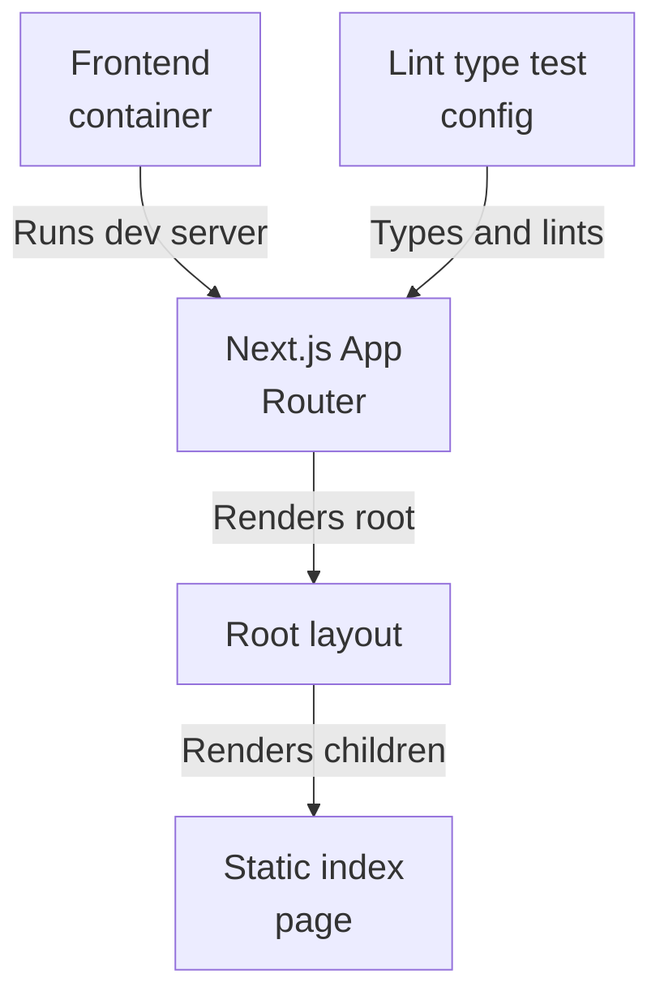
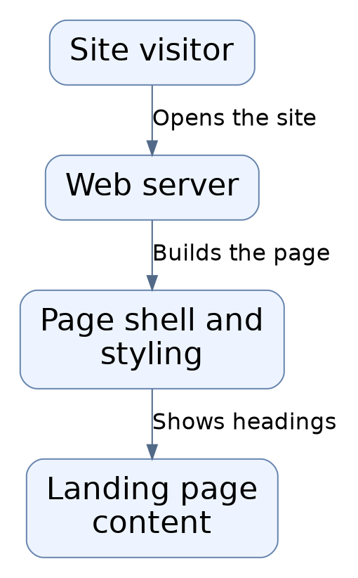
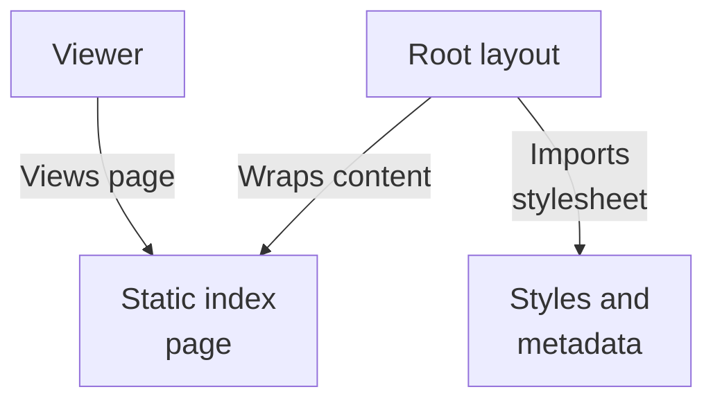
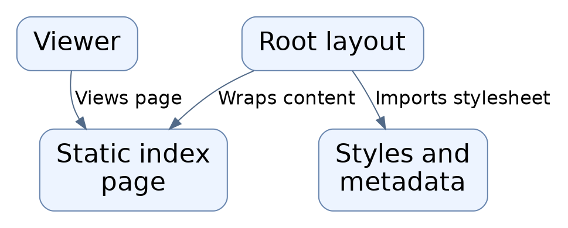
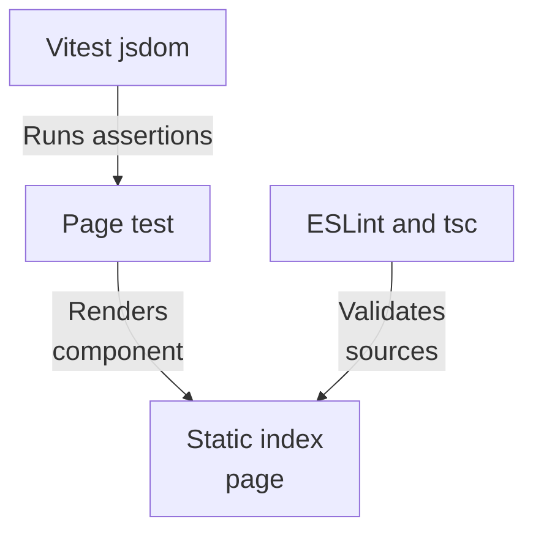
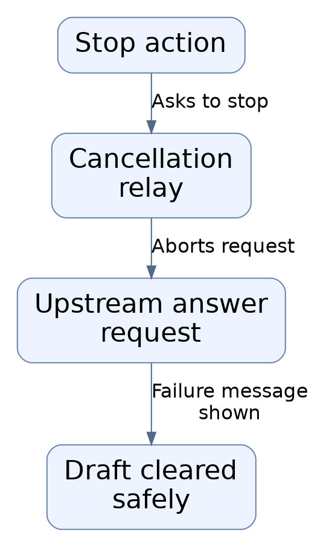

# Repository map

This subsystem is the hybrid-rag-search-web frontend: a private Next.js 16 / React 19 App Router project whose container runs the dev server on Node 22. It renders a root layout wrapping a purely static Home page with no state, inputs, or async data loading. No fetch, API route, or environment read is evidenced, so runtime linkage to the answers, foundation, or retrieval subsystems is untraced.

Commit: `f8493c1d264c525948d9d33ffaf2dd197be97e26` | Generated: 2026-10-18T18:35:34.938676+00:00

[Open PDF](repository-map.pdf)

**AI-generated analysis. Source references are checked for existence and supplied scope; this does not prove semantic correctness.**

## Scope

Tracked, eligible text only; bounded excerpts, not exhaustive.

10/10 eligible files analyzed; 213 tracked files excluded by policy.

2 API calls. See coverage.json for budgets, exclusions, and usage.

## Architecture

The container runs the Next.js App Router dev server. Layout renders a static index page. Toolchain config types, lints, and tests the sources but is not a runtime entry point; backend linkage is unevidenced.

PNG fallback

### Source evidence

- **F0001**: The frontend is a private Next.js App Router project named hybrid-rag-search-web that pins Node to the 22.x line via the engines field (&gt;=22 &lt;23), matching the node:22.23.2-bookworm-slim base image in the Dockerfile. (<a href="https://github.com/Justin-Mendoza/hybrid-rag-search/blob/f8493c1d264c525948d9d33ffaf2dd197be97e26/frontend/package.json#L1-L39">frontend/package.json:1-39</a>, <a href="https://github.com/Justin-Mendoza/hybrid-rag-search/blob/f8493c1d264c525948d9d33ffaf2dd197be97e26/frontend/Dockerfile#L1-L12">frontend/Dockerfile:1-12</a>)
- **F0002**: The frontend container installs dependencies deterministically from package.json and package-lock.json using npm ci, copies the full source tree into /app, exposes port 3000, and its default command runs the Next.js dev server bound to 0.0.0.0 rather than a production build. (<a href="https://github.com/Justin-Mendoza/hybrid-rag-search/blob/f8493c1d264c525948d9d33ffaf2dd197be97e26/frontend/Dockerfile#L1-L12">frontend/Dockerfile:1-12</a>)
- **F0011**: React 19, ReactDOM 19, and Next 16 are the only runtime dependencies, with testing, lint, format, and build tooling confined to devDependencies. (<a href="https://github.com/Justin-Mendoza/hybrid-rag-search/blob/f8493c1d264c525948d9d33ffaf2dd197be97e26/frontend/package.json#L1-L39">frontend/package.json:1-39</a>)
- **F0010**: next.config.ts sets reactStrictMode true and agentRules false, indicating use of the standard Next config typing with strict-mode rendering enabled; no rewrites, redirects, or proxy rules are declared in the supplied excerpt. (<a href="https://github.com/Justin-Mendoza/hybrid-rag-search/blob/f8493c1d264c525948d9d33ffaf2dd197be97e26/frontend/next.config.ts#L1-L7">frontend/next.config.ts:1-7</a>)
- **F0004**: The App Router entry structure is a root layout (src/app/layout.tsx) exporting metadata for 'Hybrid RAG Search' and importing a global stylesheet, wrapping the Home page (src/app/page.tsx) rendered as children in the body. (<a href="https://github.com/Justin-Mendoza/hybrid-rag-search/blob/f8493c1d264c525948d9d33ffaf2dd197be97e26/frontend/src/app/layout.tsx#L1-L19">frontend/src/app/layout.tsx:1-19</a>, <a href="https://github.com/Justin-Mendoza/hybrid-rag-search/blob/f8493c1d264c525948d9d33ffaf2dd197be97e26/frontend/src/app/page.tsx#L1-L9">frontend/src/app/page.tsx:1-9</a>)
- **F0005**: Home is a purely static server component returning only presentational markup (eyebrow, h1, paragraph) with no state, event handlers, data loading, or search input, so no search interaction or user flow is wired on the index route. (<a href="https://github.com/Justin-Mendoza/hybrid-rag-search/blob/f8493c1d264c525948d9d33ffaf2dd197be97e26/frontend/src/app/page.tsx#L1-L9">frontend/src/app/page.tsx:1-9</a>)
- **F0003**: The script surface separates development, production (build/start), formatting, linting (eslint --max-warnings=0), type checking (tsc --noEmit), and unit testing (vitest run), indicating lint and typecheck are enforced gates in addition to tests. (<a href="https://github.com/Justin-Mendoza/hybrid-rag-search/blob/f8493c1d264c525948d9d33ffaf2dd197be97e26/frontend/package.json#L1-L39">frontend/package.json:1-39</a>)
- **F0008**: TypeScript is configured with strict mode, noEmit, bundler module resolution, the React JSX transform, and a '@/ *' path alias mapping to ./src/*, unifying source imports across the app. (<a href="https://github.com/Justin-Mendoza/hybrid-rag-search/blob/f8493c1d264c525948d9d33ffaf2dd197be97e26/frontend/tsconfig.json#L1-L33">frontend/tsconfig.json:1-33</a>)
- **F0009**: ESLint is configured by flat config extending eslint-config-next core-web-vitals and typescript rule sets and ignoring .next, coverage, and next-env.d.ts build artifacts. (<a href="https://github.com/Justin-Mendoza/hybrid-rag-search/blob/f8493c1d264c525948d9d33ffaf2dd197be97e26/frontend/eslint.config.mjs#L1-L9">frontend/eslint.config.mjs:1-9</a>)

## Page render flow

The only observed user flow: layout imports the global stylesheet, exports metadata, and wraps the static Home markup. Layout is the response boundary; no search interaction or data loading is wired on this route.

PNG fallback

### Source evidence

- **F0012**: No fetch call, API route, database access, or environment-variable read appears in the supplied frontend sources, so how the frontend would reach the answers, foundation, or retrieval subsystems at runtime is not evidenced by this batch. (<a href="https://github.com/Justin-Mendoza/hybrid-rag-search/blob/f8493c1d264c525948d9d33ffaf2dd197be97e26/frontend/src/app/page.tsx#L1-L9">frontend/src/app/page.tsx:1-9</a>, <a href="https://github.com/Justin-Mendoza/hybrid-rag-search/blob/f8493c1d264c525948d9d33ffaf2dd197be97e26/frontend/src/app/layout.tsx#L1-L19">frontend/src/app/layout.tsx:1-19</a>, <a href="https://github.com/Justin-Mendoza/hybrid-rag-search/blob/f8493c1d264c525948d9d33ffaf2dd197be97e26/frontend/next.config.ts#L1-L7">frontend/next.config.ts:1-7</a>)
- **F0004**: The App Router entry structure is a root layout (src/app/layout.tsx) exporting metadata for 'Hybrid RAG Search' and importing a global stylesheet, wrapping the Home page (src/app/page.tsx) rendered as children in the body. (<a href="https://github.com/Justin-Mendoza/hybrid-rag-search/blob/f8493c1d264c525948d9d33ffaf2dd197be97e26/frontend/src/app/layout.tsx#L1-L19">frontend/src/app/layout.tsx:1-19</a>, <a href="https://github.com/Justin-Mendoza/hybrid-rag-search/blob/f8493c1d264c525948d9d33ffaf2dd197be97e26/frontend/src/app/page.tsx#L1-L9">frontend/src/app/page.tsx:1-9</a>)
- **F0005**: Home is a purely static server component returning only presentational markup (eyebrow, h1, paragraph) with no state, event handlers, data loading, or search input, so no search interaction or user flow is wired on the index route. (<a href="https://github.com/Justin-Mendoza/hybrid-rag-search/blob/f8493c1d264c525948d9d33ffaf2dd197be97e26/frontend/src/app/page.tsx#L1-L9">frontend/src/app/page.tsx:1-9</a>)

## Toolchain boundary

Vitest with jsdom renders Home against Testing Library assertions; ESLint and tsc gate sources. These dev-time tools sit outside the runtime entry point, so passing checks does not evidence any backend wiring.

PNG fallback

### Source evidence

- **F0007**: Vitest is configured with the React plugin and jsdom environment, providing the component-test boundary used by the page test; this toolchain is a dev-time concern separate from the runtime dev-server entry point. (<a href="https://github.com/Justin-Mendoza/hybrid-rag-search/blob/f8493c1d264c525948d9d33ffaf2dd197be97e26/frontend/vitest.config.ts#L1-L7">frontend/vitest.config.ts:1-7</a>, <a href="https://github.com/Justin-Mendoza/hybrid-rag-search/blob/f8493c1d264c525948d9d33ffaf2dd197be97e26/frontend/src/app/page.test.tsx#L1-L14">frontend/src/app/page.test.tsx:1-14</a>)
- **F0006**: The only observed test (page.test.tsx) renders Home with Testing Library and asserts the level-1 heading text 'Evidence-first answers, built for inspection.', confirming the page is treated as a static presentational component. (<a href="https://github.com/Justin-Mendoza/hybrid-rag-search/blob/f8493c1d264c525948d9d33ffaf2dd197be97e26/frontend/src/app/page.test.tsx#L1-L14">frontend/src/app/page.test.tsx:1-14</a>, <a href="https://github.com/Justin-Mendoza/hybrid-rag-search/blob/f8493c1d264c525948d9d33ffaf2dd197be97e26/frontend/src/app/page.tsx#L1-L9">frontend/src/app/page.tsx:1-9</a>)
- **F0005**: Home is a purely static server component returning only presentational markup (eyebrow, h1, paragraph) with no state, event handlers, data loading, or search input, so no search interaction or user flow is wired on the index route. (<a href="https://github.com/Justin-Mendoza/hybrid-rag-search/blob/f8493c1d264c525948d9d33ffaf2dd197be97e26/frontend/src/app/page.tsx#L1-L9">frontend/src/app/page.tsx:1-9</a>)
- **F0003**: The script surface separates development, production (build/start), formatting, linting (eslint --max-warnings=0), type checking (tsc --noEmit), and unit testing (vitest run), indicating lint and typecheck are enforced gates in addition to tests. (<a href="https://github.com/Justin-Mendoza/hybrid-rag-search/blob/f8493c1d264c525948d9d33ffaf2dd197be97e26/frontend/package.json#L1-L39">frontend/package.json:1-39</a>)
- **F0009**: ESLint is configured by flat config extending eslint-config-next core-web-vitals and typescript rule sets and ignoring .next, coverage, and next-env.d.ts build artifacts. (<a href="https://github.com/Justin-Mendoza/hybrid-rag-search/blob/f8493c1d264c525948d9d33ffaf2dd197be97e26/frontend/eslint.config.mjs#L1-L9">frontend/eslint.config.mjs:1-9</a>)

## Uncertainties and untraced areas

- No fetch call, API route, database access, or environment-variable read appears in the supplied frontend sources, so how or whether the frontend reaches the answers, foundation, or retrieval subsystems at runtime is untraced (F0012, F0014).
- No user input controls, state, event handlers, or async data loading exist on the index route, so the intended search workspace behavior is not evidenced (F0005).
- No rewrites, redirects, or API proxying are declared in the Next.js config, leaving any client-to-backend routing path unspecified (F0010).
- The Dockerfile runs the Next.js dev server rather than a production build/start, so the production serving path is not shown (F0002).
- No findings cover the answers, foundation, or retrieval subsystems calling toward the frontend, so any inbound contract is unverified (F0012).
