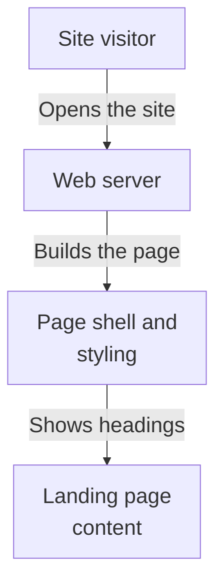
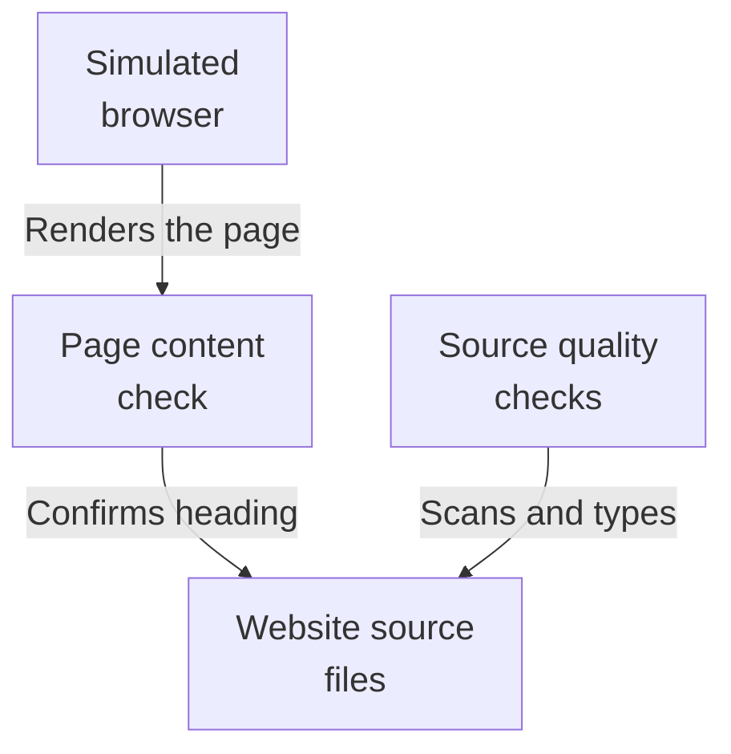

# Repository map

This area is the web front door for an evidence-first enterprise search product: a Next.js page that currently shows a placeholder landing screen with a heading and a note that a search workspace is coming. It is served by a container that runs the development server on port 3000, and it reads no data, stores nothing, and sends nothing. Search, retrieval, and answering are not implemented or connected here yet; a test checks the heading, and code-quality tools check the sources.

Commit: `3537e913c1eeec5b5f34d6cbdbf4dc3f8bc74b25` | Generated: 2026-10-19T00:24:41.881136+00:00

[Open PDF](repository-map.pdf)

**AI-generated analysis. Source references are checked for existence and supplied scope; this does not prove semantic correctness.**

## Scope

Tracked, eligible text only; bounded excerpts, not exhaustive.

10/10 eligible files analyzed; 213 tracked files excluded by policy.

2 API calls. See coverage.json for budgets, exclusions, and usage.

## How a visitor gets the landing page

A visitor opens the site, the page shell supplies styling and page title, and the static landing content appears. Nothing is looked up or saved, and no search runs.

PNG fallback

Read from top to bottom; arrows show what happens next or what is passed along.

### Source evidence

- **F0014**: The observed end-to-end flow is: a viewer requests the index route, the root layout supplies the HTML shell, stylesheet, and metadata, and the static Home component renders the heading and workspace placeholder; no data is read, stored, or sent. (<a href="https://github.com/Justin-Mendoza/hybrid-rag-search/blob/3537e913c1eeec5b5f34d6cbdbf4dc3f8bc74b25/frontend/src/app/layout.tsx#L1-L19">frontend/src/app/layout.tsx:1-19</a>, <a href="https://github.com/Justin-Mendoza/hybrid-rag-search/blob/3537e913c1eeec5b5f34d6cbdbf4dc3f8bc74b25/frontend/src/app/page.tsx#L1-L9">frontend/src/app/page.tsx:1-9</a>)
- **F0001**: The frontend container image installs dependencies with npm ci from package.json and package-lock.json, copies the source tree, and starts the Next.js dev server bound to all interfaces via 'npm run dev -- --hostname 0.0.0.0', exposing port 3000. (<a href="https://github.com/Justin-Mendoza/hybrid-rag-search/blob/3537e913c1eeec5b5f34d6cbdbf4dc3f8bc74b25/frontend/Dockerfile#L1-L12">frontend/Dockerfile:1-12</a>, <a href="https://github.com/Justin-Mendoza/hybrid-rag-search/blob/3537e913c1eeec5b5f34d6cbdbf4dc3f8bc74b25/frontend/package.json#L1-L39">frontend/package.json:1-39</a>)
- **F0002**: The image runs the development server (next dev) rather than a production build/start, so production serving behavior is not shown by these files. (<a href="https://github.com/Justin-Mendoza/hybrid-rag-search/blob/3537e913c1eeec5b5f34d6cbdbf4dc3f8bc74b25/frontend/Dockerfile#L1-L12">frontend/Dockerfile:1-12</a>, <a href="https://github.com/Justin-Mendoza/hybrid-rag-search/blob/3537e913c1eeec5b5f34d6cbdbf4dc3f8bc74b25/frontend/package.json#L1-L39">frontend/package.json:1-39</a>)
- **F0004**: The user-facing entry point is the App Router root layout (RootLayout in src/app/layout.tsx), which imports the global stylesheet, declares page metadata (title 'Hybrid RAG Search', description 'Evidence-first enterprise search'), and wraps the page children in an html/body shell. (<a href="https://github.com/Justin-Mendoza/hybrid-rag-search/blob/3537e913c1eeec5b5f34d6cbdbf4dc3f8bc74b25/frontend/src/app/layout.tsx#L1-L19">frontend/src/app/layout.tsx:1-19</a>)
- **F0005**: The index route (Home in src/app/page.tsx) is purely static markup: an eyebrow label 'Hybrid RAG Search', an h1 'Evidence-first answers, built for inspection.', and a note that the search workspace is ready for its first collection. It has no state, props, inputs, event handlers, or async data loading. (<a href="https://github.com/Justin-Mendoza/hybrid-rag-search/blob/3537e913c1eeec5b5f34d6cbdbf4dc3f8bc74b25/frontend/src/app/page.tsx#L1-L9">frontend/src/app/page.tsx:1-9</a>)

## How the page is checked before release

Automated checks run the landing content in a simulated browser and verify the heading text, while code-quality tools scan the source. These checks do not exercise any search or backend behavior.

PNG fallback

Read from top to bottom; arrows show what happens next or what is passed along.

### Source evidence

- **F0008**: A Vitest test renders the Home component in jsdom and asserts a level-1 heading with the text 'Evidence-first answers, built for inspection.', providing the only observed automated check of the page's rendered output. (<a href="https://github.com/Justin-Mendoza/hybrid-rag-search/blob/3537e913c1eeec5b5f34d6cbdbf4dc3f8bc74b25/frontend/src/app/page.test.tsx#L1-L14">frontend/src/app/page.test.tsx:1-14</a>, <a href="https://github.com/Justin-Mendoza/hybrid-rag-search/blob/3537e913c1eeec5b5f34d6cbdbf4dc3f8bc74b25/frontend/vitest.config.ts#L1-L7">frontend/vitest.config.ts:1-7</a>)
- **F0009**: The test toolchain is configured with the Vite React plugin and jsdom environment, so component tests run in a simulated browser DOM rather than a real one. (<a href="https://github.com/Justin-Mendoza/hybrid-rag-search/blob/3537e913c1eeec5b5f34d6cbdbf4dc3f8bc74b25/frontend/vitest.config.ts#L1-L7">frontend/vitest.config.ts:1-7</a>)
- **F0010**: eslint.config.mjs applies Next.js core-web-vitals and TypeScript rule sets and ignores build/coverage outputs; this gates source quality but is a development-time concern, not runtime behavior. (<a href="https://github.com/Justin-Mendoza/hybrid-rag-search/blob/3537e913c1eeec5b5f34d6cbdbf4dc3f8bc74b25/frontend/eslint.config.mjs#L1-L9">frontend/eslint.config.mjs:1-9</a>)
- **F0011**: The lint, format, typecheck, and test scripts (eslint --max-warnings=0, prettier, tsc --noEmit, vitest run) define static quality gates over the sources without executing application logic. (<a href="https://github.com/Justin-Mendoza/hybrid-rag-search/blob/3537e913c1eeec5b5f34d6cbdbf4dc3f8bc74b25/frontend/package.json#L1-L39">frontend/package.json:1-39</a>)
- **F0012**: tsconfig.json establishes strict TypeScript compilation for ES2022 with no emission, React JSX transform, bundler module resolution, and a '@/…' path alias mapping to './src/*'. (<a href="https://github.com/Justin-Mendoza/hybrid-rag-search/blob/3537e913c1eeec5b5f34d6cbdbf4dc3f8bc74b25/frontend/tsconfig.json#L1-L33">frontend/tsconfig.json:1-33</a>)

## Uncertainties and untraced areas

- No calls to any answer service, document storage, or search system appear in the web sources, so how this site would reach those systems is unconfirmed.
- The landing page has no input fields, controls, or state, so the intended search workspace behavior is not shown.
- The web server configuration declares no forwarding or routing rules, leaving any path from this site to backend services unspecified.
- The container starts the development server rather than a production build, so production serving behavior is not demonstrated.
- No evidence shows the answer, storage, or search systems calling back toward this website, so any inbound contract is unverified.
