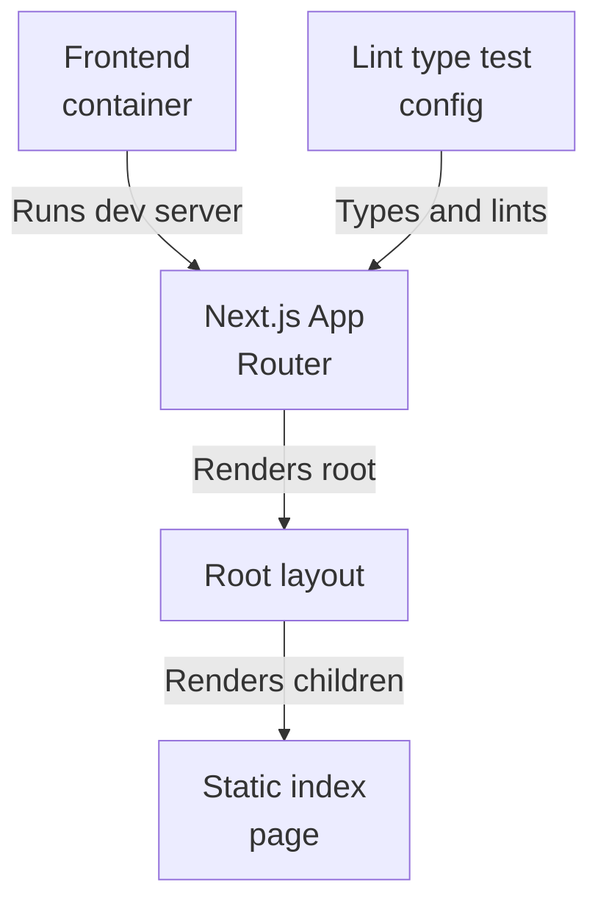
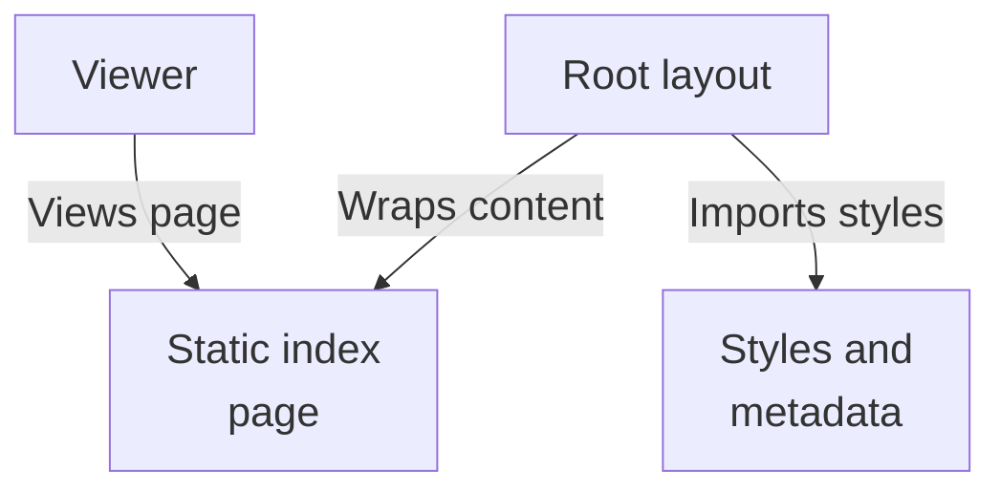
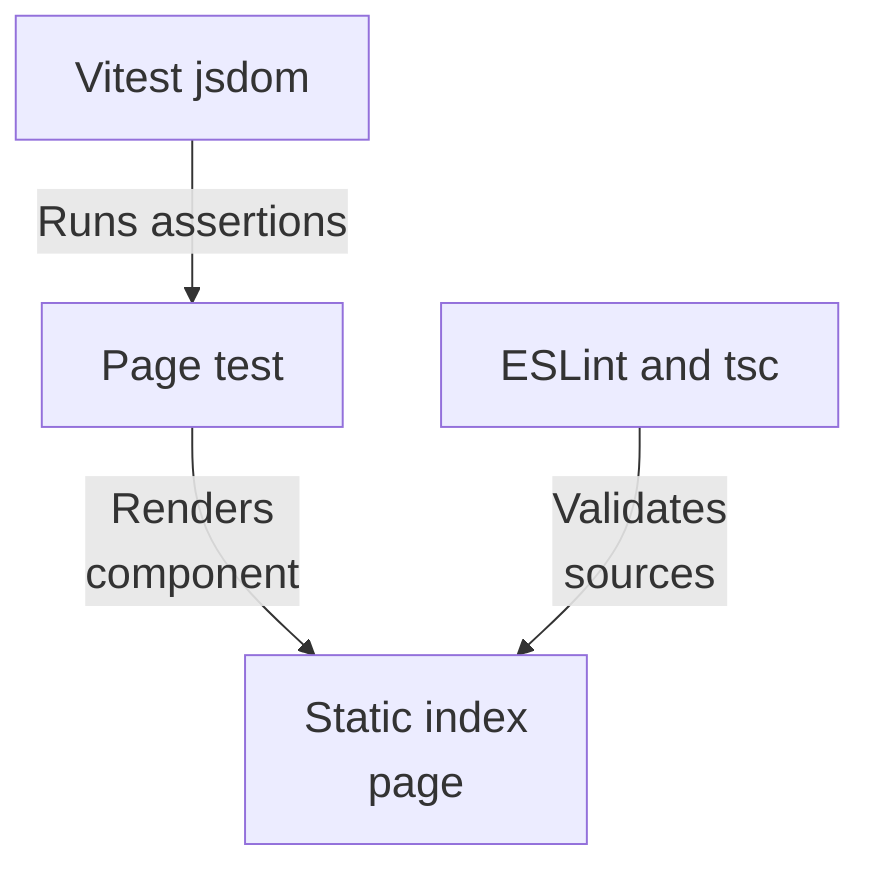

# Repository map

This subsystem is the hybrid-rag-search-web frontend: a private Next.js 16 / React 19 App Router project whose Dockerfile runs the dev server on Node 22. It renders a root layout wrapping a purely static Home page, with no state, inputs, or async data loading. No fetch, API route, or env read is present, so runtime linkage to the answers, foundation, or retrieval subsystems is unevidenced.

Commit: `56291a0b9cc466341d5d7a4b71aed8b2c5f412bb` | Generated: 2026-10-17T22:59:10.016925+00:00

[Open PDF](repository-map.pdf)

**AI-generated analysis. Source references are checked for existence and supplied scope; this does not prove semantic correctness.**

## Scope

Tracked, eligible text only; bounded excerpts, not exhaustive.

10/10 eligible files analyzed; 213 tracked files excluded by policy.

2 API calls. See coverage.json for budgets, exclusions, and usage.

## Architecture

The container runs the Next.js app; the App Router renders layout then static Home. Toolchain config types, lints, and tests but is not a runtime entry point. Backend linkage is unevidenced.

PNG fallback

### Source evidence

- **F0001**: frontend/Dockerfile builds a Node 22.23.2-bookworm-slim image, installs dependencies with `npm ci` from the lockfile, copies the source, exposes port 3000, and runs the dev server via `npm run dev -- --hostname 0.0.0.0`; it does not run a production `next build`/`next start` by default. (<a href="https://github.com/Justin-Mendoza/hybrid-rag-search/blob/56291a0b9cc466341d5d7a4b71aed8b2c5f412bb/frontend/Dockerfile#L1-L12">frontend/Dockerfile:1-12</a>, <a href="https://github.com/Justin-Mendoza/hybrid-rag-search/blob/56291a0b9cc466341d5d7a4b71aed8b2c5f412bb/frontend/package.json#L1-L39">frontend/package.json:1-39</a>)
- **F0002**: package.json declares `hybrid-rag-search-web` as a private Next.js 16 / React 19 App Router project with scripts dev, build, start, lint, typecheck, format, and `vitest run`; `engines` constrains Node to &gt;=22 &lt;23. (<a href="https://github.com/Justin-Mendoza/hybrid-rag-search/blob/56291a0b9cc466341d5d7a4b71aed8b2c5f412bb/frontend/package.json#L1-L39">frontend/package.json:1-39</a>)
- **F0003**: The Next.js config sets `reactStrictMode: true` and `agentRules: false`; no rewrites, redirects, or API proxying are declared, so client-to-backend routing is not configured here. (<a href="https://github.com/Justin-Mendoza/hybrid-rag-search/blob/56291a0b9cc466341d5d7a4b71aed8b2c5f412bb/frontend/next.config.ts#L1-L7">frontend/next.config.ts:1-7</a>)
- **F0005**: `frontend/src/app/layout.tsx` is the root layout: it imports `./styles.css`, exports `metadata` (title "Hybrid RAG Search", description "Evidence-first enterprise search"), and renders `children` inside an HTML/body shell. (<a href="https://github.com/Justin-Mendoza/hybrid-rag-search/blob/56291a0b9cc466341d5d7a4b71aed8b2c5f412bb/frontend/src/app/layout.tsx#L1-L19">frontend/src/app/layout.tsx:1-19</a>)
- **F0010**: `next-env.d.ts` references Next type packages and imports generated `.next/dev` route and root-param type definitions, indicating Next.js App Router typings are generated at build/dev time. (<a href="https://github.com/Justin-Mendoza/hybrid-rag-search/blob/56291a0b9cc466341d5d7a4b71aed8b2c5f412bb/frontend/next-env.d.ts#L1-L7">frontend/next-env.d.ts:1-7</a>)
- **F0006**: `frontend/src/app/page.tsx` defines the default-exported `Home` component rendering a static `&lt;main&gt;` with an eyebrow, an h1 ("Evidence-first answers, built for inspection."), and a paragraph; it contains no state, input controls, event handlers, or async data loading. (<a href="https://github.com/Justin-Mendoza/hybrid-rag-search/blob/56291a0b9cc466341d5d7a4b71aed8b2c5f412bb/frontend/src/app/page.tsx#L1-L9">frontend/src/app/page.tsx:1-9</a>)
- **F0004**: ESLint is configured via flat `defineConfig` composing `eslint-config-next/core-web-vitals` and `eslint-config-next/typescript`, ignoring `.next/**`, `coverage/**`, and `next-env.d.ts`. (<a href="https://github.com/Justin-Mendoza/hybrid-rag-search/blob/56291a0b9cc466341d5d7a4b71aed8b2c5f412bb/frontend/eslint.config.mjs#L1-L9">frontend/eslint.config.mjs:1-9</a>)
- **F0008**: Vitest is configured with the React plugin and `environment: "jsdom"`, so component tests run in a simulated DOM. (<a href="https://github.com/Justin-Mendoza/hybrid-rag-search/blob/56291a0b9cc466341d5d7a4b71aed8b2c5f412bb/frontend/vitest.config.ts#L1-L7">frontend/vitest.config.ts:1-7</a>)
- **F0009**: TypeScript is configured with `strict`, `noEmit`, `jsx: react-jsx`, bundler module resolution, the Next plugin, and the path alias `@/*` mapping to `./src/*`. (<a href="https://github.com/Justin-Mendoza/hybrid-rag-search/blob/56291a0b9cc466341d5d7a4b71aed8b2c5f412bb/frontend/tsconfig.json#L1-L33">frontend/tsconfig.json:1-33</a>)
- **F0013**: Testing, linting, and type-checking toolchains (vitest/jsdom, eslint-config-next, tsc) are devDependencies/scaffolding and are separate from the application's runtime entry points (layout/page components and the dev server). (<a href="https://github.com/Justin-Mendoza/hybrid-rag-search/blob/56291a0b9cc466341d5d7a4b71aed8b2c5f412bb/frontend/package.json#L1-L39">frontend/package.json:1-39</a>, <a href="https://github.com/Justin-Mendoza/hybrid-rag-search/blob/56291a0b9cc466341d5d7a4b71aed8b2c5f412bb/frontend/eslint.config.mjs#L1-L9">frontend/eslint.config.mjs:1-9</a>, <a href="https://github.com/Justin-Mendoza/hybrid-rag-search/blob/56291a0b9cc466341d5d7a4b71aed8b2c5f412bb/frontend/tsconfig.json#L1-L33">frontend/tsconfig.json:1-33</a>, <a href="https://github.com/Justin-Mendoza/hybrid-rag-search/blob/56291a0b9cc466341d5d7a4b71aed8b2c5f412bb/frontend/vitest.config.ts#L1-L7">frontend/vitest.config.ts:1-7</a>)

## Page render flow

A viewer receives the layout shell, which imports styles, exports metadata, and wraps the static Home markup. This is the frontend's only observed user flow; no search interaction is wired.

PNG fallback

### Source evidence

- **F0012**: Given the supplied sources, the frontend's only observed user flow is: the dev server renders the root layout which wraps the static Home page, and a viewer sees that page; no search or collection interaction is wired. (<a href="https://github.com/Justin-Mendoza/hybrid-rag-search/blob/56291a0b9cc466341d5d7a4b71aed8b2c5f412bb/frontend/Dockerfile#L1-L12">frontend/Dockerfile:1-12</a>, <a href="https://github.com/Justin-Mendoza/hybrid-rag-search/blob/56291a0b9cc466341d5d7a4b71aed8b2c5f412bb/frontend/src/app/layout.tsx#L1-L19">frontend/src/app/layout.tsx:1-19</a>, <a href="https://github.com/Justin-Mendoza/hybrid-rag-search/blob/56291a0b9cc466341d5d7a4b71aed8b2c5f412bb/frontend/src/app/page.tsx#L1-L9">frontend/src/app/page.tsx:1-9</a>)
- **F0005**: `frontend/src/app/layout.tsx` is the root layout: it imports `./styles.css`, exports `metadata` (title "Hybrid RAG Search", description "Evidence-first enterprise search"), and renders `children` inside an HTML/body shell. (<a href="https://github.com/Justin-Mendoza/hybrid-rag-search/blob/56291a0b9cc466341d5d7a4b71aed8b2c5f412bb/frontend/src/app/layout.tsx#L1-L19">frontend/src/app/layout.tsx:1-19</a>)
- **F0006**: `frontend/src/app/page.tsx` defines the default-exported `Home` component rendering a static `&lt;main&gt;` with an eyebrow, an h1 ("Evidence-first answers, built for inspection."), and a paragraph; it contains no state, input controls, event handlers, or async data loading. (<a href="https://github.com/Justin-Mendoza/hybrid-rag-search/blob/56291a0b9cc466341d5d7a4b71aed8b2c5f412bb/frontend/src/app/page.tsx#L1-L9">frontend/src/app/page.tsx:1-9</a>)

## Toolchain boundary

Vitest with jsdom renders Home for the page test; ESLint and tsc validate sources. These dev-time tools are separate from the runtime entry points, which matters because passing here does not evidence backend wiring.

PNG fallback

### Source evidence

- **F0008**: Vitest is configured with the React plugin and `environment: "jsdom"`, so component tests run in a simulated DOM. (<a href="https://github.com/Justin-Mendoza/hybrid-rag-search/blob/56291a0b9cc466341d5d7a4b71aed8b2c5f412bb/frontend/vitest.config.ts#L1-L7">frontend/vitest.config.ts:1-7</a>)
- **F0007**: The page test `frontend/src/app/page.test.tsx` renders `Home` and asserts a level-1 heading with text "Evidence-first answers, built for inspection." via Testing Library with jest-dom/vitest. (<a href="https://github.com/Justin-Mendoza/hybrid-rag-search/blob/56291a0b9cc466341d5d7a4b71aed8b2c5f412bb/frontend/src/app/page.test.tsx#L1-L14">frontend/src/app/page.test.tsx:1-14</a>)
- **F0006**: `frontend/src/app/page.tsx` defines the default-exported `Home` component rendering a static `&lt;main&gt;` with an eyebrow, an h1 ("Evidence-first answers, built for inspection."), and a paragraph; it contains no state, input controls, event handlers, or async data loading. (<a href="https://github.com/Justin-Mendoza/hybrid-rag-search/blob/56291a0b9cc466341d5d7a4b71aed8b2c5f412bb/frontend/src/app/page.tsx#L1-L9">frontend/src/app/page.tsx:1-9</a>)
- **F0004**: ESLint is configured via flat `defineConfig` composing `eslint-config-next/core-web-vitals` and `eslint-config-next/typescript`, ignoring `.next/**`, `coverage/**`, and `next-env.d.ts`. (<a href="https://github.com/Justin-Mendoza/hybrid-rag-search/blob/56291a0b9cc466341d5d7a4b71aed8b2c5f412bb/frontend/eslint.config.mjs#L1-L9">frontend/eslint.config.mjs:1-9</a>)
- **F0009**: TypeScript is configured with `strict`, `noEmit`, `jsx: react-jsx`, bundler module resolution, the Next plugin, and the path alias `@/*` mapping to `./src/*`. (<a href="https://github.com/Justin-Mendoza/hybrid-rag-search/blob/56291a0b9cc466341d5d7a4b71aed8b2c5f412bb/frontend/tsconfig.json#L1-L33">frontend/tsconfig.json:1-33</a>)

## Uncertainties and untraced areas

- No fetch call, API route, database access, or environment-variable read appears in the supplied frontend sources, so how or whether the frontend reaches the answers, foundation, or retrieval subsystems at runtime is untraced (F0011).
- No user input controls, state, event handlers, or async data loading exist on the index page, so the intended search workspace behavior is not evidenced (F0006, F0012).
- No rewrites, redirects, or API proxying are declared in the Next.js config, leaving any client-to-backend routing path unspecified (F0003).
- The Dockerfile runs the dev server rather than a production next build/next start, so the production serving path is not shown (F0001).
- No findings cover the answers, foundation, or retrieval subsystems' calls toward the frontend, so any inbound contract is unverified (F0011).
