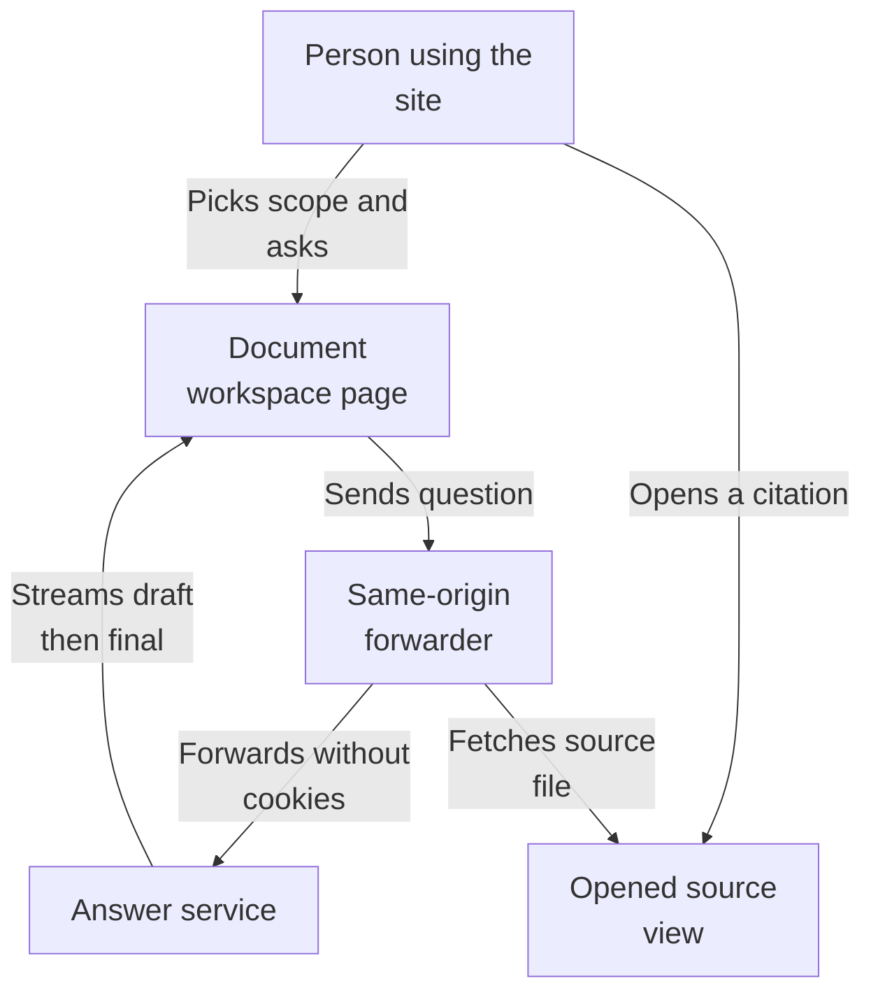
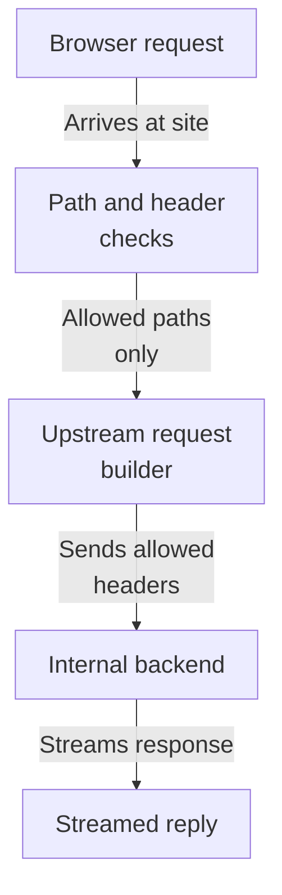
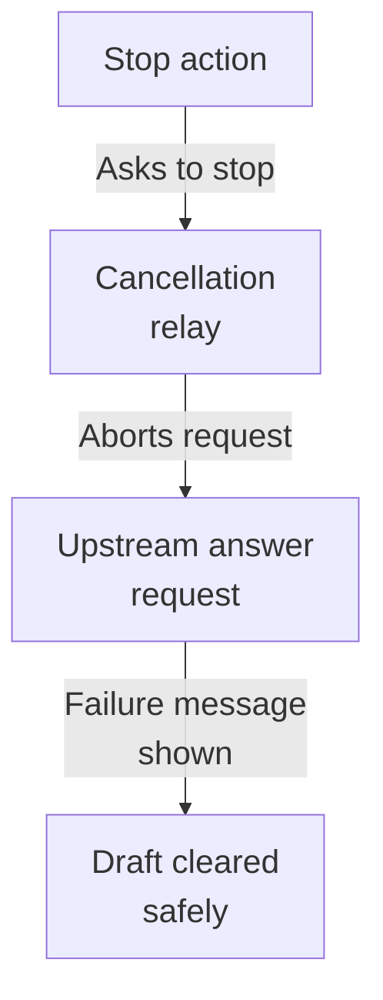
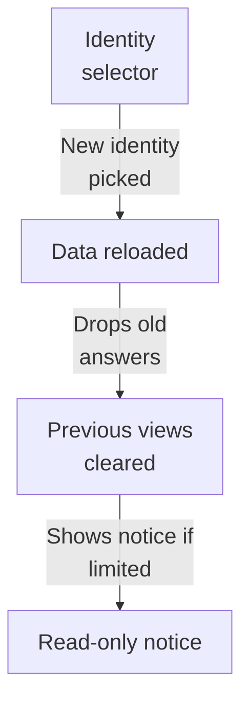
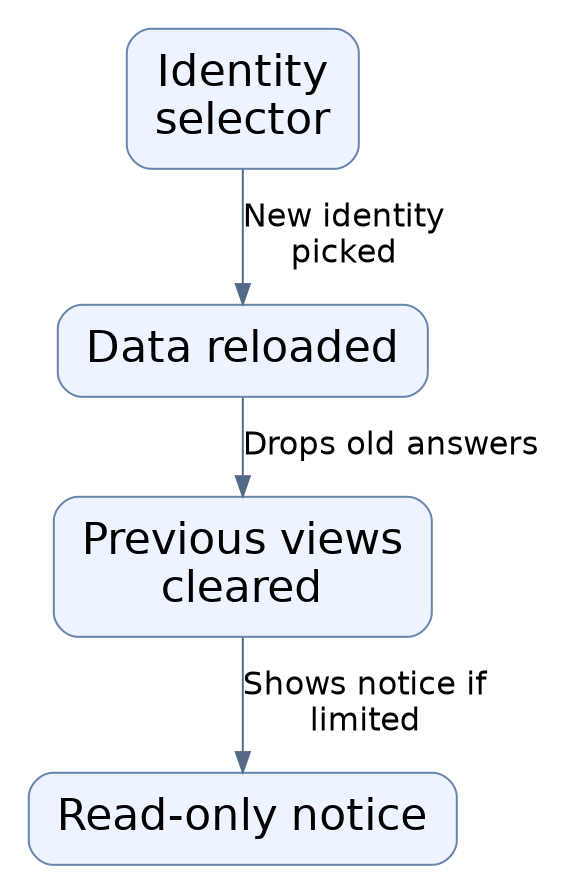

# Repository map

This area is the web front door of an evidence-backed document search product. Through their browser, a person picks a demo identity and collection, asks a question, and watches the answer arrive live with citations they can open and download the original source. All backend calls travel through the same website origin, which quietly rewrites paths, strips cookies, and streams results back.

Commit: `e4abb88a149b365c2838b0f2f0606dff0127b1ab` | Generated: 2026-10-22T15:20:08.828525+00:00

[Open PDF](repository-map.pdf)

**AI-generated analysis. Source references are checked for existence and supplied scope; this does not prove semantic correctness.**

## Scope

Tracked, eligible text only; bounded excerpts, not exhaustive.

6/17 eligible files analyzed; 243 tracked files excluded by policy.

2 API calls. See coverage.json for budgets, exclusions, and usage.

## How a question becomes a cited answer

A person picks a collection and identity, asks a question, and watches the answer stream back live. Citations can be opened to view and download the original source document.

PNG fallback

Read from top to bottom; arrows show what happens next or what is passed along.

### Source evidence

- **F0007**: The home page (Home in page.tsx, exercised by page.test.tsx) is a client-side document workspace that loads demo identities, workspaces/collections, capabilities, documents, and saved answers from the same-origin API and renders selectors for collection scope and demo user identity. (<a href="https://github.com/Justin-Mendoza/Afterclass/blob/e4abb88a149b365c2838b0f2f0606dff0127b1ab/frontend/src/app/page.test.tsx#L1-L321">frontend/src/app/page.test.tsx:1-321</a>)
- **F0012**: Switching the simulated demo identity reloads workspace/collection/capability data for the new identity and explicitly clears previously loaded answers, open source context (e.g., notes.txt), and manager-only controls like "Permissions"; a read-only identity instead sees a read-only notice about the collection. (<a href="https://github.com/Justin-Mendoza/Afterclass/blob/e4abb88a149b365c2838b0f2f0606dff0127b1ab/frontend/src/app/page.test.tsx#L1-L321">frontend/src/app/page.test.tsx:1-321</a>)
- **F0001**: The web app exposes a catch-all API route handler (forward, exported as GET/POST/PATCH/PUT/DELETE) under /api/[...path] that acts as a fixed reverse proxy: it only permits paths whose first segment is "v1" and whose segments match /^[a-zA-Z0-9_-]+$/, returning a 404 not_found JSON error otherwise. (<a href="https://github.com/Justin-Mendoza/Afterclass/blob/e4abb88a149b365c2838b0f2f0606dff0127b1ab/frontend/src/app/api/%5B...path%5D/route.ts#L1-L104">frontend/src/app/api/[...path]/route.ts:1-104</a>)
- **F0002**: The proxy builds its upstream URL from process.env.API_INTERNAL_URL (defaulting to http://127.0.0.1:8000) plus the sanitized path, and forwards request.method, selected headers, and the request body (with duplex: "half" for non-GET/HEAD methods), so browser clients reach the backend API through the same origin. (<a href="https://github.com/Justin-Mendoza/Afterclass/blob/e4abb88a149b365c2838b0f2f0606dff0127b1ab/frontend/src/app/api/%5B...path%5D/route.ts#L1-L104">frontend/src/app/api/[...path]/route.ts:1-104</a>, <a href="https://github.com/Justin-Mendoza/Afterclass/blob/e4abb88a149b365c2838b0f2f0606dff0127b1ab/frontend/src/app/api/%5B...path%5D/route.test.ts#L1-L97">frontend/src/app/api/[...path]/route.test.ts:1-97</a>)
- **F0008**: Asking a question streams answer events (progress, content, citations, complete, error) from the /answers/stream endpoint; partial "content" drafts are shown while streaming and are replaced by the final AnswerResult text once a "complete" event arrives. (<a href="https://github.com/Justin-Mendoza/Afterclass/blob/e4abb88a149b365c2838b0f2f0606dff0127b1ab/frontend/src/app/page.test.tsx#L1-L321">frontend/src/app/page.test.tsx:1-321</a>)
- **F0011**: Selecting a citation ("Open source 1") fetches and displays the currently authorized source document including original filename, page/locator info (e.g., "Page 2"), the cited passage text, and a "Download original" control. (<a href="https://github.com/Justin-Mendoza/Afterclass/blob/e4abb88a149b365c2838b0f2f0606dff0127b1ab/frontend/src/app/page.test.tsx#L1-L321">frontend/src/app/page.test.tsx:1-321</a>)
- **F0003**: Only an allowlist of request headers is forwarded upstream — content-type, accept, x-demo-user-id, idempotency-key, last-event-id — so cookies and authorization headers are intentionally stripped (the backend, not this proxy, owns authorization). (<a href="https://github.com/Justin-Mendoza/Afterclass/blob/e4abb88a149b365c2838b0f2f0606dff0127b1ab/frontend/src/app/api/%5B...path%5D/route.ts#L1-L104">frontend/src/app/api/[...path]/route.ts:1-104</a>, <a href="https://github.com/Justin-Mendoza/Afterclass/blob/e4abb88a149b365c2838b0f2f0606dff0127b1ab/frontend/src/app/api/%5B...path%5D/route.test.ts#L1-L97">frontend/src/app/api/[...path]/route.test.ts:1-97</a>)
- **F0004**: The proxy streams upstream responses rather than buffering: it pipes response.body through a ReadableStream reader, forwards content-type, content-disposition, and x-request-id, and always sets Cache-Control: no-store and X-Accel-Buffering: no, which supports live server-sent-event answer streams. (<a href="https://github.com/Justin-Mendoza/Afterclass/blob/e4abb88a149b365c2838b0f2f0606dff0127b1ab/frontend/src/app/api/%5B...path%5D/route.ts#L1-L104">frontend/src/app/api/[...path]/route.ts:1-104</a>, <a href="https://github.com/Justin-Mendoza/Afterclass/blob/e4abb88a149b365c2838b0f2f0606dff0127b1ab/frontend/src/app/api/%5B...path%5D/route.test.ts#L1-L97">frontend/src/app/api/[...path]/route.test.ts:1-97</a>)

## How requests are filtered and forwarded

A browser request reaches the site forwarder, which rejects anything outside the allowed path shape, strips sensitive headers, and forwards the rest to the internal backend while streaming the reply back.

PNG fallback

Read from top to bottom; arrows show what happens next or what is passed along.

### Source evidence

- **F0002**: The proxy builds its upstream URL from process.env.API_INTERNAL_URL (defaulting to http://127.0.0.1:8000) plus the sanitized path, and forwards request.method, selected headers, and the request body (with duplex: "half" for non-GET/HEAD methods), so browser clients reach the backend API through the same origin. (<a href="https://github.com/Justin-Mendoza/Afterclass/blob/e4abb88a149b365c2838b0f2f0606dff0127b1ab/frontend/src/app/api/%5B...path%5D/route.ts#L1-L104">frontend/src/app/api/[...path]/route.ts:1-104</a>, <a href="https://github.com/Justin-Mendoza/Afterclass/blob/e4abb88a149b365c2838b0f2f0606dff0127b1ab/frontend/src/app/api/%5B...path%5D/route.test.ts#L1-L97">frontend/src/app/api/[...path]/route.test.ts:1-97</a>)
- **F0001**: The web app exposes a catch-all API route handler (forward, exported as GET/POST/PATCH/PUT/DELETE) under /api/[...path] that acts as a fixed reverse proxy: it only permits paths whose first segment is "v1" and whose segments match /^[a-zA-Z0-9_-]+$/, returning a 404 not_found JSON error otherwise. (<a href="https://github.com/Justin-Mendoza/Afterclass/blob/e4abb88a149b365c2838b0f2f0606dff0127b1ab/frontend/src/app/api/%5B...path%5D/route.ts#L1-L104">frontend/src/app/api/[...path]/route.ts:1-104</a>)
- **F0003**: Only an allowlist of request headers is forwarded upstream — content-type, accept, x-demo-user-id, idempotency-key, last-event-id — so cookies and authorization headers are intentionally stripped (the backend, not this proxy, owns authorization). (<a href="https://github.com/Justin-Mendoza/Afterclass/blob/e4abb88a149b365c2838b0f2f0606dff0127b1ab/frontend/src/app/api/%5B...path%5D/route.ts#L1-L104">frontend/src/app/api/[...path]/route.ts:1-104</a>, <a href="https://github.com/Justin-Mendoza/Afterclass/blob/e4abb88a149b365c2838b0f2f0606dff0127b1ab/frontend/src/app/api/%5B...path%5D/route.test.ts#L1-L97">frontend/src/app/api/[...path]/route.test.ts:1-97</a>)
- **F0004**: The proxy streams upstream responses rather than buffering: it pipes response.body through a ReadableStream reader, forwards content-type, content-disposition, and x-request-id, and always sets Cache-Control: no-store and X-Accel-Buffering: no, which supports live server-sent-event answer streams. (<a href="https://github.com/Justin-Mendoza/Afterclass/blob/e4abb88a149b365c2838b0f2f0606dff0127b1ab/frontend/src/app/api/%5B...path%5D/route.ts#L1-L104">frontend/src/app/api/[...path]/route.ts:1-104</a>, <a href="https://github.com/Justin-Mendoza/Afterclass/blob/e4abb88a149b365c2838b0f2f0606dff0127b1ab/frontend/src/app/api/%5B...path%5D/route.test.ts#L1-L97">frontend/src/app/api/[...path]/route.test.ts:1-97</a>)

## Stopping or losing a connection

If a person stops an answer or the connection drops, the site cancels the upstream request, clears the partial draft and citations, and shows a safe message rather than an invented answer.

PNG fallback

Read from top to bottom; arrows show what happens next or what is passed along.

### Source evidence

- **F0010**: While an answer is streaming the UI offers a "Stop" action that aborts the in-flight stream request (the fetch signal is marked aborted) and clears both the draft and any citations, showing "You stopped this answer" instead. (<a href="https://github.com/Justin-Mendoza/Afterclass/blob/e4abb88a149b365c2838b0f2f0606dff0127b1ab/frontend/src/app/page.test.tsx#L1-L321">frontend/src/app/page.test.tsx:1-321</a>)
- **F0005**: Cancellation is propagated end-to-end: the incoming request.signal is linked to a local AbortController that aborts the upstream fetch, and cancelling the downstream ReadableStream (cancel handler) or a read error aborts the upstream request and releases the reader. (<a href="https://github.com/Justin-Mendoza/Afterclass/blob/e4abb88a149b365c2838b0f2f0606dff0127b1ab/frontend/src/app/api/%5B...path%5D/route.ts#L1-L104">frontend/src/app/api/[...path]/route.ts:1-104</a>, <a href="https://github.com/Justin-Mendoza/Afterclass/blob/e4abb88a149b365c2838b0f2f0606dff0127b1ab/frontend/src/app/api/%5B...path%5D/route.test.ts#L1-L97">frontend/src/app/api/[...path]/route.test.ts:1-97</a>)
- **F0009**: Failed or interrupted answer streams clear the in-progress draft and surface a safe message (e.g., "Connection interrupted" or the server-provided message such as "The answer could not be verified."); a new request is only started on explicit manual retry ("Retry question"), not automatically. (<a href="https://github.com/Justin-Mendoza/Afterclass/blob/e4abb88a149b365c2838b0f2f0606dff0127b1ab/frontend/src/app/page.test.tsx#L1-L321">frontend/src/app/page.test.tsx:1-321</a>)

## How a person switches identity

Changing the simulated demo identity reloads workspace, collection, and capability choices, clears saved answers, open sources, and manager controls, and shows a read-only notice for view-only identities.

PNG fallback

Read from top to bottom; arrows show what happens next or what is passed along.

### Source evidence

- **F0012**: Switching the simulated demo identity reloads workspace/collection/capability data for the new identity and explicitly clears previously loaded answers, open source context (e.g., notes.txt), and manager-only controls like "Permissions"; a read-only identity instead sees a read-only notice about the collection. (<a href="https://github.com/Justin-Mendoza/Afterclass/blob/e4abb88a149b365c2838b0f2f0606dff0127b1ab/frontend/src/app/page.test.tsx#L1-L321">frontend/src/app/page.test.tsx:1-321</a>)

## Uncertainties and untraced areas

- The forwarding destination is read from an environment setting; how that setting is populated in any deployed environment is not shown.
- Only the frontend area was examined, so the shape of upstream responses and error payloads is taken on trust from this side.
- The upload flow is described as reachable with accepted file types and a size limit, but the path from chosen file to stored document is not shown in these findings.
- Direct-link parameters for workspace, answer, and source are honored, but how those links are generated for sharing is not shown.
