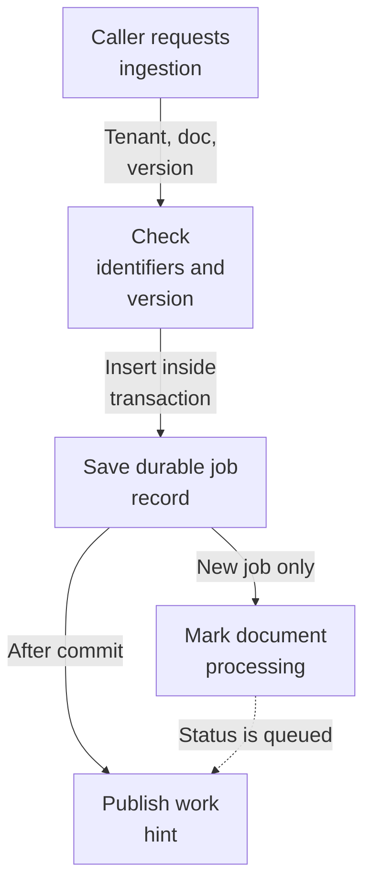
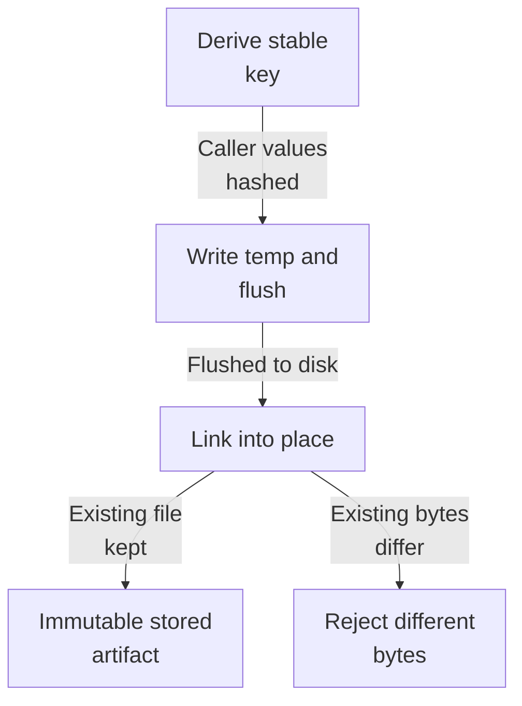
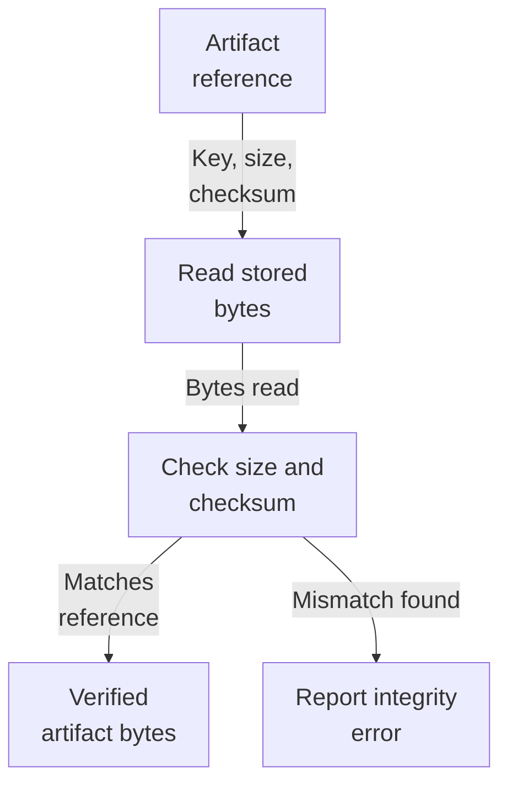
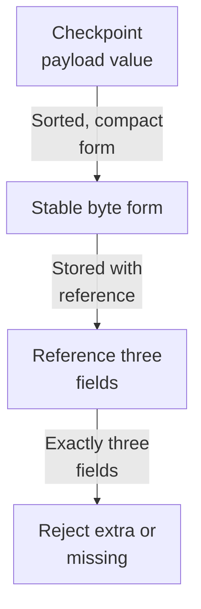

# Repository map

This area lets the system accept a document for processing and keep durable, tamper-evident records of the results. A caller supplies a tenant, document, and pipeline version; the service saves a job record, flips the document to processing, and only then signals that work is ready. Finished artifacts (parsed text, chunks, embeddings) are stored as immutable checksum-verified files under one root, keyed safely per tenant and job, so identical inputs can't produce conflicting or corrupted data.

Commit: `e4abb88a149b365c2838b0f2f0606dff0127b1ab` | Generated: 2026-10-22T15:20:38.351186+00:00

[Open PDF](repository-map.pdf)

**AI-generated analysis. Source references are checked for existence and supplied scope; this does not prove semantic correctness.**

## Scope

Tracked, eligible text only; bounded excerpts, not exhaustive.

2/80 eligible files analyzed; 180 tracked files excluded by policy.

2 API calls. See coverage.json for budgets, exclusions, and usage.

## How a document becomes an ingestion job

A caller submits a tenant, document, and pipeline version. The service saves a job, marks the document as processing, and after the database commit signals that work is ready.

PNG fallback

Read from top to bottom. Dashed arrows show connections that need confirmation.

### Source evidence

- **F0007**: IngestionJobService.enqueue_document validates tenant/document UUIDs and a pipe_&lt;64 hex&gt; pipeline version, opens a transaction, calls enqueue_in_session, and only publishes a job to the JobPublisher after the transaction commits and the resulting status is QUEUED. (<a href="https://github.com/Justin-Mendoza/Afterclass/blob/e4abb88a149b365c2838b0f2f0606dff0127b1ab/backend/src/hybrid_rag_search/ingestion/jobs.py#L1-L108">backend/src/hybrid_rag_search/ingestion/jobs.py:1-108</a>)
- **F0010** (inferred): The ingestion batch's main input-to-result path is: a caller supplies tenant, document, and pipeline version; the service persists a durable IngestionJob row (and flips the document to PROCESSING) inside a transaction; after commit it emits a Redis-style hint via JobPublisher; the worker later produces artifacts saved as checksum-verified immutable files keyed per job. (<a href="https://github.com/Justin-Mendoza/Afterclass/blob/e4abb88a149b365c2838b0f2f0606dff0127b1ab/backend/src/hybrid_rag_search/ingestion/jobs.py#L1-L108">backend/src/hybrid_rag_search/ingestion/jobs.py:1-108</a>)
- **F0002**: Artifact keys and references are strictly validated: keys must match a fixed UUID/UUID/kind/sha256.json pattern (ArtifactKind, _valid_key), references must carry a 64-char lowercase SHA-256 and nonnegative size (ArtifactRef.__post_init__), and lookup rejects symlinks in the key path (_path) to prevent escaping the storage root. (<a href="https://github.com/Justin-Mendoza/Afterclass/blob/e4abb88a149b365c2838b0f2f0606dff0127b1ab/backend/src/hybrid_rag_search/ingestion/artifacts.py#L1-L205">backend/src/hybrid_rag_search/ingestion/artifacts.py:1-205</a>)
- **F0008**: enqueue_in_session row-locks the target document, raises DocumentNotFound when absent and DocumentUnavailable when the document is deleting or deleted, then inserts an IngestionJob with content_hash and pipeline_version using on-conflict-do-nothing on the unique document/recipe constraint, treating a returned row as a freshly created job. (<a href="https://github.com/Justin-Mendoza/Afterclass/blob/e4abb88a149b365c2838b0f2f0606dff0127b1ab/backend/src/hybrid_rag_search/ingestion/jobs.py#L1-L108">backend/src/hybrid_rag_search/ingestion/jobs.py:1-108</a>)
- **F0009**: When a job is created the service marks the document PROCESSING and clears any error message; when an existing job already exists it falls back to a select by tenant, document, content_hash, and pipeline_version to recover the existing job id and status, making enqueue idempotent for identical inputs. (<a href="https://github.com/Justin-Mendoza/Afterclass/blob/e4abb88a149b365c2838b0f2f0606dff0127b1ab/backend/src/hybrid_rag_search/ingestion/jobs.py#L1-L108">backend/src/hybrid_rag_search/ingestion/jobs.py:1-108</a>)
- **F0011**: Transactions and publishing are deliberately separated so a job hint is never published before its database row is committed, and callers can create durable work inside their own transaction via enqueue_in_session without triggering a publish. (<a href="https://github.com/Justin-Mendoza/Afterclass/blob/e4abb88a149b365c2838b0f2f0606dff0127b1ab/backend/src/hybrid_rag_search/ingestion/jobs.py#L1-L108">backend/src/hybrid_rag_search/ingestion/jobs.py:1-108</a>)

## How artifacts are saved safely

Finished results become immutable files. Bytes are written to a temporary file, verified, then linked into place under one root so a key can never hold two different payloads.

PNG fallback

Read from top to bottom; arrows show what happens next or what is passed along.

### Source evidence

- **F0005**: Artifact identity is derived from the artifact kind plus caller-supplied values through stable_digest (artifact_identity), so the key for a given input is deterministic and can be reconstructed without side-channel state. (<a href="https://github.com/Justin-Mendoza/Afterclass/blob/e4abb88a149b365c2838b0f2f0606dff0127b1ab/backend/src/hybrid_rag_search/ingestion/artifacts.py#L1-L205">backend/src/hybrid_rag_search/ingestion/artifacts.py:1-205</a>)
- **F0002**: Artifact keys and references are strictly validated: keys must match a fixed UUID/UUID/kind/sha256.json pattern (ArtifactKind, _valid_key), references must carry a 64-char lowercase SHA-256 and nonnegative size (ArtifactRef.__post_init__), and lookup rejects symlinks in the key path (_path) to prevent escaping the storage root. (<a href="https://github.com/Justin-Mendoza/Afterclass/blob/e4abb88a149b365c2838b0f2f0606dff0127b1ab/backend/src/hybrid_rag_search/ingestion/artifacts.py#L1-L205">backend/src/hybrid_rag_search/ingestion/artifacts.py:1-205</a>)
- **F0003**: save writes new artifact bytes atomically via a temporary file plus os.link, fsyncs before linking, and if the target already exists re-reads it; if existing bytes differ in size or SHA-256 it raises ArtifactConflictError, so a deterministic key can never hold two different payloads. (<a href="https://github.com/Justin-Mendoza/Afterclass/blob/e4abb88a149b365c2838b0f2f0606dff0127b1ab/backend/src/hybrid_rag_search/ingestion/artifacts.py#L1-L205">backend/src/hybrid_rag_search/ingestion/artifacts.py:1-205</a>)
- **F0001**: LocalArtifactStorage stores immutable ingestion checkpoint artifacts (parsed, chunks, embeddings) as files beneath an application-owned root, keyed by tenant UUID, job UUID, artifact kind, and a content identity digest; a path containing path traversal components in the key is rejected and all published files live under one root. (<a href="https://github.com/Justin-Mendoza/Afterclass/blob/e4abb88a149b365c2838b0f2f0606dff0127b1ab/backend/src/hybrid_rag_search/ingestion/artifacts.py#L1-L205">backend/src/hybrid_rag_search/ingestion/artifacts.py:1-205</a>)
- **F0014**: ArtifactFitMismatch or integrity problems surface as distinct errors: ArtifactConflictError for a key holding different bytes, ArtifactIntegrityError for bytes that no longer match their reference, and ValueError for malformed keys, references, or argument types. (<a href="https://github.com/Justin-Mendoza/Afterclass/blob/e4abb88a149b365c2838b0f2f0606dff0127b1ab/backend/src/hybrid_rag_search/ingestion/artifacts.py#L1-L205">backend/src/hybrid_rag_search/ingestion/artifacts.py:1-205</a>)

## How artifacts are read back

A stored artifact is fetched by its reference and re-checked against the declared size and checksum. Bad bytes or malformed keys are rejected rather than returned.

PNG fallback

Read from top to bottom; arrows show what happens next or what is passed along.

### Source evidence

- **F0012**: Checkpoint references serialize to and from three fields (key, sha256, size_bytes) via ArtifactRef.checkpoint_value and from_checkpoint, enforcing exact field sets so an untrusted checkpoint cannot smuggle extra or missing keys. (<a href="https://github.com/Justin-Mendoza/Afterclass/blob/e4abb88a149b365c2838b0f2f0606dff0127b1ab/backend/src/hybrid_rag_search/ingestion/artifacts.py#L1-L205">backend/src/hybrid_rag_search/ingestion/artifacts.py:1-205</a>)
- **F0002**: Artifact keys and references are strictly validated: keys must match a fixed UUID/UUID/kind/sha256.json pattern (ArtifactKind, _valid_key), references must carry a 64-char lowercase SHA-256 and nonnegative size (ArtifactRef.__post_init__), and lookup rejects symlinks in the key path (_path) to prevent escaping the storage root. (<a href="https://github.com/Justin-Mendoza/Afterclass/blob/e4abb88a149b365c2838b0f2f0606dff0127b1ab/backend/src/hybrid_rag_search/ingestion/artifacts.py#L1-L205">backend/src/hybrid_rag_search/ingestion/artifacts.py:1-205</a>)
- **F0004**: fetch verifies stored bytes against the reference's declared size and SHA-256 and raises ArtifactIntegrityError on mismatch; lookup describes an existing file without a checkpoint reference, returning None if the file is absent; delete removes one artifact and delete_job removes all artifacts for a tenant/job pair. (<a href="https://github.com/Justin-Mendoza/Afterclass/blob/e4abb88a149b365c2838b0f2f0606dff0127b1ab/backend/src/hybrid_rag_search/ingestion/artifacts.py#L1-L205">backend/src/hybrid_rag_search/ingestion/artifacts.py:1-205</a>)
- **F0014**: ArtifactFitMismatch or integrity problems surface as distinct errors: ArtifactConflictError for a key holding different bytes, ArtifactIntegrityError for bytes that no longer match their reference, and ValueError for malformed keys, references, or argument types. (<a href="https://github.com/Justin-Mendoza/Afterclass/blob/e4abb88a149b365c2838b0f2f0606dff0127b1ab/backend/src/hybrid_rag_search/ingestion/artifacts.py#L1-L205">backend/src/hybrid_rag_search/ingestion/artifacts.py:1-205</a>)

## Where the checkpoint values come from

Artifact references and payloads travel through checkpoints in a strict, stable form: only key, checksum, and size fields are allowed, and payload values are serialized deterministically.

PNG fallback

Read from top to bottom; arrows show what happens next or what is passed along.

### Source evidence

- **F0006**: canonical_json_bytes serializes values with sorted keys, compact separators, no NaN, and non-ASCII preserved, providing a stable byte form for hashing or storing checkpoint payloads. (<a href="https://github.com/Justin-Mendoza/Afterclass/blob/e4abb88a149b365c2838b0f2f0606dff0127b1ab/backend/src/hybrid_rag_search/ingestion/artifacts.py#L1-L205">backend/src/hybrid_rag_search/ingestion/artifacts.py:1-205</a>)
- **F0012**: Checkpoint references serialize to and from three fields (key, sha256, size_bytes) via ArtifactRef.checkpoint_value and from_checkpoint, enforcing exact field sets so an untrusted checkpoint cannot smuggle extra or missing keys. (<a href="https://github.com/Justin-Mendoza/Afterclass/blob/e4abb88a149b365c2838b0f2f0606dff0127b1ab/backend/src/hybrid_rag_search/ingestion/artifacts.py#L1-L205">backend/src/hybrid_rag_search/ingestion/artifacts.py:1-205</a>)
- **F0014**: ArtifactFitMismatch or integrity problems surface as distinct errors: ArtifactConflictError for a key holding different bytes, ArtifactIntegrityError for bytes that no longer match their reference, and ValueError for malformed keys, references, or argument types. (<a href="https://github.com/Justin-Mendoza/Afterclass/blob/e4abb88a149b365c2838b0f2f0606dff0127b1ab/backend/src/hybrid_rag_search/ingestion/artifacts.py#L1-L205">backend/src/hybrid_rag_search/ingestion/artifacts.py:1-205</a>)

## Uncertainties and untraced areas

- Whether the worker actually reads artifacts written by this storage layer, and how indexed artifacts feed search results, is inferred from changed files but not confirmed by the supplied findings (F0015).
- Local filesystem storage is only one implementation of the storage contract; deployed behavior may use an alternate backend not shown here (F0016).
- The exact end-to-end path from a published work hint to a running worker is described as inferred and may differ in the real deployment (F0010).
