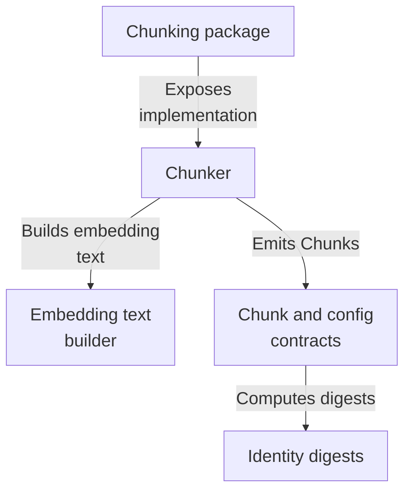
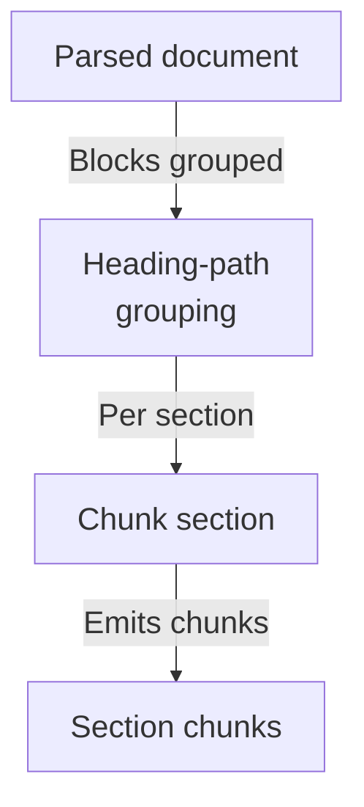
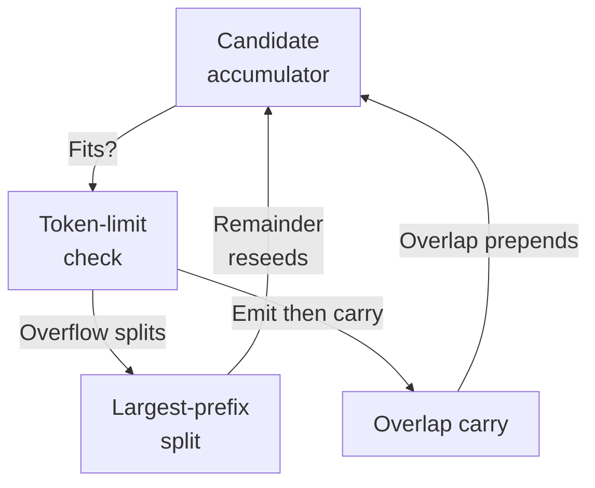
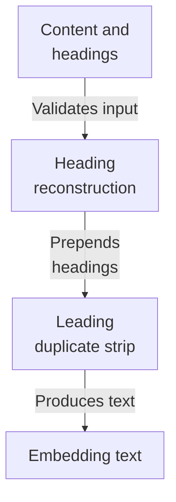
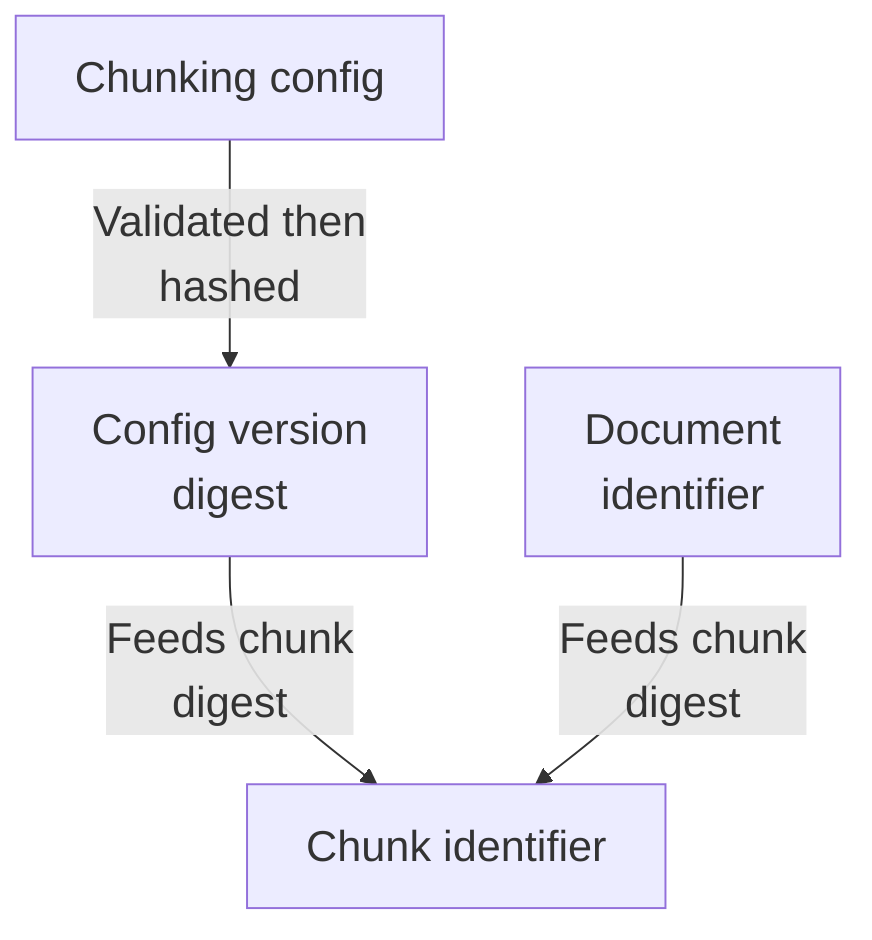
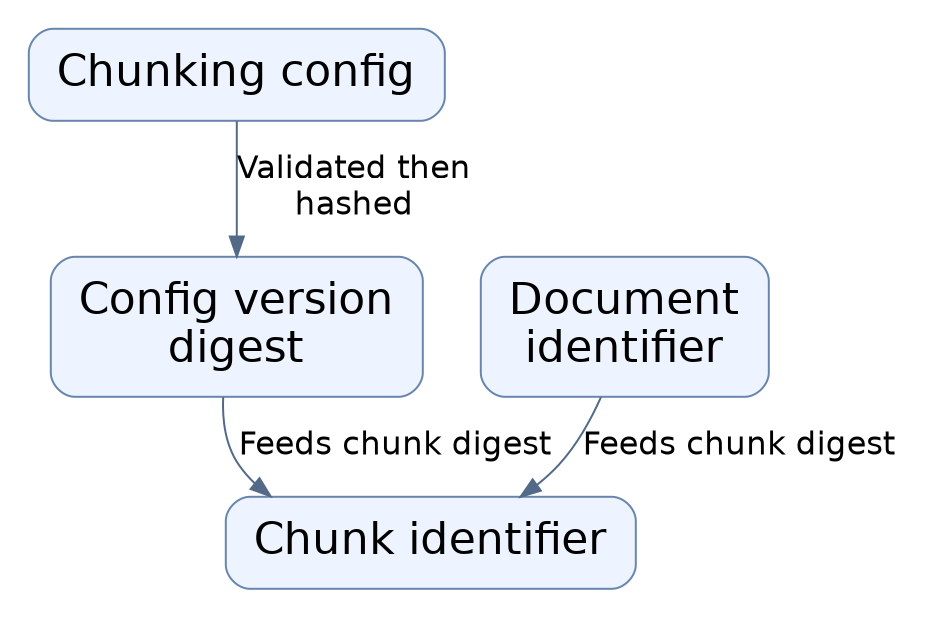

# Repository map

This batch maps the deterministic document-chunking core of the ingestion subsystem: parsed document blocks are grouped by heading path, greedily packed into token-limited chunks with overlap, enriched with reconstructed Markdown headings for embedding, and stamped with content-addressed identities from canonical digests.

Commit: `05fb919153379762ce04a644ff9f6ef3e3413ff1` | Generated: 2026-10-17T22:42:45.308776+00:00

[Open PDF](repository-map.pdf)

**AI-generated analysis. Source references are checked for existence and supplied scope; this does not prove semantic correctness.**

## Scope

Tracked, eligible text only; bounded excerpts, not exhaustive.

5/86 eligible files analyzed; 137 tracked files excluded by policy.

2 API calls. See coverage.json for budgets, exclusions, and usage.

## Architecture

The chunking package surface delegates to a chunker that consumes parsed blocks and a tokenizer, assembling content-addressed Chunk contracts via embedding-text and identity helpers.

PNG fallback

### Source evidence

- **F0015**: A chunking module docstring 'Deterministic structure-aware document chunking' is the __init__ surface for the chunking package; the actual implementation symbols live in chunker/contracts/embedding_text/identity modules. (<a href="https://github.com/Justin-Mendoza/hybrid-rag-search/blob/05fb919153379762ce04a644ff9f6ef3e3413ff1/backend/src/hybrid_rag_search/chunking/__init__.py#L1-L1">backend/src/hybrid_rag_search/chunking/__init__.py:1-1</a>, <a href="https://github.com/Justin-Mendoza/hybrid-rag-search/blob/05fb919153379762ce04a644ff9f6ef3e3413ff1/backend/src/hybrid_rag_search/chunking/chunker.py#L1-L291">backend/src/hybrid_rag_search/chunking/chunker.py:1-291</a>, <a href="https://github.com/Justin-Mendoza/hybrid-rag-search/blob/05fb919153379762ce04a644ff9f6ef3e3413ff1/backend/src/hybrid_rag_search/chunking/contracts.py#L1-L162">backend/src/hybrid_rag_search/chunking/contracts.py:1-162</a>, <a href="https://github.com/Justin-Mendoza/hybrid-rag-search/blob/05fb919153379762ce04a644ff9f6ef3e3413ff1/backend/src/hybrid_rag_search/chunking/embedding_text.py#L1-L33">backend/src/hybrid_rag_search/chunking/embedding_text.py:1-33</a>, <a href="https://github.com/Justin-Mendoza/hybrid-rag-search/blob/05fb919153379762ce04a644ff9f6ef3e3413ff1/backend/src/hybrid_rag_search/chunking/identity.py#L1-L49">backend/src/hybrid_rag_search/chunking/identity.py:1-49</a>)
- **F0001**: chunk_document groups ParsedDocument.blocks by locator.heading_path via itertools.groupby and chunks each section separately, so a chunk never spans a heading change; chunk order resumes at len(chunks)+1 for each section. (<a href="https://github.com/Justin-Mendoza/hybrid-rag-search/blob/05fb919153379762ce04a644ff9f6ef3e3413ff1/backend/src/hybrid_rag_search/chunking/chunker.py#L1-L291">backend/src/hybrid_rag_search/chunking/chunker.py:1-291</a>)
- **F0002**: _chunk_section greedily accumulates whole ParsedBlocks while the candidate embedding token count stays within config.max_tokens, then appends the resulting Chunk. (<a href="https://github.com/Justin-Mendoza/hybrid-rag-search/blob/05fb919153379762ce04a644ff9f6ef3e3413ff1/backend/src/hybrid_rag_search/chunking/chunker.py#L1-L291">backend/src/hybrid_rag_search/chunking/chunker.py:1-291</a>)
- **F0016** (inferred): chunker.py imports build_embedding_text, ParsedBlock/ParsedDocument, TextTokenizer, and chunking contracts, but the excerpts do not show a top-level call site invoking chunk_document at runtime; wiring into ingestion pipeline is inferred from the changed-files list only. (<a href="https://github.com/Justin-Mendoza/hybrid-rag-search/blob/05fb919153379762ce04a644ff9f6ef3e3413ff1/backend/src/hybrid_rag_search/chunking/chunker.py#L1-L291">backend/src/hybrid_rag_search/chunking/chunker.py:1-291</a>)
- **F0007**: build_embedding_text prepends Markdown-style headings ('#' * level) reconstructed from heading_path before the body, and strips a leading heading block that duplicates heading_path[-1] to avoid embedding it twice. (<a href="https://github.com/Justin-Mendoza/hybrid-rag-search/blob/05fb919153379762ce04a644ff9f6ef3e3413ff1/backend/src/hybrid_rag_search/chunking/embedding_text.py#L1-L33">backend/src/hybrid_rag_search/chunking/embedding_text.py:1-33</a>)
- **F0008**: build_embedding_text raises ValueError if content_text is blank, if heading_path is not a tuple of nonblank strings, or if leading_heading_block does not match the leaf heading or is not first in content_text. (<a href="https://github.com/Justin-Mendoza/hybrid-rag-search/blob/05fb919153379762ce04a644ff9f6ef3e3413ff1/backend/src/hybrid_rag_search/chunking/embedding_text.py#L1-L33">backend/src/hybrid_rag_search/chunking/embedding_text.py:1-33</a>)
- **F0010**: ChunkingConfig.version is a stable_digest of a canonical JSON serialization of algorithm, embedding_limit_tokens, max_tokens, overlap_tokens, tokenizer model/revision/sha256, prefixed with 'chunkcfg_'. (<a href="https://github.com/Justin-Mendoza/hybrid-rag-search/blob/05fb919153379762ce04a644ff9f6ef3e3413ff1/backend/src/hybrid_rag_search/chunking/contracts.py#L1-L162">backend/src/hybrid_rag_search/chunking/contracts.py:1-162</a>)
- **F0011**: ChunkingConfig.__post_init__ validates positive max_tokens, nonnegative overlap_tokens strictly less than max_tokens, max_tokens not exceeding embedding_limit_tokens, nonblank string labels, and a lowercase 64-hex tokenizer_sha256. (<a href="https://github.com/Justin-Mendoza/hybrid-rag-search/blob/05fb919153379762ce04a644ff9f6ef3e3413ff1/backend/src/hybrid_rag_search/chunking/contracts.py#L1-L162">backend/src/hybrid_rag_search/chunking/contracts.py:1-162</a>)
- **F0012**: Chunk.chunk_id is determined by stable_digest over document_id, config_version, order, content_text, embedding_text, and each span's canonical_value, prefixed with 'chk_'. (<a href="https://github.com/Justin-Mendoza/hybrid-rag-search/blob/05fb919153379762ce04a644ff9f6ef3e3413ff1/backend/src/hybrid_rag_search/chunking/contracts.py#L1-L162">backend/src/hybrid_rag_search/chunking/contracts.py:1-162</a>)
- **F0013**: Chunk.__post_init__ enforces document_id matching 'doc_[0-9a-f]{64}', config_version matching 'chunkcfg_[0-9a-f]{64}', nonblank content/embedding text, positive order and embedding_token_count, and nonempty source_spans ordered by (block_number, start_char, end_char). (<a href="https://github.com/Justin-Mendoza/hybrid-rag-search/blob/05fb919153379762ce04a644ff9f6ef3e3413ff1/backend/src/hybrid_rag_search/chunking/contracts.py#L1-L162">backend/src/hybrid_rag_search/chunking/contracts.py:1-162</a>)
- **F0014**: stable_digest hashes a versioned namespace header plus length-prefixed UTF-8 fields with SHA-256; DocumentContentIdentity.document_id derives from tenant_id, collection_id, and content_sha256 via stable_digest('document', ...) producing 'doc_&lt;digest&gt;'. (<a href="https://github.com/Justin-Mendoza/hybrid-rag-search/blob/05fb919153379762ce04a644ff9f6ef3e3413ff1/backend/src/hybrid_rag_search/chunking/identity.py#L1-L49">backend/src/hybrid_rag_search/chunking/identity.py:1-49</a>)

## Section chunking flow

chunk_document groups blocks by heading path, chunking each section independently so no chunk crosses a heading boundary.

PNG fallback

### Source evidence

- **F0001**: chunk_document groups ParsedDocument.blocks by locator.heading_path via itertools.groupby and chunks each section separately, so a chunk never spans a heading change; chunk order resumes at len(chunks)+1 for each section. (<a href="https://github.com/Justin-Mendoza/hybrid-rag-search/blob/05fb919153379762ce04a644ff9f6ef3e3413ff1/backend/src/hybrid_rag_search/chunking/chunker.py#L1-L291">backend/src/hybrid_rag_search/chunking/chunker.py:1-291</a>)
- **F0004**: _candidate raises ChunkingError if fragments have differing heading_paths or if fragments is empty, enforcing the no-cross-heading-boundary invariant at candidate construction. (<a href="https://github.com/Justin-Mendoza/hybrid-rag-search/blob/05fb919153379762ce04a644ff9f6ef3e3413ff1/backend/src/hybrid_rag_search/chunking/chunker.py#L1-L291">backend/src/hybrid_rag_search/chunking/chunker.py:1-291</a>)
- **F0002**: _chunk_section greedily accumulates whole ParsedBlocks while the candidate embedding token count stays within config.max_tokens, then appends the resulting Chunk. (<a href="https://github.com/Justin-Mendoza/hybrid-rag-search/blob/05fb919153379762ce04a644ff9f6ef3e3413ff1/backend/src/hybrid_rag_search/chunking/chunker.py#L1-L291">backend/src/hybrid_rag_search/chunking/chunker.py:1-291</a>)

## Greedy packing and splitting

Blocks accumulate while token counts stay within the limit; oversized blocks are split by binary search and overlap carry feeds the next chunk.

PNG fallback

### Source evidence

- **F0002**: _chunk_section greedily accumulates whole ParsedBlocks while the candidate embedding token count stays within config.max_tokens, then appends the resulting Chunk. (<a href="https://github.com/Justin-Mendoza/hybrid-rag-search/blob/05fb919153379762ce04a644ff9f6ef3e3413ff1/backend/src/hybrid_rag_search/chunking/chunker.py#L1-L291">backend/src/hybrid_rag_search/chunking/chunker.py:1-291</a>)
- **F0004**: _candidate raises ChunkingError if fragments have differing heading_paths or if fragments is empty, enforcing the no-cross-heading-boundary invariant at candidate construction. (<a href="https://github.com/Justin-Mendoza/hybrid-rag-search/blob/05fb919153379762ce04a644ff9f6ef3e3413ff1/backend/src/hybrid_rag_search/chunking/chunker.py#L1-L291">backend/src/hybrid_rag_search/chunking/chunker.py:1-291</a>)
- **F0009**: The _Candidate.token_count is computed with tokenizer.tokenize applied to the embedding_text (including heading context), not the raw content_text, so the token limit accounts for enrichment. (<a href="https://github.com/Justin-Mendoza/hybrid-rag-search/blob/05fb919153379762ce04a644ff9f6ef3e3413ff1/backend/src/hybrid_rag_search/chunking/chunker.py#L1-L291">backend/src/hybrid_rag_search/chunking/chunker.py:1-291</a>)
- **F0003**: When a whole block does not fit, _largest_fitting_prefix performs a binary search over token spans to find the largest prefix whose embedding token count fits, then splits the remaining block text (skipping leading whitespace) into the next pending fragment. (<a href="https://github.com/Justin-Mendoza/hybrid-rag-search/blob/05fb919153379762ce04a644ff9f6ef3e3413ff1/backend/src/hybrid_rag_search/chunking/chunker.py#L1-L291">backend/src/hybrid_rag_search/chunking/chunker.py:1-291</a>)
- **F0005**: After emitting a chunk, _chunk_section computes carry via _trailing_overlap using config.overlap_tokens, re-attaching trailing content fragments for the next chunk's overlap. (<a href="https://github.com/Justin-Mendoza/hybrid-rag-search/blob/05fb919153379762ce04a644ff9f6ef3e3413ff1/backend/src/hybrid_rag_search/chunking/chunker.py#L1-L291">backend/src/hybrid_rag_search/chunking/chunker.py:1-291</a>)
- **F0006**: _trailing_overlap tokenizes the joined content_text (fragments separated by '\n\n') and maps the token start offset back into per-fragment local character ranges to build overlap fragments. (<a href="https://github.com/Justin-Mendoza/hybrid-rag-search/blob/05fb919153379762ce04a644ff9f6ef3e3413ff1/backend/src/hybrid_rag_search/chunking/chunker.py#L1-L291">backend/src/hybrid_rag_search/chunking/chunker.py:1-291</a>)

## Embedding text enrichment

build_embedding_text reconstructs Markdown headings and strips a duplicated leading heading block before embedding.

PNG fallback

### Source evidence

- **F0007**: build_embedding_text prepends Markdown-style headings ('#' * level) reconstructed from heading_path before the body, and strips a leading heading block that duplicates heading_path[-1] to avoid embedding it twice. (<a href="https://github.com/Justin-Mendoza/hybrid-rag-search/blob/05fb919153379762ce04a644ff9f6ef3e3413ff1/backend/src/hybrid_rag_search/chunking/embedding_text.py#L1-L33">backend/src/hybrid_rag_search/chunking/embedding_text.py:1-33</a>)
- **F0008**: build_embedding_text raises ValueError if content_text is blank, if heading_path is not a tuple of nonblank strings, or if leading_heading_block does not match the leaf heading or is not first in content_text. (<a href="https://github.com/Justin-Mendoza/hybrid-rag-search/blob/05fb919153379762ce04a644ff9f6ef3e3413ff1/backend/src/hybrid_rag_search/chunking/embedding_text.py#L1-L33">backend/src/hybrid_rag_search/chunking/embedding_text.py:1-33</a>)
- **F0009**: The _Candidate.token_count is computed with tokenizer.tokenize applied to the embedding_text (including heading context), not the raw content_text, so the token limit accounts for enrichment. (<a href="https://github.com/Justin-Mendoza/hybrid-rag-search/blob/05fb919153379762ce04a644ff9f6ef3e3413ff1/backend/src/hybrid_rag_search/chunking/chunker.py#L1-L291">backend/src/hybrid_rag_search/chunking/chunker.py:1-291</a>)

## Config and identity derivation

ChunkingConfig validates limits and derives a version digest; Chunk ids and document ids derive from stable_digest over canonical fields.

PNG fallback

### Source evidence

- **F0010**: ChunkingConfig.version is a stable_digest of a canonical JSON serialization of algorithm, embedding_limit_tokens, max_tokens, overlap_tokens, tokenizer model/revision/sha256, prefixed with 'chunkcfg_'. (<a href="https://github.com/Justin-Mendoza/hybrid-rag-search/blob/05fb919153379762ce04a644ff9f6ef3e3413ff1/backend/src/hybrid_rag_search/chunking/contracts.py#L1-L162">backend/src/hybrid_rag_search/chunking/contracts.py:1-162</a>)
- **F0011**: ChunkingConfig.__post_init__ validates positive max_tokens, nonnegative overlap_tokens strictly less than max_tokens, max_tokens not exceeding embedding_limit_tokens, nonblank string labels, and a lowercase 64-hex tokenizer_sha256. (<a href="https://github.com/Justin-Mendoza/hybrid-rag-search/blob/05fb919153379762ce04a644ff9f6ef3e3413ff1/backend/src/hybrid_rag_search/chunking/contracts.py#L1-L162">backend/src/hybrid_rag_search/chunking/contracts.py:1-162</a>)
- **F0012**: Chunk.chunk_id is determined by stable_digest over document_id, config_version, order, content_text, embedding_text, and each span's canonical_value, prefixed with 'chk_'. (<a href="https://github.com/Justin-Mendoza/hybrid-rag-search/blob/05fb919153379762ce04a644ff9f6ef3e3413ff1/backend/src/hybrid_rag_search/chunking/contracts.py#L1-L162">backend/src/hybrid_rag_search/chunking/contracts.py:1-162</a>)
- **F0013**: Chunk.__post_init__ enforces document_id matching 'doc_[0-9a-f]{64}', config_version matching 'chunkcfg_[0-9a-f]{64}', nonblank content/embedding text, positive order and embedding_token_count, and nonempty source_spans ordered by (block_number, start_char, end_char). (<a href="https://github.com/Justin-Mendoza/hybrid-rag-search/blob/05fb919153379762ce04a644ff9f6ef3e3413ff1/backend/src/hybrid_rag_search/chunking/contracts.py#L1-L162">backend/src/hybrid_rag_search/chunking/contracts.py:1-162</a>)
- **F0014**: stable_digest hashes a versioned namespace header plus length-prefixed UTF-8 fields with SHA-256; DocumentContentIdentity.document_id derives from tenant_id, collection_id, and content_sha256 via stable_digest('document', ...) producing 'doc_&lt;digest&gt;'. (<a href="https://github.com/Justin-Mendoza/hybrid-rag-search/blob/05fb919153379762ce04a644ff9f6ef3e3413ff1/backend/src/hybrid_rag_search/chunking/identity.py#L1-L49">backend/src/hybrid_rag_search/chunking/identity.py:1-49</a>)

## Uncertainties and untraced areas

- No top-level runtime call site invoking chunk_document is shown; wiring into the ingestion pipeline is inferred from the changed-files list only (F0016).
- How ParsedDocument and ParsedBlock are produced upstream of chunking is not covered by these findings.
- How emitted Chunks are consumed downstream (embedding, indexing stages) is outside the supplied evidence.
