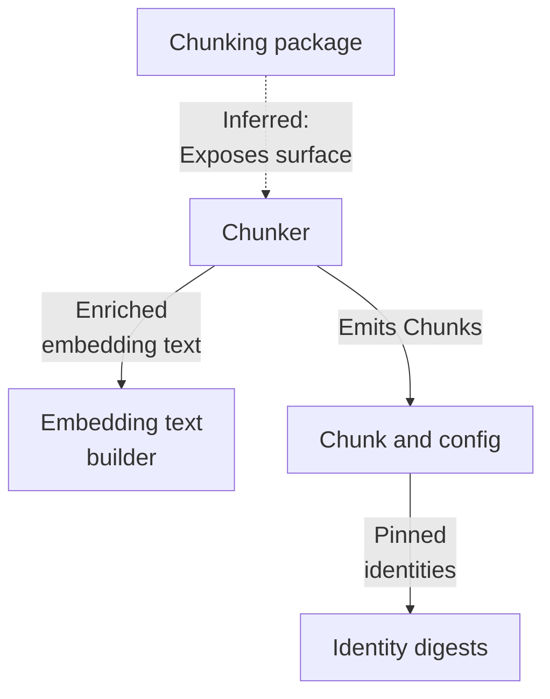
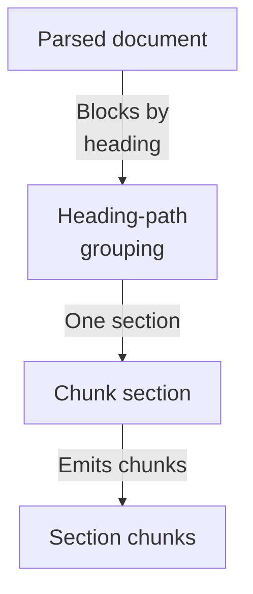
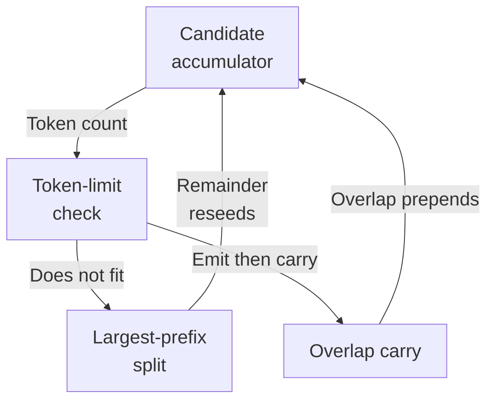
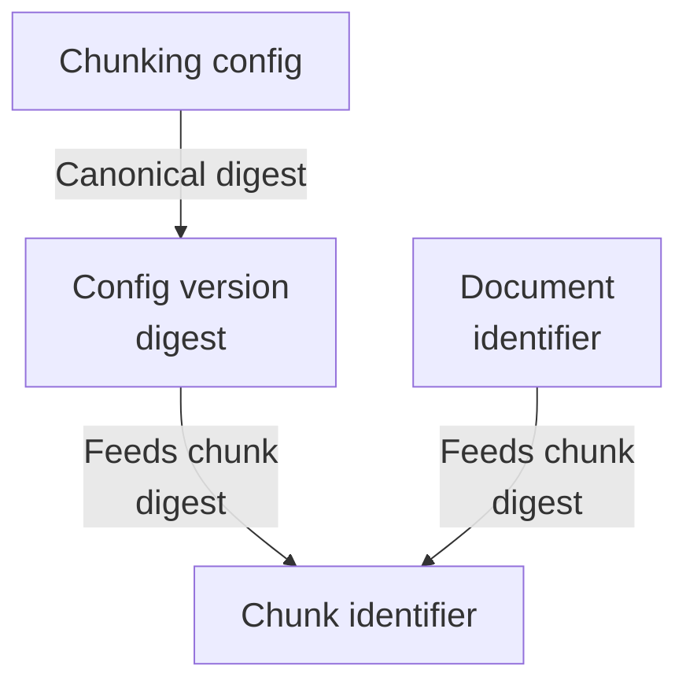

# Repository map

The chunking subsystem deterministically converts a ParsedDocument into content-addressed Chunks: it groups blocks by heading path, greedily packs them within a token budget with overlap, splits oversized blocks by prefix search, enriches text with reconstructed Markdown headings for embedding, and stamps identity digests derived from the config version and document id.

Commit: `56291a0b9cc466341d5d7a4b71aed8b2c5f412bb` | Generated: 2026-10-17T22:59:32.948438+00:00

[Open PDF](repository-map.pdf)

**AI-generated analysis. Source references are checked for existence and supplied scope; this does not prove semantic correctness.**

## Scope

Tracked, eligible text only; bounded excerpts, not exhaustive.

5/86 eligible files analyzed; 137 tracked files excluded by policy.

2 API calls. See coverage.json for budgets, exclusions, and usage.

## Architecture

The chunking package surface exposes the chunker, which reads parsed blocks and a tokenizer, produces enriched embedding text, and emits content-addressed Chunk contracts backed by identity and config digests.

PNG fallback

### Source evidence

- **F0014** (inferred): The chunking package's __init__ declares itself as 'Deterministic structure-aware document chunking', serving as the package surface, but the excerpts do not show which symbols it re-exports. (<a href="https://github.com/Justin-Mendoza/hybrid-rag-search/blob/56291a0b9cc466341d5d7a4b71aed8b2c5f412bb/backend/src/hybrid_rag_search/chunking/__init__.py#L1-L1">backend/src/hybrid_rag_search/chunking/__init__.py:1-1</a>)
- **F0001**: chunk_document is the public entry point that groups ParsedDocument.blocks by block.locator.heading_path via itertools.groupby and delegates each section to _chunk_section, guaranteeing no chunk crosses a heading boundary. (<a href="https://github.com/Justin-Mendoza/hybrid-rag-search/blob/56291a0b9cc466341d5d7a4b71aed8b2c5f412bb/backend/src/hybrid_rag_search/chunking/chunker.py#L1-L291">backend/src/hybrid_rag_search/chunking/chunker.py:1-291</a>)
- **F0002**: _chunk_section greedily packs whole ParsedBlocks into a candidate while _candidate's token_count (computed over embedding_text) stays within ChunkingConfig.max_tokens, emitting a Chunk and then seeding the next iteration with _trailing_overlap of config.overlap_tokens. (<a href="https://github.com/Justin-Mendoza/hybrid-rag-search/blob/56291a0b9cc466341d5d7a4b71aed8b2c5f412bb/backend/src/hybrid_rag_search/chunking/chunker.py#L1-L291">backend/src/hybrid_rag_search/chunking/chunker.py:1-291</a>)
- **F0003**: When a block does not fit, _largest_fitting_prefix performs a binary search over tokenizer token spans to find the largest text prefix whose candidate fits, splitting the block without losing character offsets; failure to fit even one source token raises ChunkingError. (<a href="https://github.com/Justin-Mendoza/hybrid-rag-search/blob/56291a0b9cc466341d5d7a4b71aed8b2c5f412bb/backend/src/hybrid_rag_search/chunking/chunker.py#L1-L291">backend/src/hybrid_rag_search/chunking/chunker.py:1-291</a>)
- **F0016**: In _chunk_section, when a heading-only fragment cannot be extended, the carry is progressively shrunk via _trailing_overlap down to a single token to make room for the pending block's prefix, which is an explicit failure-avoidance strategy inside the packing loop. (<a href="https://github.com/Justin-Mendoza/hybrid-rag-search/blob/56291a0b9cc466341d5d7a4b71aed8b2c5f412bb/backend/src/hybrid_rag_search/chunking/chunker.py#L1-L291">backend/src/hybrid_rag_search/chunking/chunker.py:1-291</a>)
- **F0004**: _candidate enforces the invariant that all fragments share one heading_path and raises ChunkingError otherwise, and builds embedding_text via build_embedding_text so token_count is measured on enriched text rather than raw content_text. (<a href="https://github.com/Justin-Mendoza/hybrid-rag-search/blob/56291a0b9cc466341d5d7a4b71aed8b2c5f412bb/backend/src/hybrid_rag_search/chunking/chunker.py#L1-L291">backend/src/hybrid_rag_search/chunking/chunker.py:1-291</a>)
- **F0006**: build_embedding_text reconstructs Markdown headings by enumerating heading_path with increasing # levels, and strips a leading heading block that duplicates the leaf heading so the heading is not embedded twice. (<a href="https://github.com/Justin-Mendoza/hybrid-rag-search/blob/56291a0b9cc466341d5d7a4b71aed8b2c5f412bb/backend/src/hybrid_rag_search/chunking/embedding_text.py#L1-L33">backend/src/hybrid_rag_search/chunking/embedding_text.py:1-33</a>)
- **F0005**: Each Chunk carries content_text, embedding_text, embedding_token_count, ordered source_spans, document_id, config_version, and order derived from a config version digest. (<a href="https://github.com/Justin-Mendoza/hybrid-rag-search/blob/56291a0b9cc466341d5d7a4b71aed8b2c5f412bb/backend/src/hybrid_rag_search/chunking/chunker.py#L1-L291">backend/src/hybrid_rag_search/chunking/chunker.py:1-291</a>, <a href="https://github.com/Justin-Mendoza/hybrid-rag-search/blob/56291a0b9cc466341d5d7a4b71aed8b2c5f412bb/backend/src/hybrid_rag_search/chunking/contracts.py#L1-L162">backend/src/hybrid_rag_search/chunking/contracts.py:1-162</a>)
- **F0007**: ChunkingConfig is an immutable, validated contract (frozen dataclass) enforcing positive max_tokens, nonnegative overlap_tokens smaller than max_tokens, and max_tokens not exceeding embedding_limit_tokens. (<a href="https://github.com/Justin-Mendoza/hybrid-rag-search/blob/56291a0b9cc466341d5d7a4b71aed8b2c5f412bb/backend/src/hybrid_rag_search/chunking/contracts.py#L1-L162">backend/src/hybrid_rag_search/chunking/contracts.py:1-162</a>)
- **F0010**: SourceSpan validation requires a SourceLocator, nonnegative start_char, positive end_char greater than start, and Chunk validation requires source_spans to be a nonempty tuple preserving source order by (block_number, start_char, end_char). (<a href="https://github.com/Justin-Mendoza/hybrid-rag-search/blob/56291a0b9cc466341d5d7a4b71aed8b2c5f412bb/backend/src/hybrid_rag_search/chunking/contracts.py#L1-L162">backend/src/hybrid_rag_search/chunking/contracts.py:1-162</a>)
- **F0012**: Chunk validation requires document_id to match doc_[0-9a-f]{64} and config_version to match chunkcfg_[0-9a-f]{64}, coupling chunk output to identities produced by identity.py and ChunkingConfig.version. (<a href="https://github.com/Justin-Mendoza/hybrid-rag-search/blob/56291a0b9cc466341d5d7a4b71aed8b2c5f412bb/backend/src/hybrid_rag_search/chunking/contracts.py#L1-L162">backend/src/hybrid_rag_search/chunking/contracts.py:1-162</a>, <a href="https://github.com/Justin-Mendoza/hybrid-rag-search/blob/56291a0b9cc466341d5d7a4b71aed8b2c5f412bb/backend/src/hybrid_rag_search/chunking/identity.py#L1-L49">backend/src/hybrid_rag_search/chunking/identity.py:1-49</a>)
- **F0013**: ChunkingConfig defaults pin the tokenizer to COHERE_EMBED_ENGLISH_LIGHT_V3 (model, revision, sha256), and embedding_limit_tokens defaults to EMBEDDING_LIMIT_TOKENS = 512. (<a href="https://github.com/Justin-Mendoza/hybrid-rag-search/blob/56291a0b9cc466341d5d7a4b71aed8b2c5f412bb/backend/src/hybrid_rag_search/chunking/contracts.py#L1-L162">backend/src/hybrid_rag_search/chunking/contracts.py:1-162</a>)
- **F0008**: ChunkingConfig.version is a deterministic chunkcfg_ identity computed from a canonical JSON digest over algorithm, tokenizer model/revision/sha256, and token limits, pinning the chunking interpretation. (<a href="https://github.com/Justin-Mendoza/hybrid-rag-search/blob/56291a0b9cc466341d5d7a4b71aed8b2c5f412bb/backend/src/hybrid_rag_search/chunking/contracts.py#L1-L162">backend/src/hybrid_rag_search/chunking/contracts.py:1-162</a>)
- **F0009**: Chunk.chunk_id is a content-addressed chk_ digest over document_id, config_version, order, content_text, embedding_text, and each span's canonical_value, so identity changes whenever chunk content or config changes. (<a href="https://github.com/Justin-Mendoza/hybrid-rag-search/blob/56291a0b9cc466341d5d7a4b71aed8b2c5f412bb/backend/src/hybrid_rag_search/chunking/contracts.py#L1-L162">backend/src/hybrid_rag_search/chunking/contracts.py:1-162</a>)
- **F0011**: stable_digest hashes length-prefixed UTF-8 fields within a versioned namespace prefix 'hybrid-rag-search/{namespace}/v{IDENTITY_VERSION}', and DocumentContentIdentity.document_id derives 'doc_'+digest from tenant_id, collection_id, and content_sha256. (<a href="https://github.com/Justin-Mendoza/hybrid-rag-search/blob/56291a0b9cc466341d5d7a4b71aed8b2c5f412bb/backend/src/hybrid_rag_search/chunking/identity.py#L1-L49">backend/src/hybrid_rag_search/chunking/identity.py:1-49</a>)

## Section chunking boundary

Blocks are grouped by heading path so chunking operates per section, ensuring no chunk spans a heading boundary. The section boundary is the key isolation guarantee.

PNG fallback

### Source evidence

- **F0001**: chunk_document is the public entry point that groups ParsedDocument.blocks by block.locator.heading_path via itertools.groupby and delegates each section to _chunk_section, guaranteeing no chunk crosses a heading boundary. (<a href="https://github.com/Justin-Mendoza/hybrid-rag-search/blob/56291a0b9cc466341d5d7a4b71aed8b2c5f412bb/backend/src/hybrid_rag_search/chunking/chunker.py#L1-L291">backend/src/hybrid_rag_search/chunking/chunker.py:1-291</a>)
- **F0004**: _candidate enforces the invariant that all fragments share one heading_path and raises ChunkingError otherwise, and builds embedding_text via build_embedding_text so token_count is measured on enriched text rather than raw content_text. (<a href="https://github.com/Justin-Mendoza/hybrid-rag-search/blob/56291a0b9cc466341d5d7a4b71aed8b2c5f412bb/backend/src/hybrid_rag_search/chunking/chunker.py#L1-L291">backend/src/hybrid_rag_search/chunking/chunker.py:1-291</a>)
- **F0002**: _chunk_section greedily packs whole ParsedBlocks into a candidate while _candidate's token_count (computed over embedding_text) stays within ChunkingConfig.max_tokens, emitting a Chunk and then seeding the next iteration with _trailing_overlap of config.overlap_tokens. (<a href="https://github.com/Justin-Mendoza/hybrid-rag-search/blob/56291a0b9cc466341d5d7a4b71aed8b2c5f412bb/backend/src/hybrid_rag_search/chunking/chunker.py#L1-L291">backend/src/hybrid_rag_search/chunking/chunker.py:1-291</a>)
- **F0005**: Each Chunk carries content_text, embedding_text, embedding_token_count, ordered source_spans, document_id, config_version, and order derived from a config version digest. (<a href="https://github.com/Justin-Mendoza/hybrid-rag-search/blob/56291a0b9cc466341d5d7a4b71aed8b2c5f412bb/backend/src/hybrid_rag_search/chunking/chunker.py#L1-L291">backend/src/hybrid_rag_search/chunking/chunker.py:1-291</a>, <a href="https://github.com/Justin-Mendoza/hybrid-rag-search/blob/56291a0b9cc466341d5d7a4b71aed8b2c5f412bb/backend/src/hybrid_rag_search/chunking/contracts.py#L1-L162">backend/src/hybrid_rag_search/chunking/contracts.py:1-162</a>)

## Greedy packing and splitting

Blocks accumulate while the candidate token count stays within the limit; oversized blocks are split by binary prefix search, and trailing overlap seeds the next candidate.

PNG fallback

### Source evidence

- **F0002**: _chunk_section greedily packs whole ParsedBlocks into a candidate while _candidate's token_count (computed over embedding_text) stays within ChunkingConfig.max_tokens, emitting a Chunk and then seeding the next iteration with _trailing_overlap of config.overlap_tokens. (<a href="https://github.com/Justin-Mendoza/hybrid-rag-search/blob/56291a0b9cc466341d5d7a4b71aed8b2c5f412bb/backend/src/hybrid_rag_search/chunking/chunker.py#L1-L291">backend/src/hybrid_rag_search/chunking/chunker.py:1-291</a>)
- **F0004**: _candidate enforces the invariant that all fragments share one heading_path and raises ChunkingError otherwise, and builds embedding_text via build_embedding_text so token_count is measured on enriched text rather than raw content_text. (<a href="https://github.com/Justin-Mendoza/hybrid-rag-search/blob/56291a0b9cc466341d5d7a4b71aed8b2c5f412bb/backend/src/hybrid_rag_search/chunking/chunker.py#L1-L291">backend/src/hybrid_rag_search/chunking/chunker.py:1-291</a>)
- **F0003**: When a block does not fit, _largest_fitting_prefix performs a binary search over tokenizer token spans to find the largest text prefix whose candidate fits, splitting the block without losing character offsets; failure to fit even one source token raises ChunkingError. (<a href="https://github.com/Justin-Mendoza/hybrid-rag-search/blob/56291a0b9cc466341d5d7a4b71aed8b2c5f412bb/backend/src/hybrid_rag_search/chunking/chunker.py#L1-L291">backend/src/hybrid_rag_search/chunking/chunker.py:1-291</a>)
- **F0016**: In _chunk_section, when a heading-only fragment cannot be extended, the carry is progressively shrunk via _trailing_overlap down to a single token to make room for the pending block's prefix, which is an explicit failure-avoidance strategy inside the packing loop. (<a href="https://github.com/Justin-Mendoza/hybrid-rag-search/blob/56291a0b9cc466341d5d7a4b71aed8b2c5f412bb/backend/src/hybrid_rag_search/chunking/chunker.py#L1-L291">backend/src/hybrid_rag_search/chunking/chunker.py:1-291</a>)

## Config and identity derivation

ChunkingConfig validates limits and derives a deterministic version digest pinning the tokenizer; Chunk ids combine document id, config version, order, and canonical content.

PNG fallback

### Source evidence

- **F0007**: ChunkingConfig is an immutable, validated contract (frozen dataclass) enforcing positive max_tokens, nonnegative overlap_tokens smaller than max_tokens, and max_tokens not exceeding embedding_limit_tokens. (<a href="https://github.com/Justin-Mendoza/hybrid-rag-search/blob/56291a0b9cc466341d5d7a4b71aed8b2c5f412bb/backend/src/hybrid_rag_search/chunking/contracts.py#L1-L162">backend/src/hybrid_rag_search/chunking/contracts.py:1-162</a>)
- **F0013**: ChunkingConfig defaults pin the tokenizer to COHERE_EMBED_ENGLISH_LIGHT_V3 (model, revision, sha256), and embedding_limit_tokens defaults to EMBEDDING_LIMIT_TOKENS = 512. (<a href="https://github.com/Justin-Mendoza/hybrid-rag-search/blob/56291a0b9cc466341d5d7a4b71aed8b2c5f412bb/backend/src/hybrid_rag_search/chunking/contracts.py#L1-L162">backend/src/hybrid_rag_search/chunking/contracts.py:1-162</a>)
- **F0008**: ChunkingConfig.version is a deterministic chunkcfg_ identity computed from a canonical JSON digest over algorithm, tokenizer model/revision/sha256, and token limits, pinning the chunking interpretation. (<a href="https://github.com/Justin-Mendoza/hybrid-rag-search/blob/56291a0b9cc466341d5d7a4b71aed8b2c5f412bb/backend/src/hybrid_rag_search/chunking/contracts.py#L1-L162">backend/src/hybrid_rag_search/chunking/contracts.py:1-162</a>)
- **F0009**: Chunk.chunk_id is a content-addressed chk_ digest over document_id, config_version, order, content_text, embedding_text, and each span's canonical_value, so identity changes whenever chunk content or config changes. (<a href="https://github.com/Justin-Mendoza/hybrid-rag-search/blob/56291a0b9cc466341d5d7a4b71aed8b2c5f412bb/backend/src/hybrid_rag_search/chunking/contracts.py#L1-L162">backend/src/hybrid_rag_search/chunking/contracts.py:1-162</a>)
- **F0012**: Chunk validation requires document_id to match doc_[0-9a-f]{64} and config_version to match chunkcfg_[0-9a-f]{64}, coupling chunk output to identities produced by identity.py and ChunkingConfig.version. (<a href="https://github.com/Justin-Mendoza/hybrid-rag-search/blob/56291a0b9cc466341d5d7a4b71aed8b2c5f412bb/backend/src/hybrid_rag_search/chunking/contracts.py#L1-L162">backend/src/hybrid_rag_search/chunking/contracts.py:1-162</a>, <a href="https://github.com/Justin-Mendoza/hybrid-rag-search/blob/56291a0b9cc466341d5d7a4b71aed8b2c5f412bb/backend/src/hybrid_rag_search/chunking/identity.py#L1-L49">backend/src/hybrid_rag_search/chunking/identity.py:1-49</a>)
- **F0011**: stable_digest hashes length-prefixed UTF-8 fields within a versioned namespace prefix 'hybrid-rag-search/{namespace}/v{IDENTITY_VERSION}', and DocumentContentIdentity.document_id derives 'doc_'+digest from tenant_id, collection_id, and content_sha256. (<a href="https://github.com/Justin-Mendoza/hybrid-rag-search/blob/56291a0b9cc466341d5d7a4b71aed8b2c5f412bb/backend/src/hybrid_rag_search/chunking/identity.py#L1-L49">backend/src/hybrid_rag_search/chunking/identity.py:1-49</a>)

## Uncertainties and untraced areas

- No runtime call site invoking chunk_document is shown; wiring to upstream parsing and downstream embedding/indexing is inferred from imports alone (F0015).
- How ParsedDocument/ParsedBlock are produced upstream of chunking is not covered by these findings (F0015).
- How emitted Chunks are consumed downstream (embedding, indexing, storage) is outside the supplied evidence.
- Which symbols the chunking package __init__ re-exports is not shown (F0014).
