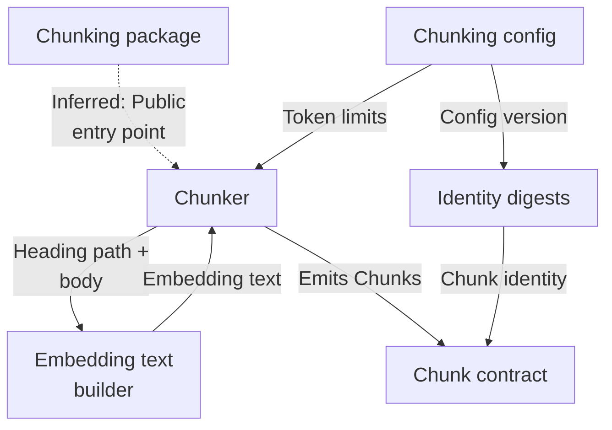
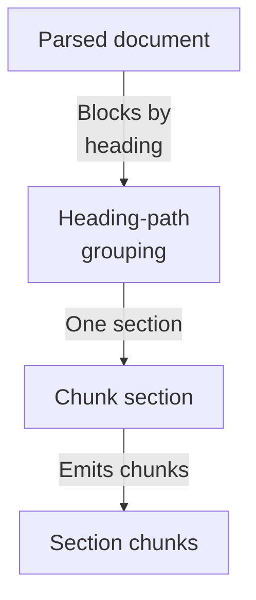
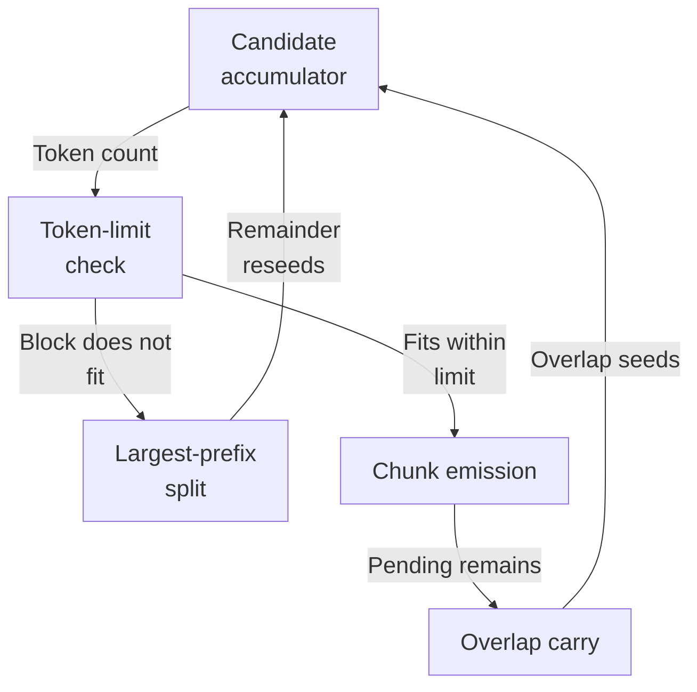
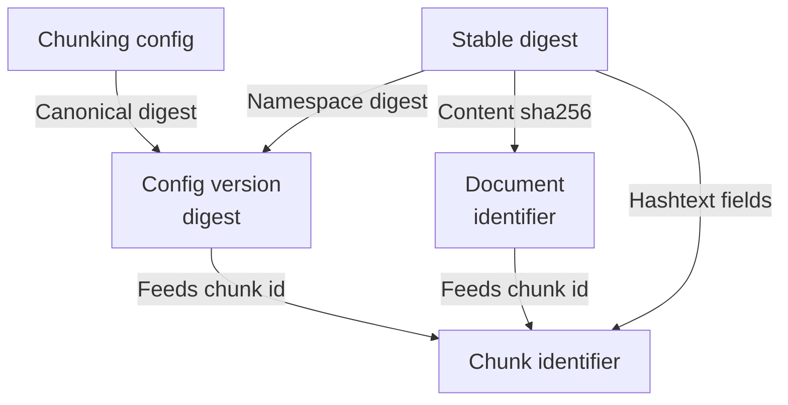

# Repository map

The chunking subsystem deterministically converts a ParsedDocument into content-addressed Chunks. It groups parsed blocks by heading path so no chunk crosses a section boundary, greedily packs whole blocks within a token budget with trailing overlap, splits oversized blocks by binary prefix search, and enriches text with reconstructed Markdown headings for embedding while stamping config-version and document-derived identity digests.

Commit: `f8493c1d264c525948d9d33ffaf2dd197be97e26` | Generated: 2026-10-18T18:36:01.162392+00:00

[Open PDF](repository-map.pdf)

**AI-generated analysis. Source references are checked for existence and supplied scope; this does not prove semantic correctness.**

## Scope

Tracked, eligible text only; bounded excerpts, not exhaustive.

5/80 eligible files analyzed; 143 tracked files excluded by policy.

2 API calls. See coverage.json for budgets, exclusions, and usage.

## Architecture

The chunking package groups parsed blocks per heading section, packs them under the token budget, enriches embedding text, and emits Chunk contracts whose identities are derived from config and document digests.

PNG fallback

### Source evidence

- **F0016** (inferred): The chunking package __init__ docstring describes the subsystem as 'Deterministic structure-aware document chunking', but the specific symbols it re-exports are not shown in the supplied source. (<a href="https://github.com/Justin-Mendoza/hybrid-rag-search/blob/f8493c1d264c525948d9d33ffaf2dd197be97e26/backend/src/hybrid_rag_search/chunking/__init__.py#L1-L1">backend/src/hybrid_rag_search/chunking/__init__.py:1-1</a>)
- **F0001**: chunk_document is the package's public entry point: it takes a document_id, a ParsedDocument, a TextTokenizer, and an optional ChunkingConfig (defaulting to DEFAULT_CHUNKING_CONFIG) and returns a tuple of Chunk records. (<a href="https://github.com/Justin-Mendoza/hybrid-rag-search/blob/f8493c1d264c525948d9d33ffaf2dd197be97e26/backend/src/hybrid_rag_search/chunking/chunker.py#L1-L291">backend/src/hybrid_rag_search/chunking/chunker.py:1-291</a>, <a href="https://github.com/Justin-Mendoza/hybrid-rag-search/blob/f8493c1d264c525948d9d33ffaf2dd197be97e26/backend/src/hybrid_rag_search/chunking/contracts.py#L1-L162">backend/src/hybrid_rag_search/chunking/contracts.py:1-162</a>)
- **F0002**: chunk_document groups parsed blocks with itertools.groupby keyed on block.locator.heading_path, then delegates each section to _chunk_section, so chunking is performed section-by-section and a chunk never crosses a heading boundary. (<a href="https://github.com/Justin-Mendoza/hybrid-rag-search/blob/f8493c1d264c525948d9d33ffaf2dd197be97e26/backend/src/hybrid_rag_search/chunking/chunker.py#L1-L291">backend/src/hybrid_rag_search/chunking/chunker.py:1-291</a>)
- **F0003**: _candidate enforces the heading-boundary invariant by raising ChunkingError when fragments in one candidate carry differing heading_path values. (<a href="https://github.com/Justin-Mendoza/hybrid-rag-search/blob/f8493c1d264c525948d9d33ffaf2dd197be97e26/backend/src/hybrid_rag_search/chunking/chunker.py#L1-L291">backend/src/hybrid_rag_search/chunking/chunker.py:1-291</a>)
- **F0004**: _chunk_section greedily appends whole blocks to the current candidate while _candidate's token count stays within config.max_tokens, then emits a Chunk via _make_chunk with order = first_order + len(chunks). (<a href="https://github.com/Justin-Mendoza/hybrid-rag-search/blob/f8493c1d264c525948d9d33ffaf2dd197be97e26/backend/src/hybrid_rag_search/chunking/chunker.py#L1-L291">backend/src/hybrid_rag_search/chunking/chunker.py:1-291</a>)
- **F0013**: build_embedding_text reconstructs Markdown headings ('#' * level + heading) from heading_path and joins them to the body, dropping a duplicated leading heading block by recognizing it as the content prefix; this produces the enriched embedding_text stored separately from content_text. (<a href="https://github.com/Justin-Mendoza/hybrid-rag-search/blob/f8493c1d264c525948d9d33ffaf2dd197be97e26/backend/src/hybrid_rag_search/chunking/embedding_text.py#L1-L33">backend/src/hybrid_rag_search/chunking/embedding_text.py:1-33</a>, <a href="https://github.com/Justin-Mendoza/hybrid-rag-search/blob/f8493c1d264c525948d9d33ffaf2dd197be97e26/backend/src/hybrid_rag_search/chunking/chunker.py#L1-L291">backend/src/hybrid_rag_search/chunking/chunker.py:1-291</a>)
- **F0014**: _candidate computes embedding_text via build_embedding_text and sets token_count from len(tokenizer.tokenize(embedding_text)), so token budgeting is measured against the enriched embedding text rather than raw content. (<a href="https://github.com/Justin-Mendoza/hybrid-rag-search/blob/f8493c1d264c525948d9d33ffaf2dd197be97e26/backend/src/hybrid_rag_search/chunking/chunker.py#L1-L291">backend/src/hybrid_rag_search/chunking/chunker.py:1-291</a>, <a href="https://github.com/Justin-Mendoza/hybrid-rag-search/blob/f8493c1d264c525948d9d33ffaf2dd197be97e26/backend/src/hybrid_rag_search/chunking/embedding_text.py#L1-L33">backend/src/hybrid_rag_search/chunking/embedding_text.py:1-33</a>)
- **F0011**: Chunk.chunk_id is a chk_-prefixed stable_digest over document_id, config_version, order, content_text, embedding_text, and each source span's canonical_value, making chunk identity content-addressed and rebuildable. (<a href="https://github.com/Justin-Mendoza/hybrid-rag-search/blob/f8493c1d264c525948d9d33ffaf2dd197be97e26/backend/src/hybrid_rag_search/chunking/contracts.py#L1-L162">backend/src/hybrid_rag_search/chunking/contracts.py:1-162</a>)
- **F0012**: Chunk.__post_init__ requires nonempty source_spans, rejects spans whose (block_number, start_char, end_char) positions are not in source order, and validates document_id, config_version, order, and nonblank content/embedding text. (<a href="https://github.com/Justin-Mendoza/hybrid-rag-search/blob/f8493c1d264c525948d9d33ffaf2dd197be97e26/backend/src/hybrid_rag_search/chunking/contracts.py#L1-L162">backend/src/hybrid_rag_search/chunking/contracts.py:1-162</a>)
- **F0007**: ChunkingConfig in contracts.py validates max_tokens (positive), overlap_tokens (nonnegative and less than max_tokens), embedding_limit_tokens (positive, and max_tokens must not exceed it), nonblank tokenizer/algorithm strings, and a 64-hex tokenizer_sha256. (<a href="https://github.com/Justin-Mendoza/hybrid-rag-search/blob/f8493c1d264c525948d9d33ffaf2dd197be97e26/backend/src/hybrid_rag_search/chunking/contracts.py#L1-L162">backend/src/hybrid_rag_search/chunking/contracts.py:1-162</a>)
- **F0008**: ChunkingConfig.version canonicalizes the algorithm, embedding_limit_tokens, max_tokens, overlap_tokens, tokenizer model/revision/sha256 via sorted-key JSON and returns a chunkcfg_-prefixed stable_digest, so any of these values changing produces a new config version. (<a href="https://github.com/Justin-Mendoza/hybrid-rag-search/blob/f8493c1d264c525948d9d33ffaf2dd197be97e26/backend/src/hybrid_rag_search/chunking/contracts.py#L1-L162">backend/src/hybrid_rag_search/chunking/contracts.py:1-162</a>, <a href="https://github.com/Justin-Mendoza/hybrid-rag-search/blob/f8493c1d264c525948d9d33ffaf2dd197be97e26/backend/src/hybrid_rag_search/chunking/identity.py#L1-L49">backend/src/hybrid_rag_search/chunking/identity.py:1-49</a>)
- **F0009**: stable_digest builds a SHA-256 over a versioned namespace header plus length-prefixed UTF-8 fields, which is the shared identity primitive used for config versions, document IDs, and chunk IDs. (<a href="https://github.com/Justin-Mendoza/hybrid-rag-search/blob/f8493c1d264c525948d9d33ffaf2dd197be97e26/backend/src/hybrid_rag_search/chunking/identity.py#L1-L49">backend/src/hybrid_rag_search/chunking/identity.py:1-49</a>)
- **F0010**: DocumentContentIdentity.document_id derives a doc_-prefixed identity from tenant_id, collection_id, and content_sha256, and Chunk validates document_id against the doc_[0-9a-f]{64} pattern. (<a href="https://github.com/Justin-Mendoza/hybrid-rag-search/blob/f8493c1d264c525948d9d33ffaf2dd197be97e26/backend/src/hybrid_rag_search/chunking/identity.py#L1-L49">backend/src/hybrid_rag_search/chunking/identity.py:1-49</a>, <a href="https://github.com/Justin-Mendoza/hybrid-rag-search/blob/f8493c1d264c525948d9d33ffaf2dd197be97e26/backend/src/hybrid_rag_search/chunking/contracts.py#L1-L162">backend/src/hybrid_rag_search/chunking/contracts.py:1-162</a>)
- **F0015**: _make_chunk raises ChunkingError when the candidate's embedding_token_count is not positive, and _chunk_section raises ChunkingError when heading context plus a single source token cannot fit in the token limit. (<a href="https://github.com/Justin-Mendoza/hybrid-rag-search/blob/f8493c1d264c525948d9d33ffaf2dd197be97e26/backend/src/hybrid_rag_search/chunking/chunker.py#L1-L291">backend/src/hybrid_rag_search/chunking/chunker.py:1-291</a>)

## Section boundary

Blocks are grouped by heading path so chunking operates per section; the heading boundary is enforced so no chunk spans sections.

PNG fallback

### Source evidence

- **F0001**: chunk_document is the package's public entry point: it takes a document_id, a ParsedDocument, a TextTokenizer, and an optional ChunkingConfig (defaulting to DEFAULT_CHUNKING_CONFIG) and returns a tuple of Chunk records. (<a href="https://github.com/Justin-Mendoza/hybrid-rag-search/blob/f8493c1d264c525948d9d33ffaf2dd197be97e26/backend/src/hybrid_rag_search/chunking/chunker.py#L1-L291">backend/src/hybrid_rag_search/chunking/chunker.py:1-291</a>, <a href="https://github.com/Justin-Mendoza/hybrid-rag-search/blob/f8493c1d264c525948d9d33ffaf2dd197be97e26/backend/src/hybrid_rag_search/chunking/contracts.py#L1-L162">backend/src/hybrid_rag_search/chunking/contracts.py:1-162</a>)
- **F0002**: chunk_document groups parsed blocks with itertools.groupby keyed on block.locator.heading_path, then delegates each section to _chunk_section, so chunking is performed section-by-section and a chunk never crosses a heading boundary. (<a href="https://github.com/Justin-Mendoza/hybrid-rag-search/blob/f8493c1d264c525948d9d33ffaf2dd197be97e26/backend/src/hybrid_rag_search/chunking/chunker.py#L1-L291">backend/src/hybrid_rag_search/chunking/chunker.py:1-291</a>)
- **F0004**: _chunk_section greedily appends whole blocks to the current candidate while _candidate's token count stays within config.max_tokens, then emits a Chunk via _make_chunk with order = first_order + len(chunks). (<a href="https://github.com/Justin-Mendoza/hybrid-rag-search/blob/f8493c1d264c525948d9d33ffaf2dd197be97e26/backend/src/hybrid_rag_search/chunking/chunker.py#L1-L291">backend/src/hybrid_rag_search/chunking/chunker.py:1-291</a>)
- **F0011**: Chunk.chunk_id is a chk_-prefixed stable_digest over document_id, config_version, order, content_text, embedding_text, and each source span's canonical_value, making chunk identity content-addressed and rebuildable. (<a href="https://github.com/Justin-Mendoza/hybrid-rag-search/blob/f8493c1d264c525948d9d33ffaf2dd197be97e26/backend/src/hybrid_rag_search/chunking/contracts.py#L1-L162">backend/src/hybrid_rag_search/chunking/contracts.py:1-162</a>)

## Packing and splitting

Blocks accumulate while the candidate stays within the token budget; oversized blocks are split by binary prefix search, and trailing overlap seeds the next candidate when pending blocks remain.

PNG fallback

### Source evidence

- **F0003**: _candidate enforces the heading-boundary invariant by raising ChunkingError when fragments in one candidate carry differing heading_path values. (<a href="https://github.com/Justin-Mendoza/hybrid-rag-search/blob/f8493c1d264c525948d9d33ffaf2dd197be97e26/backend/src/hybrid_rag_search/chunking/chunker.py#L1-L291">backend/src/hybrid_rag_search/chunking/chunker.py:1-291</a>)
- **F0004**: _chunk_section greedily appends whole blocks to the current candidate while _candidate's token count stays within config.max_tokens, then emits a Chunk via _make_chunk with order = first_order + len(chunks). (<a href="https://github.com/Justin-Mendoza/hybrid-rag-search/blob/f8493c1d264c525948d9d33ffaf2dd197be97e26/backend/src/hybrid_rag_search/chunking/chunker.py#L1-L291">backend/src/hybrid_rag_search/chunking/chunker.py:1-291</a>)
- **F0014**: _candidate computes embedding_text via build_embedding_text and sets token_count from len(tokenizer.tokenize(embedding_text)), so token budgeting is measured against the enriched embedding text rather than raw content. (<a href="https://github.com/Justin-Mendoza/hybrid-rag-search/blob/f8493c1d264c525948d9d33ffaf2dd197be97e26/backend/src/hybrid_rag_search/chunking/chunker.py#L1-L291">backend/src/hybrid_rag_search/chunking/chunker.py:1-291</a>, <a href="https://github.com/Justin-Mendoza/hybrid-rag-search/blob/f8493c1d264c525948d9d33ffaf2dd197be97e26/backend/src/hybrid_rag_search/chunking/embedding_text.py#L1-L33">backend/src/hybrid_rag_search/chunking/embedding_text.py:1-33</a>)
- **F0005**: When a block does not fit, _largest_fitting_prefix performs a binary search over the block's token spans (using TextTokenizer.tokenize) to find the largest prefix that keeps the candidate within max_tokens, and the split remainder is reseeded as the next pending fragment. (<a href="https://github.com/Justin-Mendoza/hybrid-rag-search/blob/f8493c1d264c525948d9d33ffaf2dd197be97e26/backend/src/hybrid_rag_search/chunking/chunker.py#L1-L291">backend/src/hybrid_rag_search/chunking/chunker.py:1-291</a>)
- **F0006**: After emitting a chunk with remaining pending blocks, _trailing_overlap computes carry fragments from the last config.overlap_tokens tokens of the candidate's content text, seeding the next candidate; overlap is suppressed when no pending blocks remain. (<a href="https://github.com/Justin-Mendoza/hybrid-rag-search/blob/f8493c1d264c525948d9d33ffaf2dd197be97e26/backend/src/hybrid_rag_search/chunking/chunker.py#L1-L291">backend/src/hybrid_rag_search/chunking/chunker.py:1-291</a>)
- **F0015**: _make_chunk raises ChunkingError when the candidate's embedding_token_count is not positive, and _chunk_section raises ChunkingError when heading context plus a single source token cannot fit in the token limit. (<a href="https://github.com/Justin-Mendoza/hybrid-rag-search/blob/f8493c1d264c525948d9d33ffaf2dd197be97e26/backend/src/hybrid_rag_search/chunking/chunker.py#L1-L291">backend/src/hybrid_rag_search/chunking/chunker.py:1-291</a>)

## Identity derivation

ChunkingConfig validates limits and derives a version digest pinning the tokenizer; chunk ids combine document id, config version, order, and canonical content via a shared digest primitive.

PNG fallback

### Source evidence

- **F0007**: ChunkingConfig in contracts.py validates max_tokens (positive), overlap_tokens (nonnegative and less than max_tokens), embedding_limit_tokens (positive, and max_tokens must not exceed it), nonblank tokenizer/algorithm strings, and a 64-hex tokenizer_sha256. (<a href="https://github.com/Justin-Mendoza/hybrid-rag-search/blob/f8493c1d264c525948d9d33ffaf2dd197be97e26/backend/src/hybrid_rag_search/chunking/contracts.py#L1-L162">backend/src/hybrid_rag_search/chunking/contracts.py:1-162</a>)
- **F0008**: ChunkingConfig.version canonicalizes the algorithm, embedding_limit_tokens, max_tokens, overlap_tokens, tokenizer model/revision/sha256 via sorted-key JSON and returns a chunkcfg_-prefixed stable_digest, so any of these values changing produces a new config version. (<a href="https://github.com/Justin-Mendoza/hybrid-rag-search/blob/f8493c1d264c525948d9d33ffaf2dd197be97e26/backend/src/hybrid_rag_search/chunking/contracts.py#L1-L162">backend/src/hybrid_rag_search/chunking/contracts.py:1-162</a>, <a href="https://github.com/Justin-Mendoza/hybrid-rag-search/blob/f8493c1d264c525948d9d33ffaf2dd197be97e26/backend/src/hybrid_rag_search/chunking/identity.py#L1-L49">backend/src/hybrid_rag_search/chunking/identity.py:1-49</a>)
- **F0011**: Chunk.chunk_id is a chk_-prefixed stable_digest over document_id, config_version, order, content_text, embedding_text, and each source span's canonical_value, making chunk identity content-addressed and rebuildable. (<a href="https://github.com/Justin-Mendoza/hybrid-rag-search/blob/f8493c1d264c525948d9d33ffaf2dd197be97e26/backend/src/hybrid_rag_search/chunking/contracts.py#L1-L162">backend/src/hybrid_rag_search/chunking/contracts.py:1-162</a>)
- **F0012**: Chunk.__post_init__ requires nonempty source_spans, rejects spans whose (block_number, start_char, end_char) positions are not in source order, and validates document_id, config_version, order, and nonblank content/embedding text. (<a href="https://github.com/Justin-Mendoza/hybrid-rag-search/blob/f8493c1d264c525948d9d33ffaf2dd197be97e26/backend/src/hybrid_rag_search/chunking/contracts.py#L1-L162">backend/src/hybrid_rag_search/chunking/contracts.py:1-162</a>)
- **F0010**: DocumentContentIdentity.document_id derives a doc_-prefixed identity from tenant_id, collection_id, and content_sha256, and Chunk validates document_id against the doc_[0-9a-f]{64} pattern. (<a href="https://github.com/Justin-Mendoza/hybrid-rag-search/blob/f8493c1d264c525948d9d33ffaf2dd197be97e26/backend/src/hybrid_rag_search/chunking/identity.py#L1-L49">backend/src/hybrid_rag_search/chunking/identity.py:1-49</a>, <a href="https://github.com/Justin-Mendoza/hybrid-rag-search/blob/f8493c1d264c525948d9d33ffaf2dd197be97e26/backend/src/hybrid_rag_search/chunking/contracts.py#L1-L162">backend/src/hybrid_rag_search/chunking/contracts.py:1-162</a>)
- **F0009**: stable_digest builds a SHA-256 over a versioned namespace header plus length-prefixed UTF-8 fields, which is the shared identity primitive used for config versions, document IDs, and chunk IDs. (<a href="https://github.com/Justin-Mendoza/hybrid-rag-search/blob/f8493c1d264c525948d9d33ffaf2dd197be97e26/backend/src/hybrid_rag_search/chunking/identity.py#L1-L49">backend/src/hybrid_rag_search/chunking/identity.py:1-49</a>)

## Uncertainties and untraced areas

- No runtime call site invoking chunk_document is shown; wiring to upstream parsing and downstream embedding or indexing is inferred from the public entry point alone (F0001, F0016).
- How ParsedDocument and ParsedBlock are produced upstream of chunking is not covered by these findings.
- How emitted Chunks are consumed downstream (embedding, indexing, storage) is outside the supplied evidence.
- Which symbols the chunking package __init__ re-exports is not shown (F0016).
- The relationship between ChunkingConfig.embedding_limit_tokens and any downstream embedding model is not evidenced beyond validation (F0007).
