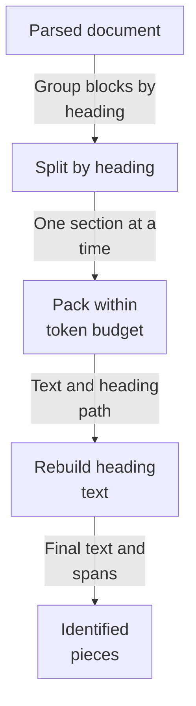
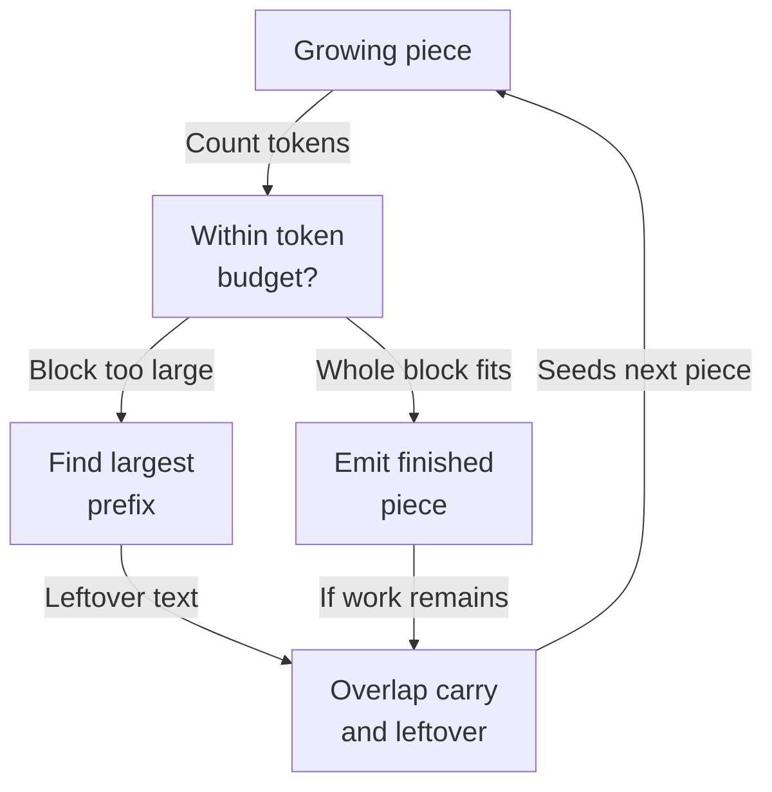
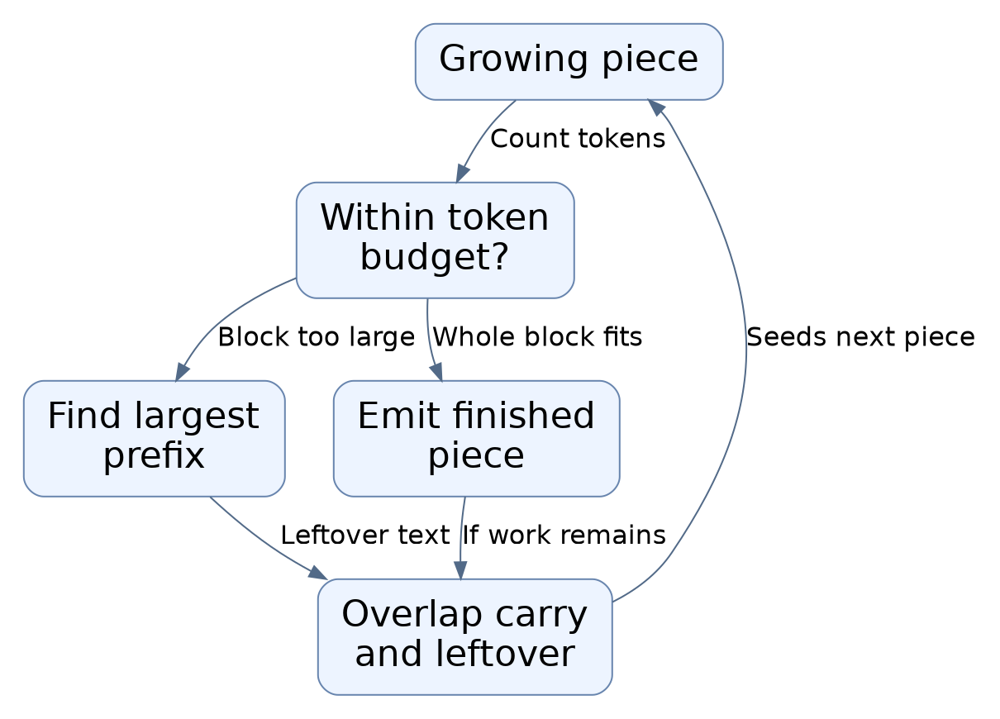
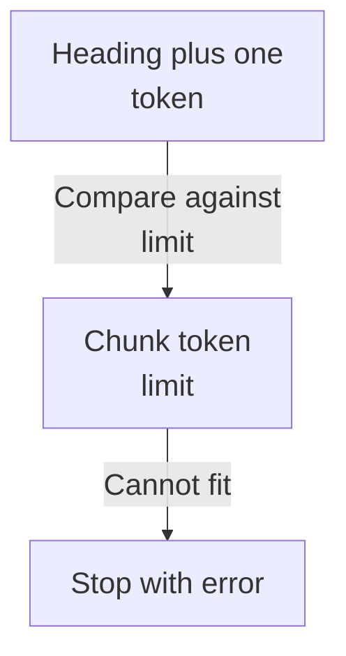
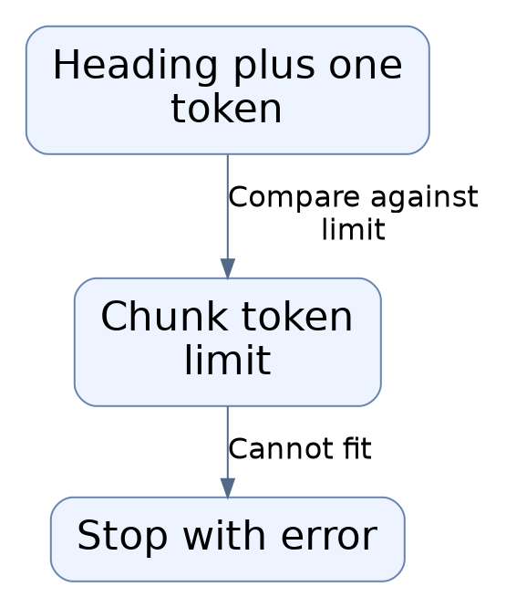
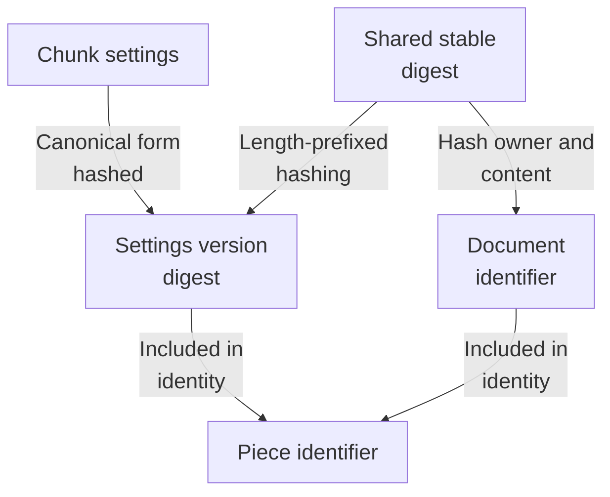
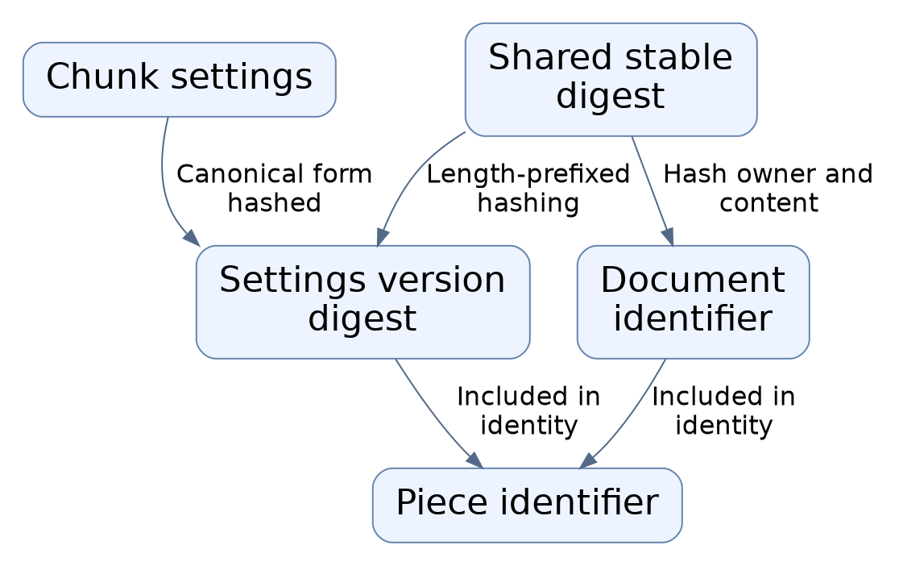

# Repository map

This area turns a parsed document into ordered, ready-to-search pieces. It keeps each piece inside one heading section, packs text up to a token budget with a little overlap, and rebuilds Markdown headings so context is preserved. Each piece gets a stable identifier derived from its document, settings, and content. It runs as a library step; how it is called or where results go next is not shown.

Commit: `3537e913c1eeec5b5f34d6cbdbf4dc3f8bc74b25` | Generated: 2026-10-19T00:25:15.681194+00:00

[Open PDF](repository-map.pdf)

**AI-generated analysis. Source references are checked for existence and supplied scope; this does not prove semantic correctness.**

## Scope

Tracked, eligible text only; bounded excerpts, not exhaustive.

5/80 eligible files analyzed; 143 tracked files excluded by policy.

2 API calls. See coverage.json for budgets, exclusions, and usage.

## How a parsed document becomes searchable pieces

A parsed document is split by heading section, packed into token-budgeted pieces with overlap, enriched with reconstructed headings, and given stable identifiers.

PNG fallback

Read from top to bottom; arrows show what happens next or what is passed along.

### Source evidence

- **F0001**: chunk_document is the subsystem's entry point: it accepts a document_id, a ParsedDocument, a TextTokenizer, and an optional ChunkingConfig, and returns an ordered tuple of Chunk records. It groups document.blocks by each block's locator.heading_path using groupby, then chunks each section independently so no chunk crosses a heading boundary. (<a href="https://github.com/Justin-Mendoza/hybrid-rag-search/blob/3537e913c1eeec5b5f34d6cbdbf4dc3f8bc74b25/backend/src/hybrid_rag_search/chunking/chunker.py#L1-L291">backend/src/hybrid_rag_search/chunking/chunker.py:1-291</a>)
- **F0002**: Chunking is deterministic and structure-aware per the package docstring; the algorithm label is 'structure-aware-v1' (CHUNKING_ALGORITHM) and is stamped into config versioning. (<a href="https://github.com/Justin-Mendoza/hybrid-rag-search/blob/3537e913c1eeec5b5f34d6cbdbf4dc3f8bc74b25/backend/src/hybrid_rag_search/chunking/__init__.py#L1-L1">backend/src/hybrid_rag_search/chunking/__init__.py:1-1</a>, <a href="https://github.com/Justin-Mendoza/hybrid-rag-search/blob/3537e913c1eeec5b5f34d6cbdbf4dc3f8bc74b25/backend/src/hybrid_rag_search/chunking/contracts.py#L1-L162">backend/src/hybrid_rag_search/chunking/contracts.py:1-162</a>)
- **F0003**: _chunk_section greedily packs whole ParsedBlock fragments into a candidate while the candidate's token count stays within config.max_tokens, popping blocks from a pending list and tracking whether a whole block was added. (<a href="https://github.com/Justin-Mendoza/hybrid-rag-search/blob/3537e913c1eeec5b5f34d6cbdbf4dc3f8bc74b25/backend/src/hybrid_rag_search/chunking/chunker.py#L1-L291">backend/src/hybrid_rag_search/chunking/chunker.py:1-291</a>)
- **F0004**: When a block does not fit (or the current candidate is heading-only), _largest_fitting_prefix performs a binary search over the fragment's token spans to find the longest prefix whose combined candidate stays within max_tokens; the leftover text becomes a new _Fragment remainder on the pending block. (<a href="https://github.com/Justin-Mendoza/hybrid-rag-search/blob/3537e913c1eeec5b5f34d6cbdbf4dc3f8bc74b25/backend/src/hybrid_rag_search/chunking/chunker.py#L1-L291">backend/src/hybrid_rag_search/chunking/chunker.py:1-291</a>)
- **F0006**: After emitting a chunk, _trailing_overlap reconstructs trailing content from the candidate by re-tokenizing the joined content text and taking the last config.overlap_tokens tokens, seeding the next candidate's carry when pending blocks remain. (<a href="https://github.com/Justin-Mendoza/hybrid-rag-search/blob/3537e913c1eeec5b5f34d6cbdbf4dc3f8bc74b25/backend/src/hybrid_rag_search/chunking/chunker.py#L1-L291">backend/src/hybrid_rag_search/chunking/chunker.py:1-291</a>)
- **F0007**: _candidate enforces that all fragments share one heading_path ('A chunk cannot cross a heading boundary') and joins fragment text with double newlines to form content_text; it passes content_text, heading_path, and any leading heading block to build_embedding_text, then counts tokens on the embedding text for token_count. (<a href="https://github.com/Justin-Mendoza/hybrid-rag-search/blob/3537e913c1eeec5b5f34d6cbdbf4dc3f8bc74b25/backend/src/hybrid_rag_search/chunking/chunker.py#L1-L291">backend/src/hybrid_rag_search/chunking/chunker.py:1-291</a>)
- **F0008**: build_embedding_text reconstructs Markdown headings by joining '# '*level + heading for each level in heading_path, and strips a leading heading block from the body if it duplicates the leaf heading so the heading is not embedded twice; it raises ValueError on invalid inputs or mismatched leading heading. (<a href="https://github.com/Justin-Mendoza/hybrid-rag-search/blob/3537e913c1eeec5b5f34d6cbdbf4dc3f8bc74b25/backend/src/hybrid_rag_search/chunking/embedding_text.py#L1-L33">backend/src/hybrid_rag_search/chunking/embedding_text.py:1-33</a>)
- **F0009**: A Chunk record carries document_id, config_version, order, content_text, embedding_text, embedding_token_count, and source_spans; validation requires nonblank texts, positive order and token count, a nonempty tuple of SourceSpan, and source spans sorted in source order. (<a href="https://github.com/Justin-Mendoza/hybrid-rag-search/blob/3537e913c1eeec5b5f34d6cbdbf4dc3f8bc74b25/backend/src/hybrid_rag_search/chunking/contracts.py#L1-L162">backend/src/hybrid_rag_search/chunking/contracts.py:1-162</a>)
- **F0010**: Chunk.chunk_id is computed by stable_digest over document_id, config_version, order, content_text, embedding_text, and each span's canonical_value, producing a prefixed digest ('chk_'); this content-addressed identity is what downstream consumers can use as a stable key. (<a href="https://github.com/Justin-Mendoza/hybrid-rag-search/blob/3537e913c1eeec5b5f34d6cbdbf4dc3f8bc74b25/backend/src/hybrid_rag_search/chunking/contracts.py#L1-L162">backend/src/hybrid_rag_search/chunking/contracts.py:1-162</a>)
- **F0011**: SourceSpan captures a half-open character range (start_char, end_char) within one parser block, validated nonnegative start and end greater than start, and canonicalizes to JSON including block_number, page_number, and heading_path from the SourceLocator. (<a href="https://github.com/Justin-Mendoza/hybrid-rag-search/blob/3537e913c1eeec5b5f34d6cbdbf4dc3f8bc74b25/backend/src/hybrid_rag_search/chunking/contracts.py#L1-L162">backend/src/hybrid_rag_search/chunking/contracts.py:1-162</a>)

## How oversized blocks are split

Blocks accumulate while they fit the token budget; a block that will not fit is split at the longest fitting prefix, and leftover text carries into the next piece.

PNG fallback

Read from top to bottom; arrows show what happens next or what is passed along.

### Source evidence

- **F0003**: _chunk_section greedily packs whole ParsedBlock fragments into a candidate while the candidate's token count stays within config.max_tokens, popping blocks from a pending list and tracking whether a whole block was added. (<a href="https://github.com/Justin-Mendoza/hybrid-rag-search/blob/3537e913c1eeec5b5f34d6cbdbf4dc3f8bc74b25/backend/src/hybrid_rag_search/chunking/chunker.py#L1-L291">backend/src/hybrid_rag_search/chunking/chunker.py:1-291</a>)
- **F0004**: When a block does not fit (or the current candidate is heading-only), _largest_fitting_prefix performs a binary search over the fragment's token spans to find the longest prefix whose combined candidate stays within max_tokens; the leftover text becomes a new _Fragment remainder on the pending block. (<a href="https://github.com/Justin-Mendoza/hybrid-rag-search/blob/3537e913c1eeec5b5f34d6cbdbf4dc3f8bc74b25/backend/src/hybrid_rag_search/chunking/chunker.py#L1-L291">backend/src/hybrid_rag_search/chunking/chunker.py:1-291</a>)
- **F0006**: After emitting a chunk, _trailing_overlap reconstructs trailing content from the candidate by re-tokenizing the joined content text and taking the last config.overlap_tokens tokens, seeding the next candidate's carry when pending blocks remain. (<a href="https://github.com/Justin-Mendoza/hybrid-rag-search/blob/3537e913c1eeec5b5f34d6cbdbf4dc3f8bc74b25/backend/src/hybrid_rag_search/chunking/chunker.py#L1-L291">backend/src/hybrid_rag_search/chunking/chunker.py:1-291</a>)
- **F0007**: _candidate enforces that all fragments share one heading_path ('A chunk cannot cross a heading boundary') and joins fragment text with double newlines to form content_text; it passes content_text, heading_path, and any leading heading block to build_embedding_text, then counts tokens on the embedding text for token_count. (<a href="https://github.com/Justin-Mendoza/hybrid-rag-search/blob/3537e913c1eeec5b5f34d6cbdbf4dc3f8bc74b25/backend/src/hybrid_rag_search/chunking/chunker.py#L1-L291">backend/src/hybrid_rag_search/chunking/chunker.py:1-291</a>)

## What stops the process

A piece must always hold its heading plus at least one source token; if that cannot fit the configured budget, chunking stops with an error instead of producing an invalid piece.

PNG fallback

Read from top to bottom; arrows show what happens next or what is passed along.

### Source evidence

- **F0005**: If even a heading-plus-one-token chunk cannot fit, _chunk_section raises ChunkingError with the message 'Heading context and one source token exceed the chunk token limit', making the token budget a hard failure boundary. (<a href="https://github.com/Justin-Mendoza/hybrid-rag-search/blob/3537e913c1eeec5b5f34d6cbdbf4dc3f8bc74b25/backend/src/hybrid_rag_search/chunking/chunker.py#L1-L291">backend/src/hybrid_rag_search/chunking/chunker.py:1-291</a>)
- **F0015**: The default config uses max_tokens=400, overlap_tokens=50, embedding_limit_tokens=512, and pins the tokenizer to the Cohere embed-english-light-v3 model, revision, and SHA-256, so chunk identity is tied to a specific tokenizer artifact. (<a href="https://github.com/Justin-Mendoza/hybrid-rag-search/blob/3537e913c1eeec5b5f34d6cbdbf4dc3f8bc74b25/backend/src/hybrid_rag_search/chunking/contracts.py#L1-L162">backend/src/hybrid_rag_search/chunking/contracts.py:1-162</a>)

## Where stable identifiers come from

Settings are validated and turned into a version digest; that version, the document identifier, position, and content are hashed together so identical input always yields the same piece identifier.

PNG fallback

Read from top to bottom; arrows show what happens next or what is passed along.

### Source evidence

- **F0014**: ChunkingConfig validates that max_tokens is a positive integer, overlap_tokens is nonnegative and strictly less than max_tokens, embedding_limit_tokens is positive and at least max_tokens, and tokenizer/algorithm fields are nonblank with a valid 64-hex SHA-256 tokenizer hash; its version property yields 'chunkcfg_&lt;digest&gt;' over the canonical JSON of these fields. (<a href="https://github.com/Justin-Mendoza/hybrid-rag-search/blob/3537e913c1eeec5b5f34d6cbdbf4dc3f8bc74b25/backend/src/hybrid_rag_search/chunking/contracts.py#L1-L162">backend/src/hybrid_rag_search/chunking/contracts.py:1-162</a>)
- **F0013**: DocumentContentIdentity derives document_id ('doc_&lt;digest&gt;') from tenant_id, collection_id, and content_sha256, so document identity is scoped to authorization boundaries and original file content; chunks then embed this document_id. (<a href="https://github.com/Justin-Mendoza/hybrid-rag-search/blob/3537e913c1eeec5b5f34d6cbdbf4dc3f8bc74b25/backend/src/hybrid_rag_search/chunking/identity.py#L1-L49">backend/src/hybrid_rag_search/chunking/identity.py:1-49</a>, <a href="https://github.com/Justin-Mendoza/hybrid-rag-search/blob/3537e913c1eeec5b5f34d6cbdbf4dc3f8bc74b25/backend/src/hybrid_rag_search/chunking/contracts.py#L1-L162">backend/src/hybrid_rag_search/chunking/contracts.py:1-162</a>)
- **F0012**: stable_digest builds a length-prefixed SHA-256 over a versioned namespace ('hybrid-rag-search/&lt;namespace&gt;/v1') followed by each UTF-8 value, yielding collision-resistant deterministic identities reused for document and chunk IDs. (<a href="https://github.com/Justin-Mendoza/hybrid-rag-search/blob/3537e913c1eeec5b5f34d6cbdbf4dc3f8bc74b25/backend/src/hybrid_rag_search/chunking/identity.py#L1-L49">backend/src/hybrid_rag_search/chunking/identity.py:1-49</a>)
- **F0010**: Chunk.chunk_id is computed by stable_digest over document_id, config_version, order, content_text, embedding_text, and each span's canonical_value, producing a prefixed digest ('chk_'); this content-addressed identity is what downstream consumers can use as a stable key. (<a href="https://github.com/Justin-Mendoza/hybrid-rag-search/blob/3537e913c1eeec5b5f34d6cbdbf4dc3f8bc74b25/backend/src/hybrid_rag_search/chunking/contracts.py#L1-L162">backend/src/hybrid_rag_search/chunking/contracts.py:1-162</a>)

## Uncertainties and untraced areas

- No call site invoking chunk_document is shown; wiring from parsing into chunking and from chunks into embedding, indexing, or storage is inferred from the public contract alone (F0001, F0016).
- How ParsedDocument and ParsedBlock are produced upstream of this area is not covered by the supplied findings (F0001, F0016).
- What downstream consumers do with the emitted pieces, including their identifier and embedding text, is outside the supplied evidence (F0010, F0016).
- Which symbols the package __init__ re-exports is not shown (F0016).
