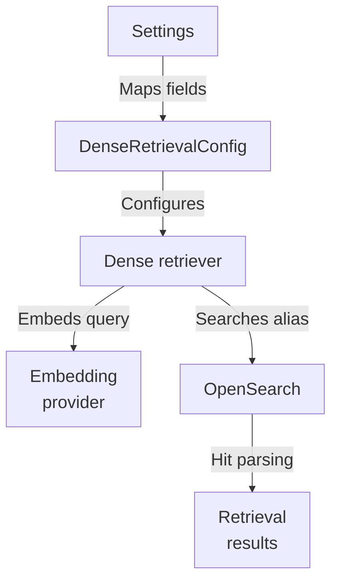
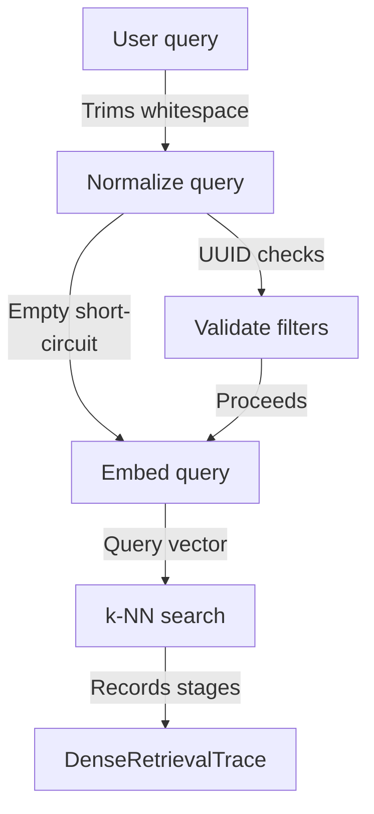
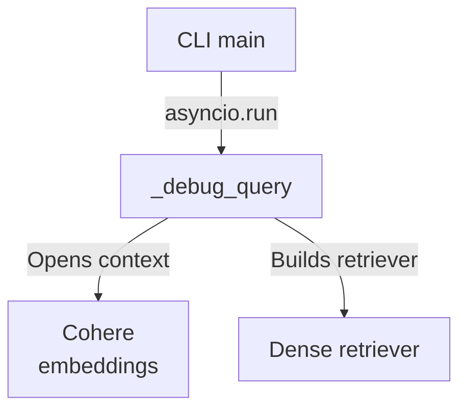

# Repository map

This batch maps the dense-query retrieval path of a hybrid RAG backend: a dense retrieval config derived from settings feeds an OpenSearch dense retriever that validates filters, embeds the normalized query via a provider, issues a k-NN search, and returns shared RetrievalResult objects, with a CLI debug entry point.

Commit: `05fb919153379762ce04a644ff9f6ef3e3413ff1` | Generated: 2026-10-17T22:43:02.534457+00:00

[Open PDF](repository-map.pdf)

**AI-generated analysis. Source references are checked for existence and supplied scope; this does not prove semantic correctness.**

## Scope

Tracked, eligible text only; bounded excerpts, not exhaustive.

1/29 eligible files analyzed; 194 tracked files excluded by policy.

2 API calls. See coverage.json for budgets, exclusions, and usage.

## Architecture

Settings flow into a dense retrieval config; the retriever uses an embedding provider and OpenSearch to serve queries, sharing result contracts with lexical retrieval.

PNG fallback

### Source evidence

- **F0002**: DenseRetrievalConfig.from_settings maps Settings fields cohere_embed_model, cohere_embed_dimensions, opensearch_index_schema_version, and opensearch_dense_candidate_limit into the config. (<a href="https://github.com/Justin-Mendoza/hybrid-rag-search/blob/05fb919153379762ce04a644ff9f6ef3e3413ff1/backend/src/hybrid_rag_search/dense_retrieval.py#L1-L364">backend/src/hybrid_rag_search/dense_retrieval.py:1-364</a>)
- **F0001**: DenseRetrievalConfig.__post_init__ validates embedding_model, embedding_dimensions, and candidate_limit, then calls physical_index_name(index_schema_version, "dense-query") to enforce the schema-version naming contract without issuing a mapping request. (<a href="https://github.com/Justin-Mendoza/hybrid-rag-search/blob/05fb919153379762ce04a644ff9f6ef3e3413ff1/backend/src/hybrid_rag_search/dense_retrieval.py#L1-L364">backend/src/hybrid_rag_search/dense_retrieval.py:1-364</a>)
- **F0014**: _candidate_limit defaults to config.candidate_limit when limit is None, validates limit is a positive non-bool int, and otherwise caps it at min(limit, config.candidate_limit). (<a href="https://github.com/Justin-Mendoza/hybrid-rag-search/blob/05fb919153379762ce04a644ff9f6ef3e3413ff1/backend/src/hybrid_rag_search/dense_retrieval.py#L1-L364">backend/src/hybrid_rag_search/dense_retrieval.py:1-364</a>)
- **F0004**: OpenSearchDenseRetriever.__init__ validates base_url and read_alias as nonblank strings and checks the embedding_provider has an embed attribute. (<a href="https://github.com/Justin-Mendoza/hybrid-rag-search/blob/05fb919153379762ce04a644ff9f6ef3e3413ff1/backend/src/hybrid_rag_search/dense_retrieval.py#L1-L364">backend/src/hybrid_rag_search/dense_retrieval.py:1-364</a>)
- **F0005**: OpenSearchDenseRetriever.search validates tenant_id is a UUID and collection_id is a UUID when present, builds RetrievalFilters, and normalizes the query. (<a href="https://github.com/Justin-Mendoza/hybrid-rag-search/blob/05fb919153379762ce04a644ff9f6ef3e3413ff1/backend/src/hybrid_rag_search/dense_retrieval.py#L1-L364">backend/src/hybrid_rag_search/dense_retrieval.py:1-364</a>)
- **F0007**: search calls embedding_provider.embed with an EmbeddingRequest of one normalized query and EmbeddingPurpose.QUERY, timing it with time.perf_counter. (<a href="https://github.com/Justin-Mendoza/hybrid-rag-search/blob/05fb919153379762ce04a644ff9f6ef3e3413ff1/backend/src/hybrid_rag_search/dense_retrieval.py#L1-L364">backend/src/hybrid_rag_search/dense_retrieval.py:1-364</a>)
- **F0008**: _query_vector rejects results with purpose other than QUERY, more than one vector, model mismatch, or dimensions mismatch, raising RetrievalError with codes embedding_invalid_response, embedding_model_mismatch, and query_vector_dimensions_mismatch. (<a href="https://github.com/Justin-Mendoza/hybrid-rag-search/blob/05fb919153379762ce04a644ff9f6ef3e3413ff1/backend/src/hybrid_rag_search/dense_retrieval.py#L1-L364">backend/src/hybrid_rag_search/dense_retrieval.py:1-364</a>)
- **F0011**: search issues POST /{read_alias}/_search with the constructed body via _request and parses payload['hits']['hits'], raising RetrievalError opensearch_invalid_response when the payload, hits, or hits.hits shapes are unexpected. (<a href="https://github.com/Justin-Mendoza/hybrid-rag-search/blob/05fb919153379762ce04a644ff9f6ef3e3413ff1/backend/src/hybrid_rag_search/dense_retrieval.py#L1-L364">backend/src/hybrid_rag_search/dense_retrieval.py:1-364</a>)
- **F0013**: _request creates a per-call httpx.AsyncClient with a 10s timeout, translating httpx.HTTPError into RetrievalError opensearch_unavailable retryable=True and mapping HTTP status &gt;=500, 408, or 429 to retryable errors. (<a href="https://github.com/Justin-Mendoza/hybrid-rag-search/blob/05fb919153379762ce04a644ff9f6ef3e3413ff1/backend/src/hybrid_rag_search/dense_retrieval.py#L1-L364">backend/src/hybrid_rag_search/dense_retrieval.py:1-364</a>)
- **F0012**: search reuses OpenSearchBM25Retriever._result_from_hit and _candidate_count to convert hits into RetrievalResult objects and derive candidate_count, so dense and BM25 share the normalized result contract. (<a href="https://github.com/Justin-Mendoza/hybrid-rag-search/blob/05fb919153379762ce04a644ff9f6ef3e3413ff1/backend/src/hybrid_rag_search/dense_retrieval.py#L1-L364">backend/src/hybrid_rag_search/dense_retrieval.py:1-364</a>)
- **F0010**: _search_body builds a k-NN query with size and k set to candidate_limit, track_total_hits true, explain set to debug, an explicit _source list of chunk and document fields, and a bool filter using filters.clauses(). (<a href="https://github.com/Justin-Mendoza/hybrid-rag-search/blob/05fb919153379762ce04a644ff9f6ef3e3413ff1/backend/src/hybrid_rag_search/dense_retrieval.py#L1-L364">backend/src/hybrid_rag_search/dense_retrieval.py:1-364</a>)

## Query Execution Flow

A user query is normalized, validated, embedded, and issued as a k-NN search; empty queries short-circuit, and timings and traces are recorded.

PNG fallback

### Source evidence

- **F0003**: normalize_dense_query trims and collapses internal whitespace via " ".join(query_text.split()) and raises ValueError for non-string input. (<a href="https://github.com/Justin-Mendoza/hybrid-rag-search/blob/05fb919153379762ce04a644ff9f6ef3e3413ff1/backend/src/hybrid_rag_search/dense_retrieval.py#L1-L364">backend/src/hybrid_rag_search/dense_retrieval.py:1-364</a>)
- **F0005**: OpenSearchDenseRetriever.search validates tenant_id is a UUID and collection_id is a UUID when present, builds RetrievalFilters, and normalizes the query. (<a href="https://github.com/Justin-Mendoza/hybrid-rag-search/blob/05fb919153379762ce04a644ff9f6ef3e3413ff1/backend/src/hybrid_rag_search/dense_retrieval.py#L1-L364">backend/src/hybrid_rag_search/dense_retrieval.py:1-364</a>)
- **F0007**: search calls embedding_provider.embed with an EmbeddingRequest of one normalized query and EmbeddingPurpose.QUERY, timing it with time.perf_counter. (<a href="https://github.com/Justin-Mendoza/hybrid-rag-search/blob/05fb919153379762ce04a644ff9f6ef3e3413ff1/backend/src/hybrid_rag_search/dense_retrieval.py#L1-L364">backend/src/hybrid_rag_search/dense_retrieval.py:1-364</a>)
- **F0008**: _query_vector rejects results with purpose other than QUERY, more than one vector, model mismatch, or dimensions mismatch, raising RetrievalError with codes embedding_invalid_response, embedding_model_mismatch, and query_vector_dimensions_mismatch. (<a href="https://github.com/Justin-Mendoza/hybrid-rag-search/blob/05fb919153379762ce04a644ff9f6ef3e3413ff1/backend/src/hybrid_rag_search/dense_retrieval.py#L1-L364">backend/src/hybrid_rag_search/dense_retrieval.py:1-364</a>)
- **F0009**: _query_vector also rejects vectors containing non-numeric, boolean, or non-finite values with RetrievalError embedding_invalid_response, then coerces values to float. (<a href="https://github.com/Justin-Mendoza/hybrid-rag-search/blob/05fb919153379762ce04a644ff9f6ef3e3413ff1/backend/src/hybrid_rag_search/dense_retrieval.py#L1-L364">backend/src/hybrid_rag_search/dense_retrieval.py:1-364</a>)
- **F0010**: _search_body builds a k-NN query with size and k set to candidate_limit, track_total_hits true, explain set to debug, an explicit _source list of chunk and document fields, and a bool filter using filters.clauses(). (<a href="https://github.com/Justin-Mendoza/hybrid-rag-search/blob/05fb919153379762ce04a644ff9f6ef3e3413ff1/backend/src/hybrid_rag_search/dense_retrieval.py#L1-L364">backend/src/hybrid_rag_search/dense_retrieval.py:1-364</a>)
- **F0011**: search issues POST /{read_alias}/_search with the constructed body via _request and parses payload['hits']['hits'], raising RetrievalError opensearch_invalid_response when the payload, hits, or hits.hits shapes are unexpected. (<a href="https://github.com/Justin-Mendoza/hybrid-rag-search/blob/05fb919153379762ce04a644ff9f6ef3e3413ff1/backend/src/hybrid_rag_search/dense_retrieval.py#L1-L364">backend/src/hybrid_rag_search/dense_retrieval.py:1-364</a>)
- **F0015**: DenseRetrievalTrace records normalized_query, model/dimensions, adapter, schema version, read_alias, candidate counts, per-stage elapsed milliseconds, tenant_id, collection_id, and filter values, keeping diagnostics separate from evidence. (<a href="https://github.com/Justin-Mendoza/hybrid-rag-search/blob/05fb919153379762ce04a644ff9f6ef3e3413ff1/backend/src/hybrid_rag_search/dense_retrieval.py#L1-L364">backend/src/hybrid_rag_search/dense_retrieval.py:1-364</a>)
- **F0006**: When the normalized query is empty, search returns an empty DenseRetrievalResponse with zero candidate_count and zero elapsed timings, short-circuiting embedding and OpenSearch calls. (<a href="https://github.com/Justin-Mendoza/hybrid-rag-search/blob/05fb919153379762ce04a644ff9f6ef3e3413ff1/backend/src/hybrid_rag_search/dense_retrieval.py#L1-L364">backend/src/hybrid_rag_search/dense_retrieval.py:1-364</a>)

## Debug CLI Flow

A command-line entry point parses arguments and runs the dense query with debug tracing, opening the configured embedding provider.

PNG fallback

### Source evidence

- **F0016**: The module's CLI main parses query, --tenant (required UUID), --collection, and --limit, then runs _debug_query via asyncio.run; _debug_query opens configured_cohere_embeddings as a context manager, constructs a retriever from settings, and searches with debug=True. (<a href="https://github.com/Justin-Mendoza/hybrid-rag-search/blob/05fb919153379762ce04a644ff9f6ef3e3413ff1/backend/src/hybrid_rag_search/dense_retrieval.py#L1-L364">backend/src/hybrid_rag_search/dense_retrieval.py:1-364</a>)
- **F0004**: OpenSearchDenseRetriever.__init__ validates base_url and read_alias as nonblank strings and checks the embedding_provider has an embed attribute. (<a href="https://github.com/Justin-Mendoza/hybrid-rag-search/blob/05fb919153379762ce04a644ff9f6ef3e3413ff1/backend/src/hybrid_rag_search/dense_retrieval.py#L1-L364">backend/src/hybrid_rag_search/dense_retrieval.py:1-364</a>)

## Uncertainties and untraced areas

- No supplied finding shows how hybrid_retrieval, reranked_retrieval, or lexical_retrieval combine with this dense retriever.
- Supporting modules (models/retrieval.py, retrieval_filters.py, opensearch_index.py, providers/*) are listed as changed but their internal behavior beyond dense_retrieval imports is not described.
- Tests are listed but their assertions and coverage of the dense path are not detailed.
