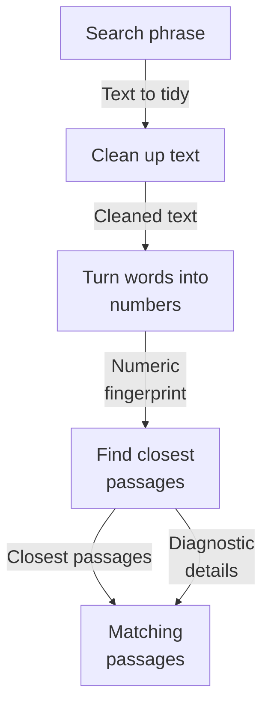
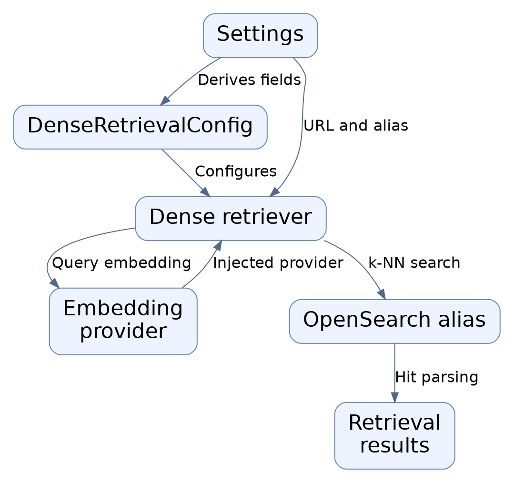
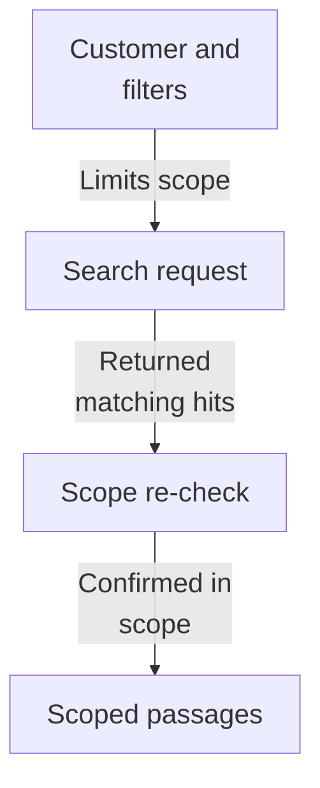
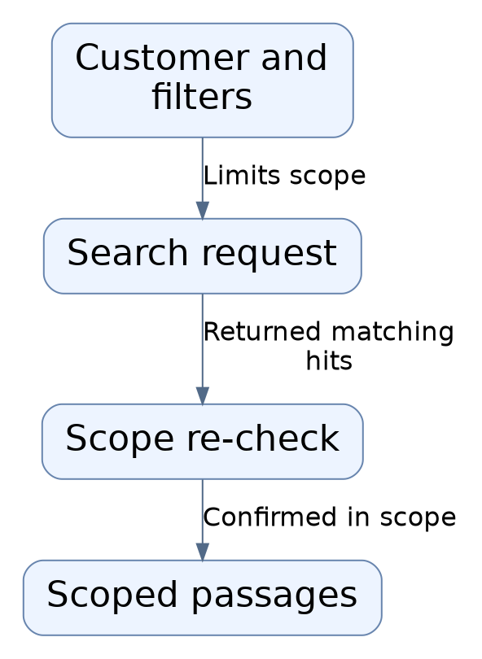
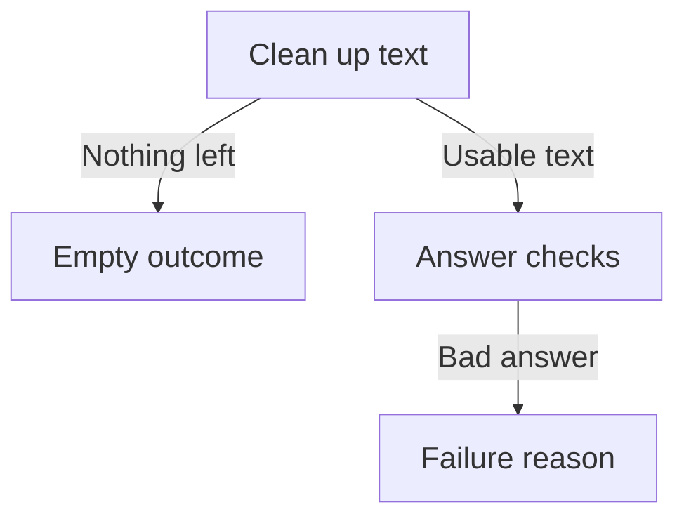
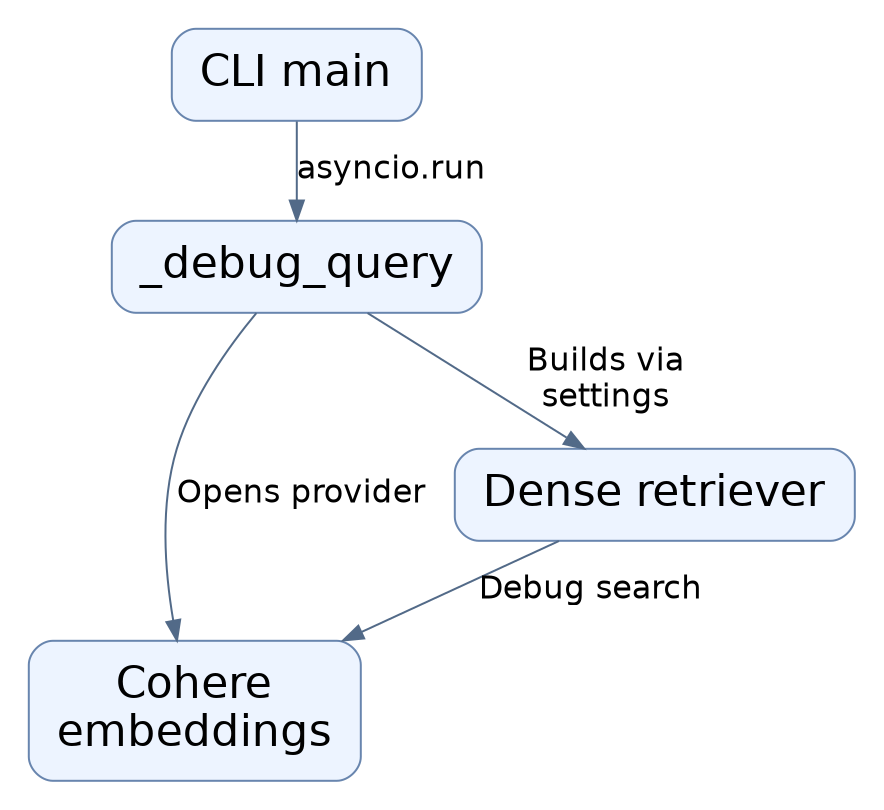
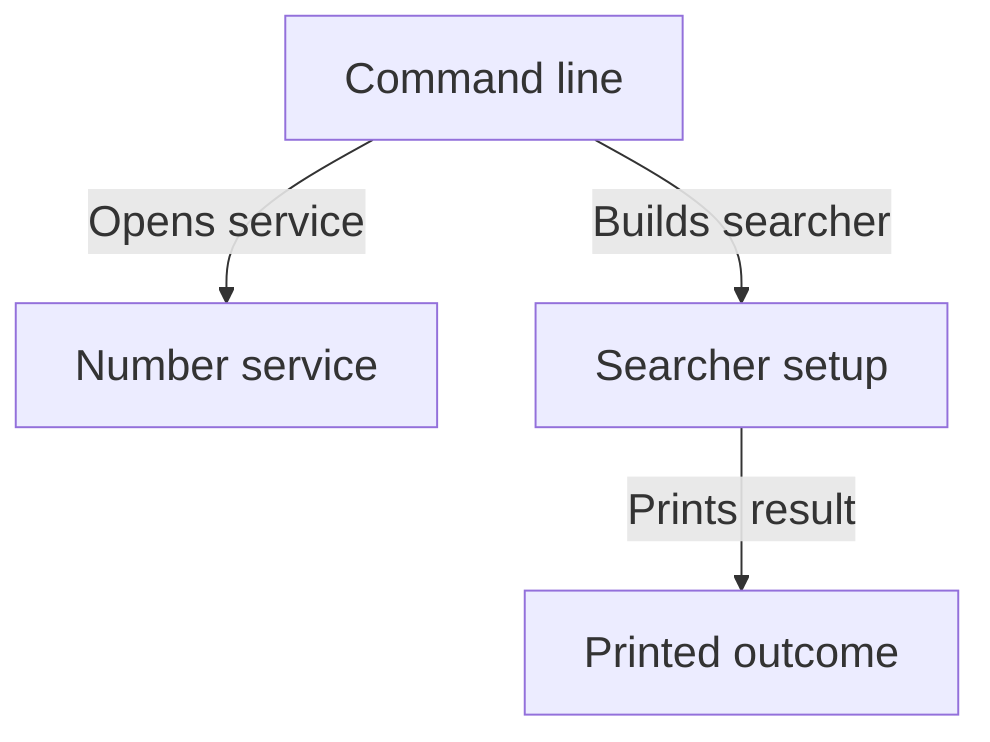
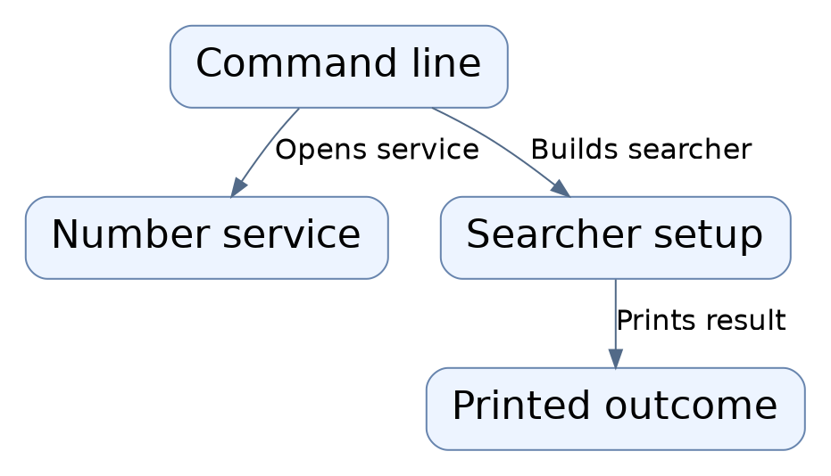

# Repository map

This area turns a person's search text into likely matching document passages. The text is cleaned, turned into a numeric fingerprint by an outside service, then used to ask a search index for the closest passages, scoped so one customer only sees their own material. It returns those passages plus separate diagnostic details, and is currently runnable only through a developer test command. Blank text is handled without contacting anything.

Commit: `e4abb88a149b365c2838b0f2f0606dff0127b1ab` | Generated: 2026-10-22T15:21:02.116607+00:00

[Open PDF](repository-map.pdf)

**AI-generated analysis. Source references are checked for existence and supplied scope; this does not prove semantic correctness.**

## Scope

Tracked, eligible text only; bounded excerpts, not exhaustive.

1/27 eligible files analyzed; 233 tracked files excluded by policy.

2 API calls. See coverage.json for budgets, exclusions, and usage.

## How a search becomes matching passages

A search phrase is cleaned, sent out to be turned into numbers, used to find the closest stored passages in the search index, and returned as passages with optional diagnostic detail.

PNG fallback

Read from top to bottom; arrows show what happens next or what is passed along.

### Source evidence

- **F0001**: OpenSearchDenseRetriever.search is the primary entry point of this module: given a query string and a required tenant UUID, it normalizes the text, embeds it as a QUERY-purpose vector, and runs a filtered k-NN search over the configured OpenSearch read alias, returning a DenseRetrievalResponse containing results and a trace. (<a href="https://github.com/Justin-Mendoza/Afterclass/blob/e4abb88a149b365c2838b0f2f0606dff0127b1ab/backend/src/hybrid_rag_search/dense_retrieval.py#L1-L379">backend/src/hybrid_rag_search/dense_retrieval.py:1-379</a>)
- **F0008**: normalize_dense_query trims outer whitespace and collapses internal whitespace without rewriting text, and rejects non-string input with ValueError. (<a href="https://github.com/Justin-Mendoza/Afterclass/blob/e4abb88a149b365c2838b0f2f0606dff0127b1ab/backend/src/hybrid_rag_search/dense_retrieval.py#L1-L379">backend/src/hybrid_rag_search/dense_retrieval.py:1-379</a>)
- **F0002**: The query embedding is produced by an injected EmbeddingProvider via embed(EmbeddingRequest((normalized_query,), EmbeddingPurpose.QUERY)); the returned vector is validated for purpose, count, model name, dimensions, and finite numeric values before use, raising RetrievalError on mismatch (embedding_model_mismatch, query_vector_dimensions_mismatch, embedding_invalid_response). (<a href="https://github.com/Justin-Mendoza/Afterclass/blob/e4abb88a149b365c2838b0f2f0606dff0127b1ab/backend/src/hybrid_rag_search/dense_retrieval.py#L1-L379">backend/src/hybrid_rag_search/dense_retrieval.py:1-379</a>)
- **F0015**: External systems used by this module are the configurable embedding service (reached only via the injected EmbeddingProvider; the CLI wires the Cohere-configured provider) and the OpenSearch HTTP API reached at base_url/{read_alias}/_search. (<a href="https://github.com/Justin-Mendoza/Afterclass/blob/e4abb88a149b365c2838b0f2f0606dff0127b1ab/backend/src/hybrid_rag_search/dense_retrieval.py#L1-L379">backend/src/hybrid_rag_search/dense_retrieval.py:1-379</a>)
- **F0003**: The k-NN request body (_search_body) sends size=candidate_limit, track_total_hits=True, explain set from the debug flag, an explicit _source field list (chunk_id, tenant_id, collection_id, document_id, document_content_id, content_text, source_spans, generation_id, pipeline_version, source_metadata), and a knn query over the 'embedding' field with k equal to candidate_limit and a bool filter built from RetrievalFilters.clauses(). (<a href="https://github.com/Justin-Mendoza/Afterclass/blob/e4abb88a149b365c2838b0f2f0606dff0127b1ab/backend/src/hybrid_rag_search/dense_retrieval.py#L1-L379">backend/src/hybrid_rag_search/dense_retrieval.py:1-379</a>)
- **F0006**: The HTTP call to OpenSearch is made through OpenSearchDenseRetriever._request using httpx.AsyncClient with a 10-second timeout; httpx.HTTPError becomes RetrievalError('opensearch_unavailable', retryable=True), and error responses become the same error with retryable true for status &gt;= 500 or in (408, 429), otherwise retryable false. (<a href="https://github.com/Justin-Mendoza/Afterclass/blob/e4abb88a149b365c2838b0f2f0606dff0127b1ab/backend/src/hybrid_rag_search/dense_retrieval.py#L1-L379">backend/src/hybrid_rag_search/dense_retrieval.py:1-379</a>)
- **F0010**: DenseRetrievalConfig defines the query-model/index pairing (default model embed-english-light-v3.0, 384 dimensions, schema version chunks-v3, candidate_limit 20), validates types and positivity, and calls physical_index_name(index_schema_version, 'dense-query') to enforce the schema-version naming contract without issuing a mapping request per query; from_settings pulls these from Settings fields (cohere_embed_model, cohere_embed_dimensions, opensearch_index_schema_version, opensearch_dense_candidate_limit). (<a href="https://github.com/Justin-Mendoza/Afterclass/blob/e4abb88a149b365c2838b0f2f0606dff0127b1ab/backend/src/hybrid_rag_search/dense_retrieval.py#L1-L379">backend/src/hybrid_rag_search/dense_retrieval.py:1-379</a>)
- **F0004**: Tenant scoping and filter enforcement happen inside the OpenSearch kNN filter (from RetrievalFilters) and are re-verified after retrieval: any result whose tenant_id differs, whose collection_id mismatches a requested collection, whose document_id is in excluded_document_ids, or whose collection_id is not in collection_ids raises RetrievalError('retrieval_scope_violation'). (<a href="https://github.com/Justin-Mendoza/Afterclass/blob/e4abb88a149b365c2838b0f2f0606dff0127b1ab/backend/src/hybrid_rag_search/dense_retrieval.py#L1-L379">backend/src/hybrid_rag_search/dense_retrieval.py:1-379</a>)
- **F0005**: Raw OpenSearch hits are converted to shared RetrievalResult values by reusing OpenSearchBM25Retriever._result_from_hit and _candidate_count, so dense retrieval emits the same normalized result contract as lexical BM25 retrieval. (<a href="https://github.com/Justin-Mendoza/Afterclass/blob/e4abb88a149b365c2838b0f2f0606dff0127b1ab/backend/src/hybrid_rag_search/dense_retrieval.py#L1-L379">backend/src/hybrid_rag_search/dense_retrieval.py:1-379</a>)
- **F0011**: Dense retrieval diagnostics are kept separate from evidence: DenseRetrievalTrace carries normalized_query, embedding model/dimensions/adapter, index_schema_version, read_alias, candidate_limit, candidate_count, embedding and opensearch elapsed milliseconds, tenant_id, collection_id, and filter trace values; results are returned via the shared RetrievalResult tuple inside DenseRetrievalResponse. (<a href="https://github.com/Justin-Mendoza/Afterclass/blob/e4abb88a149b365c2838b0f2f0606dff0127b1ab/backend/src/hybrid_rag_search/dense_retrieval.py#L1-L379">backend/src/hybrid_rag_search/dense_retrieval.py:1-379</a>)

## Keeping one customer's material separate

Customer and filter details are applied inside the search request itself so only that customer's own passages are considered, and the result is checked again afterwards to confirm the scope held.

PNG fallback

Read from top to bottom; arrows show what happens next or what is passed along.

### Source evidence

- **F0003**: The k-NN request body (_search_body) sends size=candidate_limit, track_total_hits=True, explain set from the debug flag, an explicit _source field list (chunk_id, tenant_id, collection_id, document_id, document_content_id, content_text, source_spans, generation_id, pipeline_version, source_metadata), and a knn query over the 'embedding' field with k equal to candidate_limit and a bool filter built from RetrievalFilters.clauses(). (<a href="https://github.com/Justin-Mendoza/Afterclass/blob/e4abb88a149b365c2838b0f2f0606dff0127b1ab/backend/src/hybrid_rag_search/dense_retrieval.py#L1-L379">backend/src/hybrid_rag_search/dense_retrieval.py:1-379</a>)
- **F0004**: Tenant scoping and filter enforcement happen inside the OpenSearch kNN filter (from RetrievalFilters) and are re-verified after retrieval: any result whose tenant_id differs, whose collection_id mismatches a requested collection, whose document_id is in excluded_document_ids, or whose collection_id is not in collection_ids raises RetrievalError('retrieval_scope_violation'). (<a href="https://github.com/Justin-Mendoza/Afterclass/blob/e4abb88a149b365c2838b0f2f0606dff0127b1ab/backend/src/hybrid_rag_search/dense_retrieval.py#L1-L379">backend/src/hybrid_rag_search/dense_retrieval.py:1-379</a>)
- **F0009**: Empty/blank normalized query text, or an explicitly empty collection_ids tuple on the filter, short-circuits to an empty DenseRetrievalResponse with zero counts and zero elapsed times, without calling the embedding provider or OpenSearch. (<a href="https://github.com/Justin-Mendoza/Afterclass/blob/e4abb88a149b365c2838b0f2f0606dff0127b1ab/backend/src/hybrid_rag_search/dense_retrieval.py#L1-L379">backend/src/hybrid_rag_search/dense_retrieval.py:1-379</a>)

## What happens with empty or unusable input

Blank text or an empty collection list returns nothing without contacting any outside service, while mismatched or malformed answers from the number service and search index stop the flow with a clear failure reason.

PNG fallback

Read from top to bottom; arrows show what happens next or what is passed along.

### Source evidence

- **F0008**: normalize_dense_query trims outer whitespace and collapses internal whitespace without rewriting text, and rejects non-string input with ValueError. (<a href="https://github.com/Justin-Mendoza/Afterclass/blob/e4abb88a149b365c2838b0f2f0606dff0127b1ab/backend/src/hybrid_rag_search/dense_retrieval.py#L1-L379">backend/src/hybrid_rag_search/dense_retrieval.py:1-379</a>)
- **F0009**: Empty/blank normalized query text, or an explicitly empty collection_ids tuple on the filter, short-circuits to an empty DenseRetrievalResponse with zero counts and zero elapsed times, without calling the embedding provider or OpenSearch. (<a href="https://github.com/Justin-Mendoza/Afterclass/blob/e4abb88a149b365c2838b0f2f0606dff0127b1ab/backend/src/hybrid_rag_search/dense_retrieval.py#L1-L379">backend/src/hybrid_rag_search/dense_retrieval.py:1-379</a>)
- **F0002**: The query embedding is produced by an injected EmbeddingProvider via embed(EmbeddingRequest((normalized_query,), EmbeddingPurpose.QUERY)); the returned vector is validated for purpose, count, model name, dimensions, and finite numeric values before use, raising RetrievalError on mismatch (embedding_model_mismatch, query_vector_dimensions_mismatch, embedding_invalid_response). (<a href="https://github.com/Justin-Mendoza/Afterclass/blob/e4abb88a149b365c2838b0f2f0606dff0127b1ab/backend/src/hybrid_rag_search/dense_retrieval.py#L1-L379">backend/src/hybrid_rag_search/dense_retrieval.py:1-379</a>)
- **F0007**: Malformed OpenSearch responses (payload not a dict, hits not a dict, or hits.hits not a list) raise RetrievalError('opensearch_invalid_response', retryable=False). (<a href="https://github.com/Justin-Mendoza/Afterclass/blob/e4abb88a149b365c2838b0f2f0606dff0127b1ab/backend/src/hybrid_rag_search/dense_retrieval.py#L1-L379">backend/src/hybrid_rag_search/dense_retrieval.py:1-379</a>)
- **F0006**: The HTTP call to OpenSearch is made through OpenSearchDenseRetriever._request using httpx.AsyncClient with a 10-second timeout; httpx.HTTPError becomes RetrievalError('opensearch_unavailable', retryable=True), and error responses become the same error with retryable true for status &gt;= 500 or in (408, 429), otherwise retryable false. (<a href="https://github.com/Justin-Mendoza/Afterclass/blob/e4abb88a149b365c2838b0f2f0606dff0127b1ab/backend/src/hybrid_rag_search/dense_retrieval.py#L1-L379">backend/src/hybrid_rag_search/dense_retrieval.py:1-379</a>)

## How a developer runs it today

A command-line tool takes a search phrase with a required customer identifier plus optional collection and size, opens the outside number service, builds the searcher, and prints the outcome with extra explanation switched on.

PNG fallback

Read from top to bottom; arrows show what happens next or what is passed along.

### Source evidence

- **F0014**: The only user-facing entry point in this file is the developer CLI main(): it parses a positional query plus required --tenant UUID, optional --collection UUID and --limit, opens configured_cohere_embeddings(settings) as the provider, builds OpenSearchDenseRetriever.from_settings, runs search with debug=True, and prints the response. Its docstring states it runs a local dense debug query without exposing a public search API yet. (<a href="https://github.com/Justin-Mendoza/Afterclass/blob/e4abb88a149b365c2838b0f2f0606dff0127b1ab/backend/src/hybrid_rag_search/dense_retrieval.py#L1-L379">backend/src/hybrid_rag_search/dense_retrieval.py:1-379</a>)
- **F0013**: OpenSearchDenseRetriever.__init__ validates base_url and read_alias as nonblank strings and requires the embedding provider to expose an 'embed' attribute, raising ValueError otherwise; an optional httpx.AsyncBaseTransport can be injected for testing. (<a href="https://github.com/Justin-Mendoza/Afterclass/blob/e4abb88a149b365c2838b0f2f0606dff0127b1ab/backend/src/hybrid_rag_search/dense_retrieval.py#L1-L379">backend/src/hybrid_rag_search/dense_retrieval.py:1-379</a>)
- **F0015**: External systems used by this module are the configurable embedding service (reached only via the injected EmbeddingProvider; the CLI wires the Cohere-configured provider) and the OpenSearch HTTP API reached at base_url/{read_alias}/_search. (<a href="https://github.com/Justin-Mendoza/Afterclass/blob/e4abb88a149b365c2838b0f2f0606dff0127b1ab/backend/src/hybrid_rag_search/dense_retrieval.py#L1-L379">backend/src/hybrid_rag_search/dense_retrieval.py:1-379</a>)

## Uncertainties and untraced areas

- How this search is combined with word-based or mixed search, or exposed as a service others call, is not shown; orchestration is stated to live elsewhere.
- No public search interface or production caller appears in the supplied evidence; only a developer command-line tool is present.
- The outside number service's internals and its failure behaviour beyond the debug tool wiring are not described.
- Behaviour of supporting pieces (shared result shapes, filter objects, index naming, provider helpers) beyond their use here is not described.
