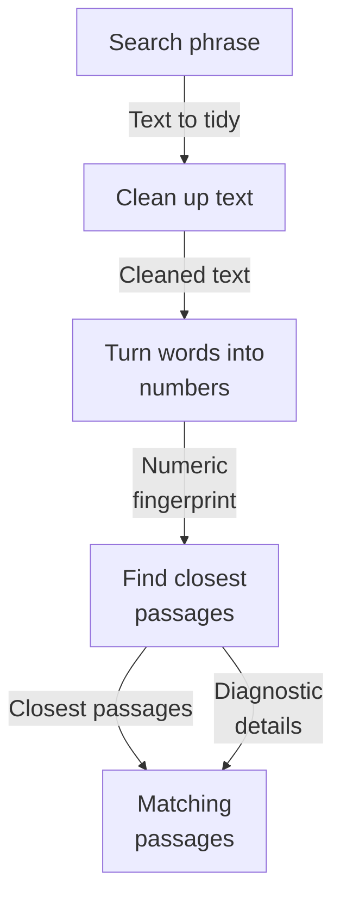
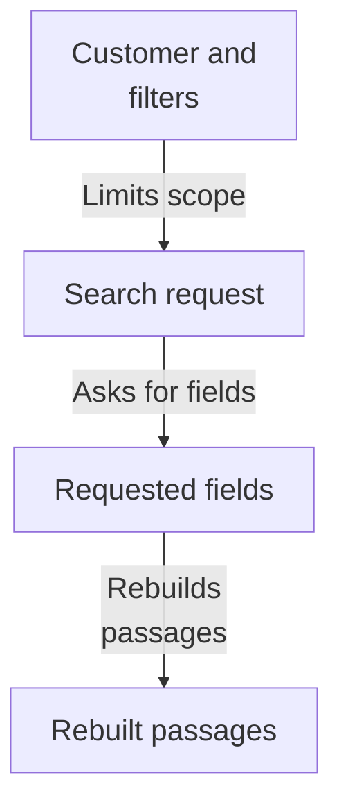
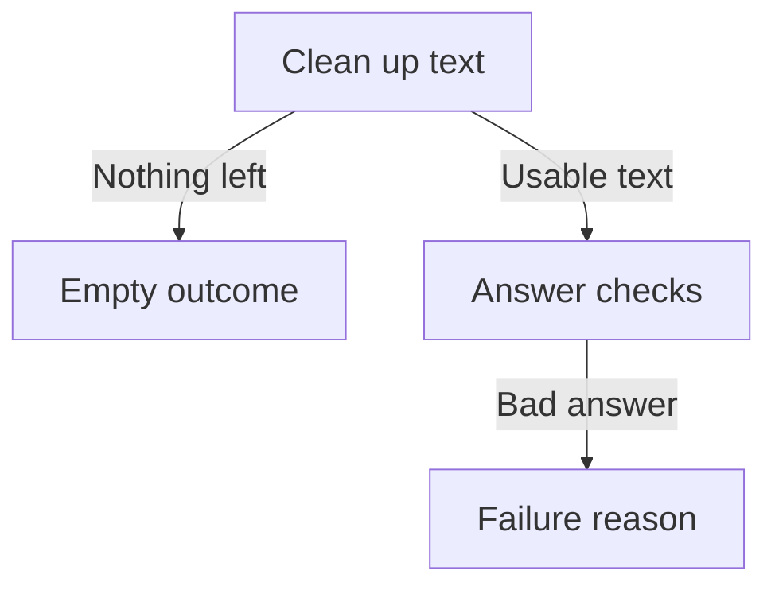
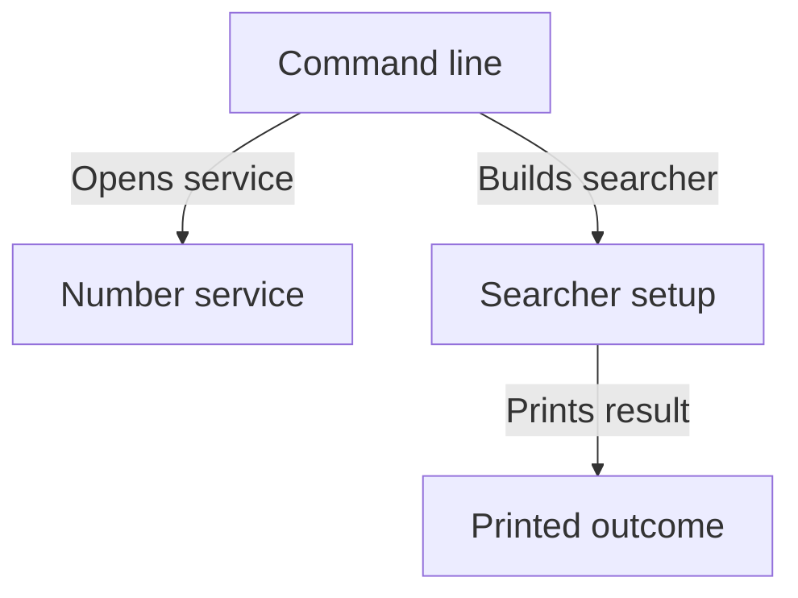

# Repository map

This area turns a person's search text into likely matching document passages. The text is cleaned, turned into a numeric fingerprint by an outside service, then used to ask a search index for the closest passages, scoped so one customer only sees their own material. It returns those passages plus separate diagnostic details, and is currently runnable only through a developer test command. Blank text is handled without contacting anything.

Commit: `3537e913c1eeec5b5f34d6cbdbf4dc3f8bc74b25` | Generated: 2026-10-19T00:25:53.220315+00:00

[Open PDF](repository-map.pdf)

**AI-generated analysis. Source references are checked for existence and supplied scope; this does not prove semantic correctness.**

## Scope

Tracked, eligible text only; bounded excerpts, not exhaustive.

1/25 eligible files analyzed; 198 tracked files excluded by policy.

2 API calls. See coverage.json for budgets, exclusions, and usage.

## How a search becomes matching passages

A search phrase is cleaned, sent out to be turned into numbers, used to find the closest stored passages in the search index, and returned as passages with optional diagnostic detail.

PNG fallback

Read from top to bottom; arrows show what happens next or what is passed along.

### Source evidence

- **F0001**: OpenSearchDenseRetriever.search is the core dense retrieval path: it accepts a query string with required tenant_id UUID and optional collection, source_type, author, source_date_from/to, limit, and debug, returning a DenseRetrievalResponse containing results tuple and a trace. (<a href="https://github.com/Justin-Mendoza/hybrid-rag-search/blob/3537e913c1eeec5b5f34d6cbdbf4dc3f8bc74b25/backend/src/hybrid_rag_search/dense_retrieval.py#L1-L364">backend/src/hybrid_rag_search/dense_retrieval.py:1-364</a>)
- **F0006**: Query normalization (normalize_dense_query) trims outer whitespace and collapses internal whitespace via ' '.join(query_text.split()) without otherwise rewriting text; non-string input raises ValueError. (<a href="https://github.com/Justin-Mendoza/hybrid-rag-search/blob/3537e913c1eeec5b5f34d6cbdbf4dc3f8bc74b25/backend/src/hybrid_rag_search/dense_retrieval.py#L1-L364">backend/src/hybrid_rag_search/dense_retrieval.py:1-364</a>)
- **F0002**: search normalizes and embeds the query through an injected EmbeddingProvider (embed(EmbeddingRequest((normalized_query,), EmbeddingPurpose.QUERY))) and issues a POST to the OpenSearch read alias _search endpoint within a 10-second httpx AsyncClient timeout. (<a href="https://github.com/Justin-Mendoza/hybrid-rag-search/blob/3537e913c1eeec5b5f34d6cbdbf4dc3f8bc74b25/backend/src/hybrid_rag_search/dense_retrieval.py#L1-L364">backend/src/hybrid_rag_search/dense_retrieval.py:1-364</a>)
- **F0007**: Embedding responses are validated before search: purpose must be QUERY, exactly one vector must be returned, model and dimensions must match configured embedding_model/embedding_dimensions, the vector length must match configured dimensions, and every element must be a finite non-boolean number. (<a href="https://github.com/Justin-Mendoza/hybrid-rag-search/blob/3537e913c1eeec5b5f34d6cbdbf4dc3f8bc74b25/backend/src/hybrid_rag_search/dense_retrieval.py#L1-L364">backend/src/hybrid_rag_search/dense_retrieval.py:1-364</a>)
- **F0003**: Tenant and metadata scoping is pushed into the OpenSearch k-NN query as a bool filter built from RetrievalFilters rather than post-filtering, and the requested _source fields (chunk_id, tenant_id, content_text, source_spans, etc.) are those needed to rebuild the shared RetrievalResult contract. (<a href="https://github.com/Justin-Mendoza/hybrid-rag-search/blob/3537e913c1eeec5b5f34d6cbdbf4dc3f8bc74b25/backend/src/hybrid_rag_search/dense_retrieval.py#L1-L364">backend/src/hybrid_rag_search/dense_retrieval.py:1-364</a>)
- **F0010**: The effective candidate limit defaults to DenseRetrievalConfig.candidate_limit (20) and any provided limit is capped at that maximum (min(limit, candidate_limit)); non-positive or boolean limits raise ValueError. (<a href="https://github.com/Justin-Mendoza/hybrid-rag-search/blob/3537e913c1eeec5b5f34d6cbdbf4dc3f8bc74b25/backend/src/hybrid_rag_search/dense_retrieval.py#L1-L364">backend/src/hybrid_rag_search/dense_retrieval.py:1-364</a>)
- **F0004**: Result hits are converted to shared RetrievalResult objects by reusing OpenSearchBM25Retriever._result_from_hit and _candidate_count, so dense evidence shares the same normalized shape as lexical retrieval. (<a href="https://github.com/Justin-Mendoza/hybrid-rag-search/blob/3537e913c1eeec5b5f34d6cbdbf4dc3f8bc74b25/backend/src/hybrid_rag_search/dense_retrieval.py#L1-L364">backend/src/hybrid_rag_search/dense_retrieval.py:1-364</a>)
- **F0009**: Diagnostics (normalized query, embedding model/dimensions, adapter, schema version, read alias, candidate limit/count, per-stage elapsed milliseconds, tenant/collection, filter values) are kept in a separate DenseRetrievalTrace attached to the response rather than merged into evidence results. (<a href="https://github.com/Justin-Mendoza/hybrid-rag-search/blob/3537e913c1eeec5b5f34d6cbdbf4dc3f8bc74b25/backend/src/hybrid_rag_search/dense_retrieval.py#L1-L364">backend/src/hybrid_rag_search/dense_retrieval.py:1-364</a>)

## Keeping one customer's material separate

Customer and filter details are applied inside the search request itself, so only that customer's own passages are considered, and the requested fields are enough to rebuild each passage for callers.

PNG fallback

Read from top to bottom; arrows show what happens next or what is passed along.

### Source evidence

- **F0003**: Tenant and metadata scoping is pushed into the OpenSearch k-NN query as a bool filter built from RetrievalFilters rather than post-filtering, and the requested _source fields (chunk_id, tenant_id, content_text, source_spans, etc.) are those needed to rebuild the shared RetrievalResult contract. (<a href="https://github.com/Justin-Mendoza/hybrid-rag-search/blob/3537e913c1eeec5b5f34d6cbdbf4dc3f8bc74b25/backend/src/hybrid_rag_search/dense_retrieval.py#L1-L364">backend/src/hybrid_rag_search/dense_retrieval.py:1-364</a>)
- **F0004**: Result hits are converted to shared RetrievalResult objects by reusing OpenSearchBM25Retriever._result_from_hit and _candidate_count, so dense evidence shares the same normalized shape as lexical retrieval. (<a href="https://github.com/Justin-Mendoza/hybrid-rag-search/blob/3537e913c1eeec5b5f34d6cbdbf4dc3f8bc74b25/backend/src/hybrid_rag_search/dense_retrieval.py#L1-L364">backend/src/hybrid_rag_search/dense_retrieval.py:1-364</a>)

## What happens with empty or unusable input

Blank text returns nothing without contacting any outside service, while mismatched or malformed answers from the number service and search index stop the flow with a clear failure reason.

PNG fallback

Read from top to bottom; arrows show what happens next or what is passed along.

### Source evidence

- **F0005**: A blank normalized query short-circuits: search returns an empty results tuple and a trace with zero counts and zero elapsed times without making any embedding or OpenSearch call. (<a href="https://github.com/Justin-Mendoza/hybrid-rag-search/blob/3537e913c1eeec5b5f34d6cbdbf4dc3f8bc74b25/backend/src/hybrid_rag_search/dense_retrieval.py#L1-L364">backend/src/hybrid_rag_search/dense_retrieval.py:1-364</a>)
- **F0006**: Query normalization (normalize_dense_query) trims outer whitespace and collapses internal whitespace via ' '.join(query_text.split()) without otherwise rewriting text; non-string input raises ValueError. (<a href="https://github.com/Justin-Mendoza/hybrid-rag-search/blob/3537e913c1eeec5b5f34d6cbdbf4dc3f8bc74b25/backend/src/hybrid_rag_search/dense_retrieval.py#L1-L364">backend/src/hybrid_rag_search/dense_retrieval.py:1-364</a>)
- **F0007**: Embedding responses are validated before search: purpose must be QUERY, exactly one vector must be returned, model and dimensions must match configured embedding_model/embedding_dimensions, the vector length must match configured dimensions, and every element must be a finite non-boolean number. (<a href="https://github.com/Justin-Mendoza/hybrid-rag-search/blob/3537e913c1eeec5b5f34d6cbdbf4dc3f8bc74b25/backend/src/hybrid_rag_search/dense_retrieval.py#L1-L364">backend/src/hybrid_rag_search/dense_retrieval.py:1-364</a>)
- **F0008**: RetrievalFailures are raised with distinct codes for embedding_invalid_response, embedding_model_mismatch, query_vector_dimensions_mismatch, and opensearch_invalid_response (non-retryable) versus opensearch_unavailable (marked retryable based on HTTPError or 5xx/408/429 status). (<a href="https://github.com/Justin-Mendoza/hybrid-rag-search/blob/3537e913c1eeec5b5f34d6cbdbf4dc3f8bc74b25/backend/src/hybrid_rag_search/dense_retrieval.py#L1-L364">backend/src/hybrid_rag_search/dense_retrieval.py:1-364</a>)

## How a developer runs it today

A command-line tool takes a search phrase with a required customer identifier and optional collection and size, opens the outside number service, builds the searcher, and prints the outcome with extra explanation switched on.

PNG fallback

Read from top to bottom; arrows show what happens next or what is passed along.

### Source evidence

- **F0014**: The only local entry point is a CLI main(): positional query plus --tenant (required UUID), --collection (UUID), and --limit (int) are parsed, then asyncio.run(_debug_query(get_settings(), args)) is printed. No public search API is exposed here. (<a href="https://github.com/Justin-Mendoza/hybrid-rag-search/blob/3537e913c1eeec5b5f34d6cbdbf4dc3f8bc74b25/backend/src/hybrid_rag_search/dense_retrieval.py#L1-L364">backend/src/hybrid_rag_search/dense_retrieval.py:1-364</a>)
- **F0013**: The debug request path (_debug_query) opens a configured Cohere embeddings provider via configured_cohere_embeddings(settings), builds the retriever via OpenSearchDenseRetriever.from_settings, and always runs search with debug=True (which sets explain:true on the OpenSearch body). (<a href="https://github.com/Justin-Mendoza/hybrid-rag-search/blob/3537e913c1eeec5b5f34d6cbdbf4dc3f8bc74b25/backend/src/hybrid_rag_search/dense_retrieval.py#L1-L364">backend/src/hybrid_rag_search/dense_retrieval.py:1-364</a>)

## Uncertainties and untraced areas

- How this search is combined with word-based or mixed search, or exposed as a service others call, is not shown; orchestration is stated to live elsewhere.
- No public search interface or production caller appears in the supplied evidence; only a developer command-line tool is present.
- The outside number service's internals and its failure behaviour beyond the debug tool wiring are not described.
- Behaviour of supporting pieces (shared result shapes, filter objects, index naming, provider helpers) beyond their use here is not described.
