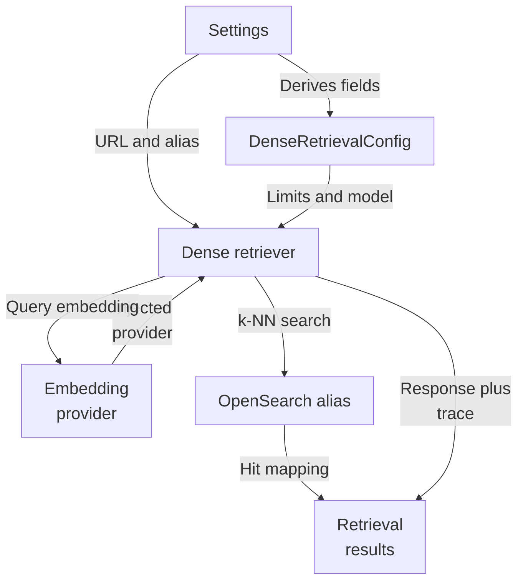
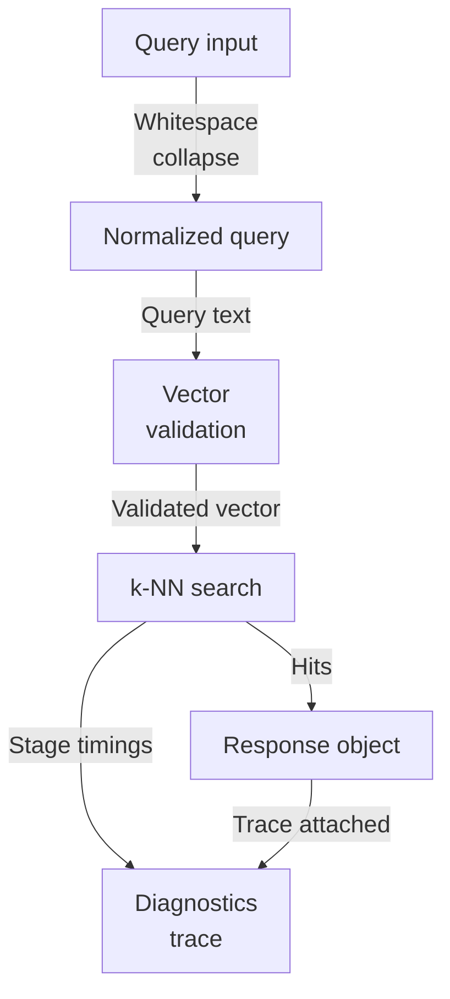
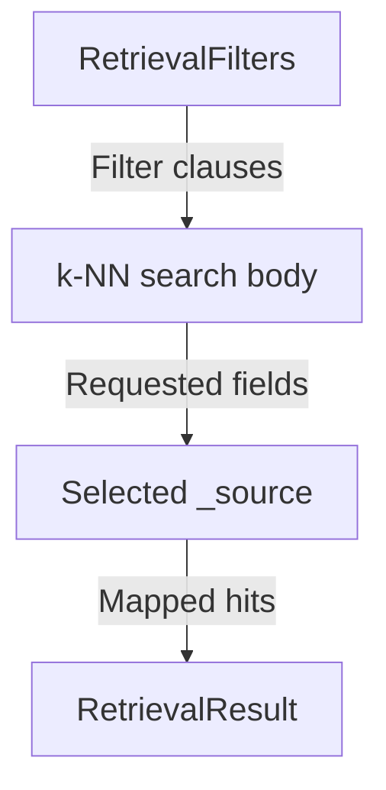
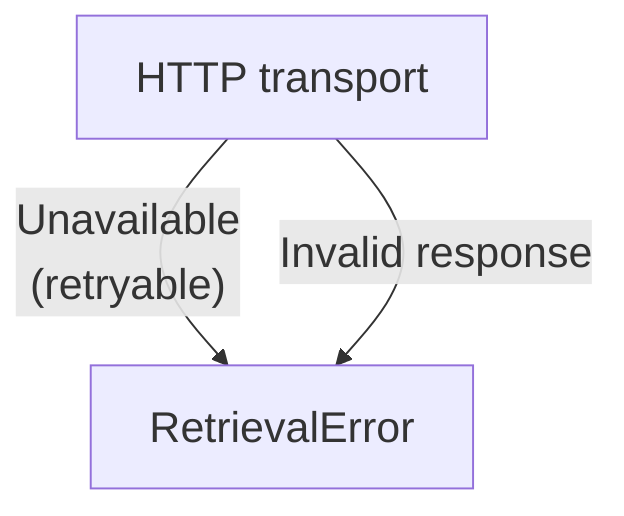
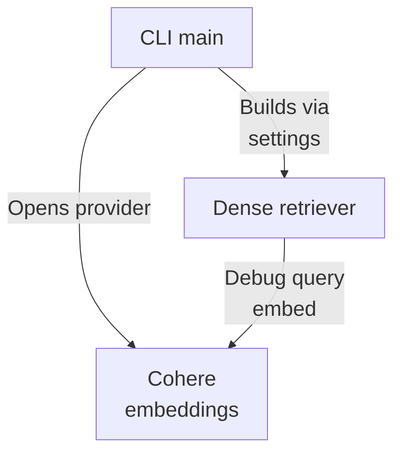
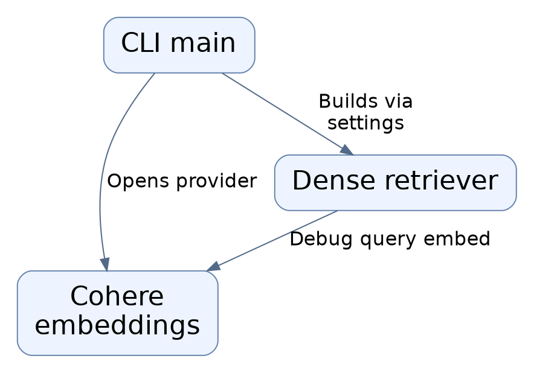

# Repository map

Dense-query retrieval for a multi-tenant hybrid RAG backend: a normalized query is embedded via an injected provider into a vector, then issued as an OpenSearch k-NN search against a read alias with tenant scoping applied at query level. Hits are renormalized into the shared RetrievalResult contract reused by lexical retrieval, with diagnostics kept in a separate trace. Configuration derives from Settings; the only local entry point is a debug CLI, with orchestration living elsewhere.

Commit: `f8493c1d264c525948d9d33ffaf2dd197be97e26` | Generated: 2026-10-18T18:36:27.937462+00:00

[Open PDF](repository-map.pdf)

**AI-generated analysis. Source references are checked for existence and supplied scope; this does not prove semantic correctness.**

## Scope

Tracked, eligible text only; bounded excerpts, not exhaustive.

1/25 eligible files analyzed; 198 tracked files excluded by policy.

2 API calls. See coverage.json for budgets, exclusions, and usage.

## Architecture

Settings derive a dense config and connection details; the retriever injects an embedding provider, queries the OpenSearch read alias with tenant-scoped filters, and emits shared results plus a separate trace.

PNG fallback

### Source evidence

- **F0003**: DenseRetrievalConfig can be built from Settings via from_settings, deriving embedding_model, embedding_dimensions, index_schema_version, and candidate_limit from cohere_ and opensearch_ settings fields; from_settings on the retriever also pulls opensearch_url and opensearch_read_alias. (<a href="https://github.com/Justin-Mendoza/hybrid-rag-search/blob/f8493c1d264c525948d9d33ffaf2dd197be97e26/backend/src/hybrid_rag_search/dense_retrieval.py#L1-L364">backend/src/hybrid_rag_search/dense_retrieval.py:1-364</a>)
- **F0013**: DenseRetrievalConfig.__post_init__ validates the model/index pairing by calling physical_index_name(index_schema_version, "dense-query"), reusing the existing physical-index naming rules rather than issuing a mapping request per query. (<a href="https://github.com/Justin-Mendoza/hybrid-rag-search/blob/f8493c1d264c525948d9d33ffaf2dd197be97e26/backend/src/hybrid_rag_search/dense_retrieval.py#L1-L364">backend/src/hybrid_rag_search/dense_retrieval.py:1-364</a>)
- **F0001**: OpenSearchDenseRetriever orchestrates dense retrieval: it normalizes the query via normalize_dense_query, embeds it through an injected EmbeddingProvider (EmbeddingPurpose.QUERY), then issues an OpenSearch k-NN search and maps hits into the shared RetrievalResult contract. (<a href="https://github.com/Justin-Mendoza/hybrid-rag-search/blob/f8493c1d264c525948d9d33ffaf2dd197be97e26/backend/src/hybrid_rag_search/dense_retrieval.py#L1-L364">backend/src/hybrid_rag_search/dense_retrieval.py:1-364</a>)
- **F0005**: Tenant scoping and filtering are applied inside the k-NN query: RetrievalFilters is constructed from tenant_id, collection_id, source_type, author, and source date range, and its clauses() become the kNN filter bool.filter, so tenant scoping is enforced at the query level rather than post-filtering. (<a href="https://github.com/Justin-Mendoza/hybrid-rag-search/blob/f8493c1d264c525948d9d33ffaf2dd197be97e26/backend/src/hybrid_rag_search/dense_retrieval.py#L1-L364">backend/src/hybrid_rag_search/dense_retrieval.py:1-364</a>)
- **F0008**: Embedding responses are validated before use in _query_vector: purpose must be QUERY with exactly one vector, model and dimensions must match the config, and every vector component must be a finite non-boolean number, otherwise a non-retryable RetrievalError is raised. (<a href="https://github.com/Justin-Mendoza/hybrid-rag-search/blob/f8493c1d264c525948d9d33ffaf2dd197be97e26/backend/src/hybrid_rag_search/dense_retrieval.py#L1-L364">backend/src/hybrid_rag_search/dense_retrieval.py:1-364</a>)
- **F0004**: The retriever sends the k-NN query to the OpenSearch read alias path /{read_alias}/_search by constructing an httpx.AsyncClient per request (base_url, optional injected transport, timeout 10) inside _request. (<a href="https://github.com/Justin-Mendoza/hybrid-rag-search/blob/f8493c1d264c525948d9d33ffaf2dd197be97e26/backend/src/hybrid_rag_search/dense_retrieval.py#L1-L364">backend/src/hybrid_rag_search/dense_retrieval.py:1-364</a>)
- **F0002**: Dense retrieval reuses lexical retrieval code for hit normalization and counting: it calls OpenSearchBM25Retriever._result_from_hit per hit and OpenSearchBM25Retriever._candidate_count, so both paths share one result representation. (<a href="https://github.com/Justin-Mendoza/hybrid-rag-search/blob/f8493c1d264c525948d9d33ffaf2dd197be97e26/backend/src/hybrid_rag_search/dense_retrieval.py#L1-L364">backend/src/hybrid_rag_search/dense_retrieval.py:1-364</a>)
- **F0011**: Diagnostics are separated from evidence: DenseRetrievalTrace records normalized query, model/dimensions, embedding adapter, schema version, read alias, limits/counts, per-stage elapsed ms, tenant/collection IDs, and filter trace values, while DenseRetrievalResponse carries only results plus trace. (<a href="https://github.com/Justin-Mendoza/hybrid-rag-search/blob/f8493c1d264c525948d9d33ffaf2dd197be97e26/backend/src/hybrid_rag_search/dense_retrieval.py#L1-L364">backend/src/hybrid_rag_search/dense_retrieval.py:1-364</a>)
- **F0009**: Candidate limit handling caps the caller's limit at config.candidate_limit via min(limit, candidate_limit), defaulting to the config value when limit is None, and rejecting non-positive or boolean limits. (<a href="https://github.com/Justin-Mendoza/hybrid-rag-search/blob/f8493c1d264c525948d9d33ffaf2dd197be97e26/backend/src/hybrid_rag_search/dense_retrieval.py#L1-L364">backend/src/hybrid_rag_search/dense_retrieval.py:1-364</a>)
- **F0006**: The search body requests _source fields covering chunk_id, tenant/collection/document IDs, content_text, source_spans, generation_id, pipeline_version, and source_metadata, and sets track_total_hits true with explain bound to the debug flag. (<a href="https://github.com/Justin-Mendoza/hybrid-rag-search/blob/f8493c1d264c525948d9d33ffaf2dd197be97e26/backend/src/hybrid_rag_search/dense_retrieval.py#L1-L364">backend/src/hybrid_rag_search/dense_retrieval.py:1-364</a>)

## Request Lifecycle

A query is normalized, validated, embedded, and issued as a k-NN search; empty queries short-circuit before any external call, and stage timings are recorded in a trace kept separate from evidence.

PNG fallback

### Source evidence

- **F0001**: OpenSearchDenseRetriever orchestrates dense retrieval: it normalizes the query via normalize_dense_query, embeds it through an injected EmbeddingProvider (EmbeddingPurpose.QUERY), then issues an OpenSearch k-NN search and maps hits into the shared RetrievalResult contract. (<a href="https://github.com/Justin-Mendoza/hybrid-rag-search/blob/f8493c1d264c525948d9d33ffaf2dd197be97e26/backend/src/hybrid_rag_search/dense_retrieval.py#L1-L364">backend/src/hybrid_rag_search/dense_retrieval.py:1-364</a>)
- **F0007**: Empty or whitespace-only queries short-circuit: after normalization the retriever returns an empty DenseRetrievalResponse with zero candidate counts and zero timings, without calling the embedding provider or OpenSearch. (<a href="https://github.com/Justin-Mendoza/hybrid-rag-search/blob/f8493c1d264c525948d9d33ffaf2dd197be97e26/backend/src/hybrid_rag_search/dense_retrieval.py#L1-L364">backend/src/hybrid_rag_search/dense_retrieval.py:1-364</a>)
- **F0008**: Embedding responses are validated before use in _query_vector: purpose must be QUERY with exactly one vector, model and dimensions must match the config, and every vector component must be a finite non-boolean number, otherwise a non-retryable RetrievalError is raised. (<a href="https://github.com/Justin-Mendoza/hybrid-rag-search/blob/f8493c1d264c525948d9d33ffaf2dd197be97e26/backend/src/hybrid_rag_search/dense_retrieval.py#L1-L364">backend/src/hybrid_rag_search/dense_retrieval.py:1-364</a>)
- **F0005**: Tenant scoping and filtering are applied inside the k-NN query: RetrievalFilters is constructed from tenant_id, collection_id, source_type, author, and source date range, and its clauses() become the kNN filter bool.filter, so tenant scoping is enforced at the query level rather than post-filtering. (<a href="https://github.com/Justin-Mendoza/hybrid-rag-search/blob/f8493c1d264c525948d9d33ffaf2dd197be97e26/backend/src/hybrid_rag_search/dense_retrieval.py#L1-L364">backend/src/hybrid_rag_search/dense_retrieval.py:1-364</a>)
- **F0010**: OpenSearch transport failures and error responses are normalized into RetrievalError: httpx.HTTPError becomes opensearch_unavailable (retryable), and HTTP error status codes are retryable when &gt;=500 or in (408, 429); malformed payloads raise non-retryable opensearch_invalid_response. (<a href="https://github.com/Justin-Mendoza/hybrid-rag-search/blob/f8493c1d264c525948d9d33ffaf2dd197be97e26/backend/src/hybrid_rag_search/dense_retrieval.py#L1-L364">backend/src/hybrid_rag_search/dense_retrieval.py:1-364</a>)
- **F0011**: Diagnostics are separated from evidence: DenseRetrievalTrace records normalized query, model/dimensions, embedding adapter, schema version, read alias, limits/counts, per-stage elapsed ms, tenant/collection IDs, and filter trace values, while DenseRetrievalResponse carries only results plus trace. (<a href="https://github.com/Justin-Mendoza/hybrid-rag-search/blob/f8493c1d264c525948d9d33ffaf2dd197be97e26/backend/src/hybrid_rag_search/dense_retrieval.py#L1-L364">backend/src/hybrid_rag_search/dense_retrieval.py:1-364</a>)
- **F0012**: Embedding and OpenSearch stages are timed separately using time.perf_counter around the embedding call and the OpenSearch request, and both durations are stored in the trace. (<a href="https://github.com/Justin-Mendoza/hybrid-rag-search/blob/f8493c1d264c525948d9d33ffaf2dd197be97e26/backend/src/hybrid_rag_search/dense_retrieval.py#L1-L364">backend/src/hybrid_rag_search/dense_retrieval.py:1-364</a>)
- **F0002**: Dense retrieval reuses lexical retrieval code for hit normalization and counting: it calls OpenSearchBM25Retriever._result_from_hit per hit and OpenSearchBM25Retriever._candidate_count, so both paths share one result representation. (<a href="https://github.com/Justin-Mendoza/hybrid-rag-search/blob/f8493c1d264c525948d9d33ffaf2dd197be97e26/backend/src/hybrid_rag_search/dense_retrieval.py#L1-L364">backend/src/hybrid_rag_search/dense_retrieval.py:1-364</a>)

## Data Ownership And Filtering

Tenant scoping is pushed into the k-NN query as filter clauses rather than post-filtering, and the search body selects the source fields required to rebuild the shared result contract.

PNG fallback

### Source evidence

- **F0005**: Tenant scoping and filtering are applied inside the k-NN query: RetrievalFilters is constructed from tenant_id, collection_id, source_type, author, and source date range, and its clauses() become the kNN filter bool.filter, so tenant scoping is enforced at the query level rather than post-filtering. (<a href="https://github.com/Justin-Mendoza/hybrid-rag-search/blob/f8493c1d264c525948d9d33ffaf2dd197be97e26/backend/src/hybrid_rag_search/dense_retrieval.py#L1-L364">backend/src/hybrid_rag_search/dense_retrieval.py:1-364</a>)
- **F0006**: The search body requests _source fields covering chunk_id, tenant/collection/document IDs, content_text, source_spans, generation_id, pipeline_version, and source_metadata, and sets track_total_hits true with explain bound to the debug flag. (<a href="https://github.com/Justin-Mendoza/hybrid-rag-search/blob/f8493c1d264c525948d9d33ffaf2dd197be97e26/backend/src/hybrid_rag_search/dense_retrieval.py#L1-L364">backend/src/hybrid_rag_search/dense_retrieval.py:1-364</a>)
- **F0002**: Dense retrieval reuses lexical retrieval code for hit normalization and counting: it calls OpenSearchBM25Retriever._result_from_hit per hit and OpenSearchBM25Retriever._candidate_count, so both paths share one result representation. (<a href="https://github.com/Justin-Mendoza/hybrid-rag-search/blob/f8493c1d264c525948d9d33ffaf2dd197be97e26/backend/src/hybrid_rag_search/dense_retrieval.py#L1-L364">backend/src/hybrid_rag_search/dense_retrieval.py:1-364</a>)

## Failure And Error Contract

Transport and error responses from OpenSearch are normalized into a single RetrievalError type, with retryability distinguishing transient unavailability from malformed payloads.

PNG fallback

### Source evidence

- **F0004**: The retriever sends the k-NN query to the OpenSearch read alias path /{read_alias}/_search by constructing an httpx.AsyncClient per request (base_url, optional injected transport, timeout 10) inside _request. (<a href="https://github.com/Justin-Mendoza/hybrid-rag-search/blob/f8493c1d264c525948d9d33ffaf2dd197be97e26/backend/src/hybrid_rag_search/dense_retrieval.py#L1-L364">backend/src/hybrid_rag_search/dense_retrieval.py:1-364</a>)
- **F0010**: OpenSearch transport failures and error responses are normalized into RetrievalError: httpx.HTTPError becomes opensearch_unavailable (retryable), and HTTP error status codes are retryable when &gt;=500 or in (408, 429); malformed payloads raise non-retryable opensearch_invalid_response. (<a href="https://github.com/Justin-Mendoza/hybrid-rag-search/blob/f8493c1d264c525948d9d33ffaf2dd197be97e26/backend/src/hybrid_rag_search/dense_retrieval.py#L1-L364">backend/src/hybrid_rag_search/dense_retrieval.py:1-364</a>)

## Debug CLI Entry

The only local entry point is a debug CLI that parses query, tenant, and optional collection/limit, opens the configured embedding provider, and builds the retriever from settings.

PNG fallback

### Source evidence

- **F0014**: The only local entry point in this module is a debug CLI (main / _debug_query) that parses query, required --tenant UUID, optional --collection and --limit, opens configured_cohere_embeddings(settings), builds the retriever from settings, and runs search with debug=True via asyncio.run. (<a href="https://github.com/Justin-Mendoza/hybrid-rag-search/blob/f8493c1d264c525948d9d33ffaf2dd197be97e26/backend/src/hybrid_rag_search/dense_retrieval.py#L1-L364">backend/src/hybrid_rag_search/dense_retrieval.py:1-364</a>)
- **F0003**: DenseRetrievalConfig can be built from Settings via from_settings, deriving embedding_model, embedding_dimensions, index_schema_version, and candidate_limit from cohere_ and opensearch_ settings fields; from_settings on the retriever also pulls opensearch_url and opensearch_read_alias. (<a href="https://github.com/Justin-Mendoza/hybrid-rag-search/blob/f8493c1d264c525948d9d33ffaf2dd197be97e26/backend/src/hybrid_rag_search/dense_retrieval.py#L1-L364">backend/src/hybrid_rag_search/dense_retrieval.py:1-364</a>)

## Uncertainties and untraced areas

- How dense retrieval is composed with lexical, hybrid, or reranked retrieval is not shown by any supplied finding; orchestration is stated to live elsewhere.
- No supplied finding exposes a public search API or production caller; only a debug CLI is present.
- Behavior of supporting modules (retrieval models, retrieval_filters, opensearch_index, providers) beyond dense_retrieval's use is not described.
- The EmbeddingProvider implementation behind configured_cohere_embeddings and its failure modes are not detailed beyond the debug CLI wiring.
