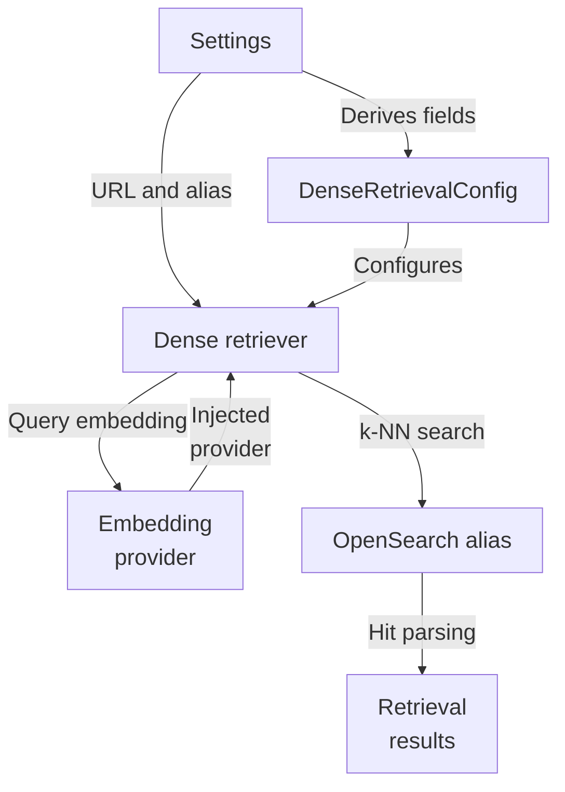
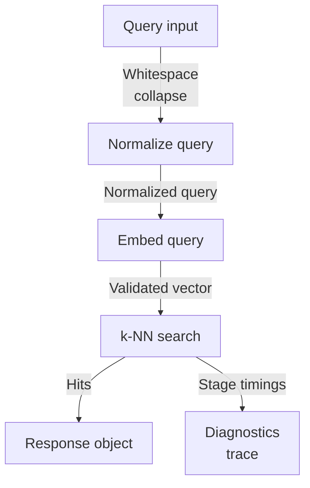
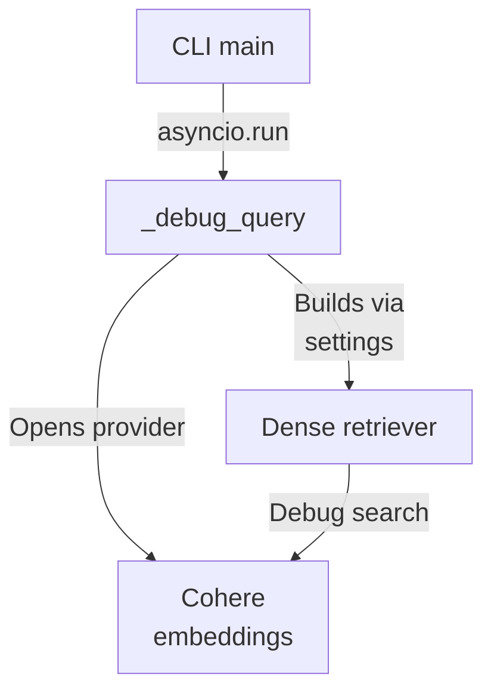

# Repository map

This subsystem implements dense-query retrieval for a multi-tenant hybrid RAG backend: an injected embedding provider turns a normalized query into a vector used in a k-NN search against an OpenSearch read alias, and hits are renormalized into the shared RetrievalResult contract reused by lexical retrieval. Configuration derives from Settings, diagnostics are separated into a trace, and the only local entry point is a debug CLI, with orchestration living elsewhere.

Commit: `56291a0b9cc466341d5d7a4b71aed8b2c5f412bb` | Generated: 2026-10-17T22:59:53.652274+00:00

[Open PDF](repository-map.pdf)

**AI-generated analysis. Source references are checked for existence and supplied scope; this does not prove semantic correctness.**

## Scope

Tracked, eligible text only; bounded excerpts, not exhaustive.

1/29 eligible files analyzed; 194 tracked files excluded by policy.

2 API calls. See coverage.json for budgets, exclusions, and usage.

## Architecture

Settings feed a dense retrieval config; the retriever injects an embedding provider and queries OpenSearch through a read alias, emitting shared RetrievalResults while reusing lexical parsing for one result contract.

PNG fallback

### Source evidence

- **F0002**: DenseRetrievalConfig pairs an embedding model/dimensions with an index schema version and candidate limit, and from_settings derives these from Settings fields (cohere_embed_model, cohere_embed_dimensions, opensearch_index_schema_version, opensearch_dense_candidate_limit). (<a href="https://github.com/Justin-Mendoza/hybrid-rag-search/blob/56291a0b9cc466341d5d7a4b71aed8b2c5f412bb/backend/src/hybrid_rag_search/dense_retrieval.py#L1-L364">backend/src/hybrid_rag_search/dense_retrieval.py:1-364</a>)
- **F0003**: OpenSearchDenseRetriever.from_settings constructs the retriever from Settings (opensearch_url, opensearch_read_alias) plus a caller-supplied EmbeddingProvider, making the provider an injected dependency rather than created internally. (<a href="https://github.com/Justin-Mendoza/hybrid-rag-search/blob/56291a0b9cc466341d5d7a4b71aed8b2c5f412bb/backend/src/hybrid_rag_search/dense_retrieval.py#L1-L364">backend/src/hybrid_rag_search/dense_retrieval.py:1-364</a>)
- **F0016**: DenseRetrievalConfig.__post_init__ calls physical_index_name(self.index_schema_version, "dense-query") to validate the schema-version contract, with an inline comment stating dense retrieval trusts the configured model/index pairing and intentionally does not issue a mapping request per query. (<a href="https://github.com/Justin-Mendoza/hybrid-rag-search/blob/56291a0b9cc466341d5d7a4b71aed8b2c5f412bb/backend/src/hybrid_rag_search/dense_retrieval.py#L1-L364">backend/src/hybrid_rag_search/dense_retrieval.py:1-364</a>)
- **F0001**: OpenSearchDenseRetriever is the dense retrieval entry point: search() normalizes the query, builds RetrievalFilters, embeds the query, issues a k-NN search against the read alias, and returns a DenseRetrievalResponse. (<a href="https://github.com/Justin-Mendoza/hybrid-rag-search/blob/56291a0b9cc466341d5d7a4b71aed8b2c5f412bb/backend/src/hybrid_rag_search/dense_retrieval.py#L1-L364">backend/src/hybrid_rag_search/dense_retrieval.py:1-364</a>)
- **F0005**: The embedding provider is called via embed(EmbeddingRequest((normalized_query,), EmbeddingPurpose.QUERY)); the returned EmbeddingResult is validated in _query_vector for purpose, vector count, model match, dimension match, and finite numeric values, raising RetrievalError with non-retryable codes otherwise. (<a href="https://github.com/Justin-Mendoza/hybrid-rag-search/blob/56291a0b9cc466341d5d7a4b71aed8b2c5f412bb/backend/src/hybrid_rag_search/dense_retrieval.py#L1-L364">backend/src/hybrid_rag_search/dense_retrieval.py:1-364</a>)
- **F0006**: The search body uses an OpenSearch knn query on field 'embedding' with k and a bool filter built from RetrievalFilters.clauses(), scoping results to tenant and optional collection/source_type/author/date filters. (<a href="https://github.com/Justin-Mendoza/hybrid-rag-search/blob/56291a0b9cc466341d5d7a4b71aed8b2c5f412bb/backend/src/hybrid_rag_search/dense_retrieval.py#L1-L364">backend/src/hybrid_rag_search/dense_retrieval.py:1-364</a>)
- **F0009**: _request opens an httpx.AsyncClient per call with a 10-second timeout and optional injected transport; HTTP transport errors map to RetrievalError('opensearch_unavailable', retryable=True), and error responses map to the same code with retryable true for status &gt;=500 or 408/429, false otherwise. (<a href="https://github.com/Justin-Mendoza/hybrid-rag-search/blob/56291a0b9cc466341d5d7a4b71aed8b2c5f412bb/backend/src/hybrid_rag_search/dense_retrieval.py#L1-L364">backend/src/hybrid_rag_search/dense_retrieval.py:1-364</a>)
- **F0007**: Dense hits are converted to shared RetrievalResult objects by reusing OpenSearchBM25Retriever._result_from_hit and _candidate_count, so dense and lexical retrieval share one normalized result contract. (<a href="https://github.com/Justin-Mendoza/hybrid-rag-search/blob/56291a0b9cc466341d5d7a4b71aed8b2c5f412bb/backend/src/hybrid_rag_search/dense_retrieval.py#L1-L364">backend/src/hybrid_rag_search/dense_retrieval.py:1-364</a>)
- **F0008**: The _source projection requested from OpenSearch fields includes chunk_id, tenant_id, collection_id, document_id, document_content_id, content_text, source_spans, generation_id, pipeline_version, and source_metadata. (<a href="https://github.com/Justin-Mendoza/hybrid-rag-search/blob/56291a0b9cc466341d5d7a4b71aed8b2c5f412bb/backend/src/hybrid_rag_search/dense_retrieval.py#L1-L364">backend/src/hybrid_rag_search/dense_retrieval.py:1-364</a>)
- **F0011**: DenseRetrievalResponse separates public evidence (tuple of RetrievalResult) from non-public diagnostics in DenseRetrievalTrace, which records normalized query, model/dimensions, adapter, schema version, alias, candidate limit/count, per-stage elapsed milliseconds, tenant_id, collection_id, and filter trace values. (<a href="https://github.com/Justin-Mendoza/hybrid-rag-search/blob/56291a0b9cc466341d5d7a4b71aed8b2c5f412bb/backend/src/hybrid_rag_search/dense_retrieval.py#L1-L364">backend/src/hybrid_rag_search/dense_retrieval.py:1-364</a>)
- **F0010**: Malformed OpenSearch bodies (non-dict payload, non-dict hits, non-list hits.hits) raise RetrievalError('opensearch_invalid_response', retryable=False). (<a href="https://github.com/Justin-Mendoza/hybrid-rag-search/blob/56291a0b9cc466341d5d7a4b71aed8b2c5f412bb/backend/src/hybrid_rag_search/dense_retrieval.py#L1-L364">backend/src/hybrid_rag_search/dense_retrieval.py:1-364</a>)

## Request Lifecycle

A query is normalized, validated, embedded, and issued as a k-NN search; empty queries short-circuit before any external call, and stage timings plus diagnostics are recorded in the trace.

PNG fallback

### Source evidence

- **F0001**: OpenSearchDenseRetriever is the dense retrieval entry point: search() normalizes the query, builds RetrievalFilters, embeds the query, issues a k-NN search against the read alias, and returns a DenseRetrievalResponse. (<a href="https://github.com/Justin-Mendoza/hybrid-rag-search/blob/56291a0b9cc466341d5d7a4b71aed8b2c5f412bb/backend/src/hybrid_rag_search/dense_retrieval.py#L1-L364">backend/src/hybrid_rag_search/dense_retrieval.py:1-364</a>)
- **F0004**: Query text is normalized by normalize_dense_query (whitespace collapse), and an empty normalized query short-circuits to an empty DenseRetrievalResponse with zeroed timings and candidate counts, skipping both embedding and OpenSearch calls. (<a href="https://github.com/Justin-Mendoza/hybrid-rag-search/blob/56291a0b9cc466341d5d7a4b71aed8b2c5f412bb/backend/src/hybrid_rag_search/dense_retrieval.py#L1-L364">backend/src/hybrid_rag_search/dense_retrieval.py:1-364</a>)
- **F0005**: The embedding provider is called via embed(EmbeddingRequest((normalized_query,), EmbeddingPurpose.QUERY)); the returned EmbeddingResult is validated in _query_vector for purpose, vector count, model match, dimension match, and finite numeric values, raising RetrievalError with non-retryable codes otherwise. (<a href="https://github.com/Justin-Mendoza/hybrid-rag-search/blob/56291a0b9cc466341d5d7a4b71aed8b2c5f412bb/backend/src/hybrid_rag_search/dense_retrieval.py#L1-L364">backend/src/hybrid_rag_search/dense_retrieval.py:1-364</a>)
- **F0006**: The search body uses an OpenSearch knn query on field 'embedding' with k and a bool filter built from RetrievalFilters.clauses(), scoping results to tenant and optional collection/source_type/author/date filters. (<a href="https://github.com/Justin-Mendoza/hybrid-rag-search/blob/56291a0b9cc466341d5d7a4b71aed8b2c5f412bb/backend/src/hybrid_rag_search/dense_retrieval.py#L1-L364">backend/src/hybrid_rag_search/dense_retrieval.py:1-364</a>)
- **F0009**: _request opens an httpx.AsyncClient per call with a 10-second timeout and optional injected transport; HTTP transport errors map to RetrievalError('opensearch_unavailable', retryable=True), and error responses map to the same code with retryable true for status &gt;=500 or 408/429, false otherwise. (<a href="https://github.com/Justin-Mendoza/hybrid-rag-search/blob/56291a0b9cc466341d5d7a4b71aed8b2c5f412bb/backend/src/hybrid_rag_search/dense_retrieval.py#L1-L364">backend/src/hybrid_rag_search/dense_retrieval.py:1-364</a>)
- **F0007**: Dense hits are converted to shared RetrievalResult objects by reusing OpenSearchBM25Retriever._result_from_hit and _candidate_count, so dense and lexical retrieval share one normalized result contract. (<a href="https://github.com/Justin-Mendoza/hybrid-rag-search/blob/56291a0b9cc466341d5d7a4b71aed8b2c5f412bb/backend/src/hybrid_rag_search/dense_retrieval.py#L1-L364">backend/src/hybrid_rag_search/dense_retrieval.py:1-364</a>)
- **F0011**: DenseRetrievalResponse separates public evidence (tuple of RetrievalResult) from non-public diagnostics in DenseRetrievalTrace, which records normalized query, model/dimensions, adapter, schema version, alias, candidate limit/count, per-stage elapsed milliseconds, tenant_id, collection_id, and filter trace values. (<a href="https://github.com/Justin-Mendoza/hybrid-rag-search/blob/56291a0b9cc466341d5d7a4b71aed8b2c5f412bb/backend/src/hybrid_rag_search/dense_retrieval.py#L1-L364">backend/src/hybrid_rag_search/dense_retrieval.py:1-364</a>)
- **F0012**: Embedding and OpenSearch stages are timed separately using time.perf_counter (embedding_elapsed_ms, opensearch_elapsed_ms) and only embedding timing is recorded for the empty-query short-circuit (as zero). (<a href="https://github.com/Justin-Mendoza/hybrid-rag-search/blob/56291a0b9cc466341d5d7a4b71aed8b2c5f412bb/backend/src/hybrid_rag_search/dense_retrieval.py#L1-L364">backend/src/hybrid_rag_search/dense_retrieval.py:1-364</a>)

## Debug CLI Entry

The only local entry point is a debug CLI that parses query, tenant, and optional collection/limit, opens the configured embedding provider, and builds the retriever from settings.

PNG fallback

### Source evidence

- **F0014**: The only local entry point is a CLI (main) that parses query, required --tenant UUID, optional --collection UUID and --limit, then runs asyncio.run(_debug_query(...)); the module docstring states no public search API is exposed yet, indicating orchestration for dense retrieval lives elsewhere. (<a href="https://github.com/Justin-Mendoza/hybrid-rag-search/blob/56291a0b9cc466341d5d7a4b71aed8b2c5f412bb/backend/src/hybrid_rag_search/dense_retrieval.py#L1-L364">backend/src/hybrid_rag_search/dense_retrieval.py:1-364</a>)
- **F0015**: _debug_query opens configured_cohere_embeddings as an async context manager to obtain the provider, builds the retriever via from_settings, and calls search with debug=True. (<a href="https://github.com/Justin-Mendoza/hybrid-rag-search/blob/56291a0b9cc466341d5d7a4b71aed8b2c5f412bb/backend/src/hybrid_rag_search/dense_retrieval.py#L1-L364">backend/src/hybrid_rag_search/dense_retrieval.py:1-364</a>)
- **F0001**: OpenSearchDenseRetriever is the dense retrieval entry point: search() normalizes the query, builds RetrievalFilters, embeds the query, issues a k-NN search against the read alias, and returns a DenseRetrievalResponse. (<a href="https://github.com/Justin-Mendoza/hybrid-rag-search/blob/56291a0b9cc466341d5d7a4b71aed8b2c5f412bb/backend/src/hybrid_rag_search/dense_retrieval.py#L1-L364">backend/src/hybrid_rag_search/dense_retrieval.py:1-364</a>)
- **F0003**: OpenSearchDenseRetriever.from_settings constructs the retriever from Settings (opensearch_url, opensearch_read_alias) plus a caller-supplied EmbeddingProvider, making the provider an injected dependency rather than created internally. (<a href="https://github.com/Justin-Mendoza/hybrid-rag-search/blob/56291a0b9cc466341d5d7a4b71aed8b2c5f412bb/backend/src/hybrid_rag_search/dense_retrieval.py#L1-L364">backend/src/hybrid_rag_search/dense_retrieval.py:1-364</a>)

## Uncertainties and untraced areas

- How dense retrieval is composed with lexical, hybrid, or reranked retrieval is not shown by any supplied finding.
- No supplied finding exposes a public search API or caller; the module docstring states orchestration for dense retrieval lives elsewhere.
- Behavior of supporting modules (models/retrieval.py, retrieval_filters.py, opensearch_index.py, providers/*) beyond dense_retrieval imports is not described.
- Tests are listed but their assertions and coverage of the dense path are not detailed.
