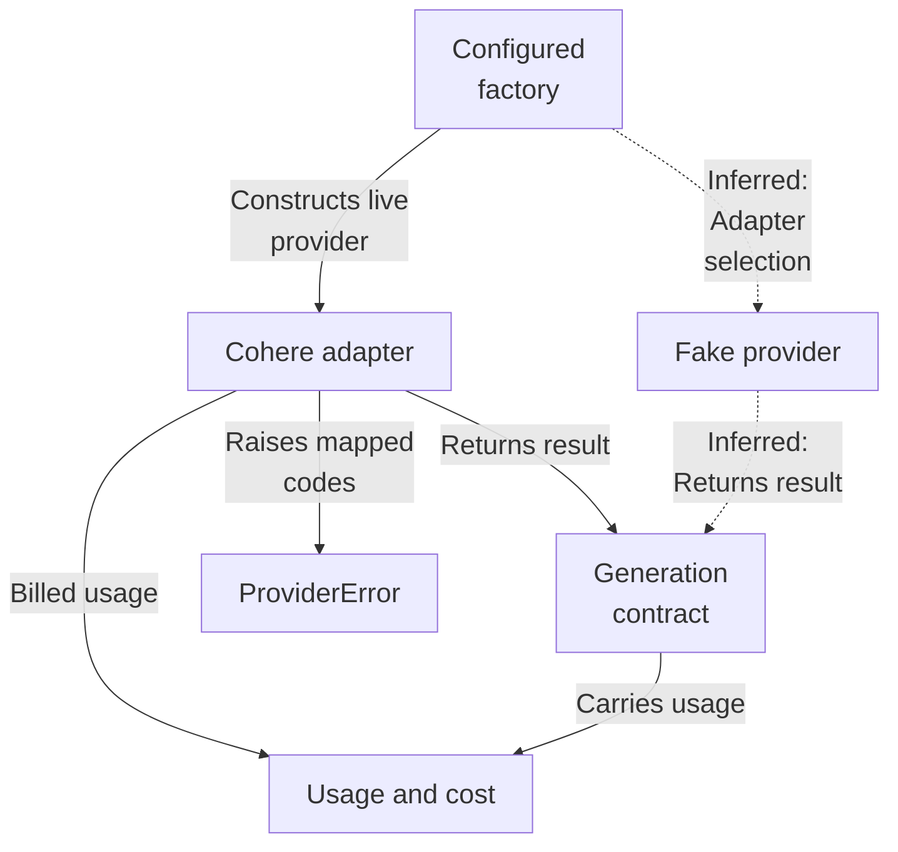
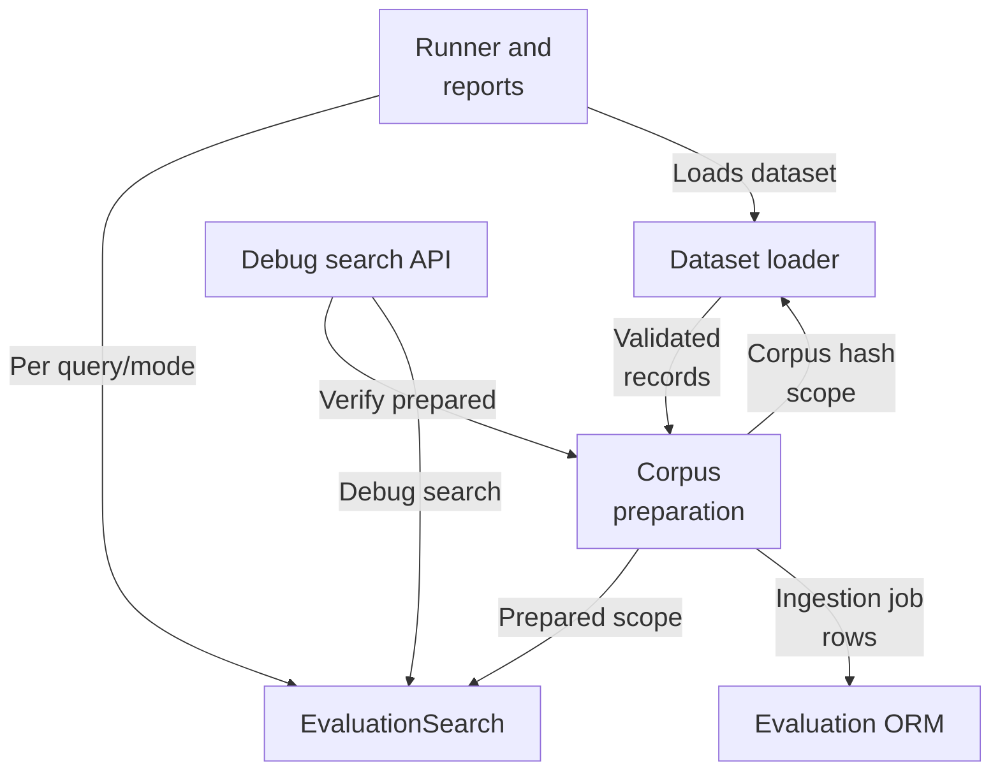
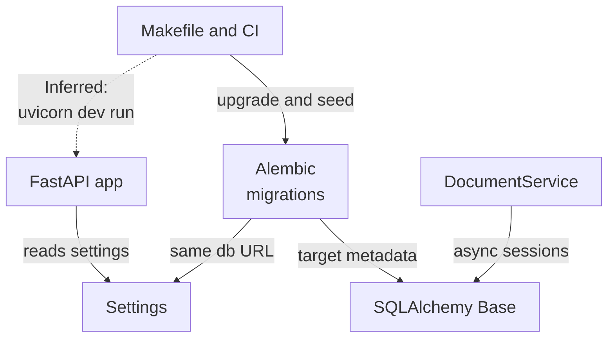
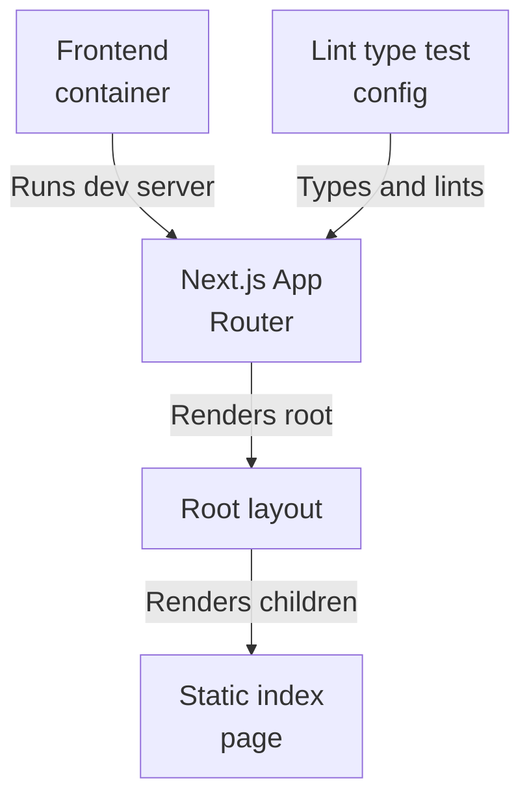
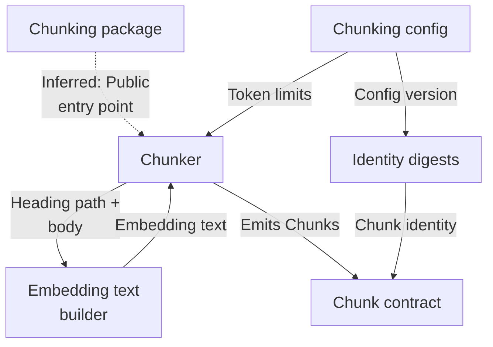
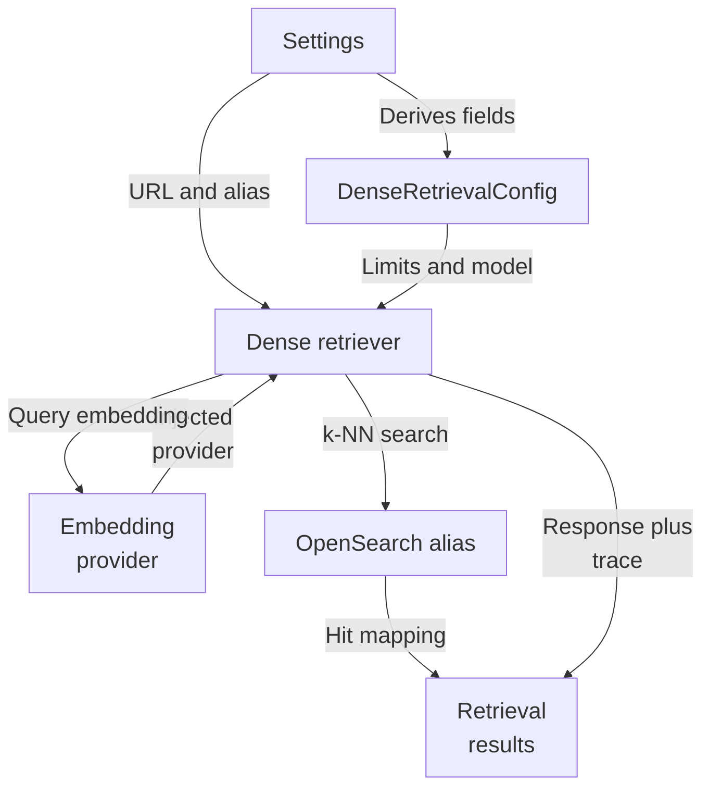

# Repository map

The overview brings together the analyzed architecture view from each subsystem. Open a subsystem map for its source evidence, detailed flows, and uncertainties.

Commit: `f8493c1d264c525948d9d33ffaf2dd197be97e26` | Generated: 2026-10-18T18:36:28.266995+00:00

[Open PDF](repository-map.pdf)

**AI-generated analysis. Source references are checked for existence and supplied scope; this does not prove semantic correctness.**

## Scope

Source-backed architecture views composed from each subsystem map. See linked subsystem pages for evidence.

0/0 eligible files analyzed; 0 tracked files excluded by policy.

0 API calls. See coverage.json for budgets, exclusions, and usage.

## answers: Architecture

Application-owned protocols define the boundary; the opt-in Cohere adapter and the deterministic fake both implement GenerationProvider. The configured factory gates live generation on credentials, but caller wiring is not evidenced. Open this subsystem map for source evidence.

PNG fallback

### Source evidence

## evaluation: Architecture

Dataset loading, corpus preparation, search dispatch, scoring/reporting, and the HTTP surface are separate boundaries; the API and runner share one search boundary, while corpus state faults map to distinct errors. Open this subsystem map for source evidence.

PNG fallback

### Source evidence

## foundation: Architecture

The FastAPI app reads shared Settings and mounts health and evaluation routes; the same Settings feeds schema management and dependency probes. Makefile, Compose, and CI form the orchestration boundary around app, schema, and tests. Open this subsystem map for source evidence.

PNG fallback

### Source evidence

## frontend: Architecture

The container runs the Next.js App Router dev server. Layout renders a static index page. Toolchain config types, lints, and tests the sources but is not a runtime entry point; backend linkage is unevidenced. Open this subsystem map for source evidence.

PNG fallback

### Source evidence

## ingestion: Architecture

The chunking package groups parsed blocks per heading section, packs them under the token budget, enriches embedding text, and emits Chunk contracts whose identities are derived from config and document digests. Open this subsystem map for source evidence.

PNG fallback

### Source evidence

## retrieval: Architecture

Settings derive a dense config and connection details; the retriever injects an embedding provider, queries the OpenSearch read alias with tenant-scoped filters, and emits shared results plus a separate trace. Open this subsystem map for source evidence.

PNG fallback

### Source evidence

## Uncertainties and untraced areas

- Subsystem boundaries and configured or import-inferred dependencies are recorded in manifest.json; they do not establish runtime calls.
