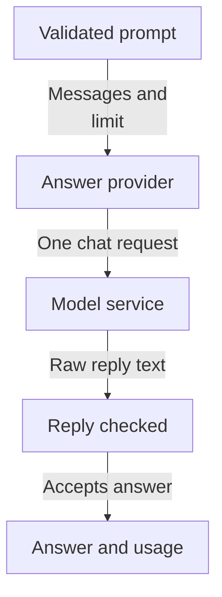
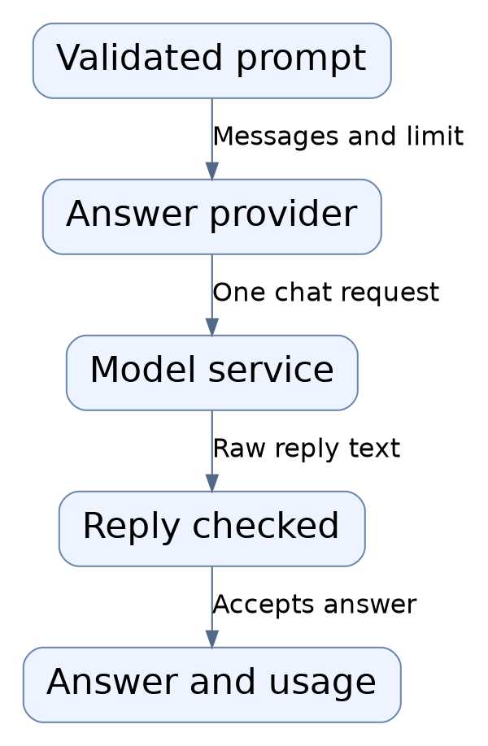
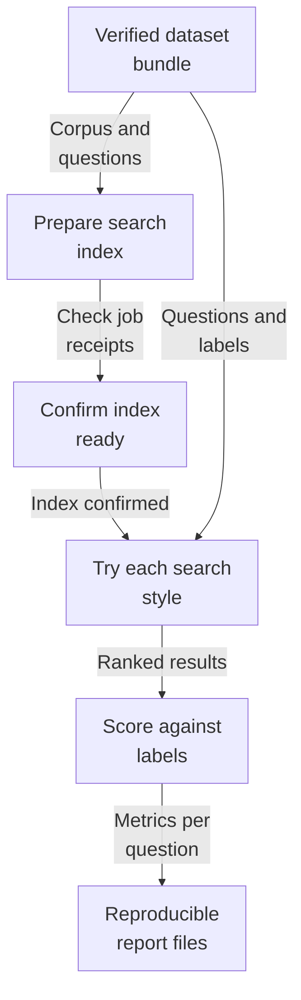
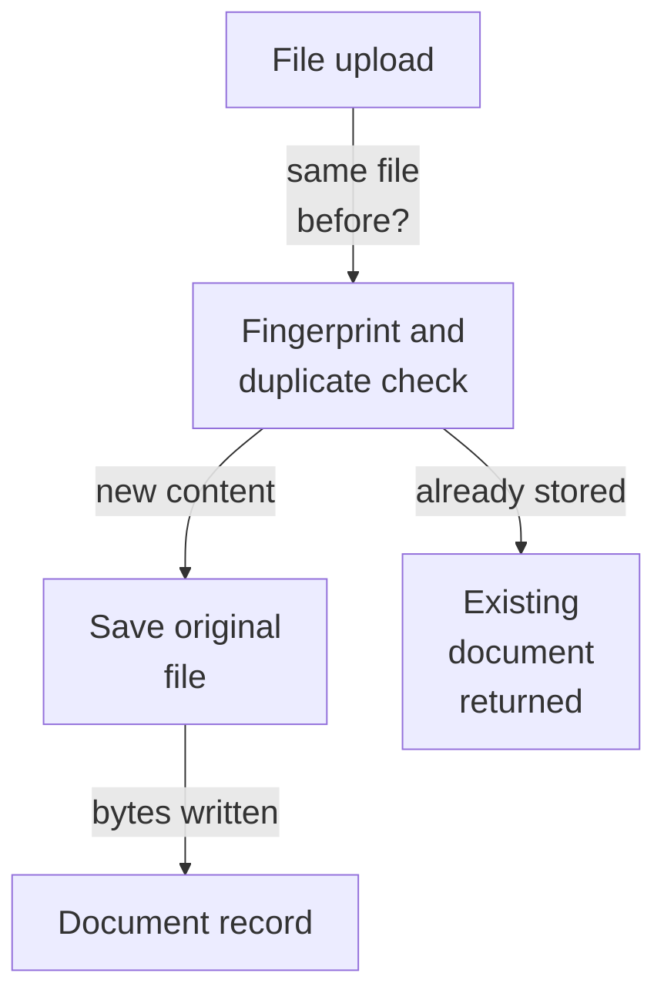
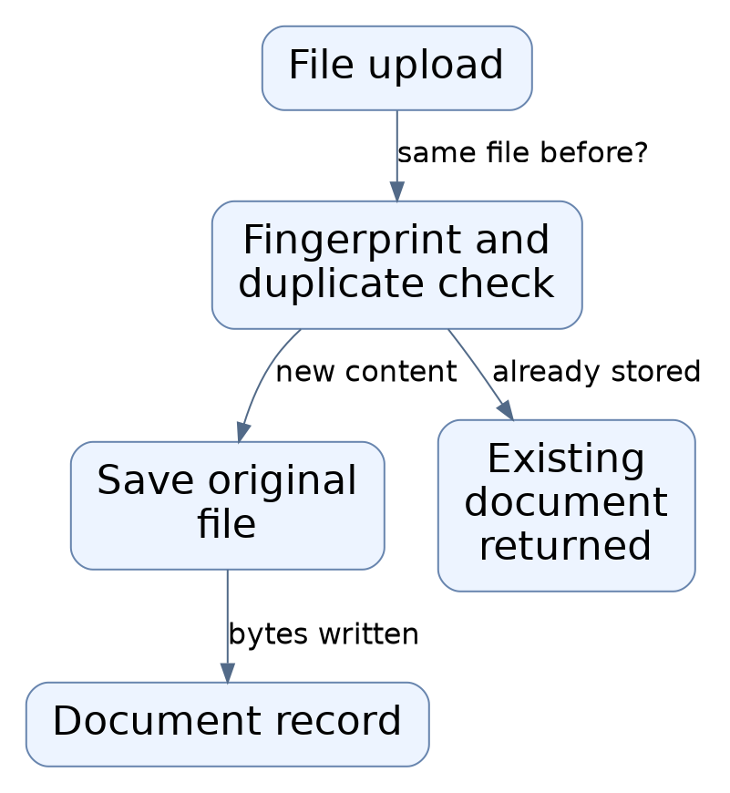
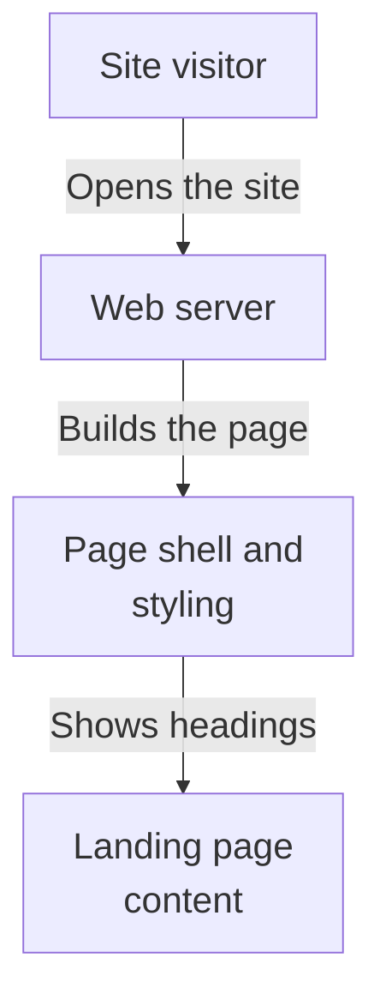
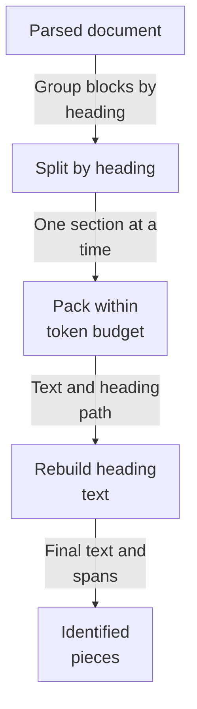
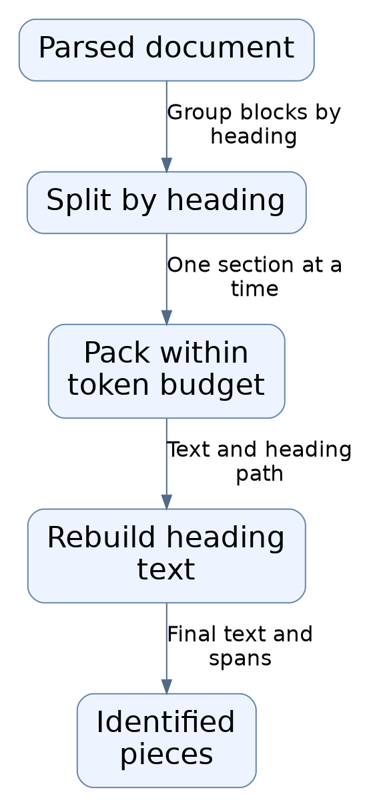
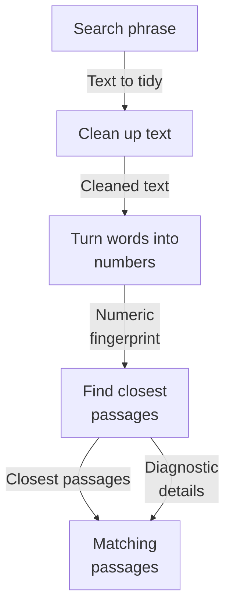
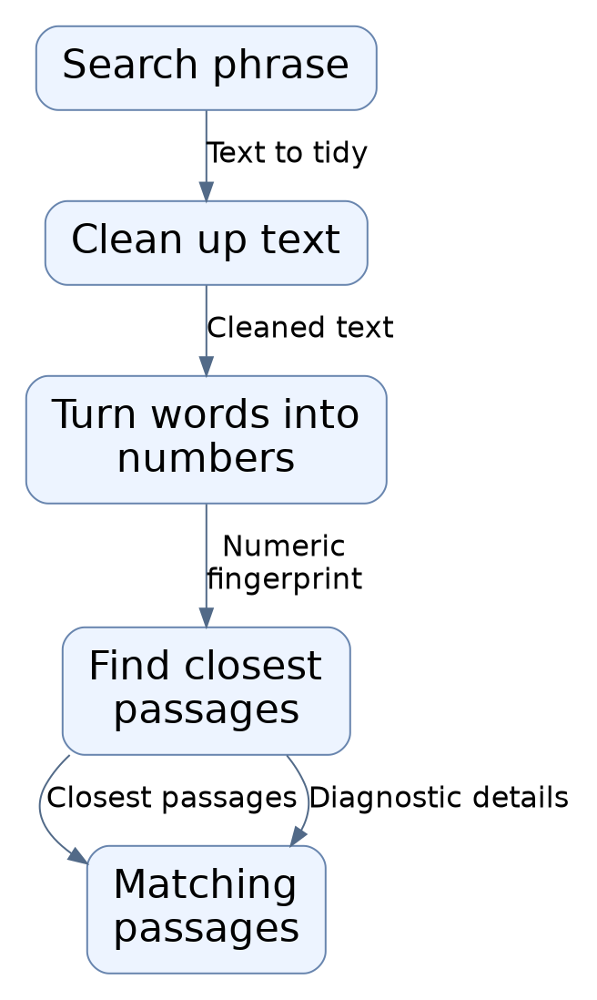

# Repository map

The overview brings together the analyzed architecture view from each subsystem. Open a subsystem map for its source evidence, detailed flows, and uncertainties.

Commit: `3537e913c1eeec5b5f34d6cbdbf4dc3f8bc74b25` | Generated: 2026-10-19T00:25:53.475115+00:00

[Open PDF](repository-map.pdf)

**AI-generated analysis. Source references are checked for existence and supplied scope; this does not prove semantic correctness.**

## Scope

Source-backed architecture views composed from each subsystem map. See linked subsystem pages for evidence.

0/0 eligible files analyzed; 0 tracked files excluded by policy.

0 API calls. See coverage.json for budgets, exclusions, and usage.

## answers: How a prompt becomes an answer

A caller supplies validated chat messages; the answer provider forwards one non-streaming request to the model service, re-checks the reply, and returns answer text with finish reason and usage.

PNG fallback

Read from top to bottom; arrows show what happens next or what is passed along.

### Source evidence

## evaluation: How a dataset becomes a scored report

A verified dataset bundle is prepared into its own search index, every test question is searched in four ways, results are scored against human relevance labels, and a repeatable report is written.

PNG fallback

Read from top to bottom; arrows show what happens next or what is passed along.

### Source evidence

## foundation: How an uploaded file becomes a stored document

A caller supplies an authorized tenant and collection scope with file bytes. The service fingerprint-checks for duplicates, saves the file, and records its status.

PNG fallback

Read from top to bottom; arrows show what happens next or what is passed along.

### Source evidence

## frontend: How a visitor gets the landing page

A visitor opens the site, the page shell supplies styling and page title, and the static landing content appears. Nothing is looked up or saved, and no search runs.

PNG fallback

Read from top to bottom; arrows show what happens next or what is passed along.

### Source evidence

## ingestion: How a parsed document becomes searchable pieces

A parsed document is split by heading section, packed into token-budgeted pieces with overlap, enriched with reconstructed headings, and given stable identifiers.

PNG fallback

Read from top to bottom; arrows show what happens next or what is passed along.

### Source evidence

## retrieval: How a search becomes matching passages

A search phrase is cleaned, sent out to be turned into numbers, used to find the closest stored passages in the search index, and returned as passages with optional diagnostic detail.

PNG fallback

Read from top to bottom; arrows show what happens next or what is passed along.

### Source evidence

## Uncertainties and untraced areas

- Subsystem boundaries and configured or import-inferred dependencies are recorded in manifest.json; they do not establish runtime calls.
