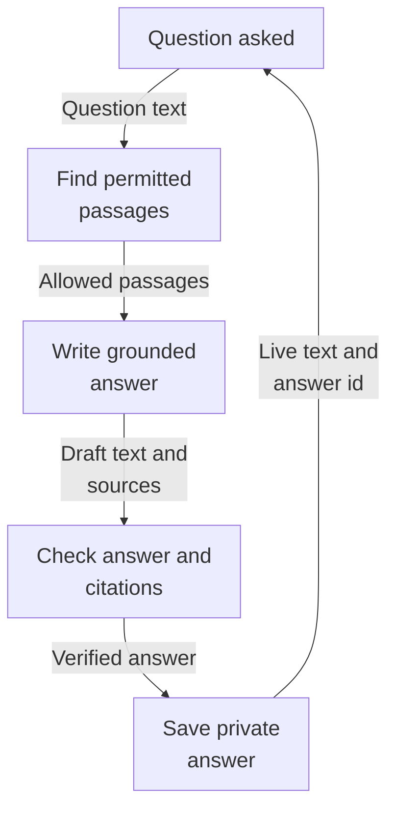
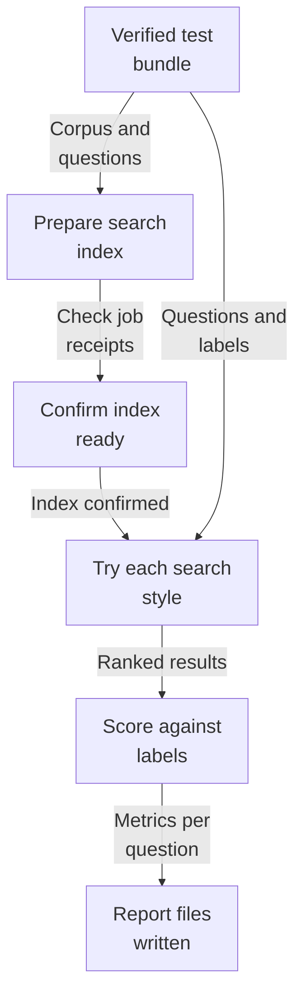
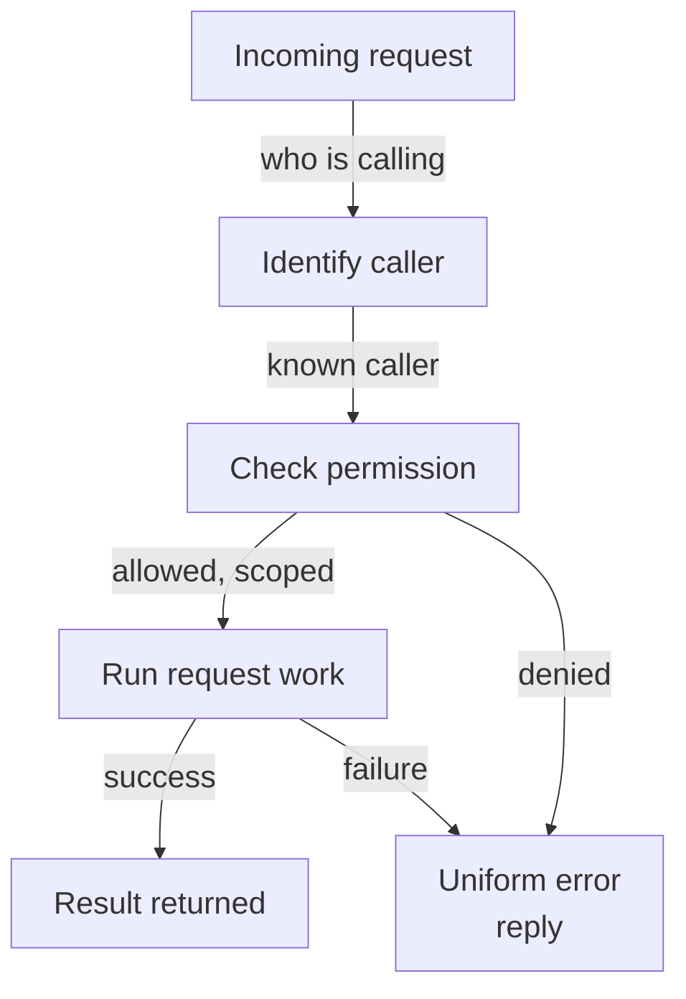
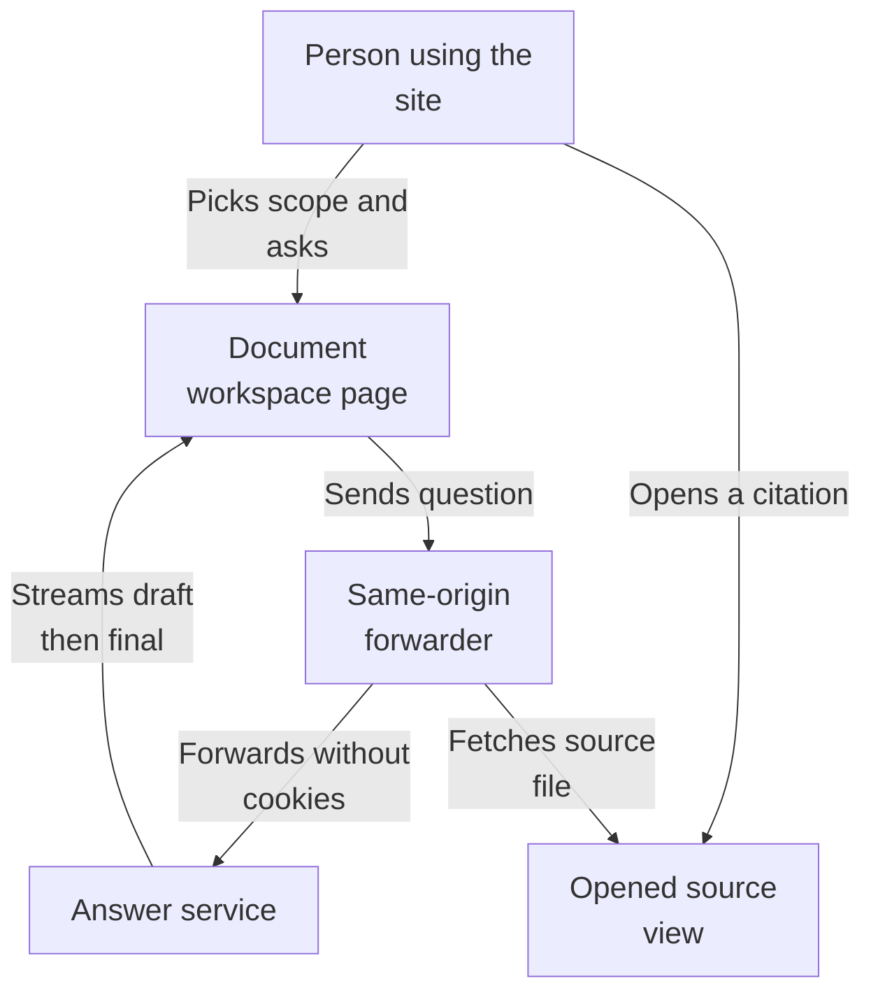
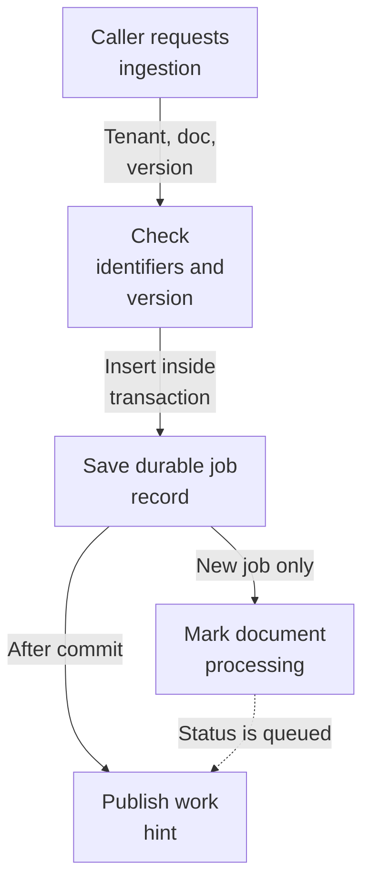
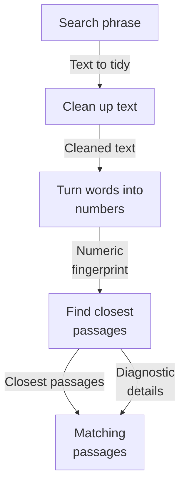

# Repository map

The overview brings together the analyzed architecture view from each subsystem. Open a subsystem map for its source evidence, detailed flows, and uncertainties.

Commit: `e4abb88a149b365c2838b0f2f0606dff0127b1ab` | Generated: 2026-10-22T15:21:02.384365+00:00

[Open PDF](repository-map.pdf)

**AI-generated analysis. Source references are checked for existence and supplied scope; this does not prove semantic correctness.**

## Scope

Source-backed architecture views composed from each subsystem map. See linked subsystem pages for evidence.

0/0 eligible files analyzed; 0 tracked files excluded by policy.

0 API calls. See coverage.json for budgets, exclusions, and usage.

## answers: How a question becomes a saved answer

Someone asks a question; the system finds their permitted passages, the model writes a checked answer streamed live, and the finished answer is saved for that person.

PNG fallback

Read from top to bottom; arrows show what happens next or what is passed along.

### Source evidence

## evaluation: How a dataset becomes a scored report

A hash-verified test bundle is prepared into its own search index, every test question is searched four ways, results are scored against human relevance labels, and repeatable report files are written.

PNG fallback

Read from top to bottom; arrows show what happens next or what is passed along.

### Source evidence

## foundation: How a request becomes a result

An incoming web request is identified, checked for permission against the caller's tenant and collections, then handled so it either produces a result or a consistent error reply.

PNG fallback

Read from top to bottom; arrows show what happens next or what is passed along.

### Source evidence

## frontend: How a question becomes a cited answer

A person picks a collection and identity, asks a question, and watches the answer stream back live. Citations can be opened to view and download the original source document.

PNG fallback

Read from top to bottom; arrows show what happens next or what is passed along.

### Source evidence

## ingestion: How a document becomes an ingestion job

A caller submits a tenant, document, and pipeline version. The service saves a job, marks the document as processing, and after the database commit signals that work is ready.

PNG fallback

Read from top to bottom. Dashed arrows show connections that need confirmation.

### Source evidence

## retrieval: How a search becomes matching passages

A search phrase is cleaned, sent out to be turned into numbers, used to find the closest stored passages in the search index, and returned as passages with optional diagnostic detail.

PNG fallback

Read from top to bottom; arrows show what happens next or what is passed along.

### Source evidence

## Uncertainties and untraced areas

- Subsystem boundaries and configured or import-inferred dependencies are recorded in manifest.json; they do not establish runtime calls.
