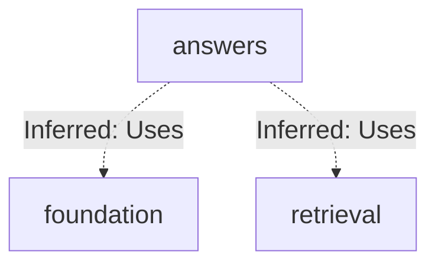
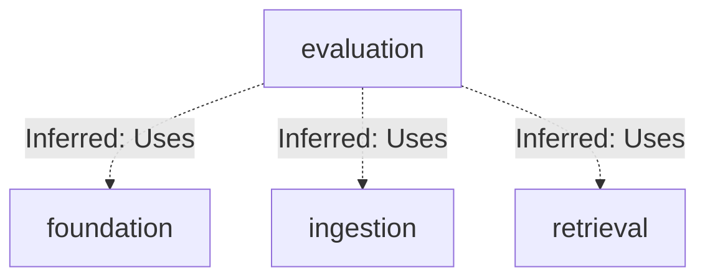
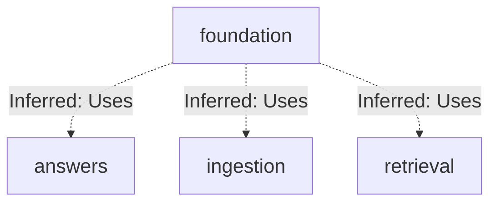
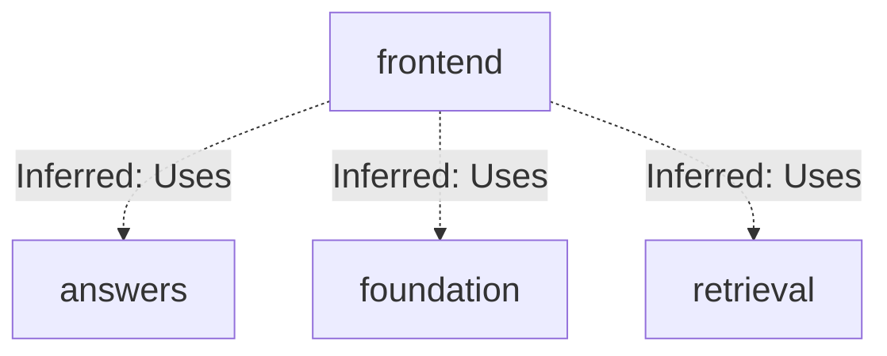
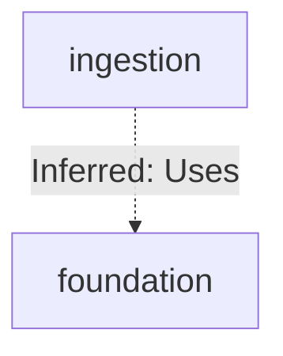
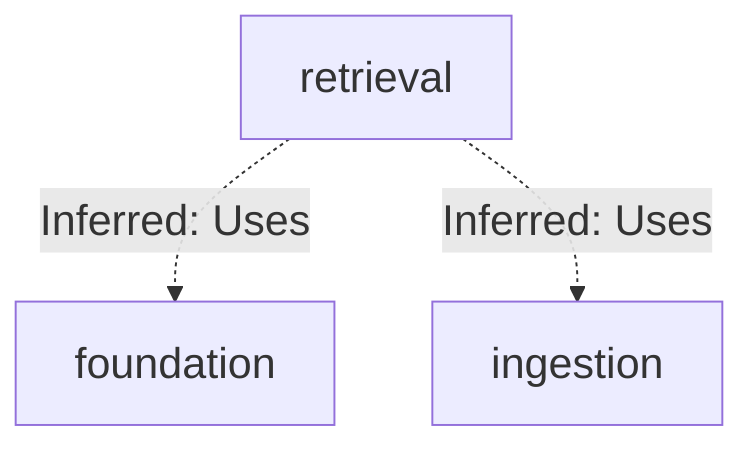

# Repository map

Separate subsystem maps with an overview of their dependency hints.

Commit: `05fb919153379762ce04a644ff9f6ef3e3413ff1` | Generated: 2026-10-17T22:43:02.770331+00:00

[Open PDF](repository-map.pdf)

**AI-generated analysis. Source references are checked for existence and supplied scope; this does not prove semantic correctness.**

## Scope

Subsystem boundaries; dependency edges are hints, not verified runtime calls.

0/0 eligible files analyzed; 0 tracked files excluded by policy.

0 API calls. See coverage.json for budgets, exclusions, and usage.

## answers: connections

Dependency hints are configured or inferred from resolvable imports. See subsystem maps for source-backed behavior.

PNG fallback

### Source evidence

## evaluation: connections

Dependency hints are configured or inferred from resolvable imports. See subsystem maps for source-backed behavior.

PNG fallback

### Source evidence

## foundation: connections

Dependency hints are configured or inferred from resolvable imports. See subsystem maps for source-backed behavior.

PNG fallback

### Source evidence

## frontend: connections

Dependency hints are configured or inferred from resolvable imports. See subsystem maps for source-backed behavior.

PNG fallback

### Source evidence

## ingestion: connections

Dependency hints are configured or inferred from resolvable imports. See subsystem maps for source-backed behavior.

PNG fallback

### Source evidence

## retrieval: connections

Dependency hints are configured or inferred from resolvable imports. See subsystem maps for source-backed behavior.

PNG fallback

### Source evidence

## Uncertainties and untraced areas

- Import inference is incomplete; configure aliases and cross-service dependencies explicitly.
